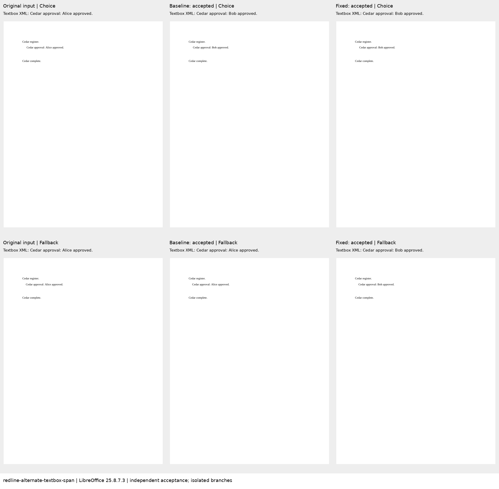
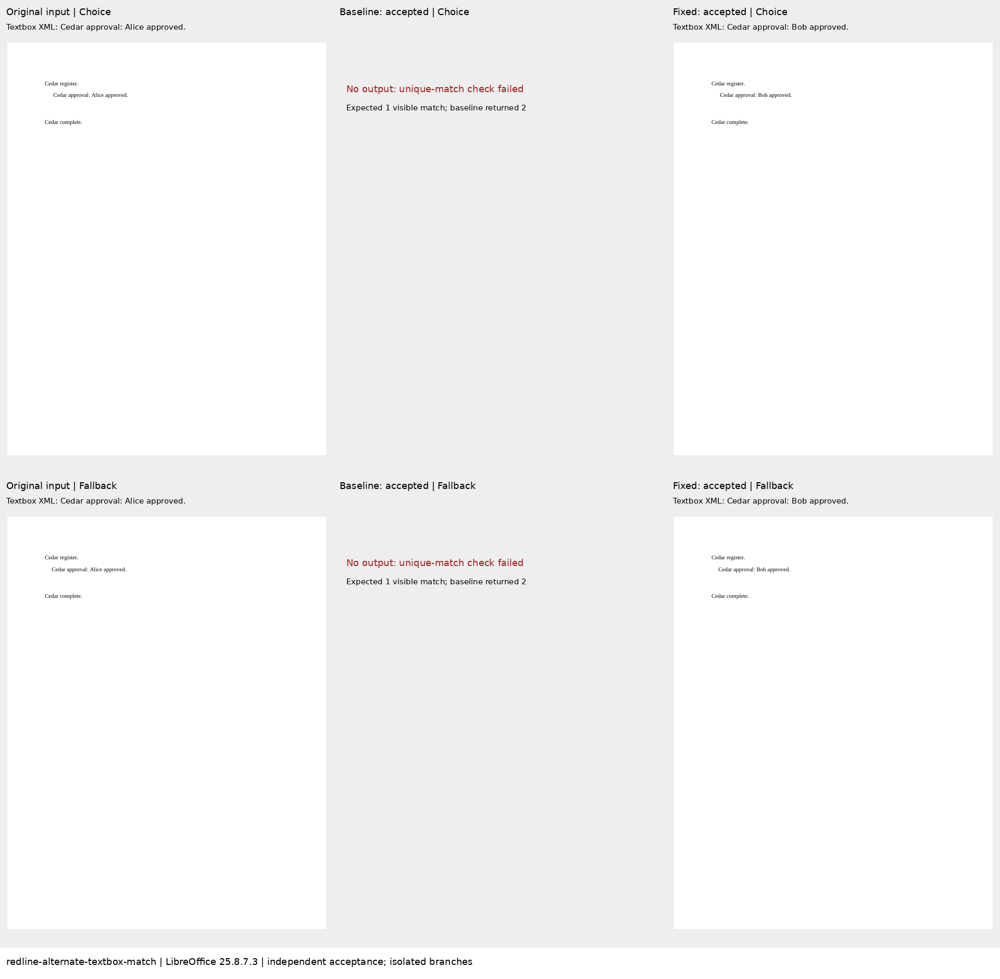
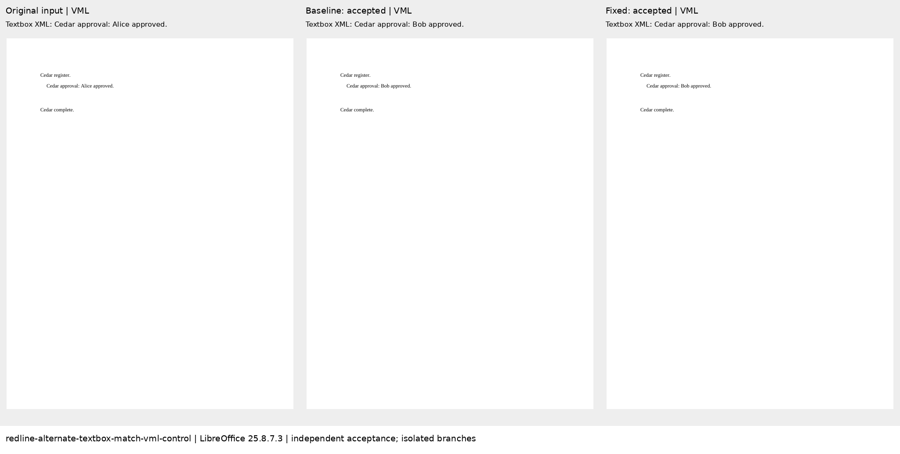

# Alternate textbox search and editing

These four authored diagnostic cases cover [Docxodus #1560](https://github.com/JSv4/Docxodus/issues/1560).
Each edits `Alice` to `Bob` in a textbox. The reproductions contain DrawingML and VML compatibility
representations; their controls contain only VML. One pair uses a numeric span, and the other requires
exactly one visible public `Grep` result before calling `ReplaceMatch`.

| Case | Baseline | Fixed | Authored calibration |
| --- | ---: | ---: | ---: |
| Alternate textbox, span | 0 | 100 | 100 |
| VML control, span | 100 | 100 | 100 |
| Alternate textbox, match | 0 | 100 | 100 |
| VML control, match | 100 | 100 | 100 |

Baseline: `5b733a20d08684d79ac0952d5337a4eb1bc6d69c`.
Fixed: `3828f1e620badfb1119e76d00ccca21d13032f2e`.
The public .NET adapter is bound to each clean checkout and its built DLL hashes.
Metric contract 19 and `redline-v31` apply. Only these four cases were scored; there is no full-suite
score or Word parity claim. All 239 earlier case inputs, expected documents and authored redlines
are unchanged. All 463 harness contract tests pass.

The baseline span edit changes DrawingML but leaves VML stale. Its visible semantic view alone would
miss that failure; the exact resolved `drawing` and `pict` assertions check both copies. The baseline
match operation is refused by the adapter because `Grep` returns two hits. Both fixed operations
update both copies. All 12 authored inputs/endpoints/redlines validate without SDK findings; all
candidate outputs that were produced also have zero findings. Independent accept/reject checks,
exact native subtree checks and all eight applicable LibreOffice endpoint comparisons pass for the
fixed build and authored calibration. No LibreOffice exemption was added.

The sheets below show all pages from LibreOffice 25.8.7.3 after the benchmark's independent acceptance.
For the compatibility cases, each branch is isolated in a derivative package before rendering so the
otherwise hidden VML text can be inspected. Captions quote the derivative's textbox XML text. These
are review previews, not Word captures, PDF-track scores or placement measurements. A blank baseline
match panel records that no output was produced. [Evidence and artifact hashes](evidence.json) bind
the inputs, exact builds, measurements, derivative packages, PDFs and screenshots.

