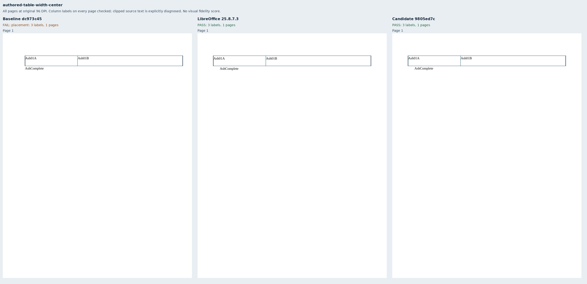
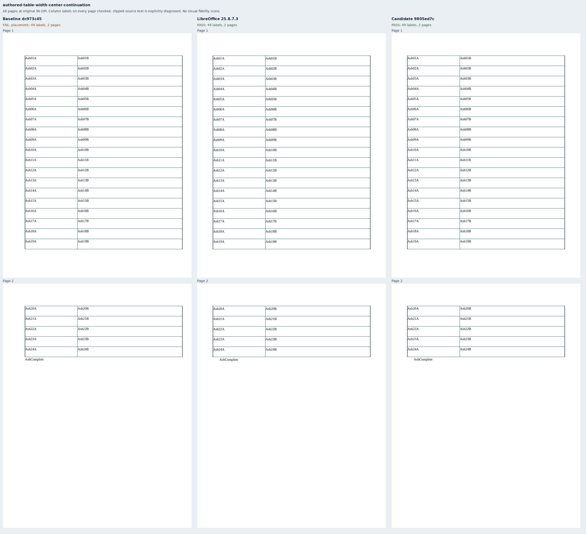
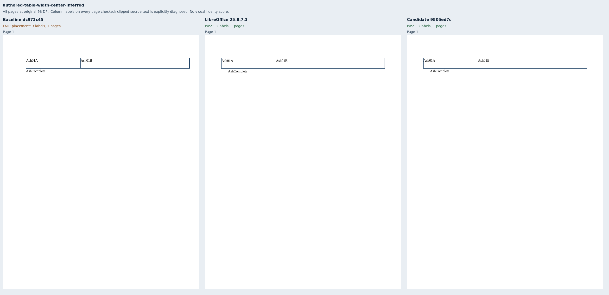
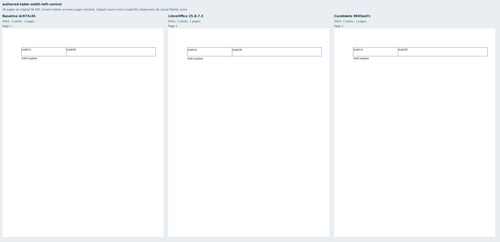
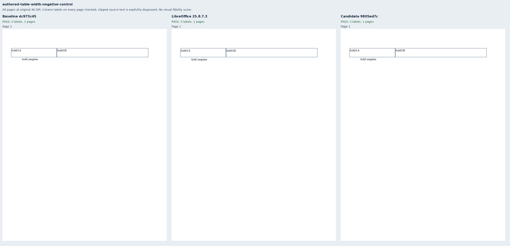
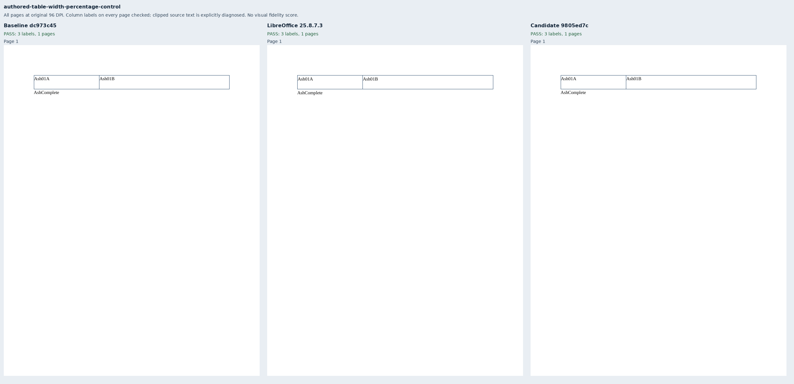
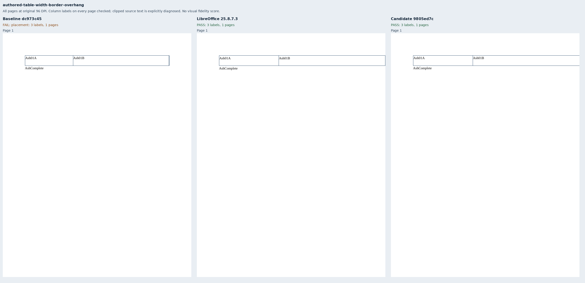
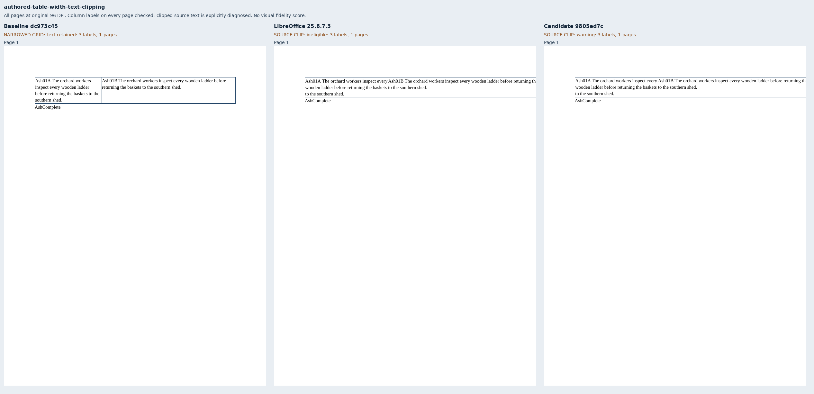

# Authored table widths and paper clipping

Eight original Ash inventory documents exercise centered 510pt tables, a two-page continuation,
an inferred fixed layout, left and negative-indent controls, a percentage-width control, and
580pt tables whose border or text extends beyond Letter paper. The columns have an asymmetric
one-third/two-thirds grid. Packages use 11pt Liberation Serif, exact 15pt paragraph lines, and
72pt margins. No renderer fixture or helper is imported.

The production baseline `dc973c457bdf16a90fbfac3301b3bd4907fdaa03` has the same complete source tree
as main `688672301a24ddc431dfb9fc40f11766a23a501c`. It passes the three placement controls and fails
the three centered cases and the border-overhang case. Candidate
`9805ed7cc31551c4fc724d07e21dd84abe0fba44` preserves the fixed grid and centers it in both margins,
including every continuation page. Automatic percentage widths retain their column-sized behavior.

LibreOffice 25.8.7.3 supplies seven eligible references. The eighth input intentionally places
source text beyond paper: native output loses the second `baskets` token, so its full-content
reference is **ineligible**. Candidate output reports `source_table_content_clipped`; it is an
explicit clipping diagnostic, not a content-complete success or a fidelity score. The old renderer
keeps that text only by narrowing the authored table. Public core tests separately cover strict
rejection, wholly off-paper cells, inline pictures, promoted pictures and promoted textbox text.

The issue author's [Word results](https://github.com/JSv4/Docxodus/issues/1563#issuecomment-6701328580)
confirm centered DXA overhang, preserved off-paper fixed width, and column-sized automatic and
percentage controls. These independent benchmark inputs have no Word reference PDFs. Captures
use separately provisioned Chromium with its sandbox enabled and strict font verification;
no pinned-browser or full-suite fidelity claim is made.

Full-page sheets retain every delivered page at original 96 DPI. Complete reports, PDF inspections,
and the native reference bundle are retained as deterministic gzip files. `evidence.json` binds
input packages, exact source/build identities, runtime asset manifests, PDF hashes, and page rasters.
Checks cover all 210 table/footer labels across 24 PDFs and 27 pages, full token inventories in the
seven eligible cases, first-row and continuation-page marker regions, and column positions on every page. A mutation
that shifts only page two by 21pt fails the declared placement checks. No metric or
scoring tolerance changes are made. Every package validates with Open XML SDK 3.5.1 against
Microsoft 365.

The suite advances to `core-v111` (792 inputs); the preceding 784 declarations and packages retain
their bytes apart from the generator provenance hash.

```sh
python3 -m bench reference libreoffice --manifest MANIFEST --out REFERENCE
node docs/results/export-reliability/Capture.mjs SOURCE MANIFEST OUTPUT ENVIRONMENT
python3 docs/results/authored-table-width/Compose.py runs/table-width-v3
```









