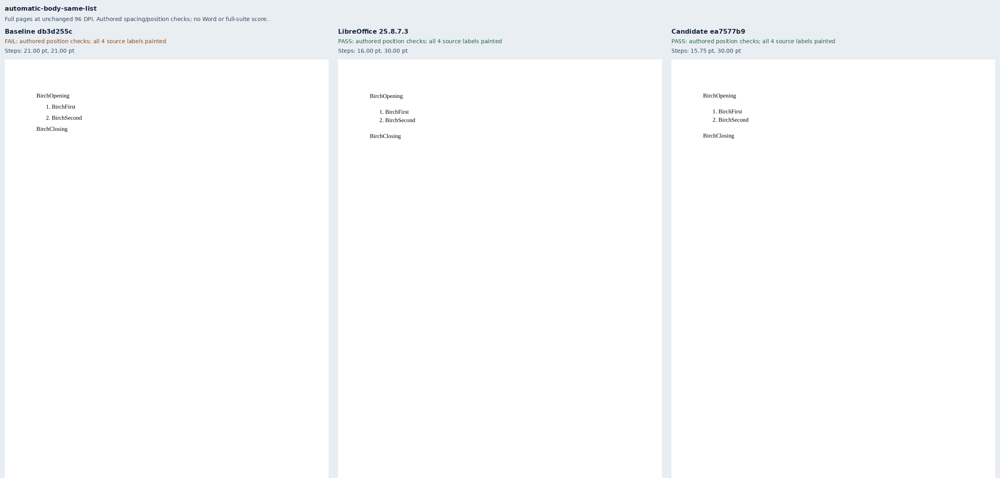
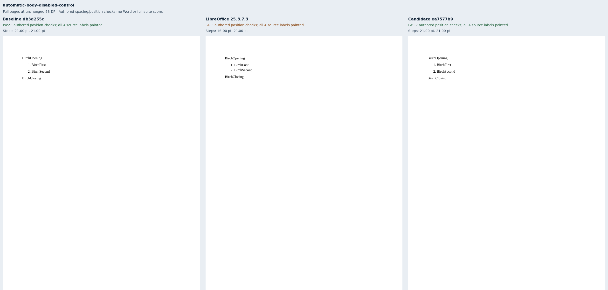
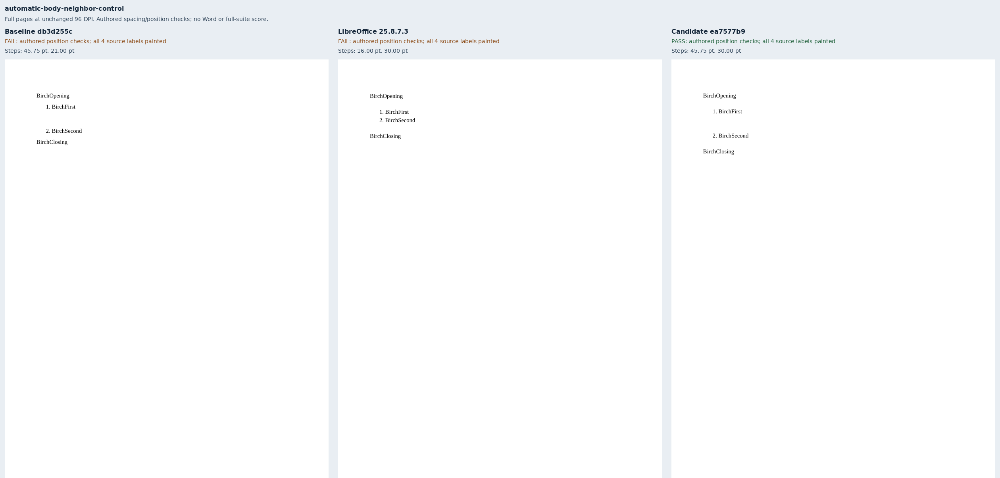

# Automatic body paragraph spacing

Eight original Birch cases isolate automatic before/after spacing from an exact 16 pt line.
They cover ordinary paragraphs with and without explicit values, entering/leaving a list,
same-list items, distinct numbering instances with an explicit restart, automatic flags off,
and an explicit larger gap owned by the neighbor.

The [issue author's Word print](https://github.com/JSv4/Docxodus/issues/1553#issuecomment-6701328156)
confirms 14 pt ordinary/into/out-of-list gaps and zero within a list. These independently authored
fixtures use explicit line heights; they do not claim Word's default line-height behavior.
Six LibreOffice references meet the authored checks. It removes explicit spacing in the two
same-list control cases, which remain ineligible with their discrepancies retained.

Primary marker-region checks bind all four source labels to authored line boxes. Exact PDF
inventory includes generated list numbers, and the companion checks paper, bounds and visible
paint. The separate-list case explicitly restarts its second numbering instance; list-number
continuation is a separate contract. No adapter or oracle changes are made.

First/last boundaries, tables and other stories, frames/borders, revisions, and enabled
`doNotUseHTMLParagraphAutoSpacing` are outside this production change. No new Word captures,
pinned-runtime qualification, or whole-suite score is claimed. The sandboxed system-Chromium
captures are public-API diagnostics, with exact source/build/runtime bindings.

The exact candidate `ea7577b9a5f3956e3343208f25109f1c76b4c210` improves authored
position checks from **1/8 to 8/8**, compared with baseline
`db3d255c1ffb5892103a4eff8fab4e79f1db9f03`. All eight files deliver in both builds. The central explicit-neighbor
gap was already retained; its incoming automatic boundary is what changes that case's positions.

`evidence.json` binds eight schema-valid inputs, 24 retained PDFs, 96 source labels and 30
painted list numbers, all report/inspection hashes, and 19 build files plus 45 runtime assets
per renderer. The eight sheets use unchanged full-page rasters. The contract tests shift the
second paragraph by -9, +5 and +9 pt to reject the old gap values and displaced controls.

## Reproduction

Generate `core-v121` with `python3 -m bench.fixtures`, select `automatic-body-*` into a manifest,
and build both exact renderer commits with `python3 -m bench build-docxodus`.
Capture native references using `python3 -m bench reference libreoffice --manifest MANIFEST --out OUT`,
then capture both public renderers with `docs/results/export-reliability/Capture.mjs --html`.
Retain the build and asset manifests and SDK validation, then run:

```sh
python3 docs/results/automatic-body-spacing/Compose.py RUN BASELINE_SOURCE CANDIDATE_SOURCE
python3 -m unittest discover -s tests -v
node --test tests/test-adapter.mjs
python3 -m bench.audit
```








