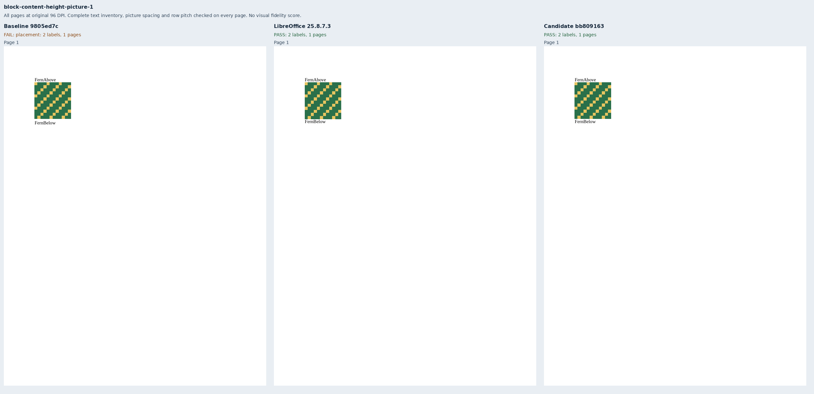
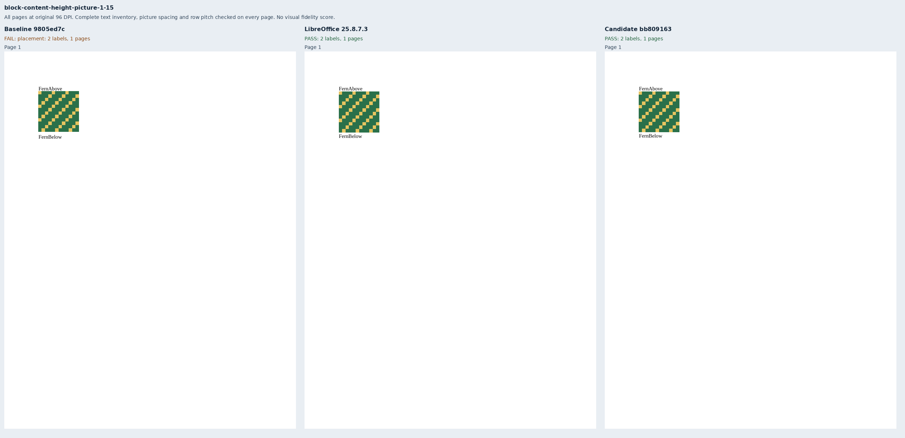
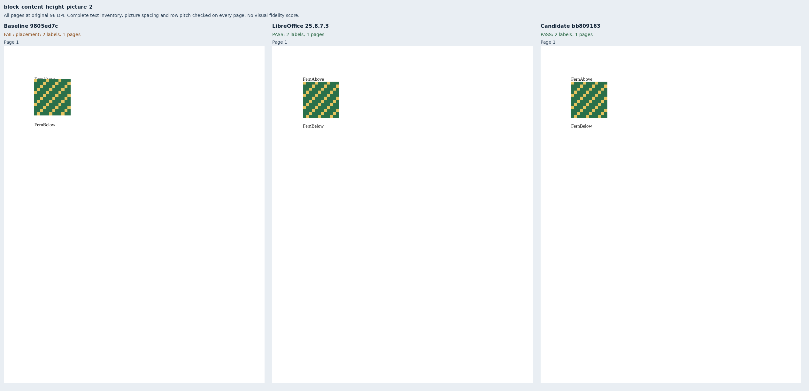
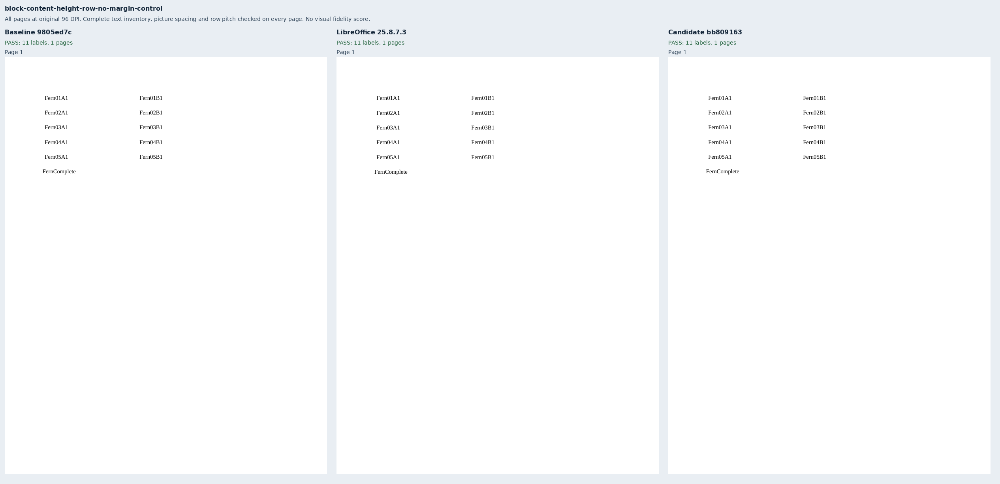
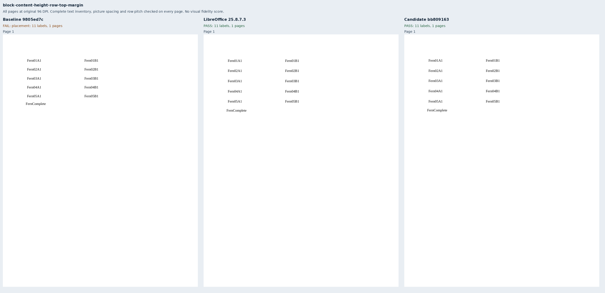
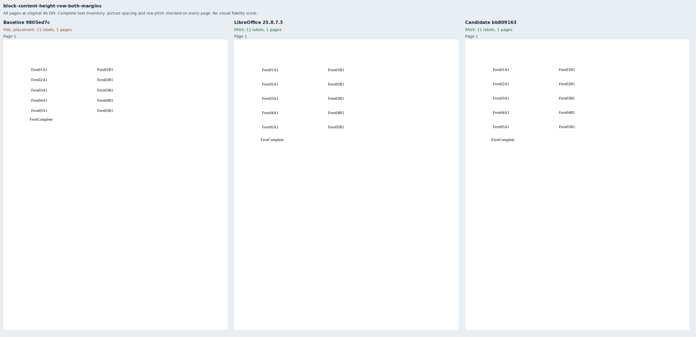
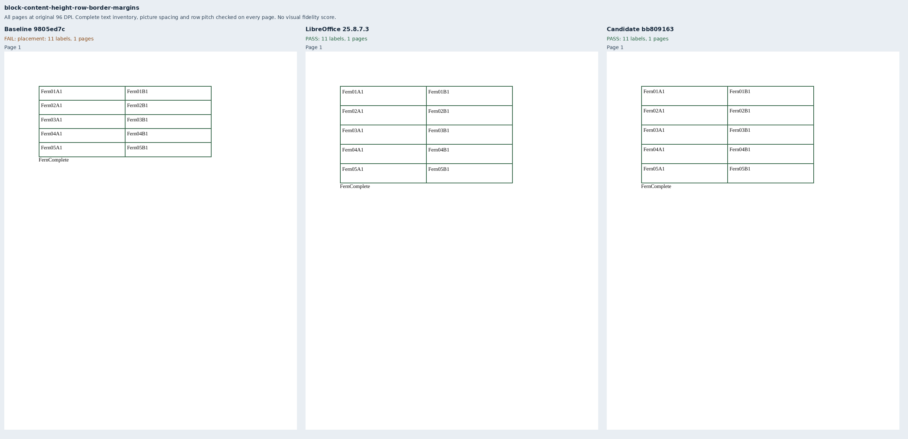
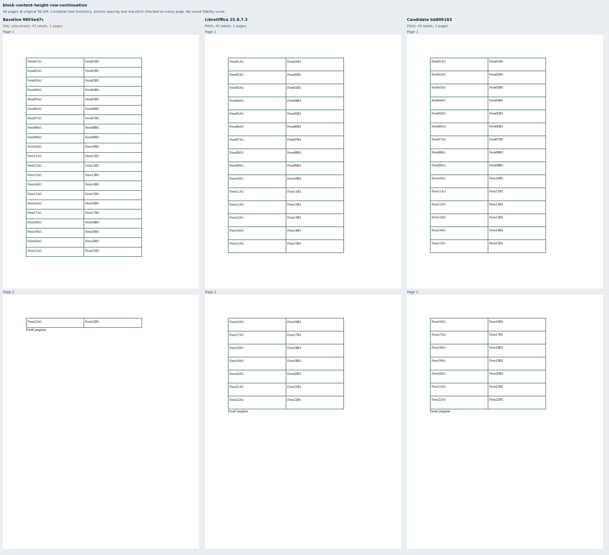
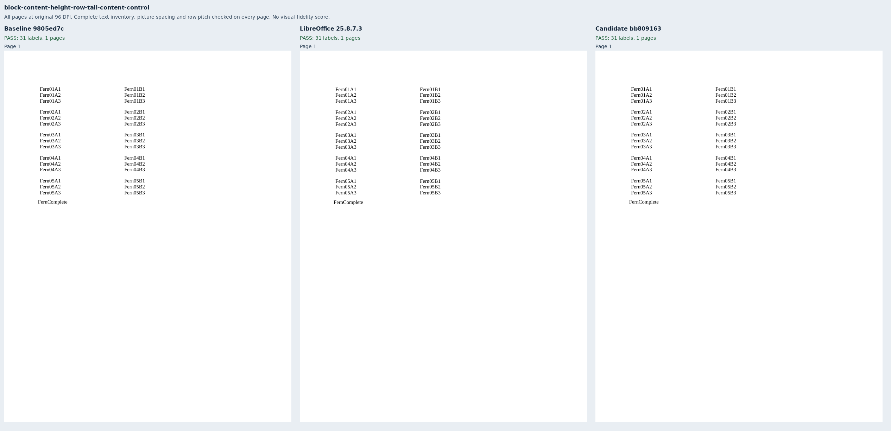

# Picture-only lines and minimum row margins

Nine original Fern packages exercise a sole 85pt bitmap at single, 1.15 and double spacing,
and 28pt minimum rows with zero, top-only and unequal top/bottom margins, collapsed borders,
a two-page continuation, and taller content. The independently authored labels, 12×12 green/gold
bitmap, dimensions and literal OOXML differ from the core regression fixtures. All use 11pt
Liberation Serif, Letter paper and 72pt margins. No renderer fixture or helper is imported.

Baseline `9805ed7cc31551c4fc724d07e21dd84abe0fba44` has the same complete source tree as main
`42bba69556dab01a80933e1d1c081b208a381f7d`. It passes the two row controls and fails seven placement
cases. Candidate `bb80916332e167209d850c162dde66fb90ce4bd0` removes the unused text descent below
a picture, leaves multiple-spacing height below it, and includes vertical cell margins outside
a row's declared minimum. The existing inline-media guard also recognizes unnamespaced images,
preventing the text-only baseline lift from moving them into the preceding paragraph.

The issue author's [Word measurements](https://github.com/JSv4/Docxodus/issues/1568#issuecomment-6701329842)
support these spacing and minimum-row rules. These independent fixtures have no Word reference
PDFs; LibreOffice 25.8.7.3 supplies nine eligible native references. Captures use the production
public export API, strict font verification and sandboxed system Chromium. They are unscored
diagnostics, with no pinned-runtime or full-suite fidelity claim.

The picture cases check both complete label inventories and the position and coverage of both
bitmap colors against native output (1.5pt raster bounds, 8% coverage tolerance). Those checks
exposed the upward picture shift even after the following label's spacing was correct. The
retained `picture-missing.pdf` deletes the image paint operation from the single-spacing native
PDF while preserving every text position; it fails both color checks. The contract test applies
those missing-color observations to all three spacing declarations. Vertical marker mutations
also reject ±3pt picture-spacing drift and ±12pt shifts confined to the continued table's second
page. No metric or scoring tolerance changes are made.

Full-page sheets show all 30 pages from 27 PDFs at original 96 DPI. Complete reports and PDF
inspections check 378 labels, full token inventories, paper bounds, picture footprint and spacing,
and row pitch on every page. `evidence.json` binds input hashes, exact source/build identities,
45 runtime assets per renderer, reports, native references and page rasters. The composer verifies
report status, input/PDF digest bindings, strict verified fonts, observed browser version and
actual asset hashes/lengths against the supplied clean source checkouts. All nine packages pass
Open XML SDK 3.5.1 validation against Microsoft 365.

The benchmark pictures are 85pt; tiny pictures and mixed text/picture lines are covered by the
core public tests. Exact/automatic row heights remain core baseline controls, without a new
LibreOffice parity claim. The suite advances to `core-v112` (801 inputs); all preceding 792 inputs
and declarations are unchanged apart from generator provenance.

```sh
python3 -m bench reference libreoffice --manifest MANIFEST --out REFERENCE
node docs/results/export-reliability/Capture.mjs SOURCE MANIFEST OUTPUT ENVIRONMENT
python3 docs/results/block-content-height/Compose.py RUN BASELINE_SOURCE CANDIDATE_SOURCE
```










