# Bordered footnote continuations

Thirteen original Ash cases cover long box/bottom-bordered paragraphs, subsequent continuation
pages, kept paragraphs, headings kept with their successors, and one-cell footnote tables.
Plain, separate-paragraph, short, kept, heading and table controls accompany the reproducers.
All packages validate with Open XML SDK 3.5.1. The preceding 620 inputs and contracts remain
unchanged except the shared generator hash; `core-v91` contains 633 cases.

Current main `06921d9505fdb8c0541d4f8c93ed8939296c521e` refuses the seven bordered overflow
cases. The fixed runtime `0875eab87ecaf0af716af7c585f9745d159c4a95` exports all thirteen with
complete source inventories. All six fitting/plain control sets retain byte-identical page PNGs.
The main capture uses the identical source tree/runtime from `cd446c19bf6b13aab0726451f50412c4c84d55c4`.

These local captures use strict fonts, explicit Liberation Serif files and a caller-owned,
sandboxed Chromium 143.0.7499.4. Reports identify that runtime as `browserObserved`.
Production owned-process measurements are pending. No fresh Word reference or exact native
layout parity is claimed. The existing border convention leaves the border open at internal
page breaks and retains the side borders.

| Cases | Main | Fixed | Native LibreOffice 25.8.7.3 |
| --- | --- | --- | --- |
| Box/bottom, 70 lines | Refused | Complete, two pages | Complete, two pages |
| Box/bottom, 100 lines | Refused | Complete, three pages | Complete, three pages |
| Box with kept 100-line paragraph | Refused | Complete, four pages | Complete, four pages |
| Box with kept heading | Refused | Complete, three pages | Complete, three pages |
| Box inside 100-line table cell | Refused | Complete, three pages | Incomplete; reference ineligible |
| Six controls | Complete | Identical page rasters | Five eligible; table control ineligible |

The two table cases retain their complete mandatory source-token contracts. LibreOffice emits
only one of their 100 note labels, and the unchanged reference-eligibility check rejects both
captures for missing source words. They are **reference-ineligible and unscored**, pending valid
native references. Their incomplete native pages and successful candidate output are retained
below as diagnostics. They are excluded explicitly from the planned **11-case diagnostic
production suite**, not accepted as passing references or assigned a layout score of zero.
The eleven eligible local comparisons pass all correctness checks with the fix; main passes
five controls and refuses six reproducers. This is not full thirteen-case fidelity validation.

[Local PDF, input, runtime and screenshot bindings](local-evidence.json) record every check and
the exact eleven-case production selection. [SDK validation](source-sdk-validation.json) binds
each package hash to its findings. Every screenshot uses all actual PDF pages at 96 DPI and 100%,
without cropping or resampling; refusal and absent-page panels are labeled. The 13 sheets
contain 81 actual page panels.

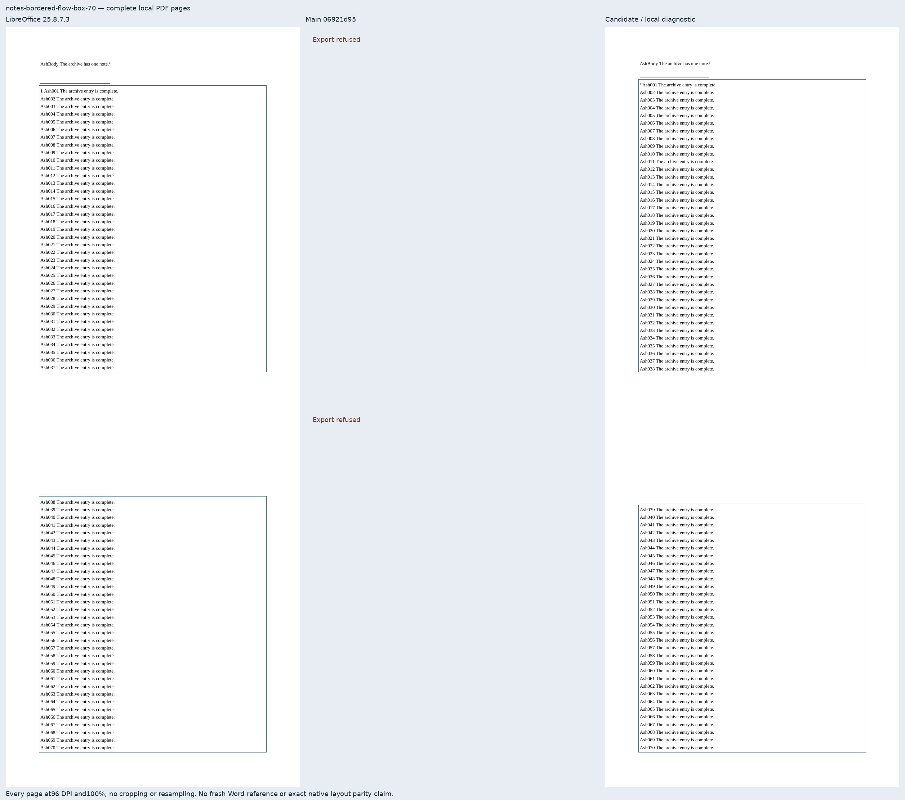

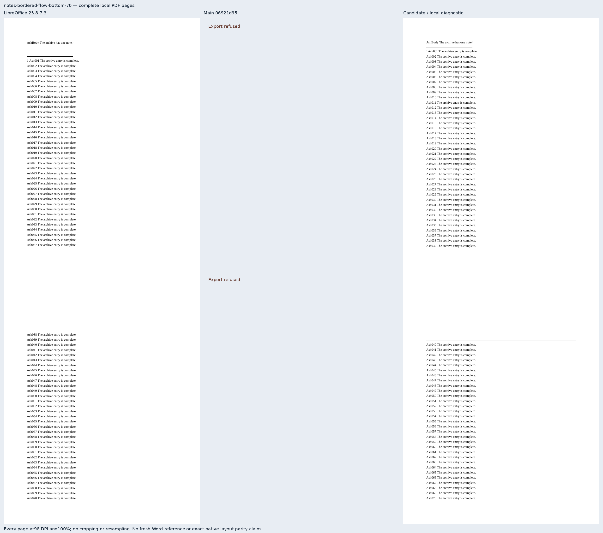

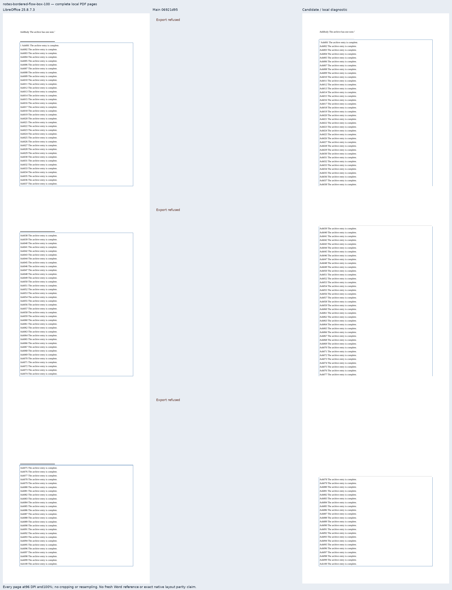

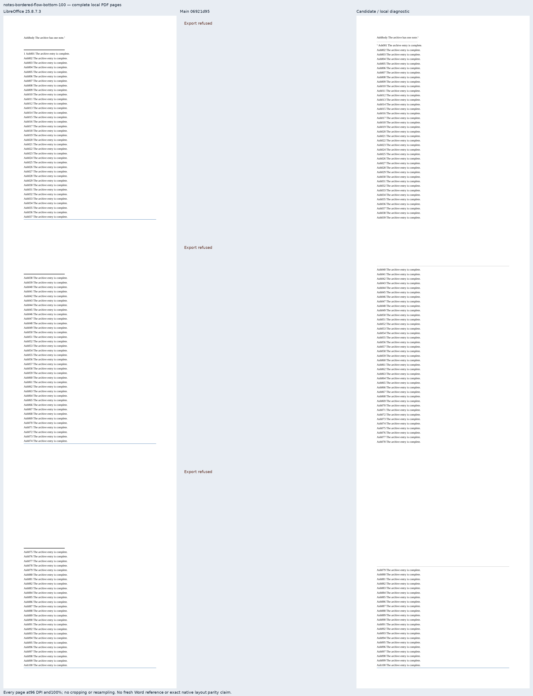

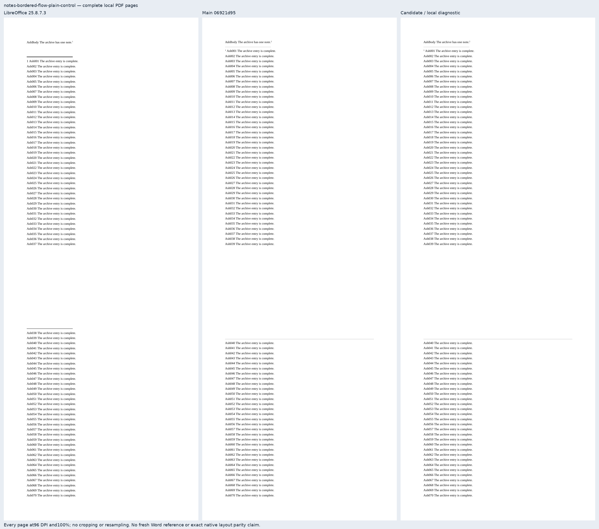

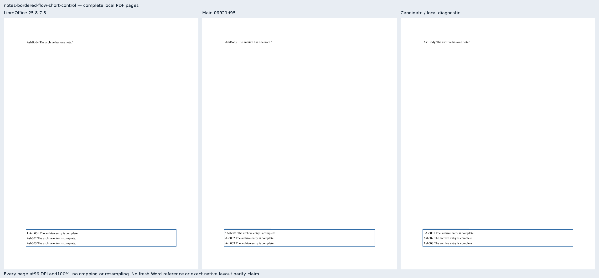

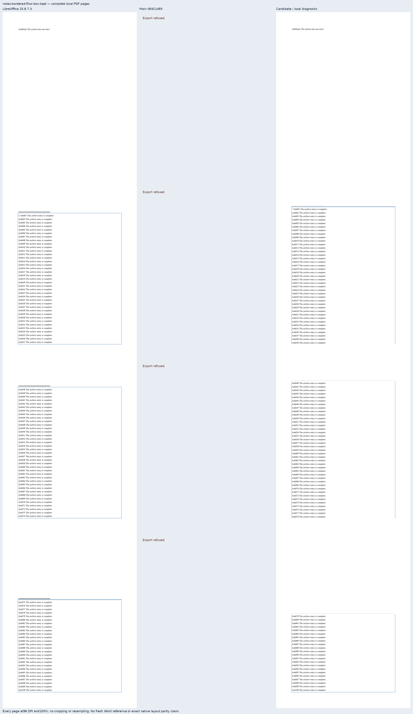

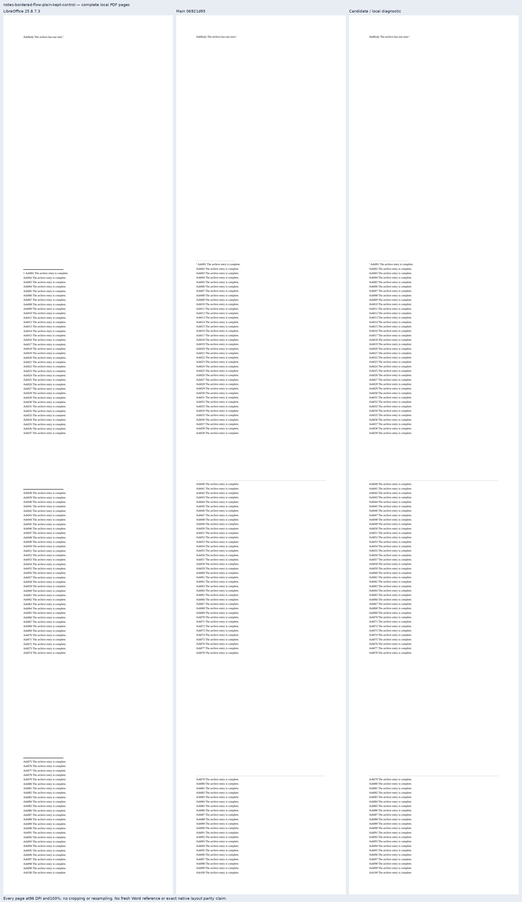

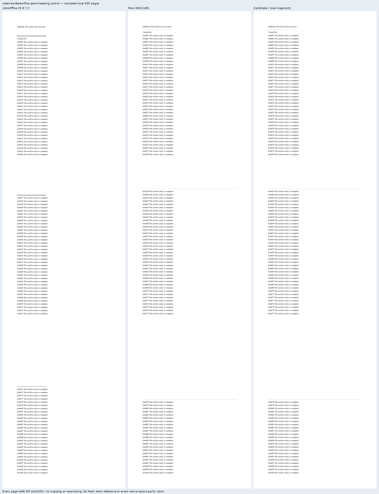

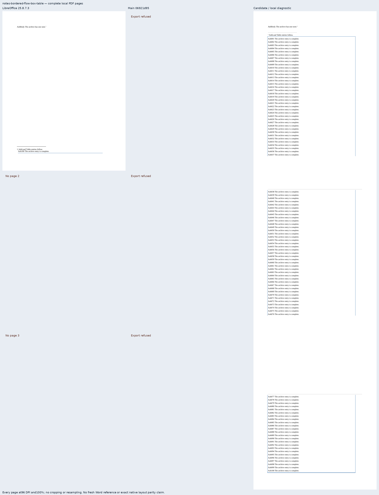

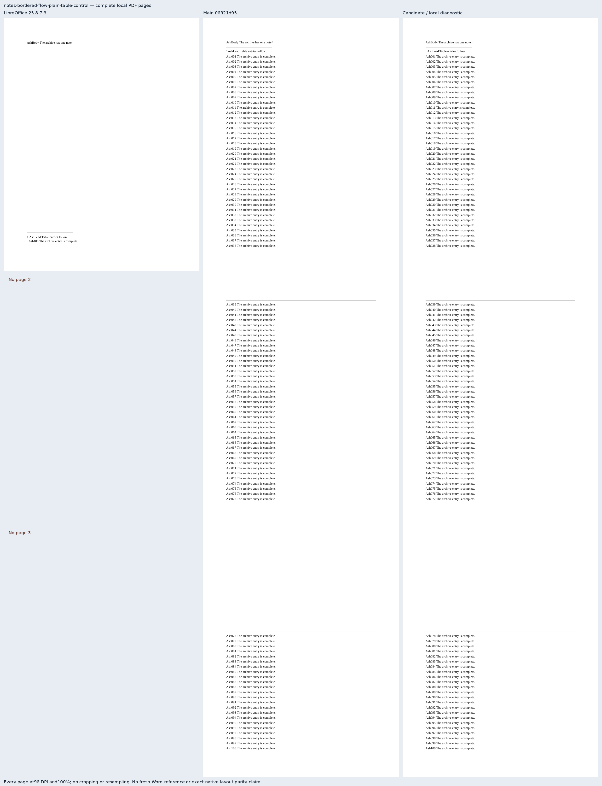
