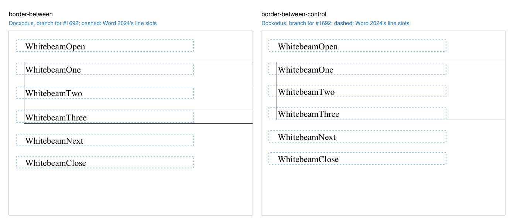
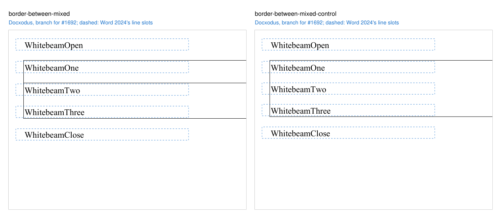
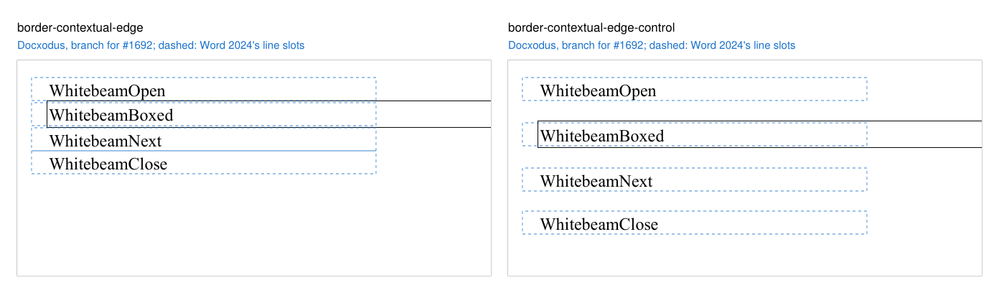
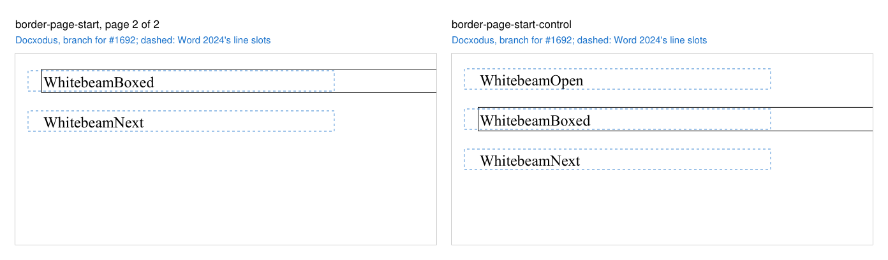
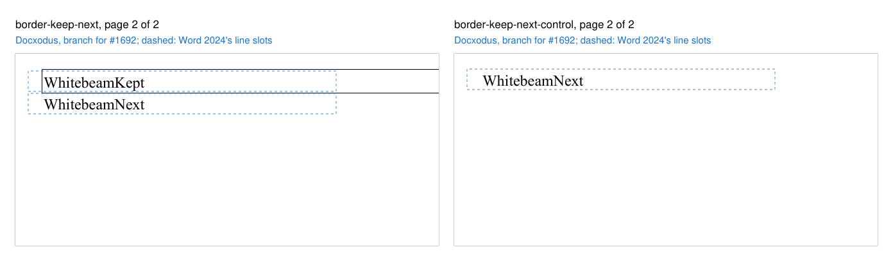
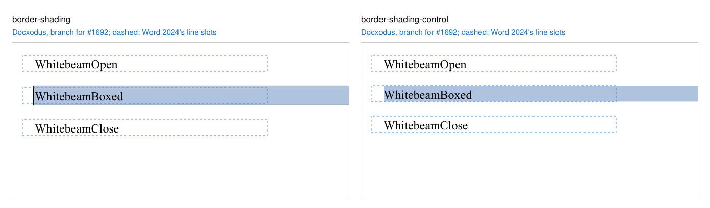

# Spacing around a bordered paragraph

Eight original Hornbeam cases accompany [Docxodus #1677](https://github.com/JSv4/Docxodus/issues/1677)
(`core-v162`). All text is 12pt Liberation Serif on exact 16pt lines. The bordered paragraphs have a
0.5pt box (`w:sz="4"`, `w:space="1"`) and 14pt before and after; every other paragraph has no
spacing unless noted.

| Case | Content | Word 2024 |
|---|---|---|
| `border-spacing-outside` | an unspaced line, a bordered paragraph, a paragraph with 14pt before and after, an unspaced line | top border 14pt below the first line; 14pt from the bottom border to the next line |
| `border-spacing-group` | the same with three bordered paragraphs sharing one box | 14pt between the members inside the box; 14pt outside it at each end |
| `border-spacing-compat` | the first case under `w:doNotUseHTMLParagraphAutoSpacing` | 28pt from the bottom border to the next line |
| `border-spacing-page-top` | forty unspaced lines fill page 1; the bordered paragraph starts page 2 | top border at the top margin, no space before; 14pt after the box |

Each control drops only the border. Word 2024 (build 16.0.20326, November 2026) printed these exact
inputs with the font renamed to its metric twin, Times New Roman. It draws the border around the
text and `w:space` only, so the bordered lines sit 1.5pt lower than the control's, the following
lines 3pt lower, and nothing else moves: the space before and after lie outside the box and
collapse, add or drop exactly as the unbordered control's do.

Each region is a label's 16pt line slot on its page. Word's word boxes lie inside every region, with
2.2pt above and 0.5pt below. The regions do not test where the border itself is drawn; a renderer
that keeps the spacing inside the box puts the bordered label in its region and the next label 14pt
below its own.

Docxodus `main` at `1aab1f44` kept the spacing inside the box: on equivalent inputs the paragraph
after the box printed 14.25pt lower than Word's (28pt of space where Word leaves 14pt, and 42pt
where Word leaves 28pt), and a box at the top of page 2 kept its 14pt above the text. The controls
matched Word. A build of the Docxodus change for #1677 meets every region of all eight cases.

The four images show that build's PDF for each input beside its control, with the regions (the
line slots Word's word boxes lie in) dashed:

| Pair | Docxodus with the #1677 change |
|---|---|
| `border-spacing-outside` |  |
| `border-spacing-group` |  |
| `border-spacing-compat` |  |
| `border-spacing-page-top` (page 2) |  |

## The box itself (`core-v163`)

Twelve original Whitebeam cases accompany [Docxodus #1692](https://github.com/JSv4/Docxodus/issues/1692),
with the same text, lines and box, and an explicit `w:pPrDefault`. Each control drops only the
property under test.

| Case | Property | Word 2024 | Docxodus `main` at `ba7c8903` |
|---|---|---|---|
| `border-between` | `w:between` on the three paragraphs of a box | 14pt, 1pt `w:space`, the 0.5pt rule and 1pt again between the lines: a 32.5pt step (control 30pt) | no rule, 30pt |
| `border-between-mixed` | the middle paragraph has no `w:between` | one box; below the first paragraph 14pt, its rule and 1pt (31.5pt step); below the second 14pt and 1pt, no rule (31pt) | three boxes, 33pt steps |
| `border-contextual-edge` | `w:contextualSpacing` on a bordered paragraph and both neighbours | no spacing on either side of the box (control 14pt) | 14pt on both sides |
| `border-page-start` | `w:pageBreakBefore` on the bordered paragraph | box at the top of page 2 (control one page) | one page |
| `border-keep-next` | `w:keepNext` on a bordered paragraph whose next paragraph does not fit | both on page 2 (control: the box stays on page 1) | the box stays on page 1 |
| `border-shading` | a border on a shaded paragraph | fill inside the border through its `w:space`, 472.9 by 18pt (control: the 16pt line, 1.4pt past the text on each side) | the line's fill at the text's width |

Word 2024 (build 16.0.20326) printed these exact inputs with the font renamed to Times New Roman, and
its word boxes lie inside every region. The shading pair declares Word's fill as `color-geometry`
with a 2pt bound tolerance, which admits the unbordered fill a renderer stops at the text edge
(1.4pt and 1.5pt in) and rejects one that stops at the text edge inside a box (2.4pt in, and 13% less
paint). The `main` column is from equivalent inputs printed through its PDF export. A build of the
Docxodus change for #1692 puts every label in its region and both fills within their bounds, by the
same word boxes and fill rectangles read with PyMuPDF; the bench's own inspection was not run here.

Not pinned: where the rules and borders themselves are drawn, the rule Word carries to the top of
the next page when a box splits there, and shading that differs between the paragraphs of one box,
which Docxodus still fills by line.

| Pair | Docxodus with the #1692 change |
|---|---|
| `border-between` |  |
| `border-between-mixed` |  |
| `border-contextual-edge` |  |
| `border-page-start` |  |
| `border-keep-next` |  |
| `border-shading` |  |

LibreOffice reference captures and candidate scoring are pending. This machine has no pinned
LibreOffice, so no reference bundle is included and no eligibility or fidelity score is claimed.
All prior input hashes are unchanged.
