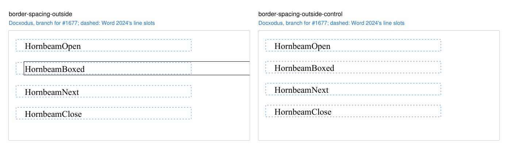
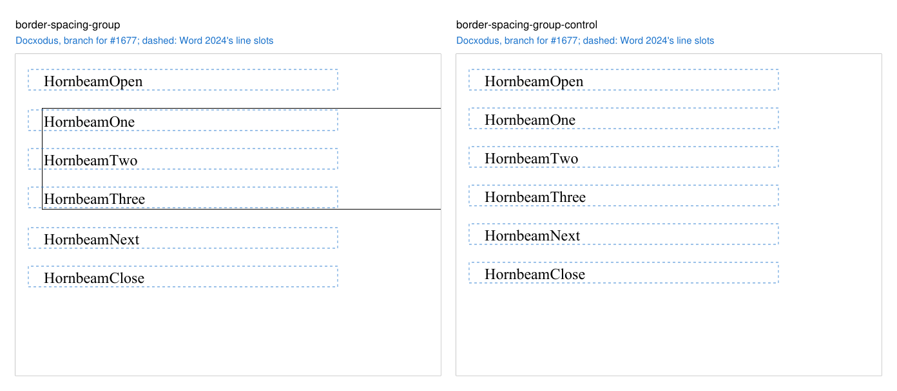
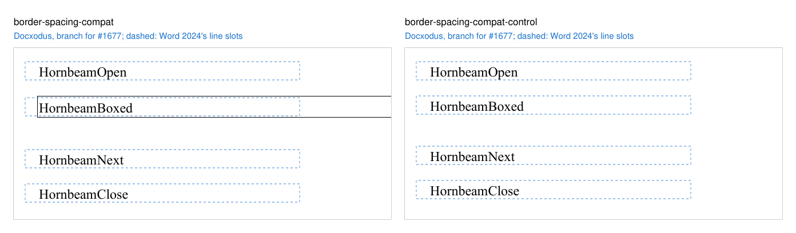
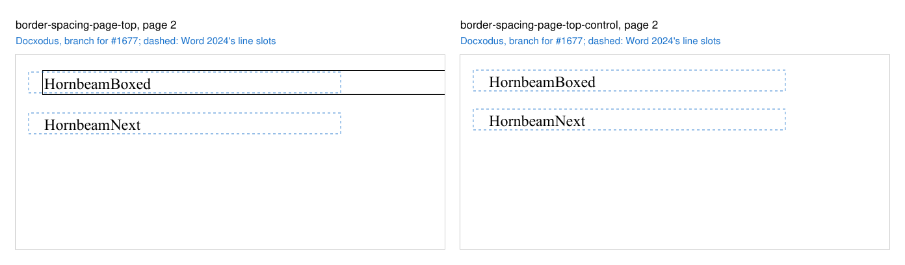

# Spacing around a bordered paragraph

Eight original Hornbeam cases accompany [Docxodus #1677](https://github.com/JSv4/Docxodus/issues/1677)
(`core-v162`). All text is 12pt Liberation Serif on exact 16pt lines. The bordered paragraphs have a
0.5pt box (`w:sz="4"`, `w:space="1"`) and 14pt before and after; every other paragraph has no
spacing unless noted.

| Case | Content | Word 2024 |
|---|---|---|
| `border-spacing-outside` | an unspaced line, a bordered paragraph, a paragraph with 14pt before and after, an unspaced line | top border 14pt below the first line; 14pt from the bottom border to the next line |
| `border-spacing-group` | the same with three bordered paragraphs sharing one box | 14pt between the members inside the box; 14pt outside it at each end |
| `border-spacing-compat` | the first case under `w:doNotUseHTMLParagraphAutoSpacing` | 28pt from the bottom border to the next line |
| `border-spacing-page-top` | forty unspaced lines fill page 1; the bordered paragraph starts page 2 | top border at the top margin, no space before; 14pt after the box |

Each control drops only the border. Word 2024 (build 16.0.20326, November 2026) printed these exact
inputs with the font renamed to its metric twin, Times New Roman. It draws the border around the
text and `w:space` only, so the bordered lines sit 1.5pt lower than the control's, the following
lines 3pt lower, and nothing else moves: the space before and after lie outside the box and
collapse, add or drop exactly as the unbordered control's do.

Each region is a label's 16pt line slot on its page. Word's word boxes lie inside every region, with
2.2pt above and 0.5pt below. The regions do not test where the border itself is drawn; a renderer
that keeps the spacing inside the box puts the bordered label in its region and the next label 14pt
below its own.

Docxodus `main` at `1aab1f44` kept the spacing inside the box: on equivalent inputs the paragraph
after the box printed 14.25pt lower than Word's (28pt of space where Word leaves 14pt, and 42pt
where Word leaves 28pt), and a box at the top of page 2 kept its 14pt above the text. The controls
matched Word. A build of the Docxodus change for #1677 meets every region of all eight cases.

The four images show that build's PDF for each input beside its control, with the regions (the
line slots Word's word boxes lie in) dashed:

| Pair | Docxodus with the #1677 change |
|---|---|
| `border-spacing-outside` |  |
| `border-spacing-group` |  |
| `border-spacing-compat` |  |
| `border-spacing-page-top` (page 2) |  |

LibreOffice reference captures and candidate scoring are pending. This machine has no pinned
LibreOffice, so no reference bundle is included and no eligibility or fidelity score is claimed.
All prior input hashes are unchanged.
