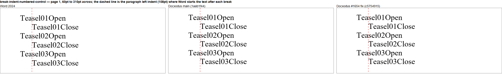
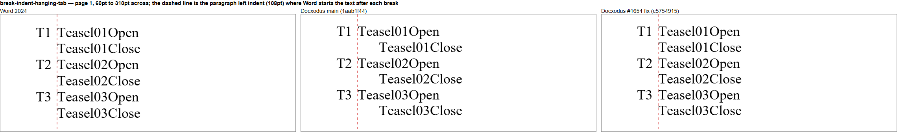
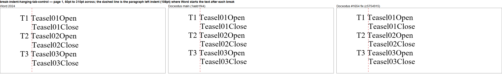
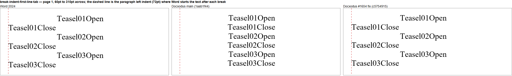
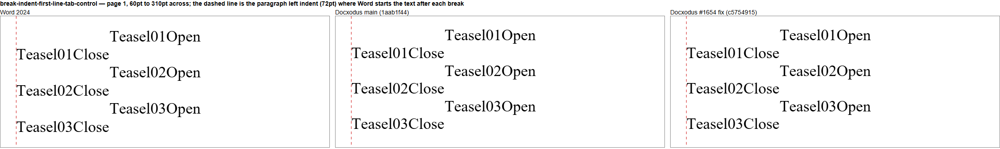

# Text after a line break in a paragraph with a tab

Six original Teasel inputs accompany [Docxodus #1654](https://github.com/JSv4/Docxodus/issues/1654),
suite `core-v162`. Each holds three paragraphs of 12 pt Liberation Serif on Letter paper with 1 in
margins, single spacing and no paragraph spacing. Every paragraph is two labels separated by a
line break (`w:br`), `Teasel01Open` then `Teasel01Close`.

| Case | Paragraph | Before the first label |
| --- | --- | --- |
| `break-indent-numbered` | numbered, level `w:ind w:left="720" w:hanging="360"` | the list number and its tab |
| `break-indent-numbered-control` | the same indent, set directly | nothing |
| `break-indent-hanging-tab` | `w:ind w:left="720" w:hanging="360"` | a lead label (`T1`) and a tab |
| `break-indent-hanging-tab-control` | the same | the lead label and a space |
| `break-indent-first-line-tab` | `w:ind w:firstLine="1417"` | a tab |
| `break-indent-first-line-tab-control` | the same | nothing |

Within a pair only the tab differs: the numbered control drops the numbering, which is what
supplies the tab, and keeps its indent.

## What Word does

Word 2024 printed these exact inputs with the font renamed to Times New Roman, Liberation Serif's
metric twin, which this machine has instead. The left edge of each label in the PDF, in points
from the left of the page:

| Case | Number or lead | First label | Label after the break |
| --- | --- | --- | --- |
| `break-indent-numbered` | 90 | 108 | 108 |
| `break-indent-numbered-control` | | 90 | 108 |
| `break-indent-hanging-tab` | 90 | 108 | 108 |
| `break-indent-hanging-tab-control` | 90 | 106.3 | 108 |
| `break-indent-first-line-tab` | | 144 | 72 |
| `break-indent-first-line-tab-control` | | 142.85 | 72 |

The text after a break starts at the paragraph's left indent (108 pt with the hanging indent,
72 pt with the first-line one), with or without a tab on the first line.

## Regions

Each label has a `marker-region` on page 1 that runs the height of the page. It starts at the
left edge in the table and is the label's advance and under 3 pt more wide, with a 0.5 pt
tolerance, so a label 18 pt to the right is outside it. Word's boxes lie inside every region of
all six cases.

## Docxodus

Docxodus `main` (1aab1f44) and the fix branch for #1654 (c5754915) converted the same
Times New Roman copies to HTML with the `docx2html` tool, and Chromium printed the HTML to Letter
with 1 in margins. This is not the harness's adapter, which was not built here. On `main` the
label after the break starts at 126 pt in `break-indent-numbered` and `break-indent-hanging-tab`,
one 18 pt first-line start to the right of the indent, and at 142.84 pt in
`break-indent-first-line-tab`. Those three inputs fail and the three controls pass. The fix
branch meets every region of all six.

Each picture is the top left of page 1, in the order Word 2024, Docxodus `main`, the fix branch.
The dashed line is the paragraph's left indent.

## Limits

This machine has no pinned LibreOffice, Poppler or qpdf. No reference bundle is included, and no
eligibility or fidelity score is claimed. LibreOffice references, a registered Word capture with
Liberation Serif and candidate scores through the harness are pending. All 1,146 prior input
hashes are unchanged.
