# Break paragraphs, content-control changes and reviewers' markers (Docxodus #1809, #1810, #1812)

Docxodus #1809 found that a comparison which merges, moves or splits the paragraph holding a section break mapped the
redline's sections to the documents' sections by number: accepting a merge or a move left the one section with no
header, and a split lost the original's break, and its margin, on reject. Docxodus #1810 found that a change to a
table's content controls alone (a row wrapped in a new control, a row moved to the next control, a cell given a
row-level control) was neither reported nor tracked, that renaming a control beside an edit replaced the whole table,
and that consolidating two reviewers' edits to such a table kept neither. Docxodus #1812 found that consolidation dropped a reviewer's
comment or bookmark beside another reviewer's edit or table formatting, and moved a content control holding only a
bookmark to the head of a composed table. See [the redline notes](../../REDLINE.md#break-paragraphs-merged-moved-or-split-content-control-changes-reviewers-markers-docxodus-1809-1810-1812)
for the cases and their assertions.

| Case | Kind | Main `c70ea5e9` | Fixes merged `66a20e2d` |
| --- | --- | --- | --- |
| `redline-break-paragraph-merged` | reproducer | `libreoffice-rejected`, `markup-accepted`, `markup-rejected` | none |
| `redline-break-paragraph-kept-merge-control` | control | none | none |
| `redline-break-paragraph-moved` | reproducer | `libreoffice-rejected`, `markup-accepted`, `markup-rejected` | none |
| `redline-break-paragraph-kept-move-control` | control | none | none |
| `redline-break-paragraph-split` | reproducer | `assertion-section-boundaries`, `assertion-section-change-values`, `assertion-section-stories`, `libreoffice-rejected`, `markup-rejected` | none |
| `redline-break-paragraph-kept-split-control` | control | none | none |
| `redline-control-wraps-row` | reproducer | `assertion-table-state`, `libreoffice-rejected` | none |
| `redline-control-renamed-beside-edit` | reproducer | `assertion-revision-count`, `assertion-untracked-text` | none |
| `redline-control-kept-beside-edit-control` | control | none | none |
| `redline-control-row-moves-on` | reproducer | `assertion-table-state` | none |
| `redline-control-rows-kept-control` | control | none | none |
| `redline-control-wraps-cell` | reproducer | `assertion-table-state` | none |
| `redline-control-cell-kept-control` | control | none | none |
| `redline-consolidate-control-rows` | reproducer | `libreoffice-accepted`, `markup-accepted`, `markup-reviewer-Reviewer A`, `markup-reviewer-Reviewer B` | none |
| `redline-consolidate-control-row-bookmark` | reproducer | `markup-accepted`, `markup-reviewer-Reviewer B` | none |
| `redline-consolidate-plain-rows-control` | control | none | none |
| `redline-consolidate-plain-row-bookmark-control` | control | none | none |
| `redline-consolidate-comment-beside-edit` | reproducer | `libreoffice-accepted`, `markup-accepted`, `markup-reviewer-Reviewer B` | none |
| `redline-consolidate-comment-other-paragraph-control` | control | none | none |
| `redline-consolidate-comment-in-table` | reproducer | `libreoffice-accepted`, `markup-accepted`, `markup-reviewer-Reviewer B` | none |
| `redline-consolidate-comment-in-table-control` | control | none | none |
| `redline-consolidate-table-format-bookmark` | reproducer | `markup-accepted`, `markup-reviewer-Reviewer B` | none |
| `redline-consolidate-bookmark-table-format` | reproducer | `markup-accepted`, `markup-reviewer-Reviewer B` | none |
| `redline-consolidate-table-format-outside-bookmark-control` | control | none | none |
| `redline-consolidate-bookmark-control-between-rows` | reproducer | `libreoffice-accepted`, `libreoffice-rejected`, `markup-accepted`, `markup-rejected`, `markup-reviewer-Reviewer A`, `markup-reviewer-Reviewer B` | none |
| `redline-consolidate-bare-bookmark-between-rows-control` | control | none | none |

Each cell lists the failed checks. The fix heads are [JSv4/Docxodus#1820](https://github.com/JSv4/Docxodus/pull/1820)
(#1809, `e0904977`), [JSv4/Docxodus#1826](https://github.com/JSv4/Docxodus/pull/1826) (#1812, `19782682`) and
[JSv4/Docxodus#1827](https://github.com/JSv4/Docxodus/pull/1827) (#1810, `4752f093`, stacked on #1826). `66a20e2d` is a
merge of `e0904977` and `4752f093`, made only for scoring; its tree, `197c6715`, is what `git merge-tree` gives for the
two heads. Main fails all fourteen reproducers and passes all twelve controls; the merge passes all twenty-six, with
exactly the authored redlines' revision records. The authored redlines pass every check. Checks are the bench's markup
comparisons, the reviewer projections, SDK validation, the declared assertions and the LibreOffice text round trips,
run on Linux with LibreOffice 25.8.7.3. No reference application capture was made for these cases. `evidence.json` holds
each run's score, failed checks, revision counts, rejected table states, section boundaries and section stories.

## Screenshots

Each sheet shows the top of the first page (for the section-break cases, of the first two pages, each with its header)
as LibreOffice 25.8.7.3 exports it to PDF with comments in the margin: the redline as opened, after LibreOffice's own
Reject All, and after its Accept All (`bench/lo_revisions.py`). Rows are the authored redline, main `c70ea5e9` and the
fixes `66a20e2d`; under each row are the checks that run failed. LibreOffice draws neither a bookmark nor a content
control's boundary in a table, so for those cases the failed checks carry what the tiles cannot show.

### `redline-break-paragraph-merged`

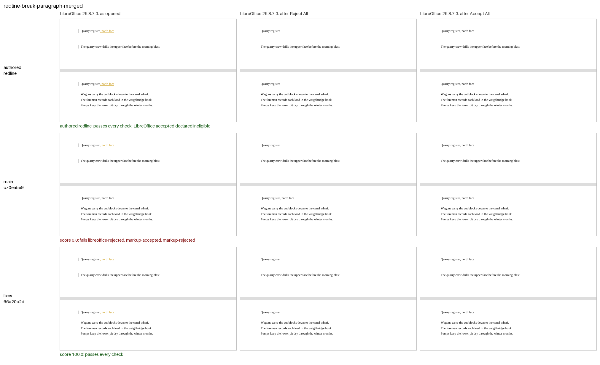

Each tile is the top of pages 1 and 2: the break makes the first section a page of its own, and each page shows its header. Main and the fixes both keep the break on the first paragraph's deleted mark. Main tracks `, north face` in the one header part, but its last section names no header and inherits it, so the bench's accepted document, where the break is gone, has no header at all (`markup-accepted`), and its rejected document shows the header only by inheritance where the expectation names it (`markup-rejected`). LibreOffice draws an inherited header's copy without its tracking, so on main its Reject All leaves the revised header on page 2 (`libreoffice-rejected`). With the fixes the last section names the tracked header. In every row LibreOffice's Accept All keeps the break and the merged paragraphs apart, the authored redline included, so its accepted comparison is declared ineligible.

### `redline-break-paragraph-kept-merge-control`

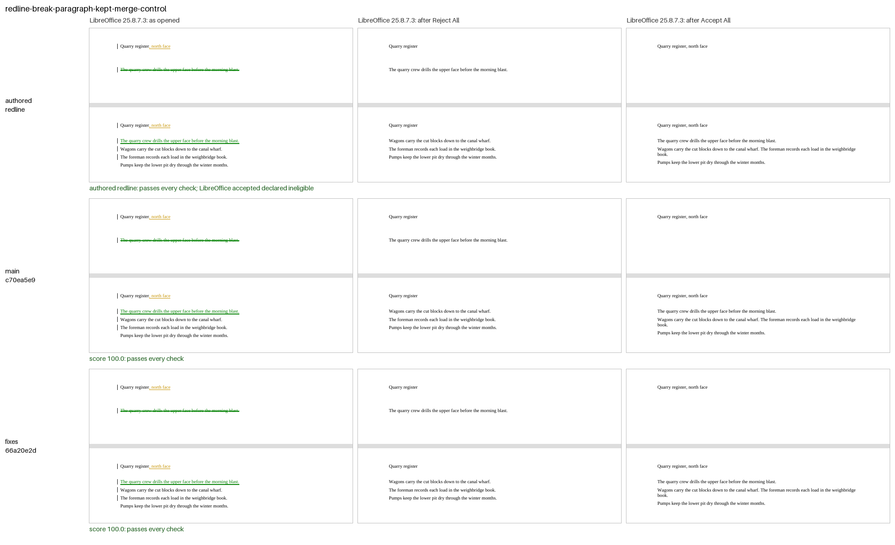

The first paragraph keeps its place and loses its break, drawn as a deleted copy holding the break and an inserted copy, and the second and third paragraphs join. Every version names the header in the last section.

### `redline-break-paragraph-moved`

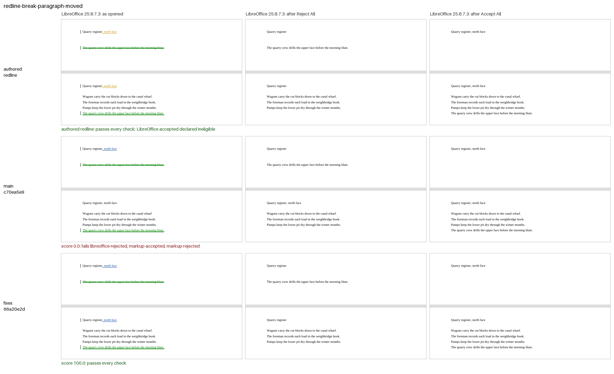

The paragraph that holds the break moves to the end; main and the fixes both draw the move as its deleted source, which keeps the break, and an inserted copy. As for the merged case, main's last section inherits the header, so the bench's accepted document has none and LibreOffice's Reject All shows the revised header on page 2; with the fixes the last section names the tracked header.

### `redline-break-paragraph-kept-move-control`

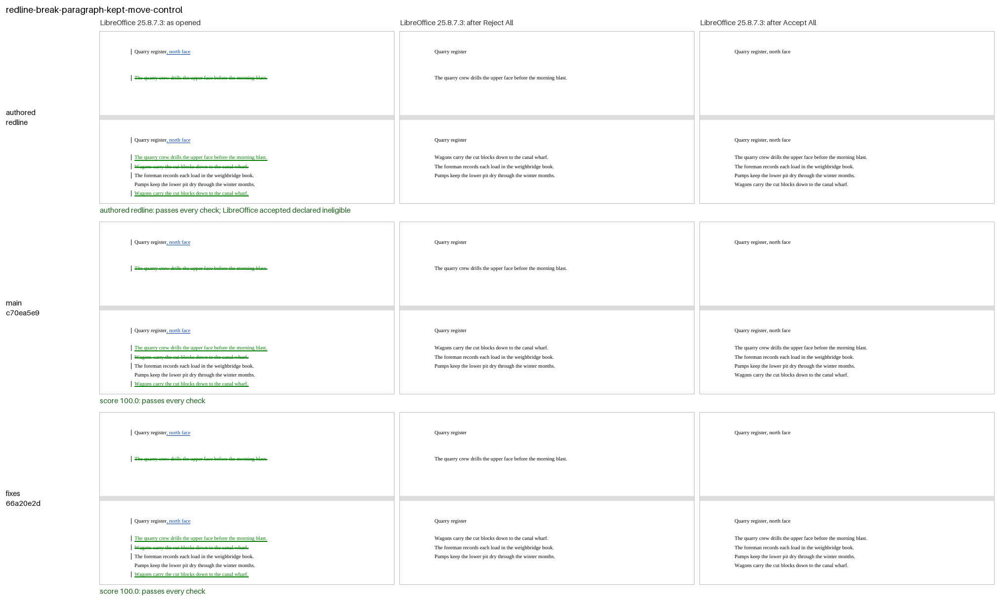

The second paragraph moves to the end and the first loses its break; every version names the header in the last section.

### `redline-break-paragraph-split`

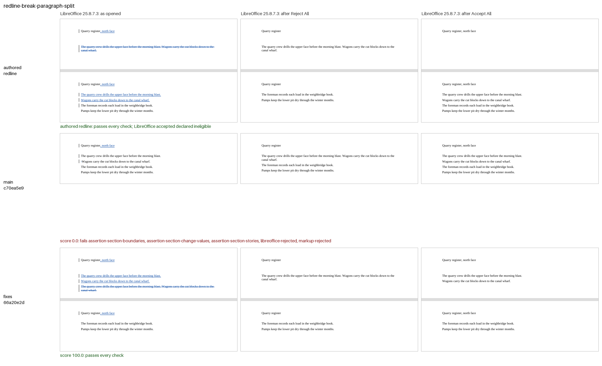

Main writes the split in place and drops the original's break: its redline has one section, so Reject All gives one page, one section and no 1800-twip top margin (`section-boundaries`, `section-change-values`, `section-stories`, `markup-rejected`). With the fixes the original paragraph, with its break, is deleted whole beside the two inserted ones, so Reject All restores both sections.

### `redline-break-paragraph-kept-split-control`

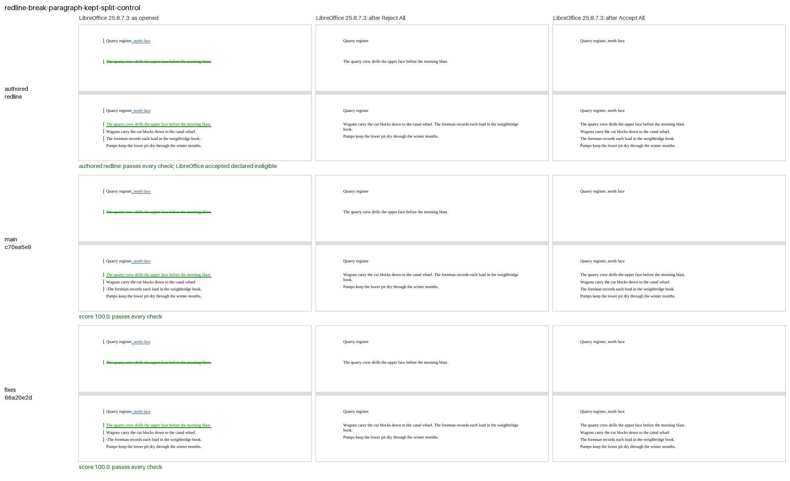

The break ends a one-sentence first paragraph, which loses it; the paragraph after it is split. Every version restores both sections on Reject All.

### `redline-control-wraps-row`

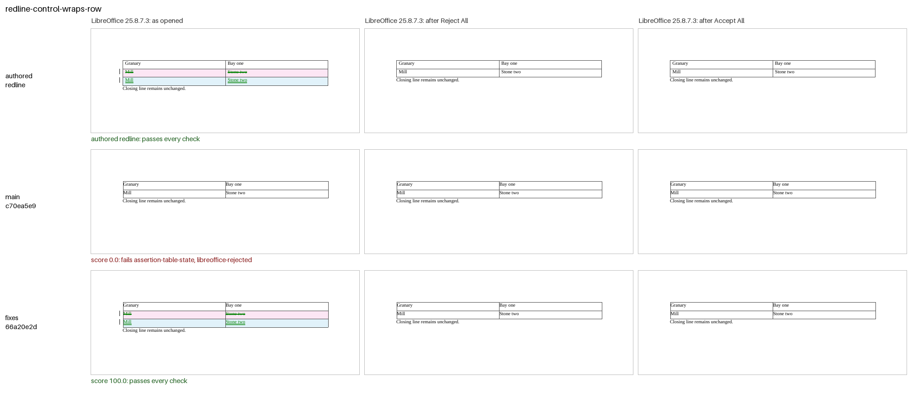

LibreOffice does not draw a content control's boundary in a table. Main records no revision and copies the revised table, control and all, so Reject All keeps the control (`table-state`; LibreOffice's text view puts the row's paragraphs inside the control, `libreoffice-rejected`). With the fixes the row is deleted where it was and inserted inside the new control.

### `redline-control-renamed-beside-edit`

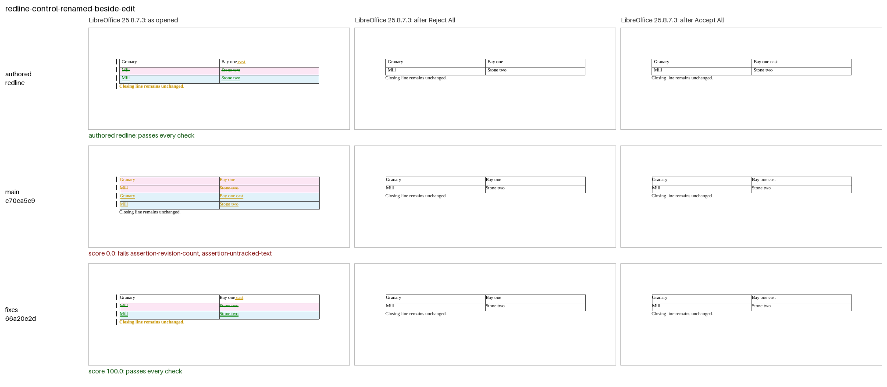

Main deletes and inserts the whole table for one word and a renamed control (20 revision records; `Granary` and `Bay one` are no longer untracked). With the fixes the word is tracked in the first row and only the controlled row is deleted in the old control and inserted in the renamed one, 19 records as authored. LibreOffice lists the closing line as a format change for the authored redline and the fixes, and marks it in the sheet: it reads the custom-XML range after the table that way. The bench's own engine finds the closing line untracked in every row.

### `redline-control-kept-beside-edit-control`

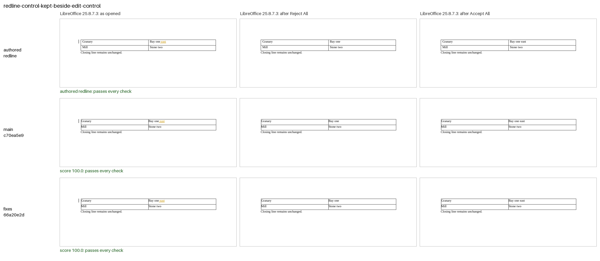

The same word with the control unchanged: every version tracks the one word.

### `redline-control-row-moves-on`

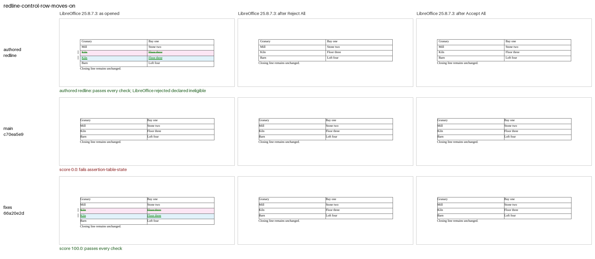

Main records no revision and copies the revised table, so Reject All leaves the third row in the second control (`table-state`). With the fixes the row is deleted in the first control and inserted in the second. LibreOffice rewrites table-level controls on load and save and writes the last row outside its control after rejecting even the authored redline, so its rejected comparison is declared ineligible.

### `redline-control-rows-kept-control`

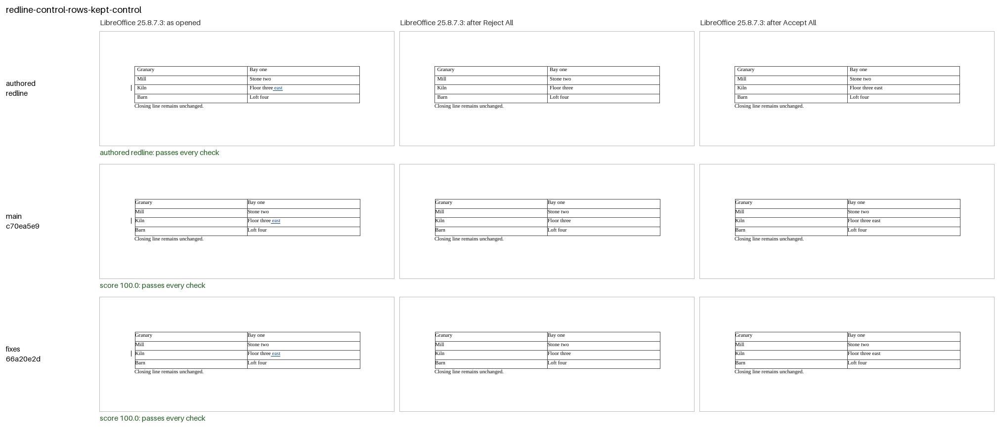

The same rows stay in their controls and the third gains a word: every version tracks the word.

### `redline-control-wraps-cell`

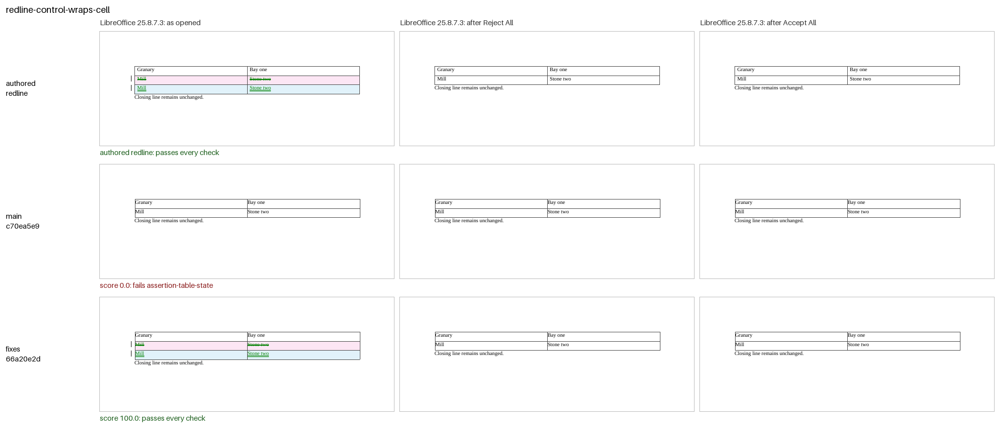

Main records no revision and copies the revised row, so Reject All keeps the cell's new control (`table-state`). With the fixes the row is deleted and inserted again with the cell in its control.

### `redline-control-cell-kept-control`

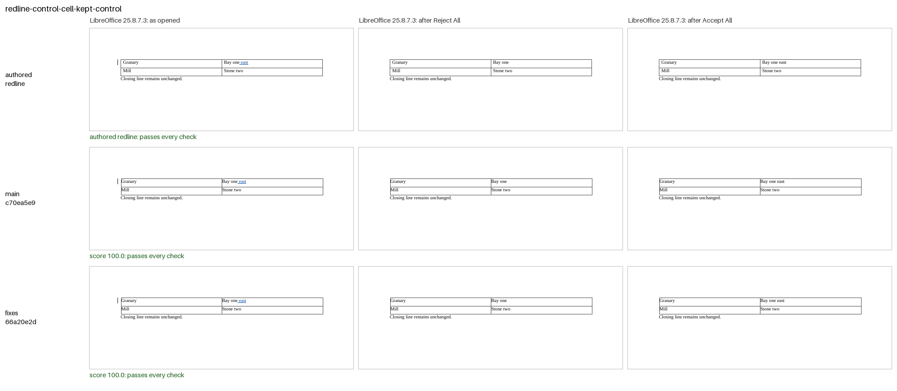

The cell's control is the same in both documents and the first row gains a word: every version tracks the word.

### `redline-consolidate-control-rows`

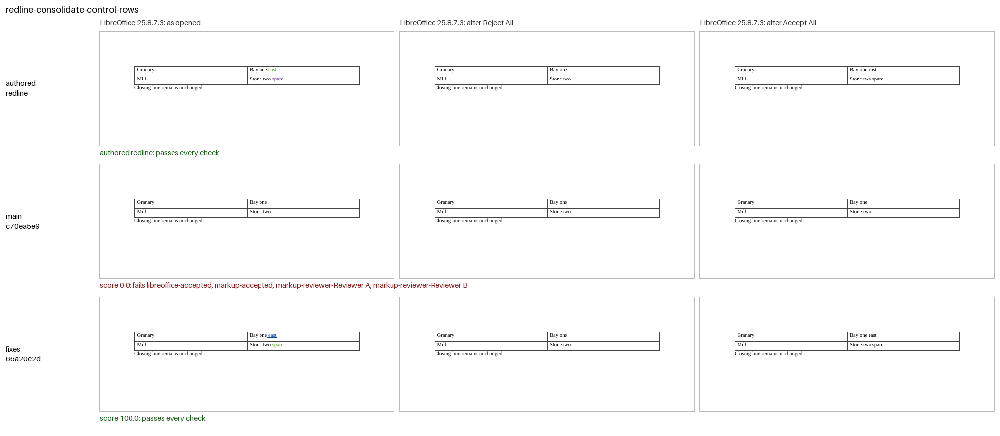

Main keeps the base's table, so neither reviewer's word is there (`markup-accepted`, both reviewer projections). With the fixes both words are tracked and the second row stays in its control.

### `redline-consolidate-control-row-bookmark`

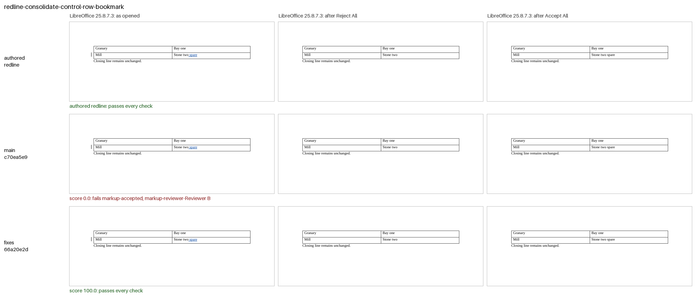

A bookmark has no rendering, so the tiles look alike. Main keeps reviewer A's word and drops reviewer B's bookmark around `Bay one` (`markup-accepted`, the B projection); with the fixes it is B's tracked insertion.

### `redline-consolidate-plain-rows-control`

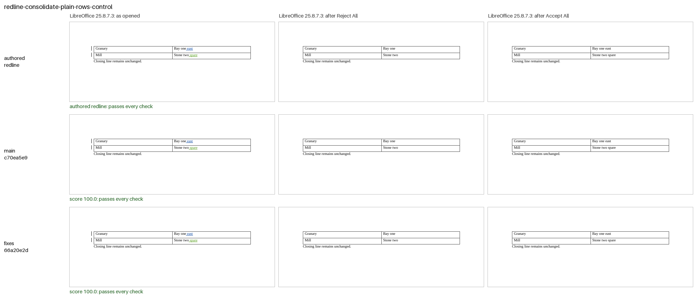

The same edits in a plain table: every version tracks both words.

### `redline-consolidate-plain-row-bookmark-control`

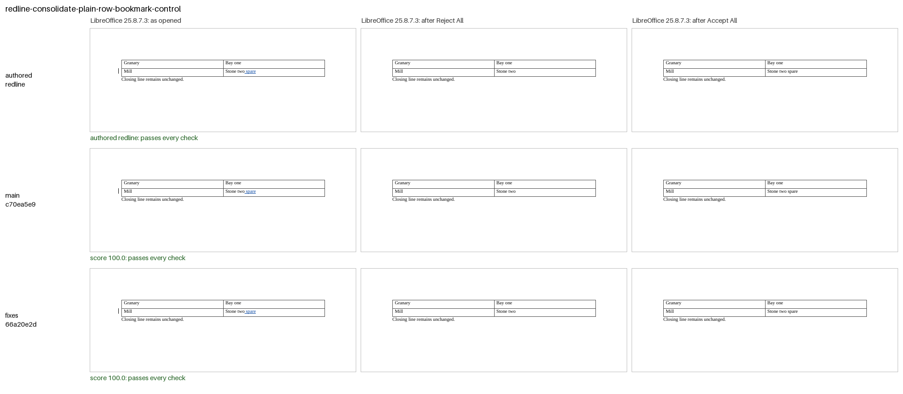

The same reviewers in a plain table: every version keeps the bookmark.

### `redline-consolidate-comment-beside-edit`

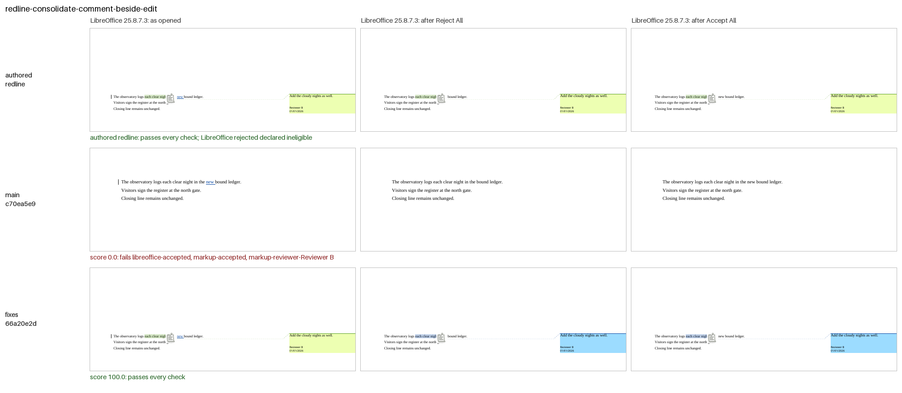

Comments are drawn in the margin. Main keeps reviewer A's `new` and drops reviewer B's comment (`markup-accepted`, the B projection, `libreoffice-accepted`); with the fixes the comment is on `each clear night`, beside A's word. LibreOffice keeps a comment whose markers are in rejected insertions, the authored redline's included, so its rejected comparison is declared ineligible.

### `redline-consolidate-comment-other-paragraph-control`

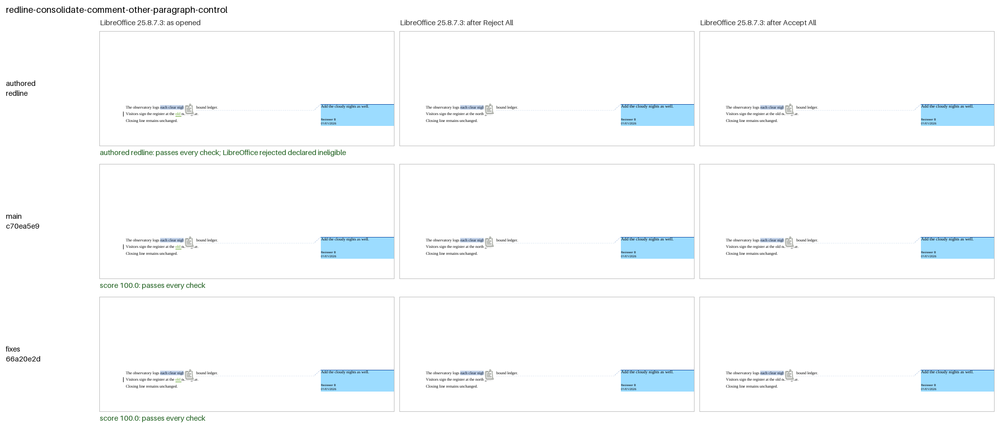

Reviewer A edits the next paragraph: every version keeps the comment.

### `redline-consolidate-comment-in-table`

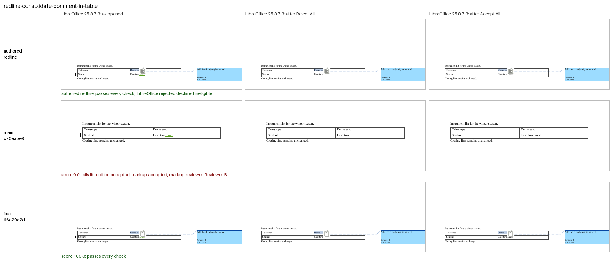

Main keeps reviewer A's `, brass` and drops reviewer B's comment on `Dome east`; with the fixes it is kept.

### `redline-consolidate-comment-in-table-control`

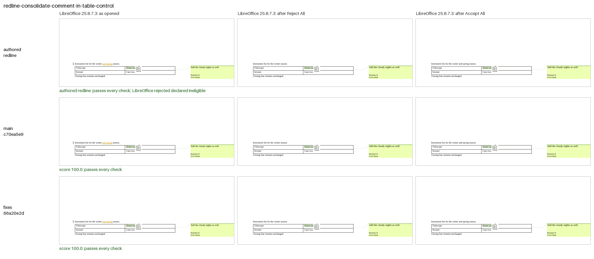

Reviewer A edits the paragraph before the table: every version keeps the comment.

### `redline-consolidate-table-format-bookmark`

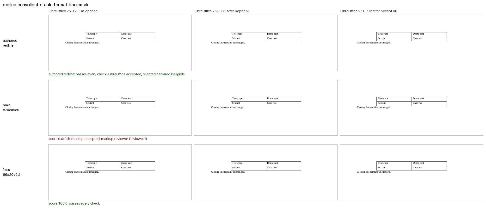

LibreOffice shows no revision for a table-property change or a bookmark insertion, so its Reject All keeps the centring in every row and both its comparisons are declared ineligible. Main keeps reviewer S's tracked centring and drops reviewer B's bookmark around `Dome east` (`markup-accepted`, the B projection); with the fixes both are there. No assertion reads the centring.

### `redline-consolidate-bookmark-table-format`

The same reviewers with B first: main drops the bookmark in this order too.

### `redline-consolidate-table-format-outside-bookmark-control`

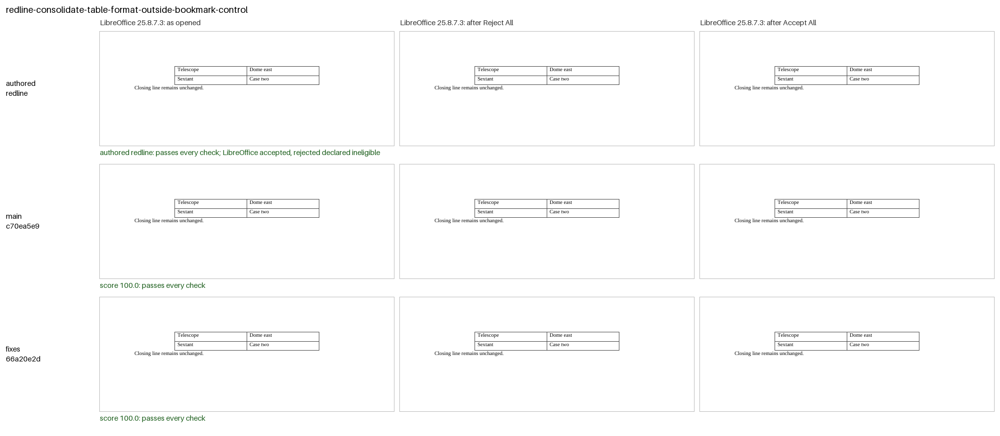

Reviewer B's bookmark is around the paragraph after the table: every version keeps it beside S's centring.

### `redline-consolidate-bookmark-control-between-rows`

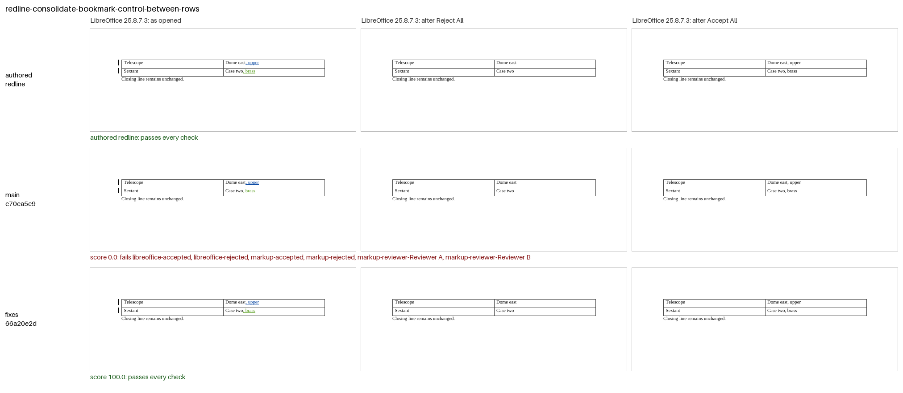

A content control holding only a bookmark sits between the two rows and has no rendering, so the tiles look alike. Main composes both edits but moves the control to the head of the table, ahead of the first row, in every view (`markup-accepted`, `markup-rejected`, both reviewer projections; LibreOffice's text view shows the control's place moving too). With the fixes it stays between the rows, which `content-controls` and the markup view both read.

### `redline-consolidate-bare-bookmark-between-rows-control`

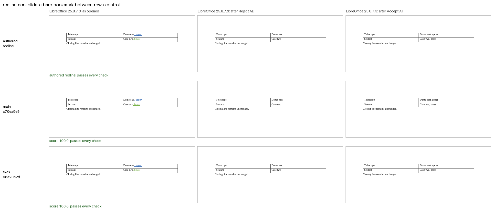

A bare bookmark between the rows: every version keeps it there.
