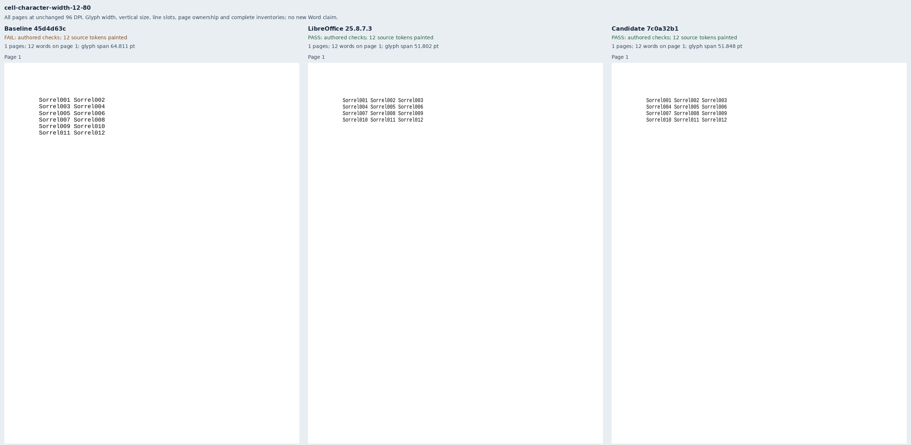
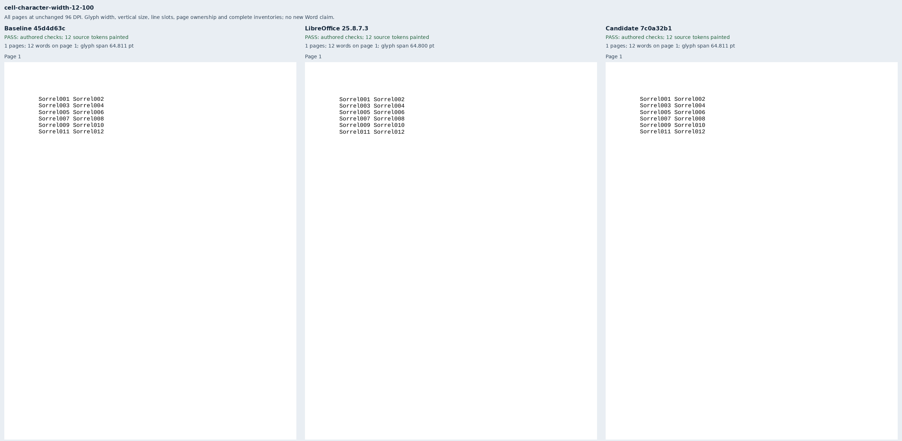
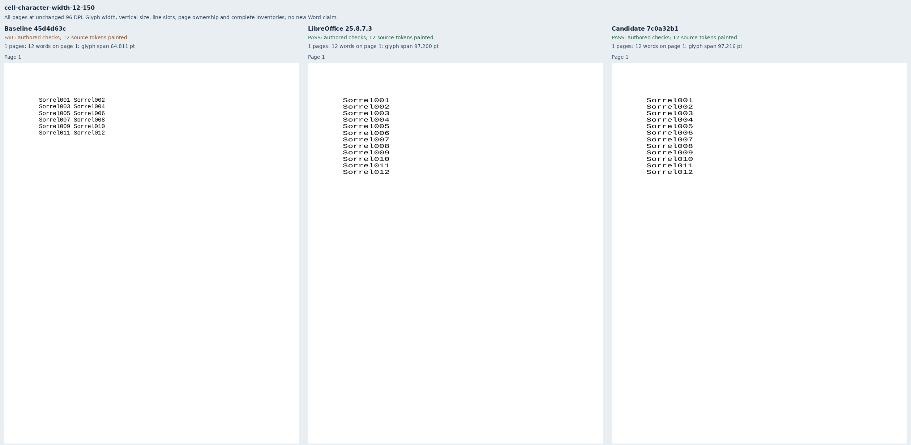
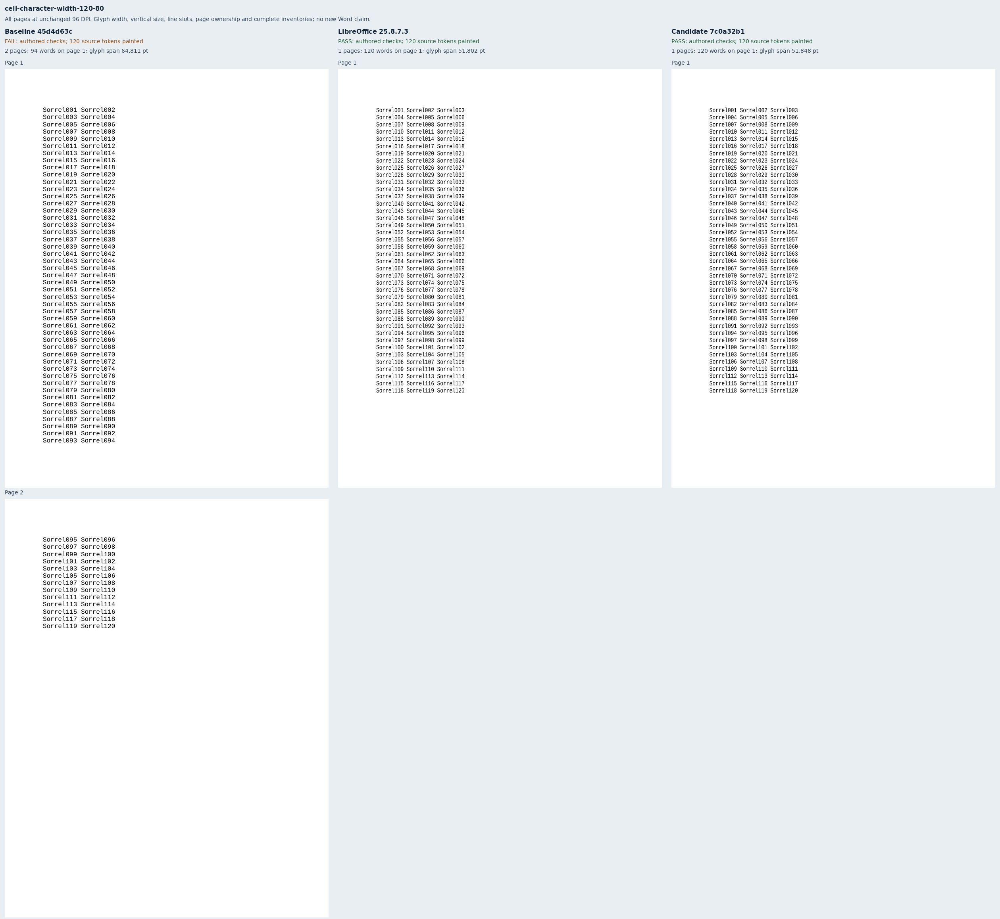
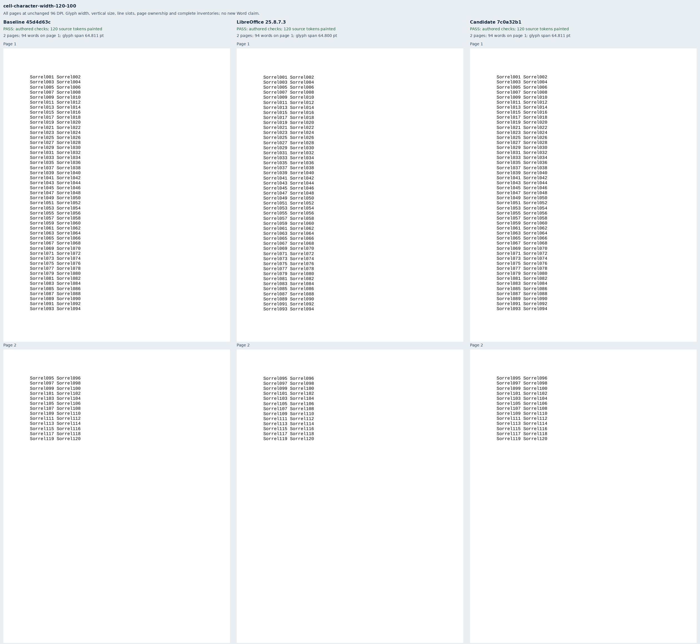
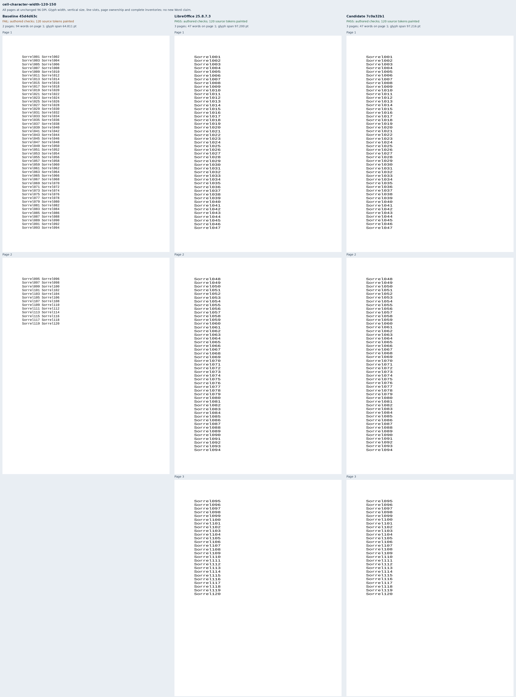

# Character width inside fixed table cells

Six original Sorrel documents wrap the existing character-width paragraphs in a fixed
468pt, single-column table with zero cell margins. Each set contains twelve or 120
unique labels at 80%, 100% or 150% character width. The paragraph and all other package
parts are byte-equivalent to their independently authored body controls; contract tests
verify that only the table wrapper changes. These cases cover the fixed-cell subset of
[Docxodus #1564](https://github.com/JSv4/Docxodus/issues/1564).

Assertions are fixed before candidate capture. Liberation Mono contributes
`1229 / 2048 × 12` points per character and `2320 / 2048 × 12` points per natural
line. The 180pt paragraph fits three, two or one nine-character labels per line at
80%, 100% and 150%; the 648pt body fits 47 lines. Every source label has a declared
page and rectangle with a 0.5pt placement tolerance. Independent checks require glyph
width and unchanged height within 0.1pt, complete ordered text, visible ink and exact
page count. All six native references satisfy these contracts without calibration.

The unchanged renderer at `45d4d63c0fd5c930096d3cdd75888b6346391ee6` passes both
100% controls and fails all four scaled cells. The final candidate at `7c0a32b12e0ec60cda8bb58141f505cbfcd2d19f` passes all six.
[Retained evidence](evidence.json) binds 18 PDFs, all 27 pages and 1,188 painted words,
12 strict-font reports, six labeled sheets, 19 build files and 45 runtime assets per
renderer. All [72 corrupted observations](mutations.json) are rejected. The full Python
suite passes 504 tests and all four Node adapter tests pass. Adversarial review verified
the source contracts, complete PDF inventories, every page raster and screenshot crop. All six authored packages have
zero Open XML SDK findings. The previous 972 cases retain their inputs and contracts;
only their generator provenance changes in `core-v132`.

System Chromium 157.0.8103.38 runs sandboxed with strict font verification; native
references use LibreOffice 25.8.7.3. This is diagnostic evidence, without a pinned
runtime score or new Word capture. Other cell structures are covered by renderer
regressions, not these six benchmark inputs. AutoFit, percentage owners, mixed runs,
`fitText` and the unresolved Word exact-fit boundary remain outside this change.

## Reproduction

Generate `core-v132`, select `cell-character-width-*`, validate packages and retain
`input-freeze.json` and the verifier freeze before public renderer capture.

```sh
node docs/results/export-reliability/Capture.mjs SOURCE RUN/manifest.json RUN/candidate RUN/environment.json --html
python3 docs/results/cell-character-width/Compose.py RUN BASELINE_SOURCE CANDIDATE_SOURCE
python3 docs/results/cell-character-width/Mutations.py
python3 -m unittest discover -s tests -v
node --test tests/test-adapter.mjs
python3 -m bench.audit
```







