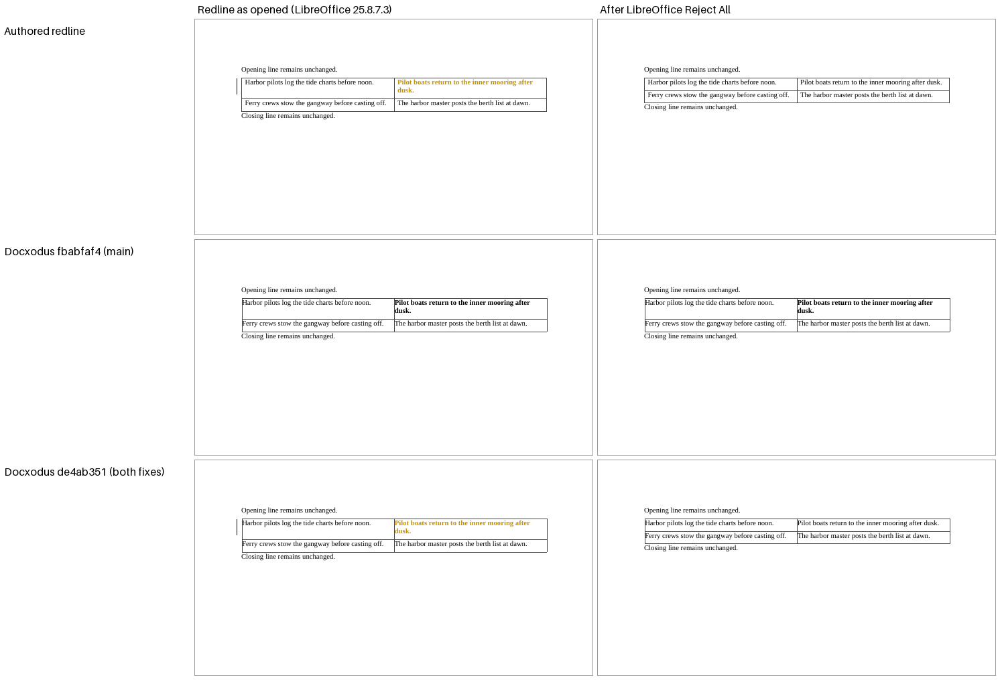
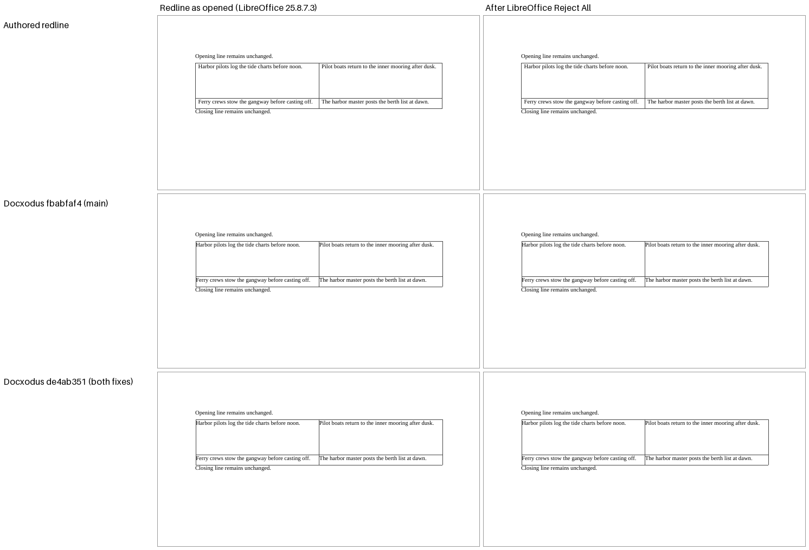
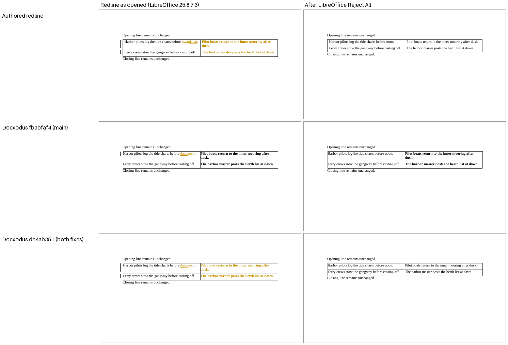
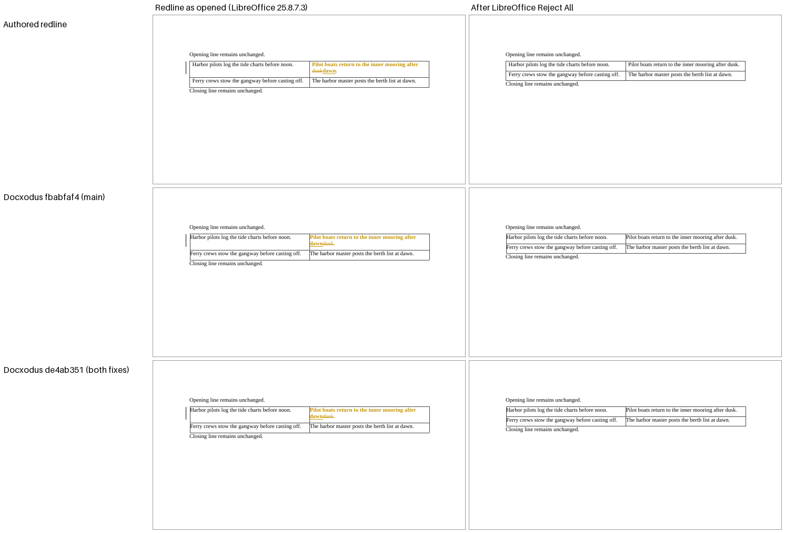
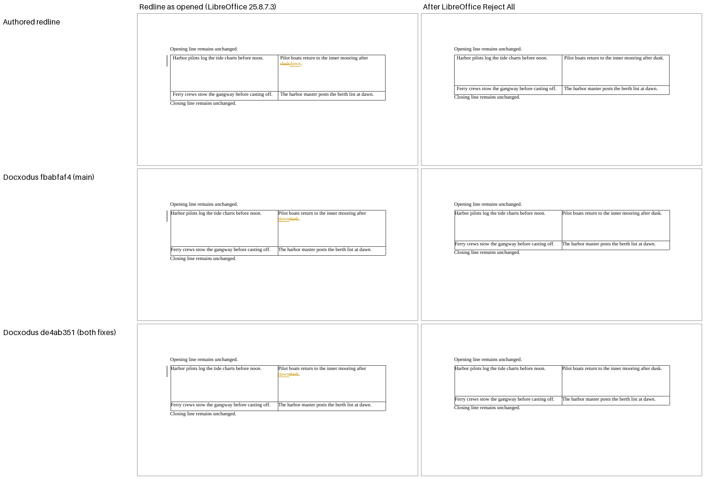
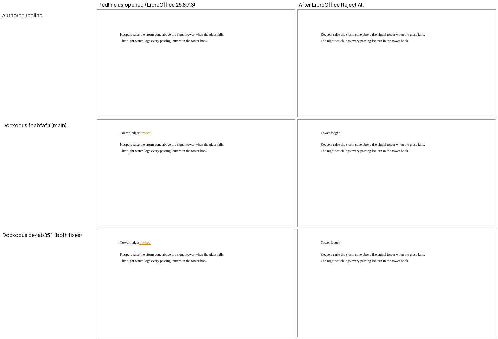
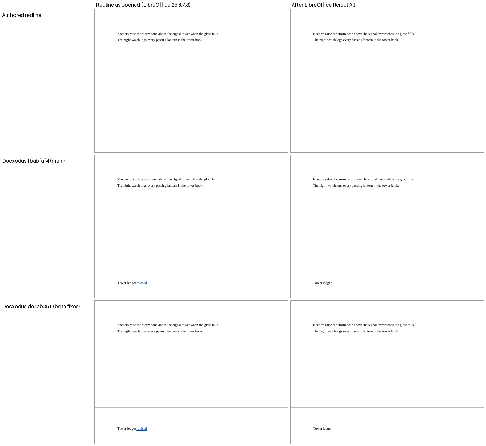
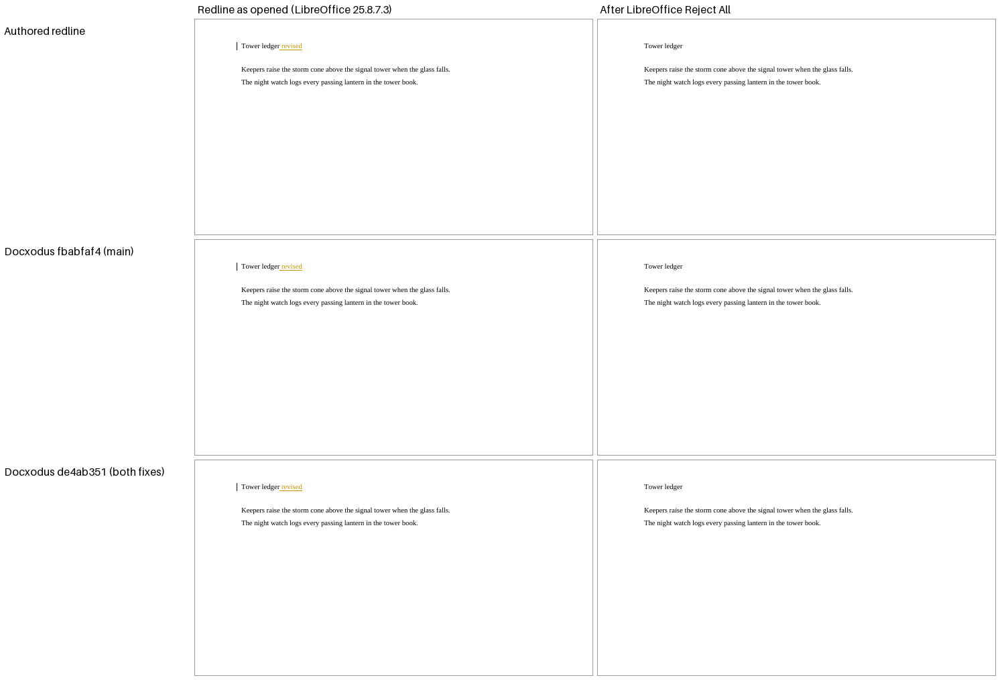
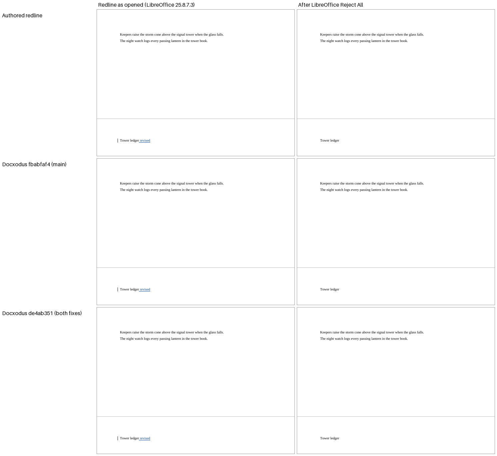

# Formatting inside table cells and untyped story references (Docxodus #1797, #1803)

Docxodus #1797 found a comparison whose table, row and cell checks compared only the cells' text, so a cell
changed only in formatting was copied from the revision untracked and reject kept the new formatting.
Docxodus #1803 found a redline that kept a header or footer reference written without `w:type` and added a
typed default one beside it, so the section had two default references. Neither round trip reads character
formatting, paragraph marks or section references, so the cases declare `run-formatting`, `mark-formatting`
and `section-stories`; every case bounds `revision-count` to its own records.

| Case | Kind | Baseline `fbabfaf4` | #1797 fix `00614c79` | #1803 fix `701bbec8` | Both fixes `de4ab351` |
| --- | --- | --- | --- | --- | --- |
| `redline-cell-bold` | reproducer | `assertion-run-formatting` | none | `assertion-run-formatting` | none |
| `redline-cell-mark-size` | reproducer | `assertion-mark-formatting` | none | `assertion-mark-formatting` | none |
| `redline-cell-bold-beside-edit` | reproducer | `assertion-run-formatting` | none | `assertion-run-formatting` | none |
| `redline-cell-bold-edit-control` | control | none | none | none | none |
| `redline-cell-mark-size-edit-control` | control | none | none | none | none |
| `redline-untyped-header-changed` | reproducer | `assertion-section-stories` | `assertion-section-stories` | none | none |
| `redline-untyped-footer-changed` | reproducer | `assertion-section-stories` | `assertion-section-stories` | none | none |
| `redline-typed-header-changed-control` | control | none | none | none | none |
| `redline-typed-footer-changed-control` | control | none | none | none | none |

Each cell lists the failed checks. The fix commits are the heads of [JSv4/Docxodus#1807](https://github.com/JSv4/Docxodus/pull/1807) (#1797) and
[JSv4/Docxodus#1806](https://github.com/JSv4/Docxodus/pull/1806) (#1803).
`de4ab351` is a merge of the two, made only for scoring (its tree, `949d24fb`, is what `git merge-tree` gives for
the two heads); each fix passes its own reproducers and all four controls, and the merge passes all nine. The authored
redlines pass every check. Checks are the bench's markup comparisons, SDK validation, assertions and the LibreOffice
text round trips, run on Linux with LibreOffice 25.8.7.3. No reference application capture was made for these
cases. `evidence.json` holds each run's failed checks, revision counts, rejected spans or marks, and section stories.

## Screenshots

Each sheet shows the top of the first page as LibreOffice 25.8.7.3 exports it to PDF: the redline as opened, and after
LibreOffice's own Reject All (`bench/lo_revisions.py`). Rows are the authored redline, the baseline `fbabfaf4` and both fixes
`de4ab351`. In the cell sheets Docxodus's cell text sits closer to the cell border than the authored redline's: its
comparison writes a hairline `w:tblInd` and `w:tblCellMar` on a fixed-width table without cell margins, as Word's
compare output does, in every version shown. That is untracked table geometry, not a cell change.

### `redline-cell-bold`

Main leaves the bold untracked, and Reject All keeps it; with the fixes it is a tracked attribute change, and Reject All restores plain text.

### `redline-cell-mark-size`

LibreOffice shows no revision for this mark-only change in a table cell, so its Reject All leaves the 36pt mark in every row, the authored one included; this case's LibreOffice comparisons are declared ineligible, and `mark-formatting` reads the marks.

### `redline-cell-bold-beside-edit`

Main tracks the word change but not the two bold cells; with the fixes all three are tracked, and Reject All restores the word and the plain text.

### `redline-cell-bold-edit-control`

The cell's text changes too, so main already tracks the bold and the word.

### `redline-cell-mark-size-edit-control`

The cell's text changes too, so main already tracks the word and the mark (`mark-formatting` reads the restored mark). LibreOffice shows no revision for the cell's mark, so its Reject All keeps the 36pt mark in every row; the case keeps its LibreOffice comparisons because the text view sees only the word.

### `redline-untyped-header-changed`

LibreOffice does not show a header through a reference without `w:type`, so the authored redline shows none. Both Docxodus rows show it through a typed reference: on main a second one beside the untyped reference, with the fixes the bound reference itself. `section-stories` reads the references.

### `redline-untyped-footer-changed`

As the header case, for a footer; each panel adds the bottom of the page below the gap line.

### `redline-typed-header-changed-control`

A typed reference: every row shows the header, with " revised" tracked and then rejected.

### `redline-typed-footer-changed-control`

As the header control, for a footer; each panel adds the bottom of the page below the gap line.
