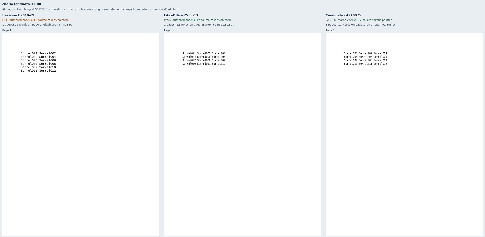
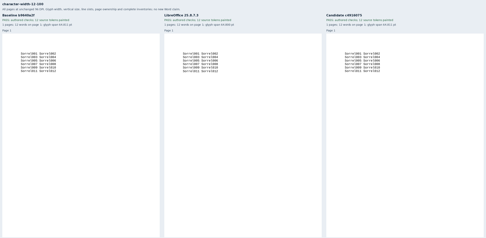
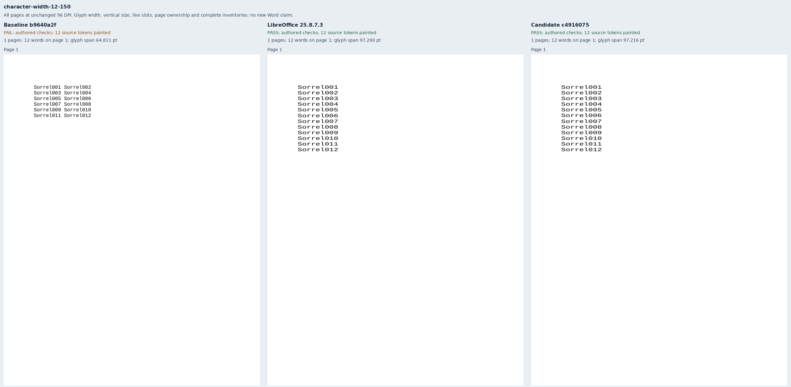
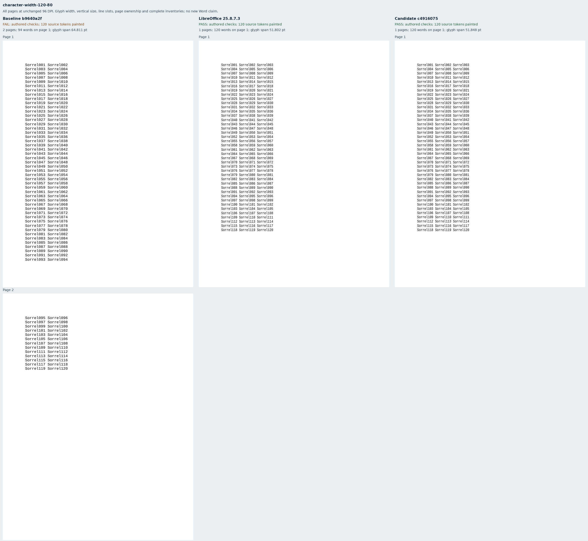
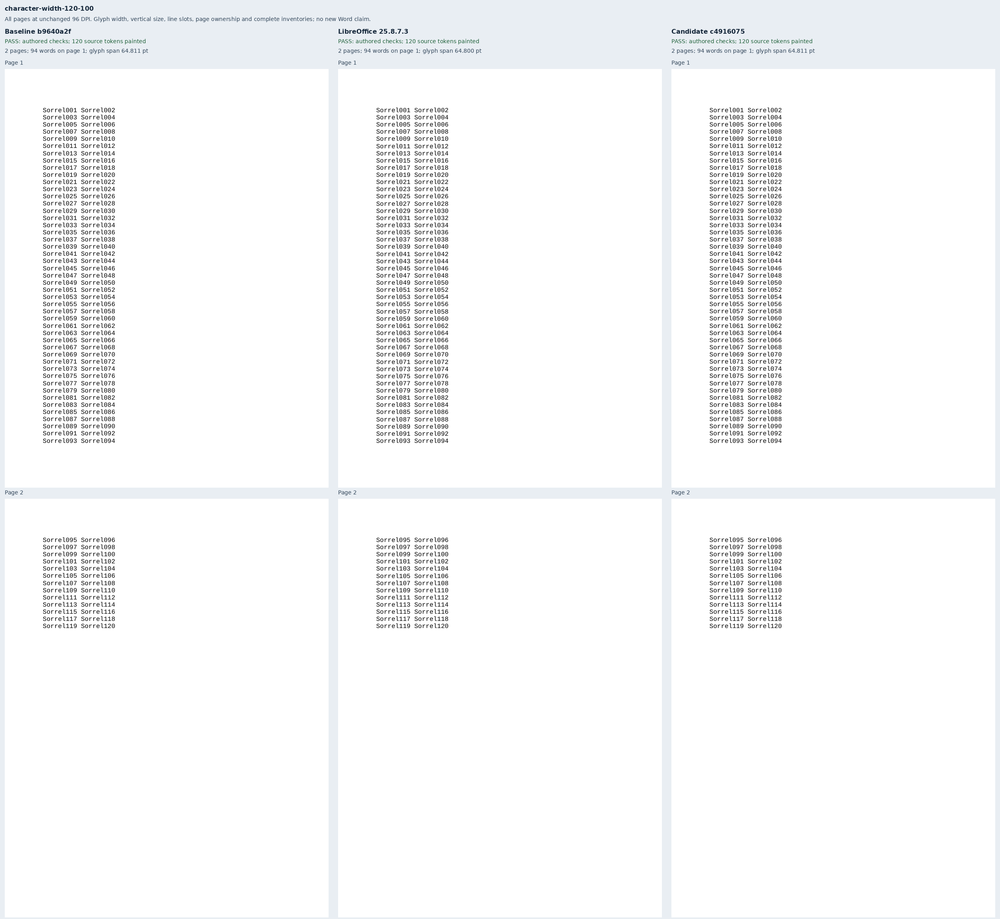
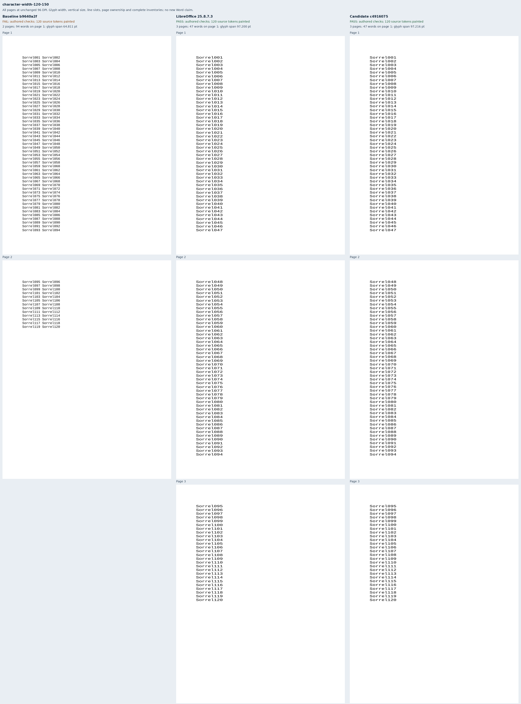

# Character width in line layout and paint

Six original Sorrel documents isolate 80%, 100% and 150% character widths in uniform
12pt Liberation Mono body text. Each set contains twelve or 120 unique labels; only
the `w:w` value changes within a set. The 180pt text column fits three, two or one
nine-character labels per line respectively. These cases cover the plain automatic-spacing
subset of [Docxodus #1564](https://github.com/JSv4/Docxodus/issues/1564).

The assertions come from font units: `1229 / 2048 × 12` points per character and
`2320 / 2048 × 12` points per natural line. The 648pt body accommodates 47 lines.
Every label has a declared page and rectangle, with a shared 0.5pt placement tolerance
for raster-origin rounding. Additional checks require the expected glyph width and
unchanged height within 0.1pt, complete ordered source text, visible ink and the exact
page count. Native nine-character widths differ from font units by at most 0.05pt.
All six LibreOffice references satisfy these contracts without changing the assertions.

Exact baseline build `b9640a2f22cbf164bc06c74da7de92e00576274c`, whose source tree is
identical to merged main `2d96467e5be8dda82c0096eb5d3dce07eed2f826`, passes the two
100% controls and fails all four scaled cases. Exact candidate build
`c49160756b4cc607101d796751d3f0eac5c750e9` passes all six. The
[retained evidence](evidence.json) binds eighteen PDFs, 1,188 painted words, all 27 pages,
twelve strict-font production reports, both inventories of nineteen build files and
forty-five runtime assets, and six labeled comparison sheets.

The [72 rejected mutations](mutations.json) cover glyph width, vertical size, line
placement, missing/duplicate/extra/unpainted text, reading order and page ownership.
The ±0.3pt glyph-width mutations still satisfy the original placement rectangles and
companion inventory checks, but fail the independent width bound. Extra blank pages
are rejected in all six cases. The generator-pair and mutation checks run in the Python suite.

The renderer uses sandboxed system Chromium 157.0.8103.38 with strict font verification;
the native reference is LibreOffice 25.8.7.3. This is diagnostic evidence, without a
pinned-runtime score, full-suite parity claim or new Word capture. Mixed runs, other
paragraph owners, the unresolved exact-fit Word boundary and `fitText` remain outside
this change. In the renderer, geometric-precision SVG text preserves the authored width
without transform-induced changes to font height or baseline.

## Reproduction

Generate `core-v128`, select `character-width-*`, validate all six packages and freeze
the manifest before capturing either renderer. Capture native references and build both
exact renderer commits. The retained records identify the original source trees and assets.

```sh
node docs/results/export-reliability/Capture.mjs SOURCE RUN/manifest.json RUN/candidate RUN/environment.json --html
python3 docs/results/character-width/Compose.py RUN BASELINE_SOURCE CANDIDATE_SOURCE
python3 docs/results/character-width/Mutations.py
python3 -m unittest discover -s tests -v
node --test tests/test-adapter.mjs
python3 -m bench.audit
```







