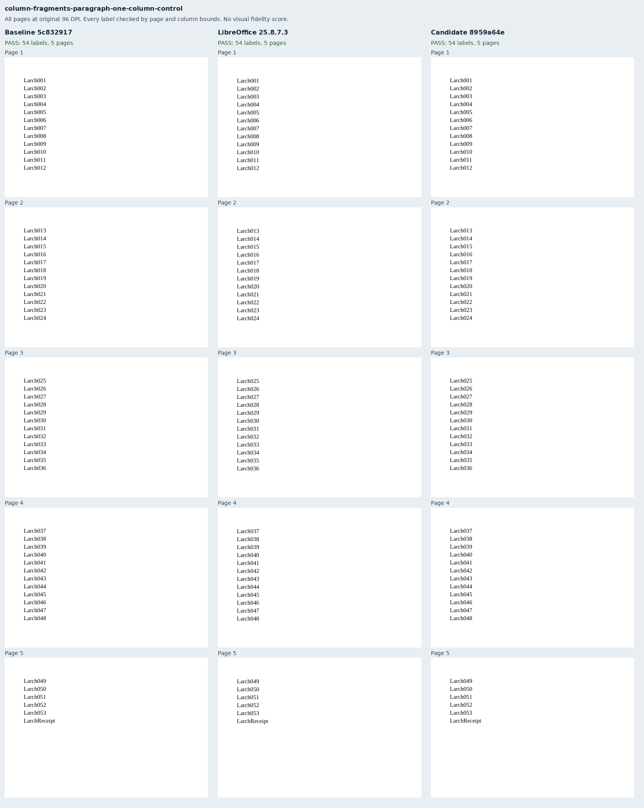
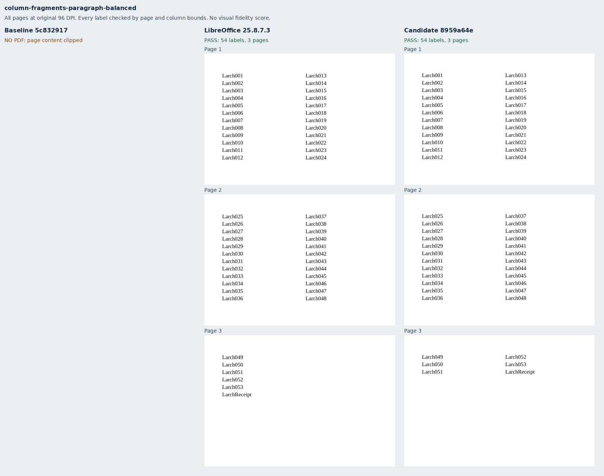
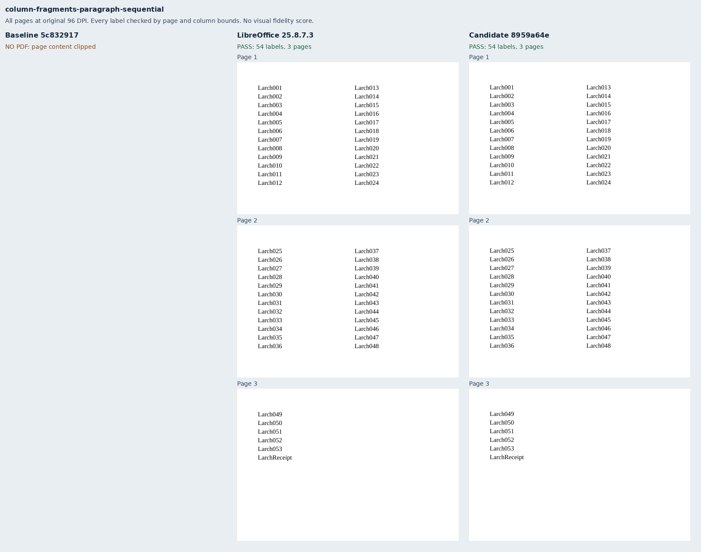
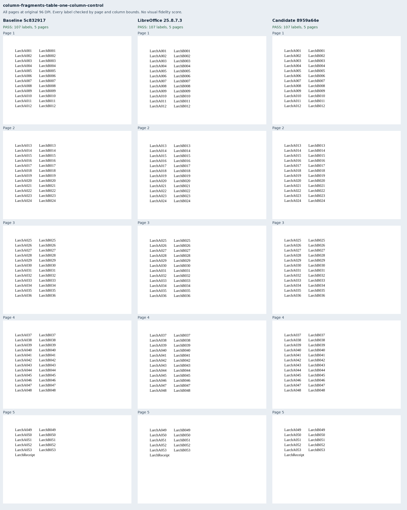
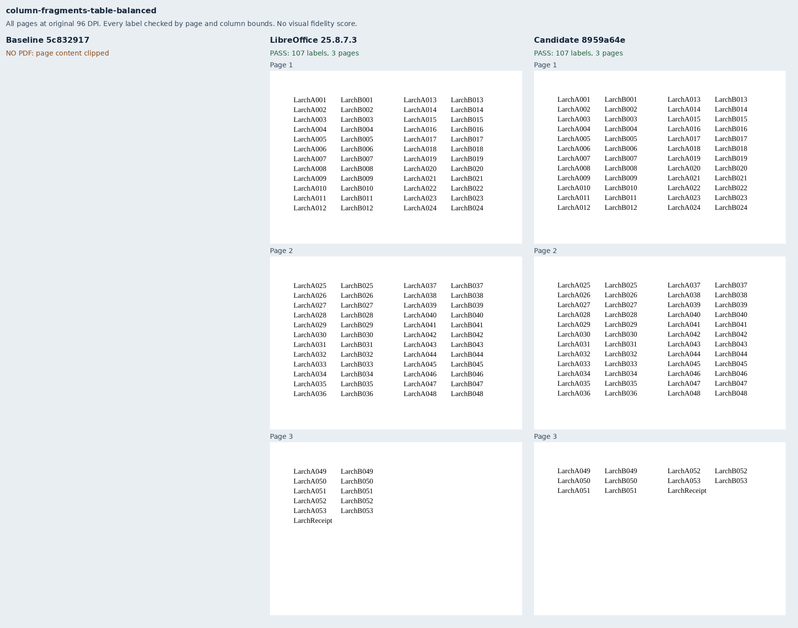
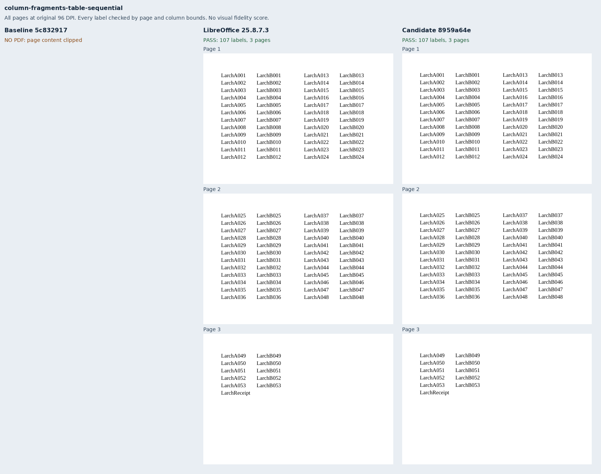

# Tall children in columns

Six original Larch registers exercise one paragraph or a two-cell table extending across pages,
with a receipt immediately after it. Each shape has a one-column control, a balanced two-column
case and a sequential two-column case. The source contains 53 lines or rows, a 15pt pitch, and a
192pt body band; the 12pt spare height excludes an unrelated exact-fit rounding discrepancy.
No renderer fixture or helper was imported.

The production baseline `5c8329174f91692519e24217b2feacde2134e8b3` delivers both controls and
rejects all four column reproducers for clipped body content. Candidate
`8959a64eab3ac15f69eef806fd394b8fbf06ca43` delivers all six with strict fonts and no warnings.
LibreOffice 25.8.7.3 supplies six eligible native references. Every delivered label occurs once,
on its independently expected page, within the body and column bounds. Both controls use five
pages; all two-column cases use three. The receipt shares the final source line or row's page.

These diagnostics check text retention, page membership, column bounds and following-content
placement. They retain the renderer's existing balancing policy; the full-page sheets expose
any different distribution within the final page. They make no Word, pinned-browser or full-suite
fidelity claim. The source-bound public captures use separately provisioned Chromium with its
sandbox enabled. Complete render reports, PDF inspections and the native reference bundle are
retained as deterministic gzip files, bound to their compressed and uncompressed hashes in
`evidence.json`. That file also binds input packages, both exact build identities, runtime asset
manifests, PDF hashes and every page raster.

All six DOCX inputs validate with Open XML SDK 3.5.1 against Microsoft 365. The suite advances to
`core-v109` (776 inputs); the preceding 770 declarations and packages retain their bytes apart
from the generator provenance hash. No metric or tolerance changes.

Reproduce with exact renderer builds, a focused manifest and a font environment:

```sh
python3 -m bench reference libreoffice --manifest MANIFEST --out REFERENCE
node docs/results/export-reliability/Capture.mjs SOURCE MANIFEST OUTPUT ENVIRONMENT
python3 docs/results/column-fragmentation/Compose.py runs/columns
```

The composer verifies all source/build bindings and every label before writing evidence. Pillow
is needed only to arrange unchanged 96-DPI page rasters with labels.












