# Complete margin-comment PDFs

Seven original Maple inventory cases cover one overflowing paragraph, a much longer
paragraph, multiple paragraphs, many independent comments, nested replies, a fitting note
and a hidden-comment control (Docxodus #1490).

The primary PDF profile hides comments and retains the normal LibreOffice layout comparison.
A separately exported companion prints margin comments and checks exact authored source-word
counts, physical paper dimensions, word bounds and dark paint in each source-word region.
The hidden companion requires an exact full inventory, so printing any extra comment fails.
Paint presence is a bounded check, not OCR or glyph-shape matching. No native margin-comment
layout parity score is claimed. Mandatory companion failures make the case score zero even
when its primary layout metrics are unchanged.

Local strict-font captures use Chromium 143.0.7499.4 with explicit Liberation Serif files and
a caller-owned sandboxed browser. Their reports say `browserObserved`; the production runs below
separately verify the owned-process runtime. Main is `784c03358775efcb8b53f9ec813bc93de30acc8d`,
using the byte-identical reviewed tree/runtime from `5aaab5820523f689147f86da75a916bcfb26dfaf`.
The fix is `cd446c19bf6b13aab0726451f50412c4c84d55c4`.

The five overflow cases fail on main (two clipped PDFs and three refusals) and pass with the
fix. Both controls pass on both versions. All seven primary hidden-comment page PNGs are
byte-identical before and after. PDF bytes contain volatile metadata and are not asserted equal.
LibreOffice 25.8.7.3 margin captures clip source words in these diagnostics; they are shown for
comparison and are not used as a completeness oracle. The hidden control uses native hidden
comments in every renderer.

| Case | Main companion | Fixed companion |
| --- | --- | --- |
| Single paragraph, 30 sentences | One page, missing tail | Two complete pages |
| Single paragraph, 900 sentences | One page, missing tail | Eleven complete pages |
| 30 comment paragraphs | Refused | Two complete pages |
| 40 independent comments | Refused | Four complete pages |
| Root, reply and nested reply | Refused | Five complete pages |
| Three-sentence fitting control | Complete, one page | Complete, one page |
| Hidden-comment control | Complete, one page | Complete, one page |

All seven packages validate with Open XML SDK 3.5.1. The earlier 613 input bytes and contracts
remain unchanged except the shared generator hash. `core-v90` contains 620 cases.

[Local PDF checks and bindings](local-evidence.json), [all-page screenshot bindings](local-screenshots.json),
[unchanged primary controls](primary-control-comparison.json), and [SDK validation](source-sdk-validation.json)
record the inputs and artifacts. Screenshots show every produced page at 96 DPI and 100%,
without cropping or resampling; missing pages and refusals have labeled panels.

Production runs [candidate](https://github.com/JSv4/docx-fidelity-bench/actions/runs/41217522515)
and [main](https://github.com/JSv4/docx-fidelity-bench/actions/runs/41217524429), both on benchmark
`9839ac1c948779cc17a126cf3e344dff18b000a0`, reproduce the same result: seven of seven mandatory
cases pass with the fix, versus two on main. Both provider calibrations score 100. All seven
primary page rasters and both companion control rasters are byte-identical across versions.
The aggregate score rises from 28.5698 to 99.9944 because companion completeness is mandatory;
the primary hidden-comment layout comparison is unchanged.
[Production artifact bindings and all-page screenshot inventory](production-evidence.json)
record exact source commits, input/report/PDF hashes, verified runtimes and every check.
The production sheets below use actual companion PDF pages at 96 DPI and 100%, with no
cropping or resampling. Local native LibreOffice diagnostics follow separately.

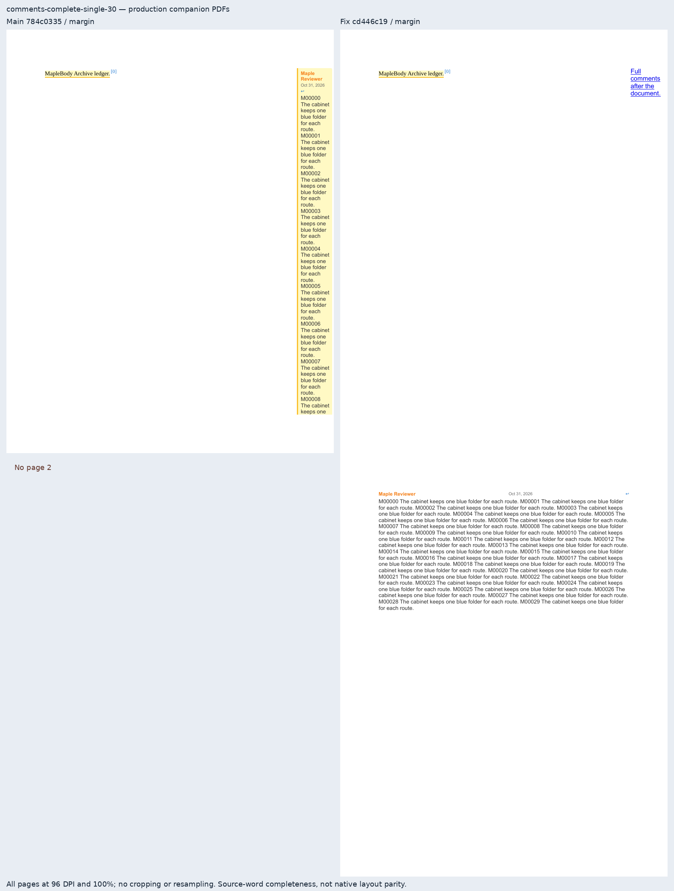

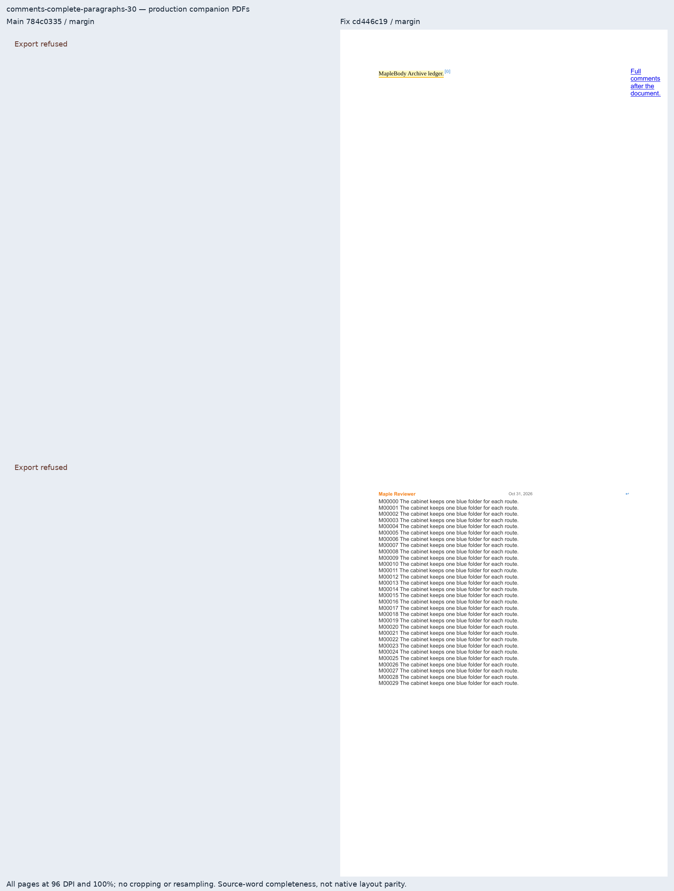

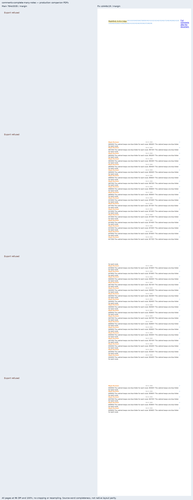

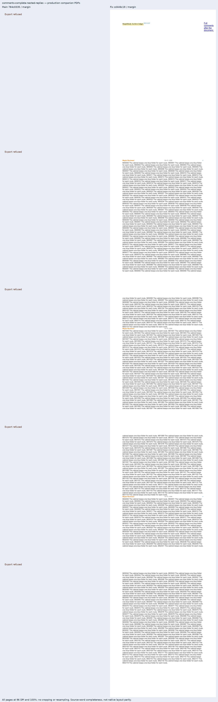

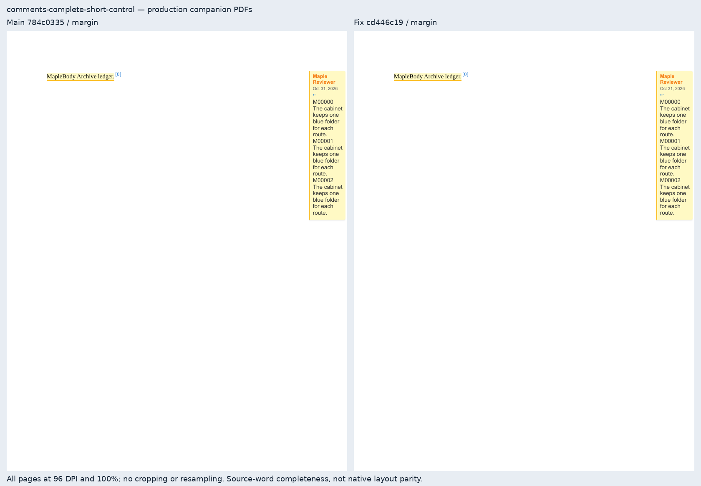

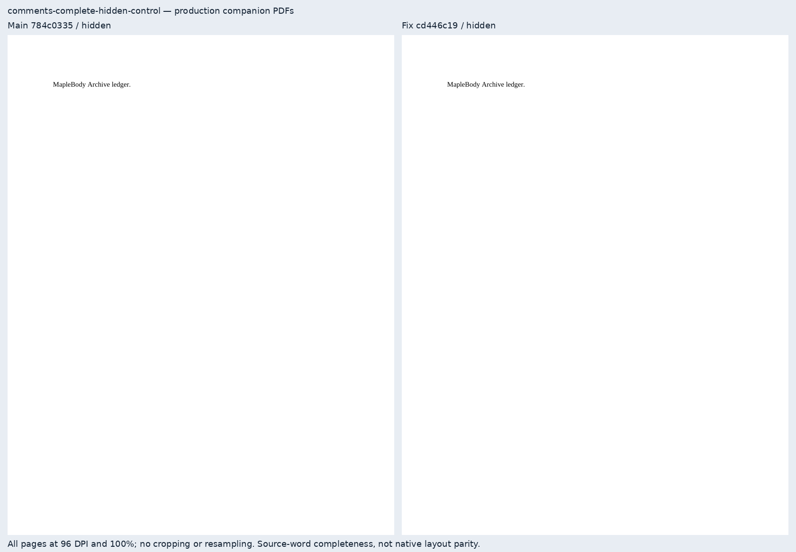

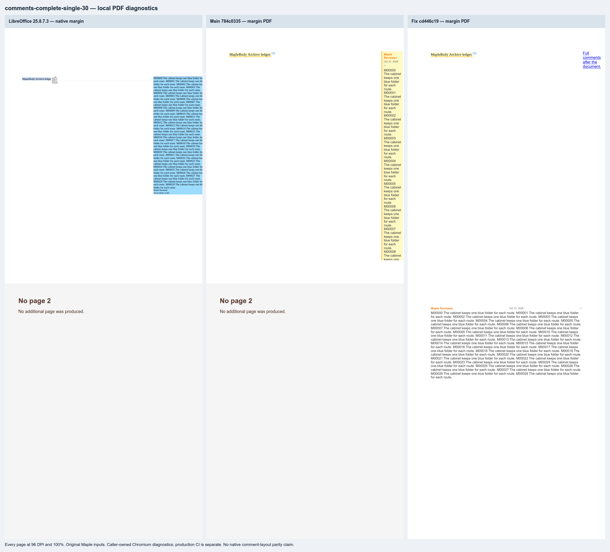

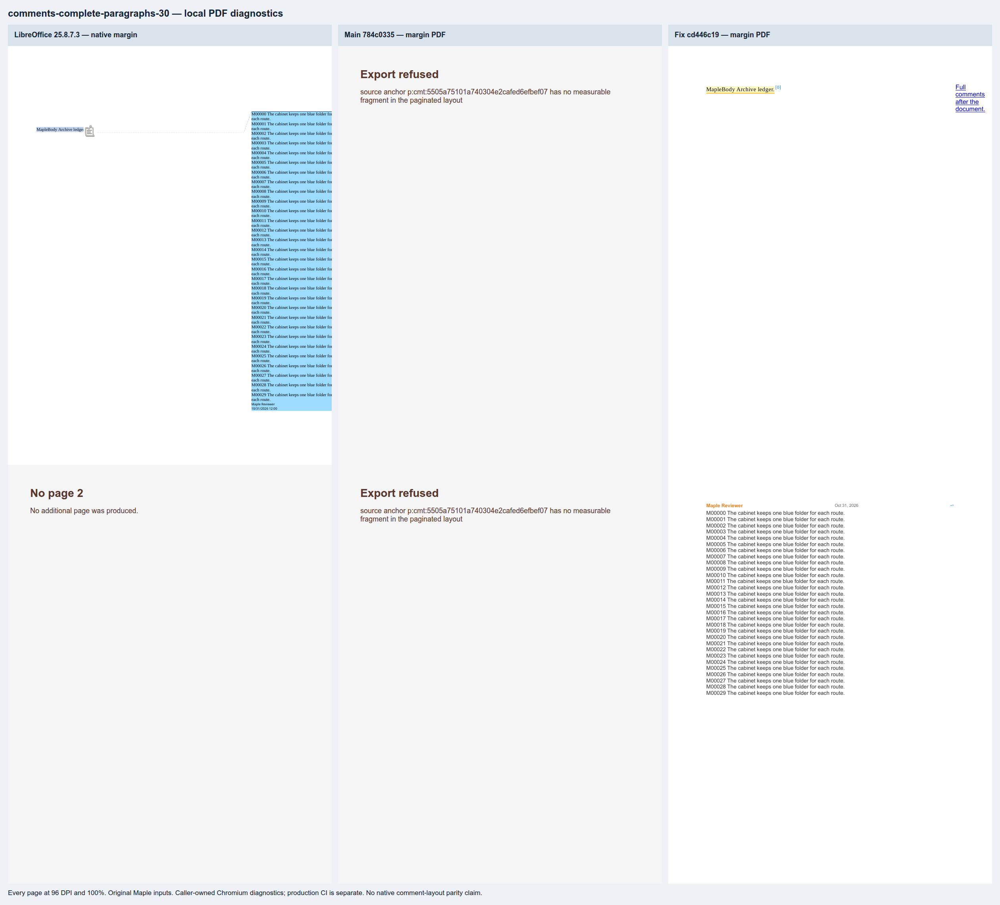

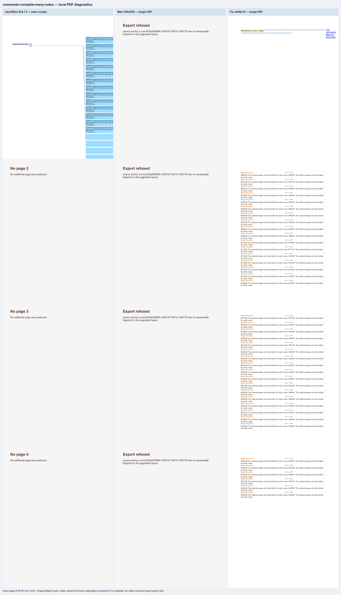

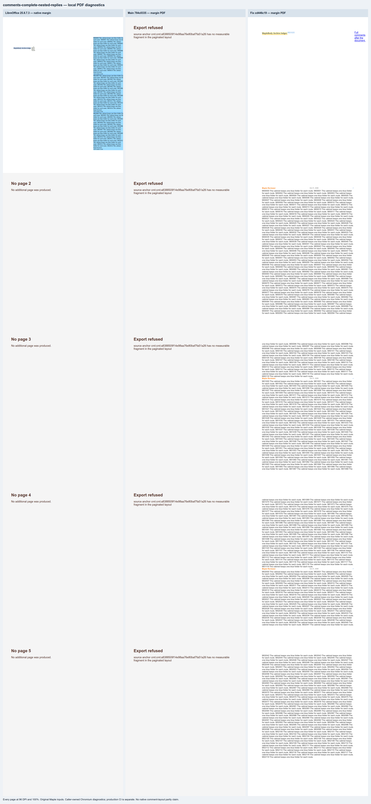

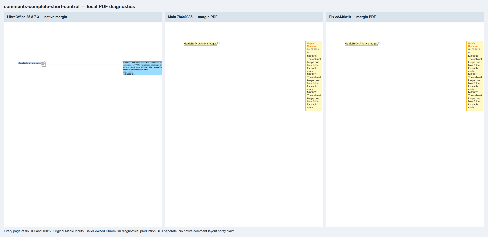

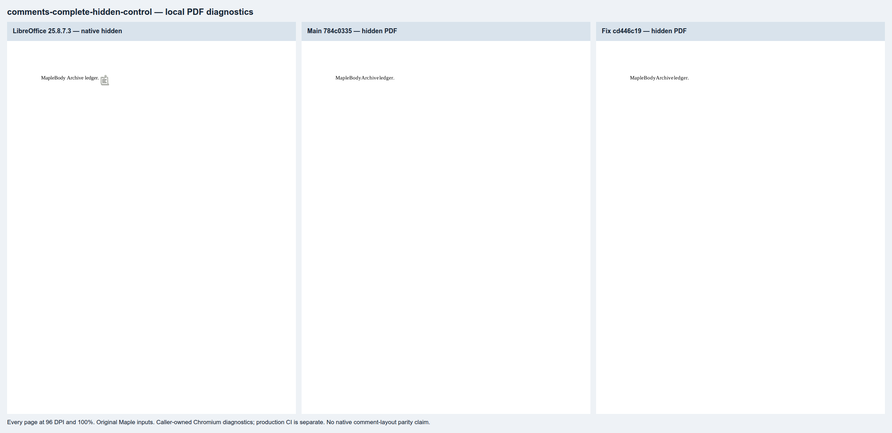
