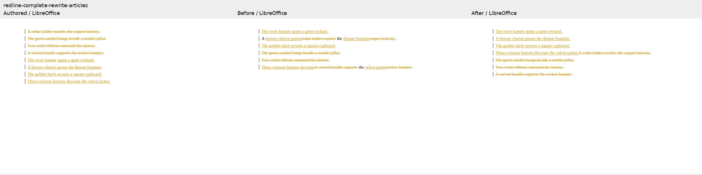
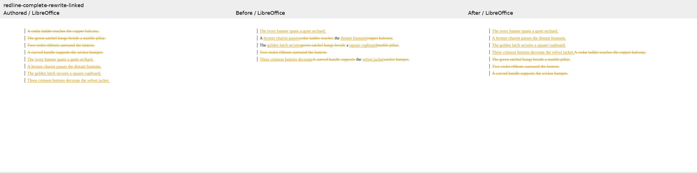
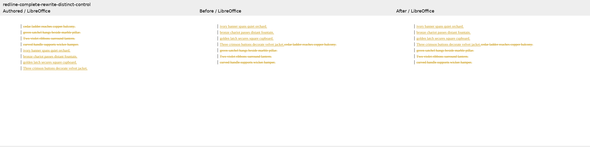

# Complete paragraph rewrites

Four original Cedar-prose cases exercise articles, literal list numbers, linked articles,
and a distinct-word control. Baseline `5bae7386` scores 0 on the three reproductions and
100 on the control; candidate `45fde3aa` scores 100 on all four. Authored calibration also
scores 100 throughout. All eight LibreOffice endpoint comparisons apply, and the SDK
checks pass. These are focused diagnostics, not a complete 233-case suite score.

The mandatory arrangement assertion checks text order, including a shared paragraph at
the boundary of the removed and added blocks. Mutation tests preserve exact endpoints
while interleaving paragraphs or individual linked words, and must fail that assertion.
The 229 previous fixture sets remain byte-identical.

Review sheets show authored, baseline and candidate markup rendered by LibreOffice.
They contain all document text. This evidence establishes arrangement and reversibility;
it is not a new native Word Compare result. Source commits, checks and rendered input/PDF
hashes are recorded in `evidence.json`.

### articles

### numbered

### linked

### distinct-control

