# Content-control rows and a removed section break (Docxodus #1804, #1805)

Docxodus #1804 found a comparison that wrote a table row held by a content control twice (once inside a copy of the
revision's control, once bare), dropped a removed control on reject, redlined a whole table when a row held a cell in
a control, and left a formatting change in such a table untracked. Docxodus #1805 found a redline that kept the
original's last section break, which names no header or footer, when the revision removed the break the last section
inherited its story from, so accepting left the document without one. The markup view looks through a table's
content controls, so the #1804 cases declare `table-state` v3, which names each row's and cell's control; the bold
cases declare `run-formatting`; every case bounds `revision-count`.

| Case | Kind | Baseline `f5cefdd1` | #1805 fix `1b7689b0` | #1804 fix `29bbb623` | Both fixes `77cfa753` |
| --- | --- | --- | --- | --- | --- |
| `redline-control-row-beside-edit` | reproducer | `assertion-table-state`, `libreoffice-accepted`, `libreoffice-rejected`, `markup-accepted`, `markup-rejected` | `assertion-table-state`, `libreoffice-accepted`, `libreoffice-rejected`, `markup-accepted`, `markup-rejected` | none | none |
| `redline-plain-row-beside-edit-control` | control | none | none | none | none |
| `redline-control-removed` | reproducer | `assertion-table-state`, `libreoffice-rejected` | `assertion-table-state`, `libreoffice-rejected` | none | none |
| `redline-plain-rows-removed-control` | control | none | none | none | none |
| `redline-control-cell-same-row` | reproducer | `assertion-revision-count`, `assertion-untracked-text` | `assertion-revision-count`, `assertion-untracked-text` | none | none |
| `redline-plain-cell-same-row-control` | control | none | none | none | none |
| `redline-control-row-bold` | reproducer | `assertion-run-formatting` | `assertion-run-formatting` | none | none |
| `redline-control-cell-bold` | reproducer | `assertion-run-formatting` | `assertion-run-formatting` | none | none |
| `redline-plain-row-bold-control` | control | none | none | none | none |
| `redline-removed-break-inherited-header` | reproducer | `libreoffice-rejected`, `markup-accepted`, `markup-rejected` | none | `libreoffice-rejected`, `markup-accepted`, `markup-rejected` | none |
| `redline-removed-break-inherited-footer` | reproducer | `libreoffice-rejected`, `markup-accepted`, `markup-rejected` | none | `libreoffice-rejected`, `markup-accepted`, `markup-rejected` | none |
| `redline-removed-break-named-header-control` | control | none | none | none | none |
| `redline-removed-break-deleted-paragraph-control` | control | none | none | none | none |

Each cell lists the failed checks. The fix commits are the heads of
[JSv4/Docxodus#1808](https://github.com/JSv4/Docxodus/pull/1808) (#1805) and [JSv4/Docxodus#1811](https://github.com/JSv4/Docxodus/pull/1811) (#1804). `77cfa753` is a merge of
the two, made only for scoring (its tree, `58c9a883`, is what `git merge-tree` gives for the two heads):
each fix passes its own reproducers and all six controls, and the merge passes all thirteen cases. The authored redlines pass
every check. Checks are the bench's markup comparisons, SDK validation, assertions and the LibreOffice text round
trips, run on Linux with LibreOffice 25.8.7.3. No reference application capture was made for these cases.
`evidence.json` holds each run's failed checks, revision counts, rejected table states and section stories.

## Screenshots

Each sheet shows the top of the first page (for the section-break cases, of the first two pages) as LibreOffice 25.8.7.3 exports it to PDF: the redline as opened, after
LibreOffice's own Reject All, and after its Accept All (`bench/lo_revisions.py`). Rows are the authored redline, the
baseline `f5cefdd1` and both fixes `77cfa753`. LibreOffice does not draw a content control's
boundary in a table, so the control cases show rows written twice or a table replaced whole, and `table-state`
reads the controls.

### `redline-control-row-beside-edit`

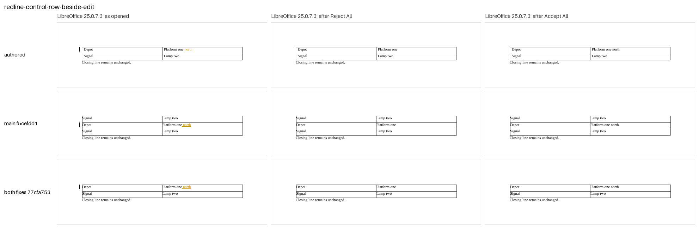

Main copies the second row's control, row and all, ahead of the first row and writes the row again in its place, so every view has three rows; with the fixes the row comes out once, inside its control.

### `redline-plain-row-beside-edit-control`

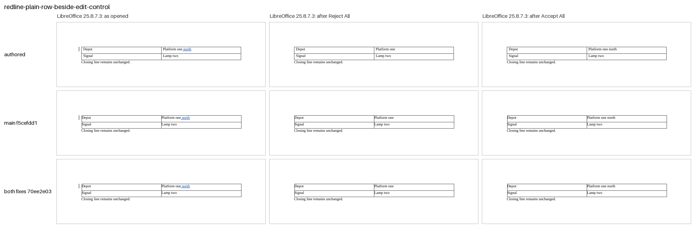

The same edit with no content control: every version tracks the one word.

### `redline-control-removed`

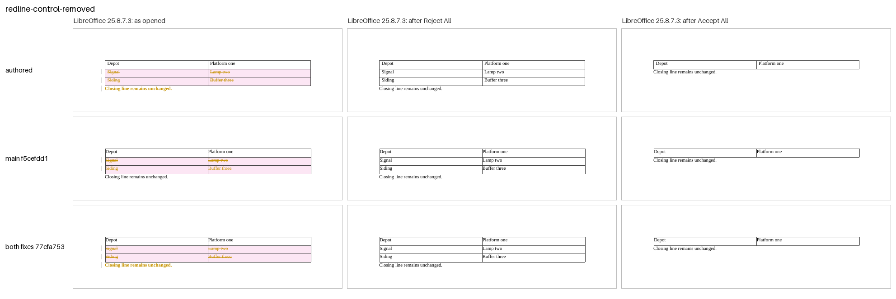

Main writes the two rows deleted but without their control, so Reject All restores them without it; with the fixes the control is marked deleted with custom-XML ranges and comes back around its rows. LibreOffice does not draw a control's boundary, so `table-state` carries the check. LibreOffice also lists a fifth revision for the authored redline and both fixes, a format change on the closing line, and marks that line in the sheet: it reads the custom-XML range after the table that way. The bench's own engine finds the closing line untracked in every row.

### `redline-plain-rows-removed-control`

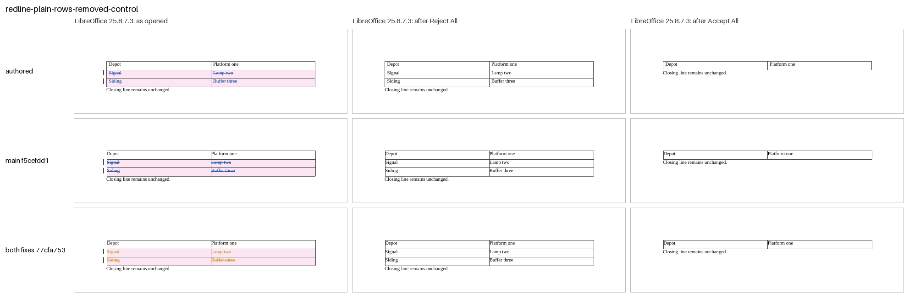

The same rows with no content control: every version deletes them row by row.

### `redline-control-cell-same-row`

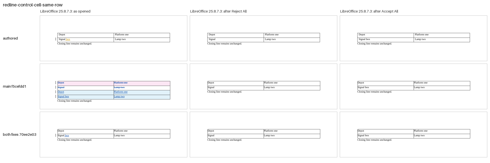

Main redlines the whole table as a deletion and an insertion for one added word; with the fixes the word is tracked in its cell.

### `redline-plain-cell-same-row-control`

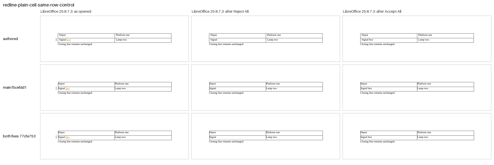

The same edit with no content control: every version tracks the one word.

### `redline-control-row-bold`

Main copies the bold untracked, so Reject All keeps it; with the fixes it is a tracked format change and Reject All restores plain text.

### `redline-control-cell-bold`

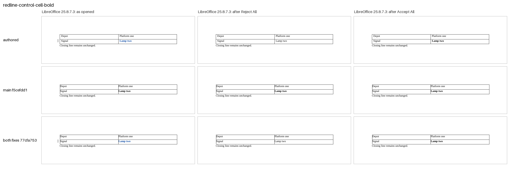

Main copies the bold in the controlled cell untracked, so Reject All keeps it; with the #1804 fix it is a tracked format change. Its control is `redline-plain-row-bold-control`.

### `redline-plain-row-bold-control`

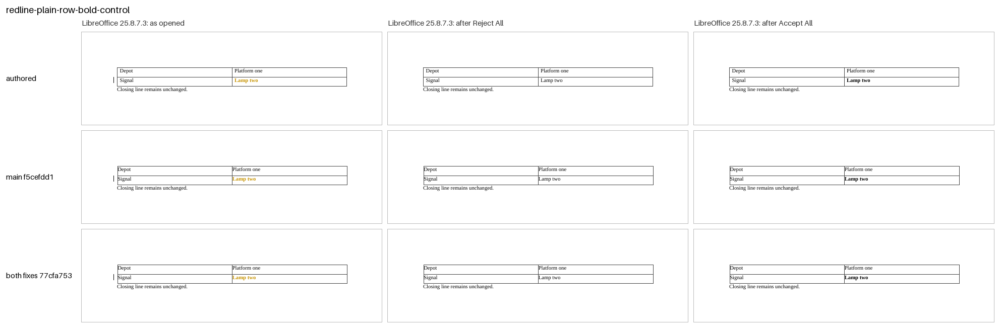

The same bold with no content control: every version tracks it.

### `redline-removed-break-inherited-header`

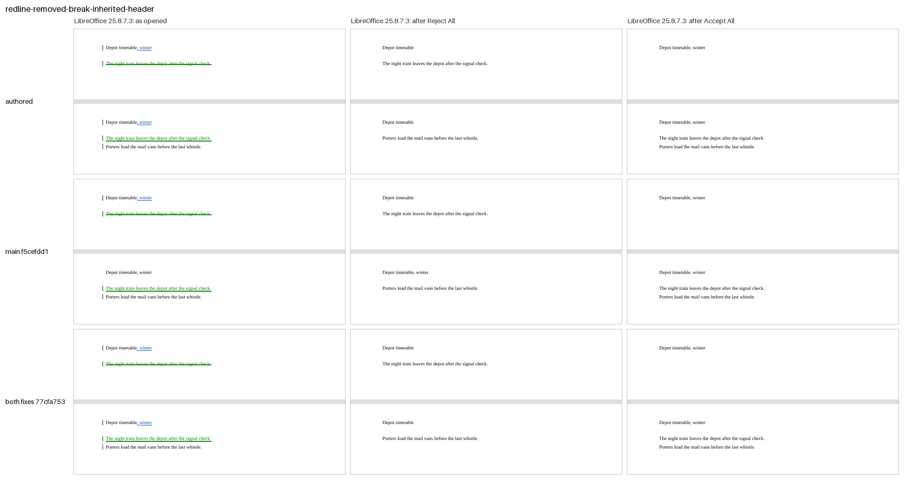

Each tile is the top of pages 1 and 2. The redline keeps the original's break, so the deleted paragraph is a page of its own. Main tracks `, winter` in its one header part, but only the first section names that part; the last inherits it. The bench's engine therefore finds main's accepted document without any header (`markup-accepted`), and its rejected document showing the right header only by inheritance, where the expectation names it (`markup-rejected`). LibreOffice shows an inherited header's copy without its tracking, so on main its Reject All leaves the revised `Depot timetable, winter` on the second page (`libreoffice-rejected`); with the fixes the last section names the tracked story and both views are right. LibreOffice's Accept All keeps the deleted paragraph's break and an empty first page in every row, the authored one included, so its accepted comparison is declared ineligible.

### `redline-removed-break-inherited-footer`

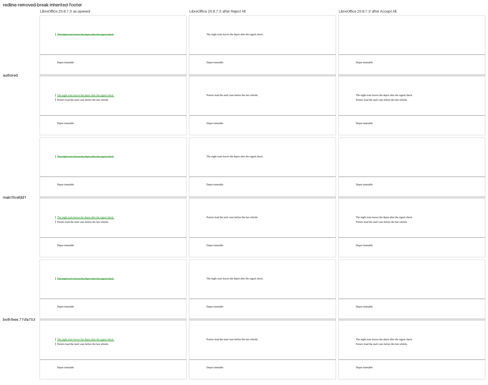

The footer version, with the story unchanged; each tile adds the bottom of each page. On main the bench's accepted document has no footer.

### `redline-removed-break-named-header-control`

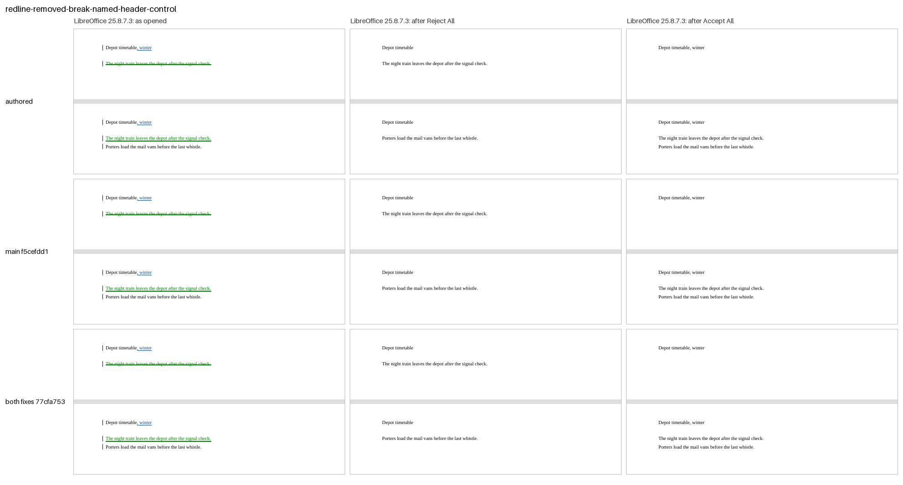

The original's last section names the header itself, so every version keeps it on accept.

### `redline-removed-break-deleted-paragraph-control`

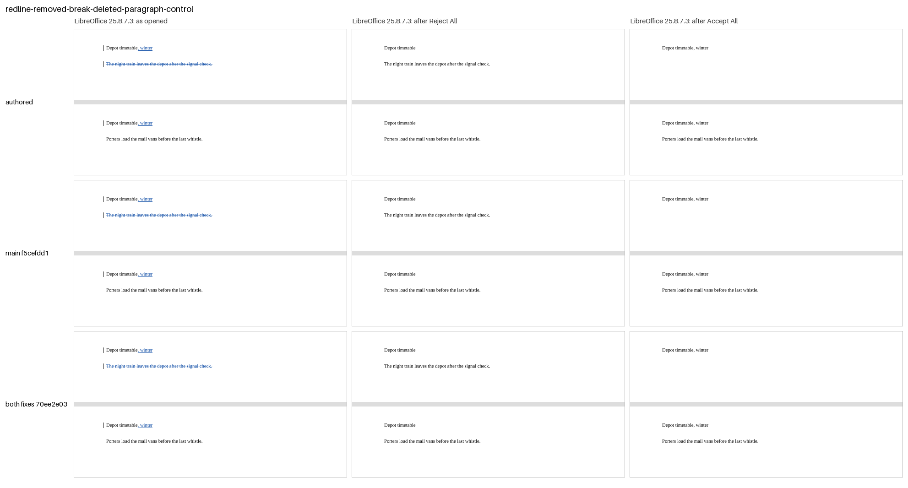

The paragraph holding the break is deleted with it; every version binds the story to the last section.
