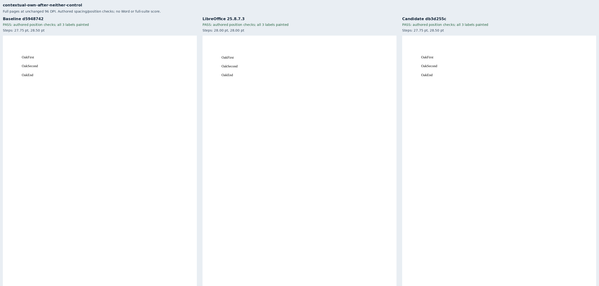
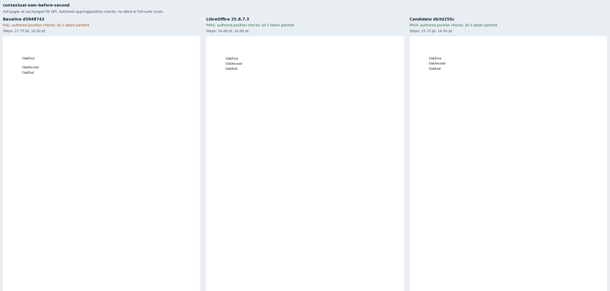
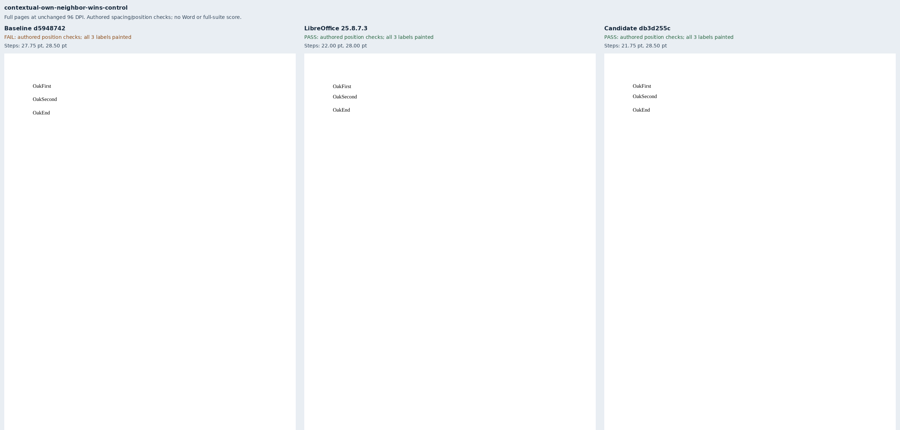
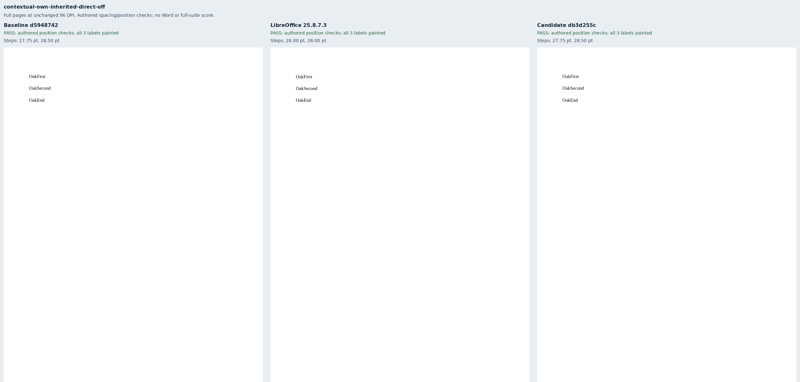
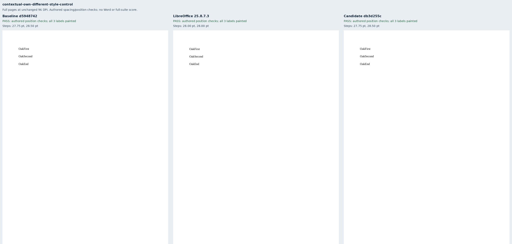
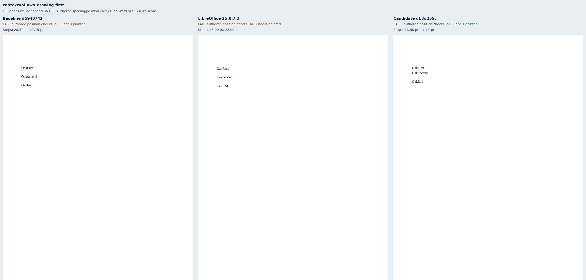
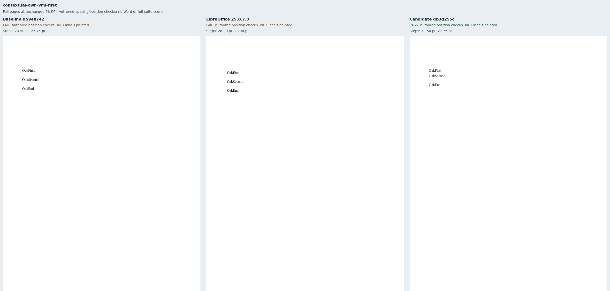

# Contextual spacing owned by each paragraph

Nine original Oak documents isolate the per-paragraph setting in
[Docxodus #1553](https://github.com/JSv4/Docxodus/issues/1553). They use 11pt Liberation
Serif, 16pt exact lines and explicit before/after spacing. Only a paragraph whose
contextual setting is enabled removes its own space beside the same style; the
neighbor's own space remains. Cases include both sides, disabled and different-style
controls, a 6pt neighbor contribution, inherited-on/direct-off, and DrawingML/VML boxes.

All nine inputs validate with zero Open XML SDK errors. All three renderers preserve
and paint every label. The authored position checks improve from **4/9 to 9/9** through
the strict public exporter. Seven LibreOffice 25.8.7.3 body references are eligible.
Its two textbox references remain **ineligible**: they retain the 12pt gap, and VML
also adds an inset. These discrepancies remain visible in the sheets and evidence.

The issue author's [Word print](https://github.com/JSv4/Docxodus/issues/1553#issuecomment-6701328156)
confirmed first-only contextual spacing in a body paragraph. Word was unavailable
for new captures; the before-second and textbox cases follow the per-paragraph
contract, without claiming new Word parity. Automatic spacing and its compatibility
settings remain separate work. These captures use sandboxed system Chromium and
strict fonts; they are targeted diagnostics, without pinned-runtime or full-suite scores.

Baseline `d59487425398a2f39b260f619b5d6044e75773bb` and candidate
`db3d255c1ffb5892103a4eff8fab4e79f1db9f03` are exact source-bound builds. The candidate
also carries only test, documentation and budget-gate follow-ups from the preceding
off-paper fix. Its rendering change is the shared contextual-spacing helper.
[Evidence](evidence.json) binds both source trees, 19 build-file and 45 runtime-asset
hashes per renderer, all 27 retained PDFs, their reports/inspections and all nine
review sheets. HTML stays in ignored runs because it embeds configured font data.
The prior 860 PDF inputs/declarations and 258 redline cases remain unchanged apart
from the PDF generator provenance hash. No oracle or adapter is changed.

The geometry regression shifts the second label down 12pt in each retained candidate
inspection and requires the unchanged position contract to reject all nine mutants.

## Reproduction

Generate `core-v120` with `python3 -m bench.fixtures`, select `contextual-own-*` into a
manifest, and build both exact renderer commits using `python3 -m bench build-docxodus`.
Capture native references with `python3 -m bench reference libreoffice --manifest MANIFEST --out OUT`;
capture both public renderers with `docs/results/export-reliability/Capture.mjs --html`.
Preserve build/asset manifests and schema validation beside the runs, then execute:

```sh
python3 docs/results/contextual-own-spacing/Compose.py RUN BASELINE_SOURCE CANDIDATE_SOURCE
python3 -m unittest discover -s tests -v
node --test tests/test-adapter.mjs
python3 -m bench.audit
```

The compositor uses Pillow, checks exact printed inventories and painted ink, verifies
every authored position, and preserves full-page 96-DPI rasters in labeled triptychs.

## Review sheets









