# Whole-paragraph control rewrites

Each sheet shows actual public `ReplaceText` outputs before (`ae68ba01`) and after
(`40e58cfe`), rendered with the final candidate's native flow HTML renderer. Saved native
control XML appears below each preview, so bindings and citation instructions can be reviewed.
`Capture.cs` and `Capture.mjs` record the offline capture method. These use installed fonts;
no Word reference, native data store or PDF score is claimed.

The baseline fails seven reproducers and passes seven controls. The final candidate passes
all fourteen cases: complete semantic views, exact native control subtrees, zero raw revisions,
schema checks and all 28 applicable LibreOffice views. This is a diagnostic subset of
`redline-v20`; no full-suite headline score is available. `capture.json` binds exact source,
input/output, script and PNG digests and retains the individual checks.

### redline-control-rewrite-binding-echo

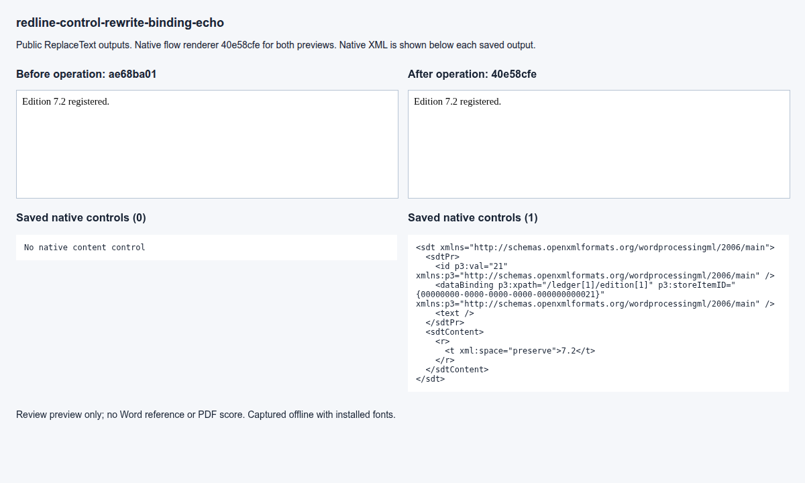

### redline-control-rewrite-binding-echo-control

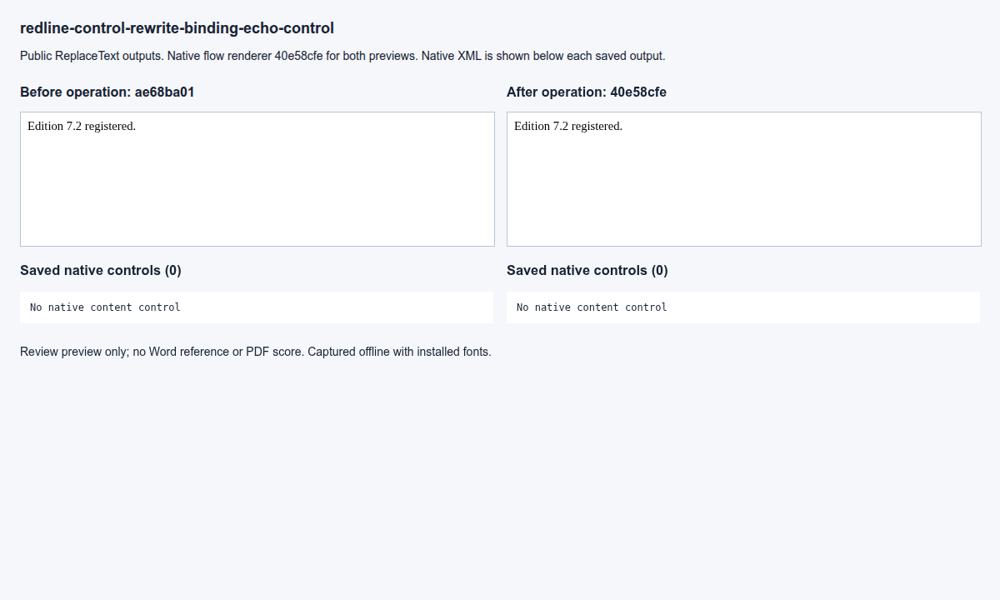

### redline-control-rewrite-binding-outside

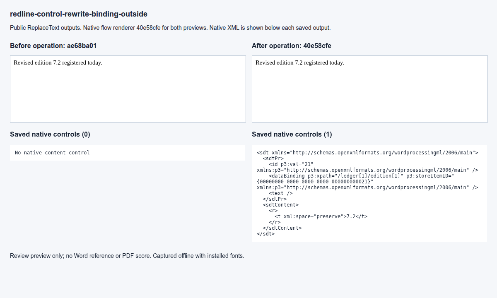

### redline-control-rewrite-binding-outside-control

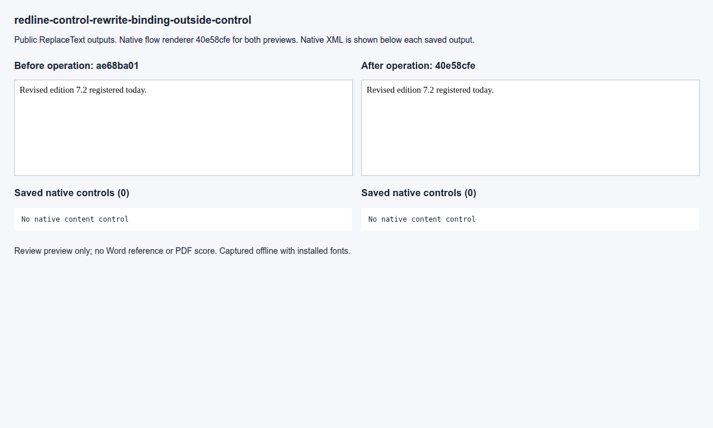

### redline-control-rewrite-citation-echo

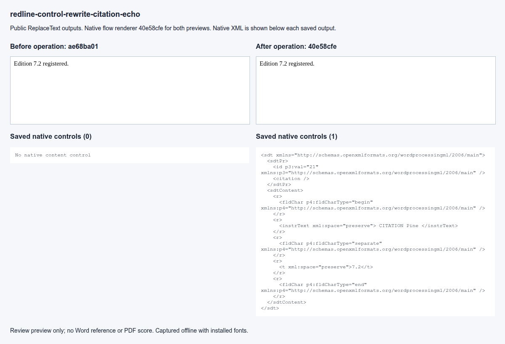

### redline-control-rewrite-citation-echo-control

### redline-control-rewrite-citation-outside

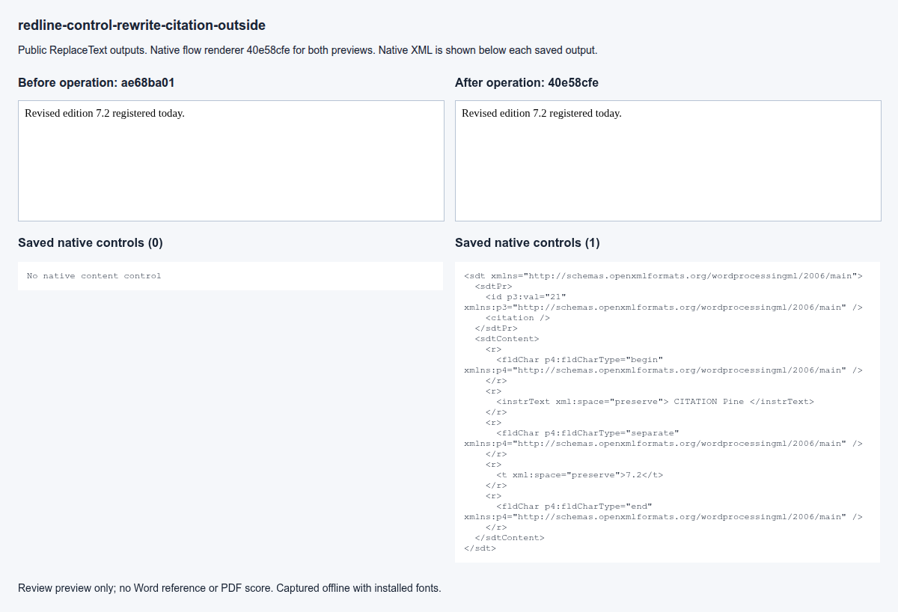

### redline-control-rewrite-citation-outside-control

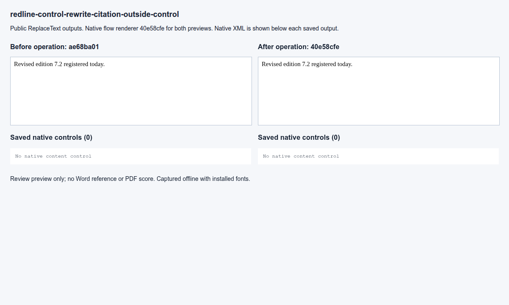

### redline-control-rewrite-strike-break

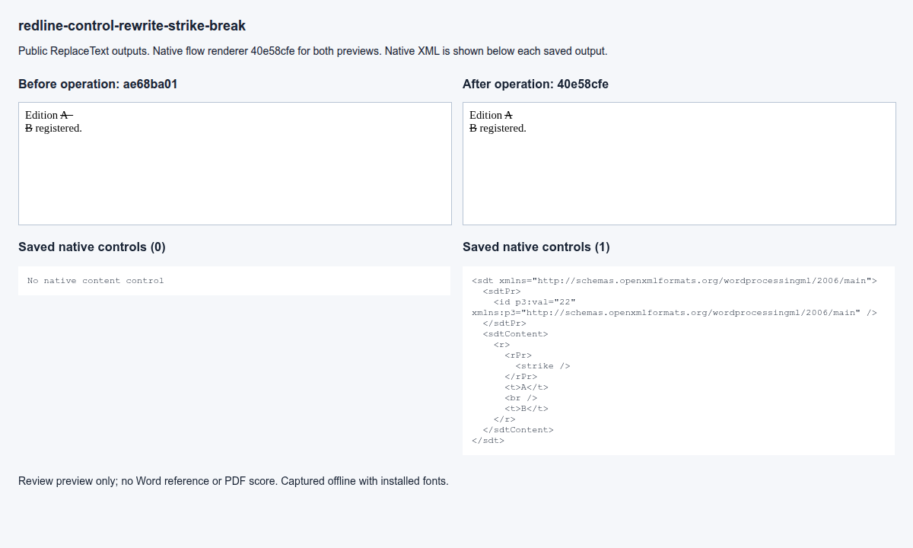

### redline-control-rewrite-strike-break-control

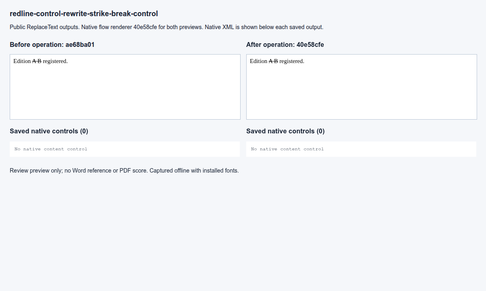

### redline-control-rewrite-code-break

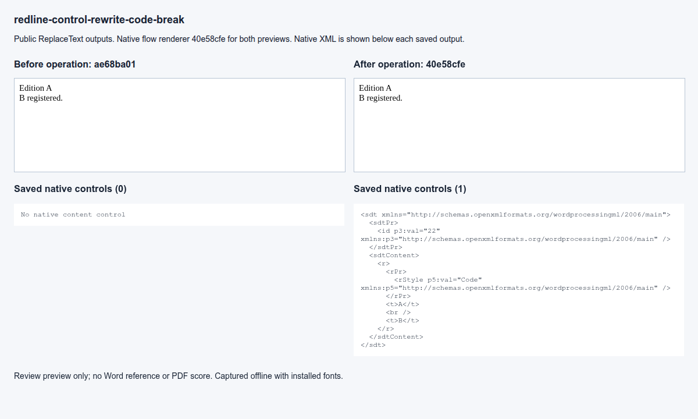

### redline-control-rewrite-code-break-control

### redline-control-rewrite-link-break

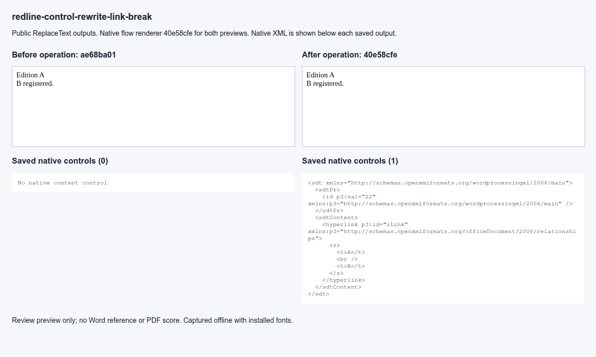

### redline-control-rewrite-link-break-control

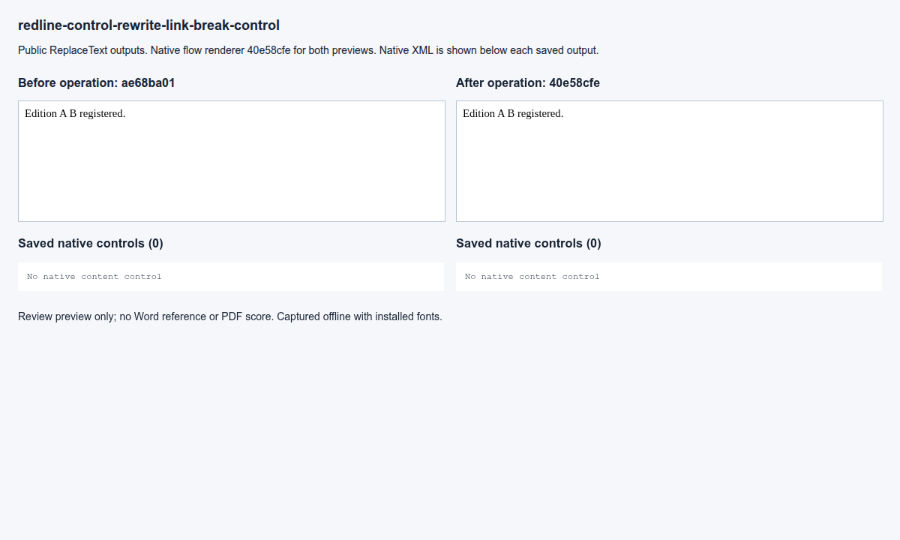
