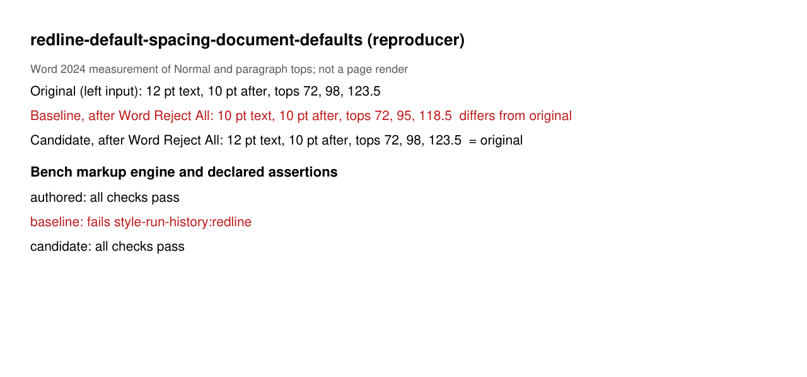
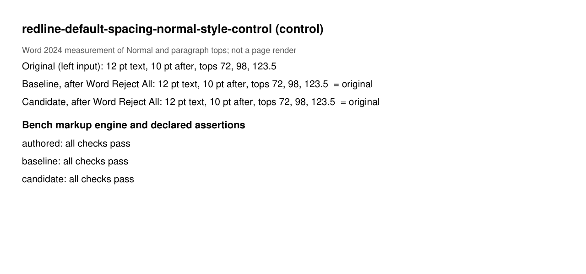

# Style revisions that Word rejects whole

Docxodus #1576 compared documents whose default paragraph spacing differs. Word 2024's own Compare
adopts the revised document's `w:docDefaults` untracked when only the defaults differ, and tracks
a differing style definition with both a `w:pPrChange` and a `w:rPrChange`. Docxodus tracks the
difference on `Normal` in both cases, so Reject All can restore the original.

Word's Reject All restores a style from both markers. Before the fix, Docxodus recorded only the
`w:pPrChange` for a difference confined to the document defaults. Word then reset `Normal`'s run
properties to its built-in 10 pt. The original spacing came back with smaller text, and neither
round trip could see it.

| Case | Kind | Word Reject All, baseline | Word Reject All, candidate | Original |
| --- | --- | --- | --- | --- |
| `redline-default-spacing-document-defaults` | reproducer | 10 pt, tops 72, 95, 118.5 | 12 pt, tops 72, 98, 123.5 | 12 pt, tops 72, 98, 123.5 |
| `redline-default-spacing-normal-style-control` | control | 12 pt, tops 72, 98, 123.5 | 12 pt, tops 72, 98, 123.5 | 12 pt, tops 72, 98, 123.5 |

Baseline is Docxodus main `8ffe24ba`; candidate is the fix branch `f9ac3a68`. Word measured copies
of each package with the font name changed from Liberation Serif to Times New Roman, its metric
twin. On the bench's own markup engine, the baseline fails only `style-run-history` on the
reproducer. Spacing, text and views pass for every build, which is why the check is needed.
The candidate and the authored redlines pass everything. LibreOffice and validator checks were
not run locally; they run in CI. `evidence.json` holds the measured values and per-check results.

The images are measurement cards, not page renders. Word's PDF export of these packages did not
return on the capture machine, so positions come from `Range.Information`.

### redline-default-spacing-document-defaults

### redline-default-spacing-normal-style-control

