# Pending deleted rows in Markdown

Seven original reproducer/control pairs pin [Docxodus #1628](https://github.com/JSv4/Docxodus/issues/1628).
The default accepted projection must omit rows with `w:trPr/w:del`: middle rows, the first row,
a table's only row, a wrapped row, a merged row, and a row carrying a textbox. The seventh pair
forces opaque tables and checks dimensions. Controls retain the same rows without deletion marks.

The [baseline](baseline.json) at `c3b7d0c4` passes 23/32 cases, failing all seven new reproducers;
the [candidate](candidate.json) at `eb3f43a5` passes 30/32. All fourteen new row cases pass.
Both builds still fail the two tracked raw-edit cases for separate issue #1625; its refusal
PR #1644 was closed without merging. Those assertions remain unchanged, and the row fix
is independent of that proposal. The other sixteen earlier diagnostics pass on both builds.
Exact text and saved-output schema are checked, with full source/build/fixture identities retained.
This is an unweighted projection diagnostic, not a Word rendering claim or PDF/redline score.
The separate engine tests cover public tracked deletion, patch removal, undo/reject restoration,
source-anchor retention, real empty rows and explicit inline-mode controls.

All inputs are original literal OOXML and Larch labels. No product fixtures or helpers are copied.
Screenshots show the recorded public Markdown, with anchor IDs shortened, in Chromium.

| Reproducer | Undeleted control |
| --- | --- |
| 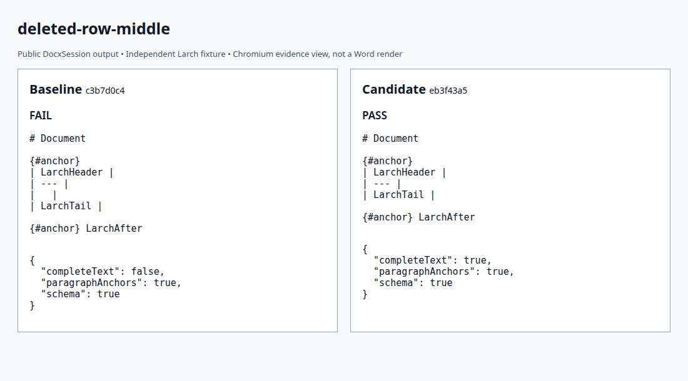 |  |
| 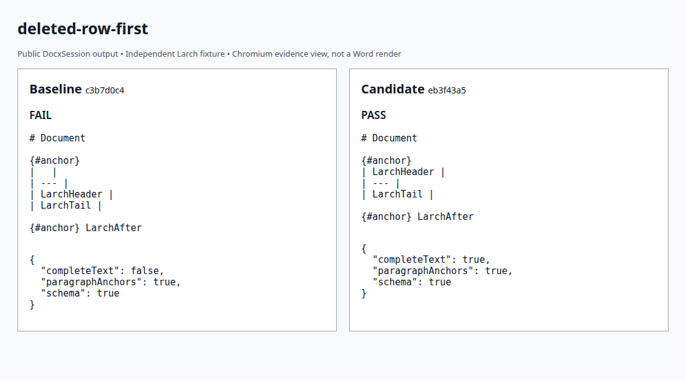 | 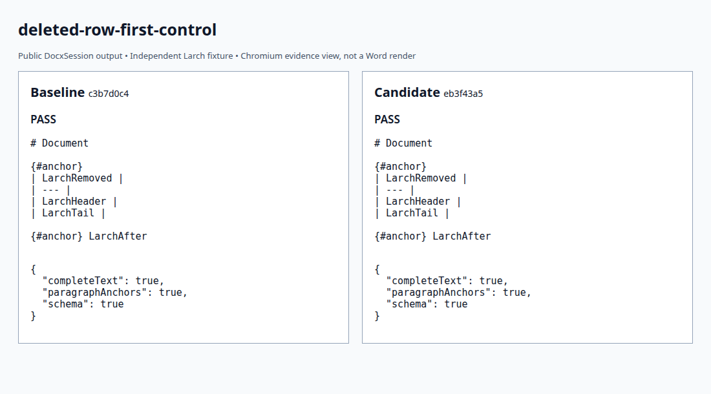 |
| 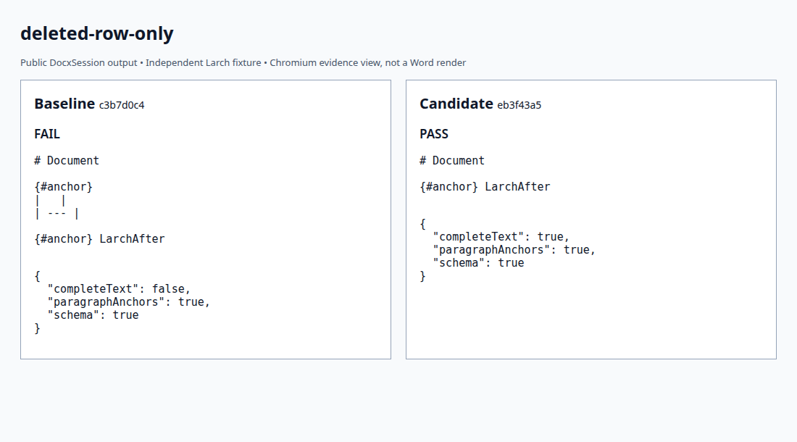 | 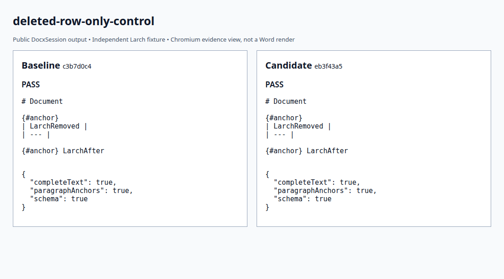 |
| 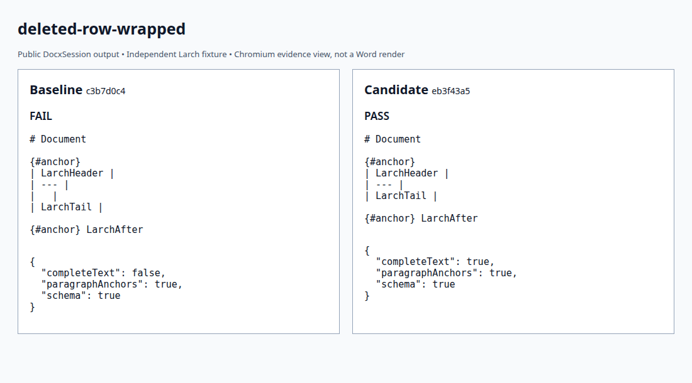 | 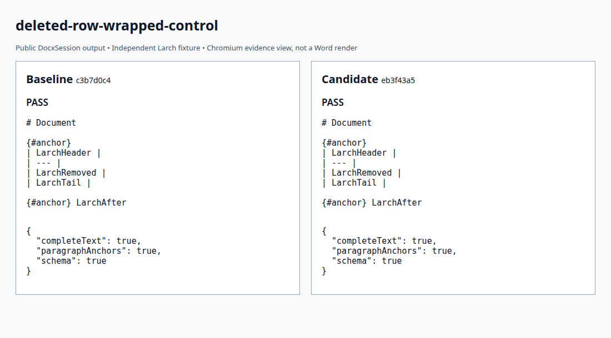 |
| 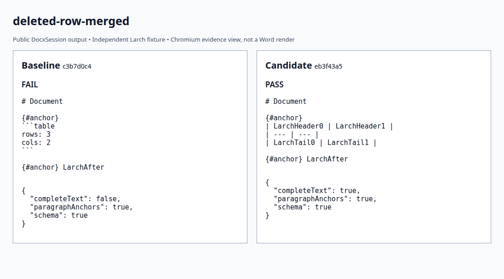 | 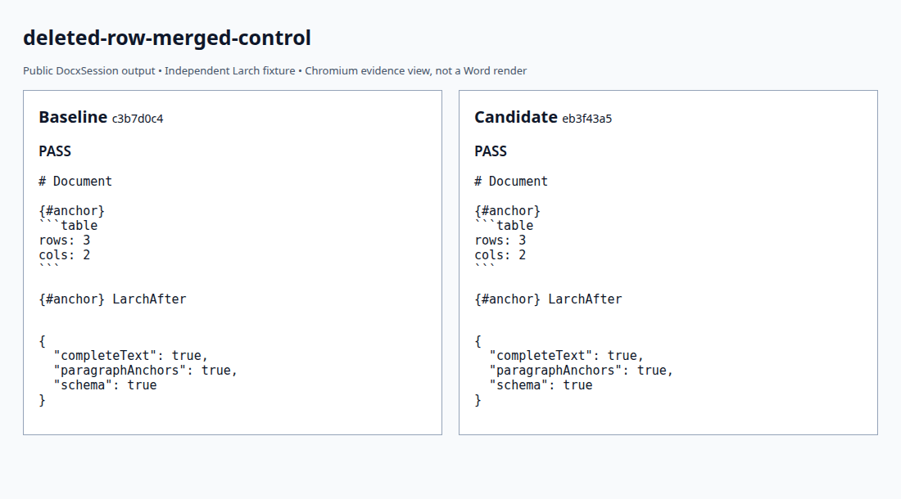 |
| 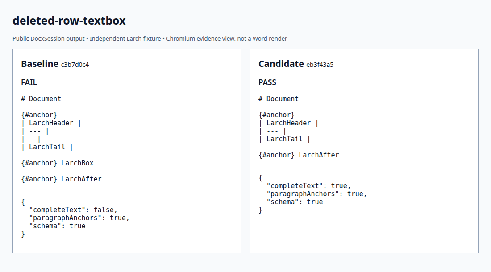 | 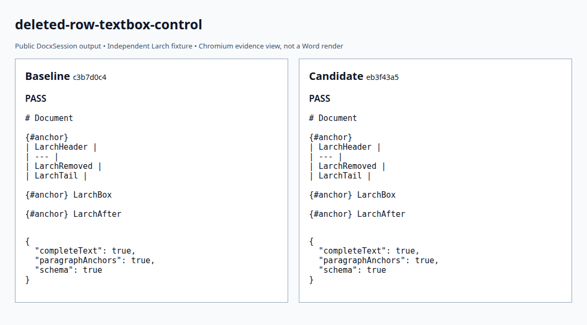 |
| 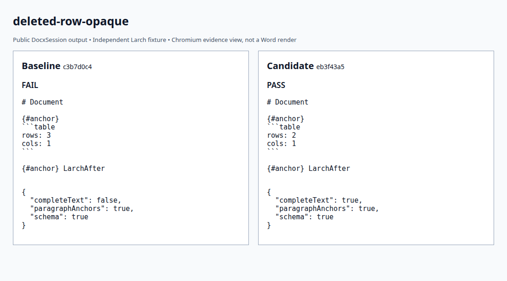 | 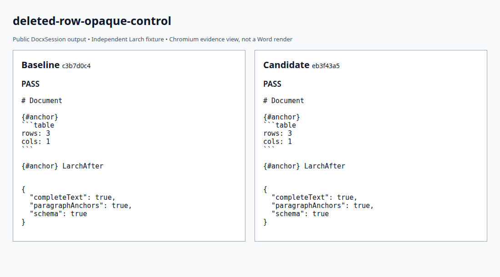 |

```bash
python3 -m bench.projection build --source /path/to/Docxodus --commit FULL_SHA --out runs/rows-build
python3 -m bench.projection run --build runs/rows-build --output runs/rows-result.json
python3 -m unittest discover -s tests -p test_projection.py -v
```
