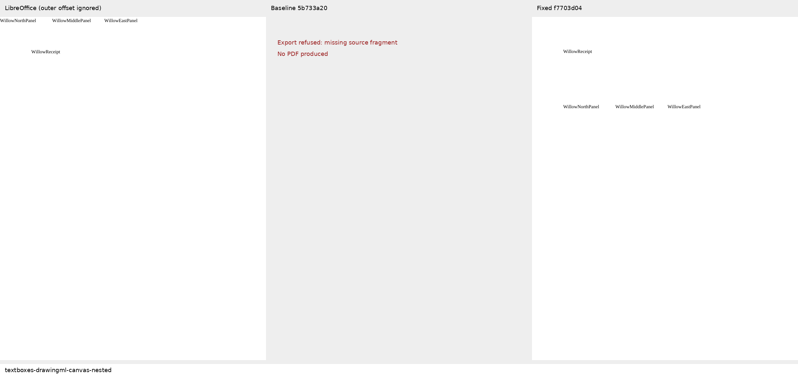
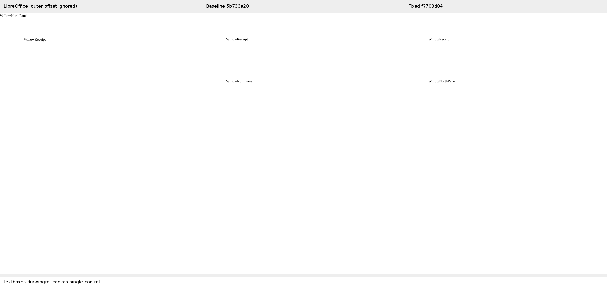

# Drawing canvas textbox stories

Three original Willow fixtures cover [Docxodus #1561](https://github.com/JSv4/Docxodus/issues/1561): sibling textboxes, a scaled group inside a canvas, and a single-textbox control. Every fixture declares its complete visible-token inventory and each label's region within the source-authored frames. The packages have zero Open XML SDK validation findings.

The baseline (`5b733a20`) refuses the sibling and nested cases because a required source anchor has no measurable fragment. The single-box control exports. The fixed build (`f7703d04`) exports all three as one-page PDFs, preserves every token once, and places the labels in their declared frames. The screenshots show full physical pages; refusal panels explicitly indicate that no baseline PDF exists.

LibreOffice preserves all labels but ignores the outer canvas anchor, placing its children at the paper origin instead of (72pt, 200pt). Its PDFs fail the declared marker regions and are **ineligible as geometric reference captures**. They are included as diagnostic evidence only. Candidate checks use the source-declared regions; no visual fidelity score, Word parity, registered Word reference, or full-suite result is claimed. Word capture remains pending because the available Office browser session redirects to sign-in.

`evidence.json` binds the core commit/tree, converter and runtime manifest, fixture/PDF/screenshot hashes, extracted word coordinates, baseline refusals, candidate checks, and LibreOffice reference failures. `schema.json` records input validation. The core's public PDF tests additionally cover header and body canvases, nested placement, and existing group/rotation controls. Independent adversarial review caught lost warnings for unrendered canvas backgrounds; the fix keeps visible formatting diagnostic while allowing empty and explicit no-fill formatting.

The corpus advances from core-v104 (752 cases) to core-v105 (755 cases). All 752 prior input hashes remain unchanged. These fixtures reuse this repository's authored literal text and geometry helpers, with no third-party content or assets. Scoring rules and tolerances are unchanged.

