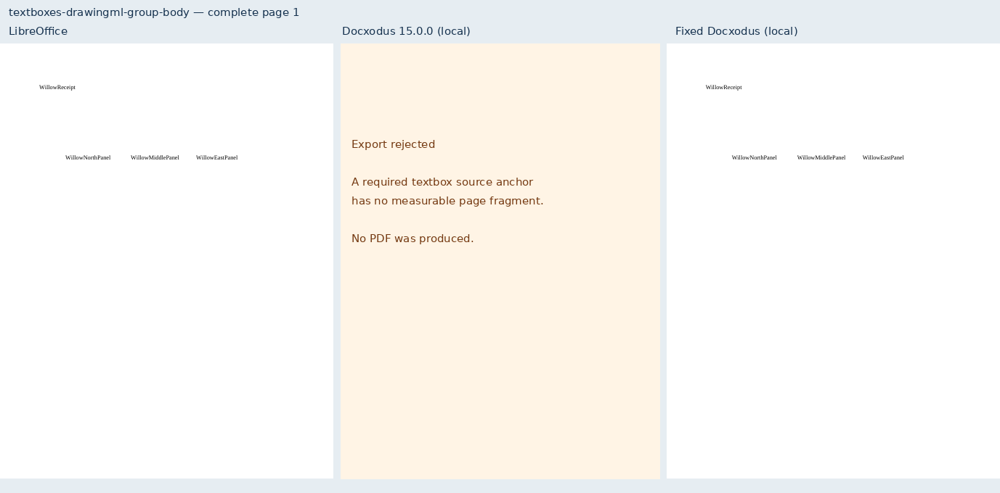
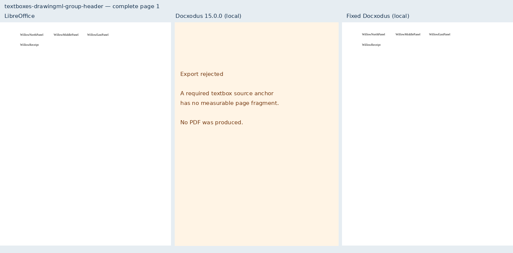
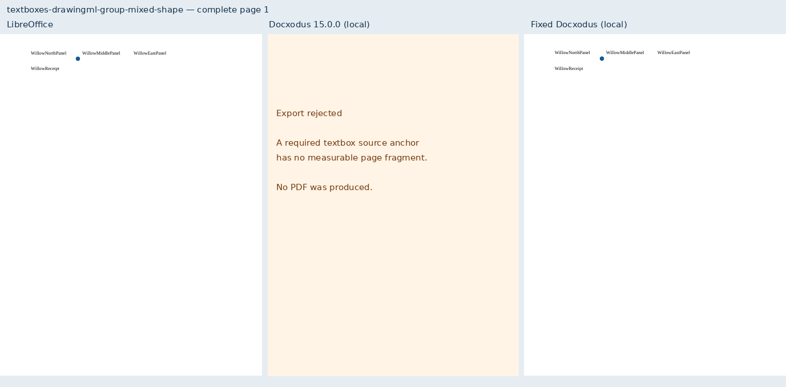
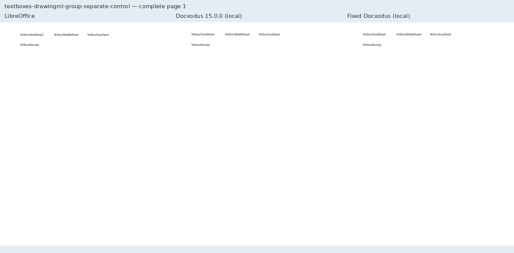
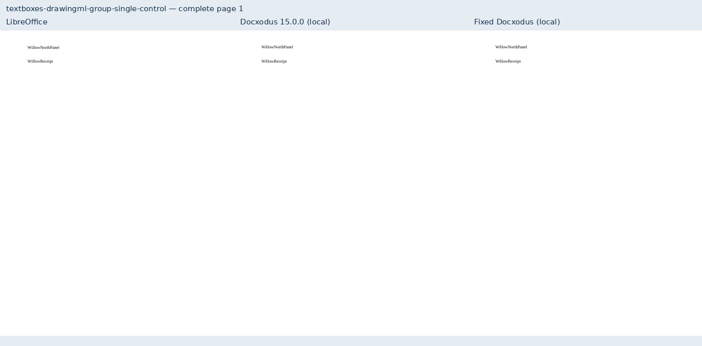

# Independent DrawingML group stories

Eight original Willow fixtures cover JSv4/Docxodus#1527: three independent header
stories, nested child coordinates, a nonuniformly scaled group with a 2pt inset,
a picture sibling, an ellipse sibling, a body group, and single/separate controls.
Complete token inventories and independent label positions apply to every case.
The two mixed cases also require the blue member’s bounds and paint coverage;
substituting the ordinary header PDF fails that check.

The screenshots show the complete page from LibreOffice, the existing local 15.0.0
build (`4bb8386be06ded02dd41564fcf2d18742dd04cbe`), and the fixed local build.
The old build rejects all six grouped cases because a required textbox source anchor
has no measurable page fragment; these panels are labeled refusals, not PDFs.
Both controls export successfully before and after. All eight candidate PDFs pass
the declared mandatory checks against LibreOffice. No native Word capture or full-suite
score is claimed here.

`evidence.json` binds core commit `57b2fb0ddc405961b39fc34a24a6d5ccead456c1`, its tree,
converter/paginator source and runtime manifest, every input/PDF/screenshot hash,
marker positions, baseline refusals and declared checks. `schema.json` records zero
Open XML SDK 3.5.1 findings on all eight inputs. The converter also has native and
public PDF tests for inserted stories, linked frames, ownership collisions, unsupported
geometry, nested reflections, rotation and upright text. LibreOffice keeps rotated
textbox text horizontal in the isolated controls, so its PDF is not an angle oracle;
those orientation tests check the declared transform directly.

The suite advances from core-v98 (707 cases) to core-v99 (715 cases). All 707 prior
inputs remain byte-identical. Scoring rules, tolerances and historical CI selections
are unchanged. Production runs pinned to the PR commits are recorded before merge.

