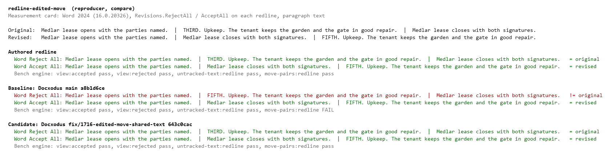
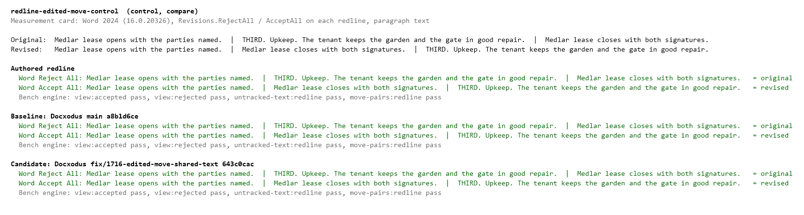
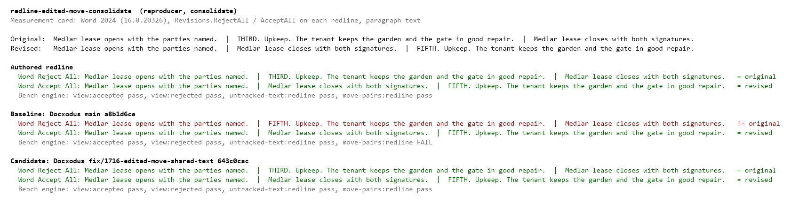
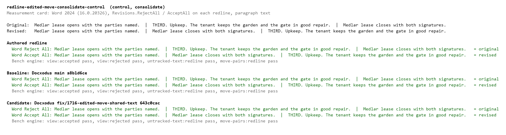

# A moved and edited paragraph

Docxodus #1716 compared documents in which a paragraph moves and its ordinal changes from "THIRD" to
"FIFTH". The redline put the whole original paragraph in its `w:moveFrom` and the whole revised one in
its `w:moveTo`. Word 2024 rejects a move by carrying each destination range's moved text back to the
source range it pairs with in order, and ignores what `w:moveFrom` holds, so Reject All put the revised
paragraph in the original's place. The bench's own engine restores what `w:moveFrom` holds, so both
round trips passed; the new `move-pairs` check is what sees it.

A correct redline moves only the text both versions share and deletes and inserts the ordinal beside
the move ranges. Each stretch of shared text between two edits has its own range in each half, and the
k-th source range holds the text of the k-th destination range.

| Case | Kind | Word Reject All, baseline | Word Reject All, candidate | Original |
| --- | --- | --- | --- | --- |
| `redline-edited-move` | reproducer | `FIFTH. Upkeep. …` | `THIRD. Upkeep. …` | `THIRD. Upkeep. …` |
| `redline-edited-move-control` | control | `THIRD. Upkeep. …` | `THIRD. Upkeep. …` | `THIRD. Upkeep. …` |
| `redline-edited-move-consolidate` | reproducer | `FIFTH. Upkeep. …` | `THIRD. Upkeep. …` | `THIRD. Upkeep. …` |
| `redline-edited-move-consolidate-control` | control | `THIRD. Upkeep. …` | `THIRD. Upkeep. …` | `THIRD. Upkeep. …` |

Baseline is Docxodus main `a8b1d6ce`; candidate is the fix branch `643c0cac`. Both were run with the
adapter's settings (author `Bench`, fixed date) through `DocxCompare.Compare` and
`DocxCompare.Consolidate`. Word Accept All gave the revised document for every build, and Word opened
every package without error. On the bench's own markup engine, the baseline fails only `move-pairs`,
and only on the two reproducers; the candidate and the authored redlines pass every check.
LibreOffice and validator checks were not run locally; they run in CI. `evidence.json` holds the
paragraph texts Word produced and the per-check results.

The images are measurement cards, not page renders: Word opened the fixtures and the Docxodus outputs
unmodified, and its accepted and rejected documents are summarized by their paragraph text. No
Word-saved file is included.

### redline-edited-move

### redline-edited-move-control

### redline-edited-move-consolidate

### redline-edited-move-consolidate-control

