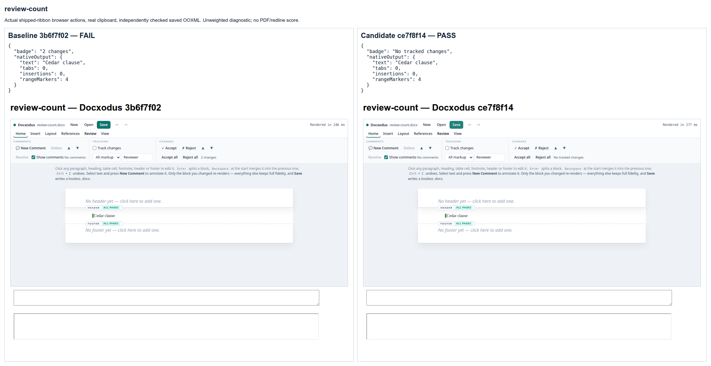
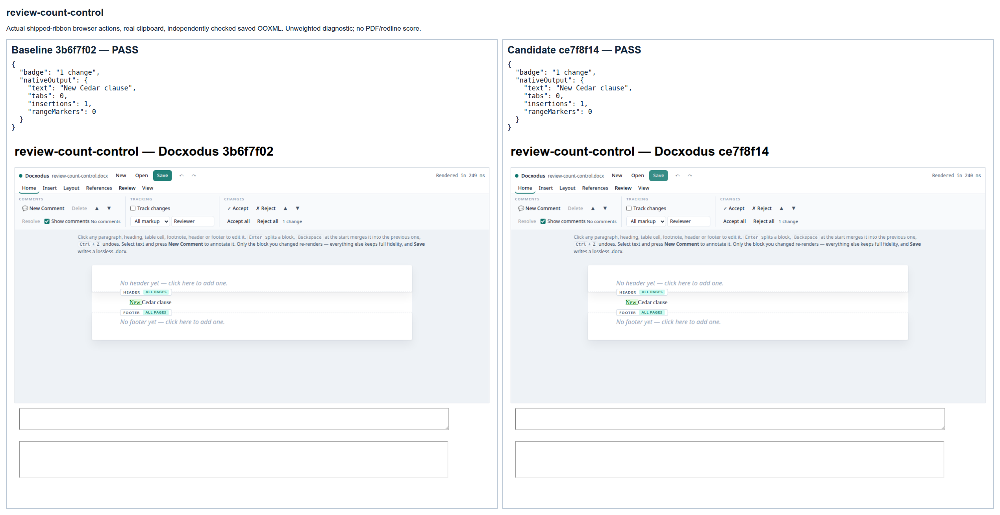
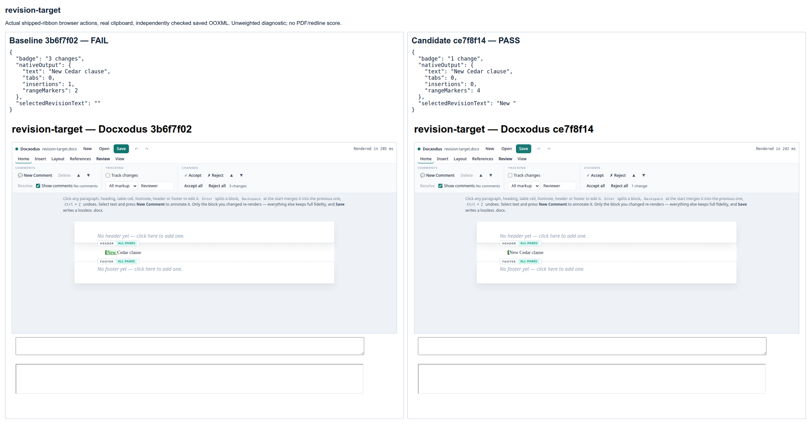
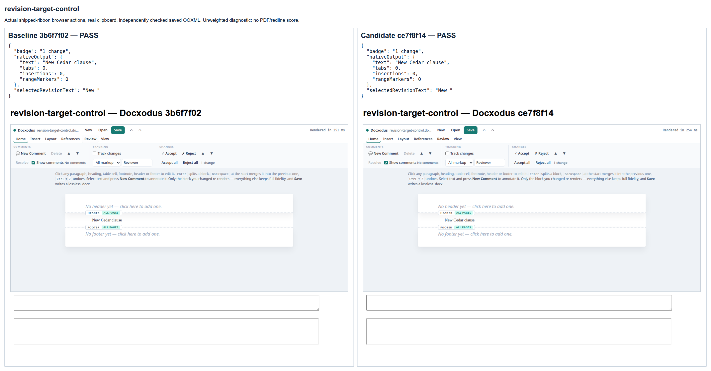
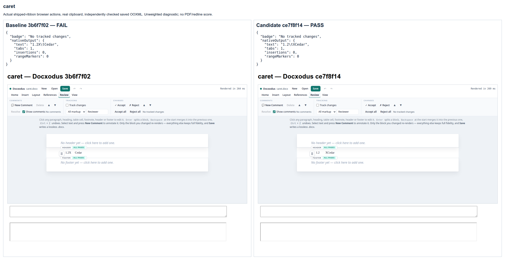
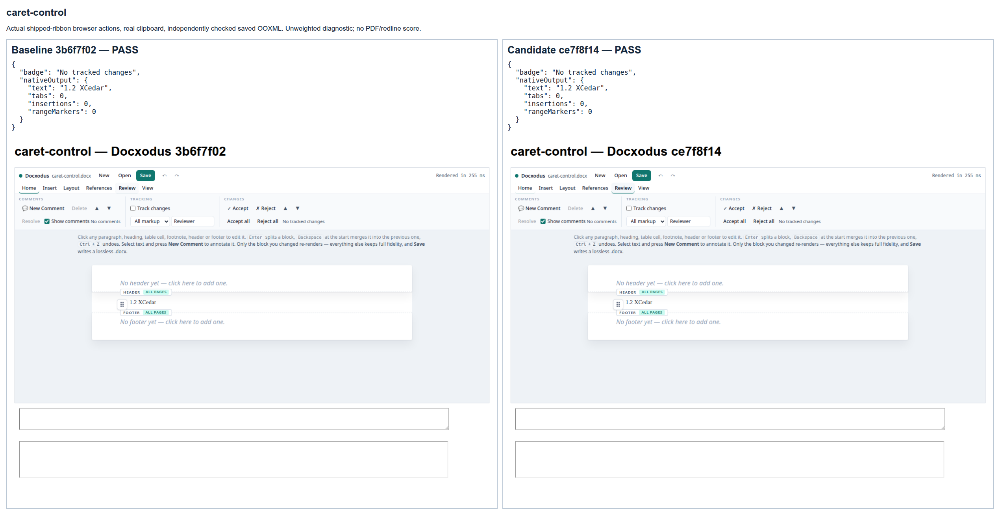
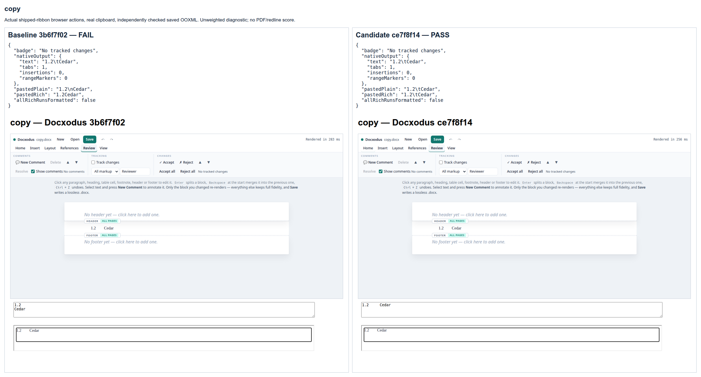
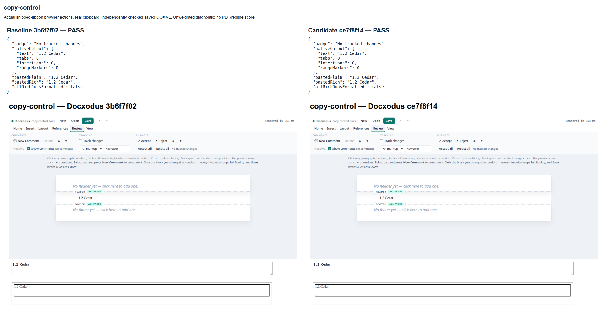
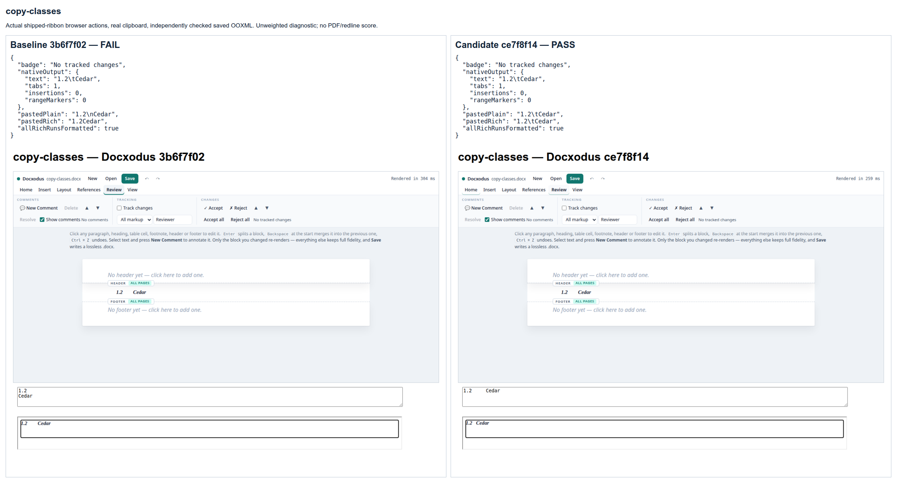
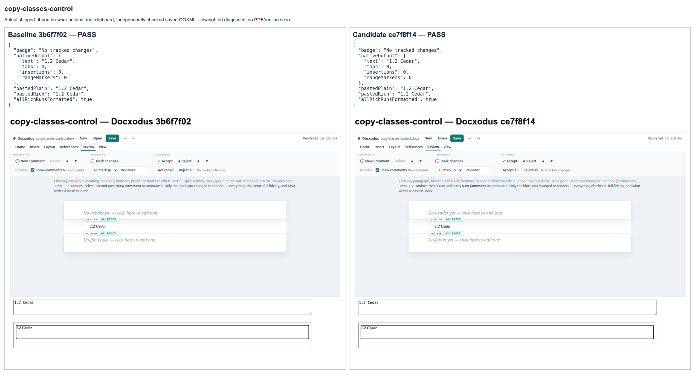

# Editor review and tab interactions

These ten original inputs exercise the shipped ribbon, public editor APIs, real browser
copy/paste, and saved OOXML. The baseline `3b6f7f02` fails five reproducers and passes all five
controls. Candidate `ce7f8f14` passes all ten. Every input and saved output has zero actual
Open XML SDK findings. The rich paste destination is a neutral iframe document, so the source
editor's styles cannot make class-only copied HTML appear correctly formatted.

This is the unweighted `editor-ui-v1` diagnostic, not a PDF/redline fidelity score or a Word
reference. The revision-target action deliberately detaches a clone of the actual rendered
mark before calling public `revisionAt`, then accepts that entry and inspects the saved XML.
The other actions operate directly on the mounted editor. The baseline revision-target run
also records transient fetch errors; three independent repetitions did not reproduce them.
They remain in the receipts and are not attributed to the revision-lookup defect.

An earlier candidate (`2edc063c`) passed eight cases and exposed a missing copy-listener
transfer when the ribbon adopts its temporary editor into the public surface. That defect
was reproduced separately and fixed; the final candidate uses the same diagnostic contract.

[Contract and reproducible commands](../../editor/README.md) explain the exact action and
validation rules. `capture.json` binds the original inputs, source-bound build/observations,
saved packages and labeled source/sheet screenshots. `outcomes.json` preserves every check.
`Capture.mjs` composes these sheets from the actual browser screenshots without altering the
UI. All document content, identities and scripts were authored for this repository.

### review-count

Baseline: fail; candidate: pass.

### review-count-control

Baseline: pass; candidate: pass.

### revision-target

Baseline: fail; candidate: pass.

### revision-target-control

Baseline: pass; candidate: pass.

### caret

Baseline: fail; candidate: pass.

### caret-control

Baseline: pass; candidate: pass.

### copy

Baseline: fail; candidate: pass.

### copy-control

Baseline: pass; candidate: pass.

### copy-classes

Baseline: fail; candidate: pass.

### copy-classes-control

Baseline: pass; candidate: pass.

