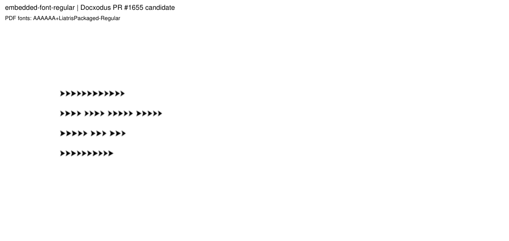
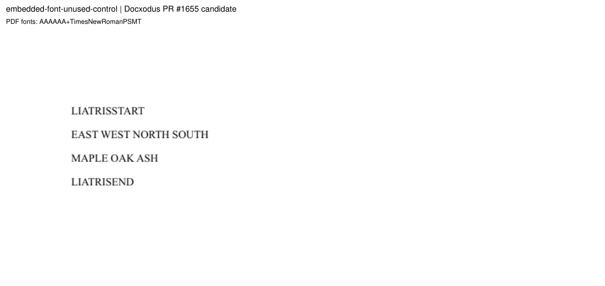

# Embedded fonts

Two original Liatris inputs accompany [Docxodus #1575](https://github.com/JSv4/Docxodus/issues/1575).
Both packages carry the same `word/fonts/font1.odttf`: the original `Liatris Packaged` program from
`bench/collection_fonts.py`, obfuscated with an invented `w:fontKey` the way Word stores embedded
fonts (the key GUID's 16 bytes, reversed, XOR the program's first 32 bytes), and linked from
`word/fontTable.xml` through `w:embedRegular`. In `embedded-font-regular` the runs request
`Liatris Packaged`; in `embedded-font-unused-control` the same runs use the provisioned default
font. Nothing else differs.

The family is declared in the case's new `embeddedFonts` list rather than in `fonts`: the host must
not provision it, so the environment contract ignores it, while the PDF font check accepts it and
the reproducer's `required-font-family` assertion demands it. The package audit admits exactly
these authored bytes in a font part, as it admits the placeholder.

Desktop Word 2024 prints a document's embedded font, maps each `w:embed*` slot to its style, and
prefers an installed font of the same family; those measurements are in Docxodus's
`docs/ooxml_corner_cases.md` ("Embedded fonts"). Word 2024 prints `embedded-font-regular` in this
embedded face (which it renames `___WRD_EMBED_SUB_45` in the PDF, so the Word font-binding
qualification would need a mapping before a Word capture is registered); its four line widths are
78.56, 123.32, 79.69 and 65.00pt at 11pt. Docxodus before #1655 substituted the family; the #1655
candidate prints `LiatrisPackaged-Regular` at 78.39, 123.36, 79.60 and 64.87pt, and the default
font for the control. The labeled sheets show the candidate.

LibreOffice reference captures and candidate scoring are pending. This machine has no pinned
LibreOffice, so no reference bundle is included and no eligibility or fidelity score is claimed.
All 1,074 prior input hashes are unchanged.
