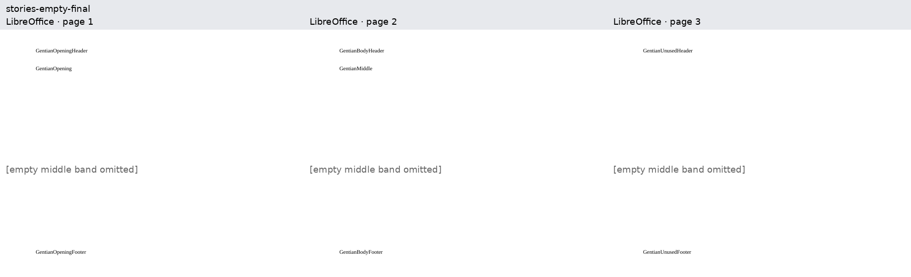
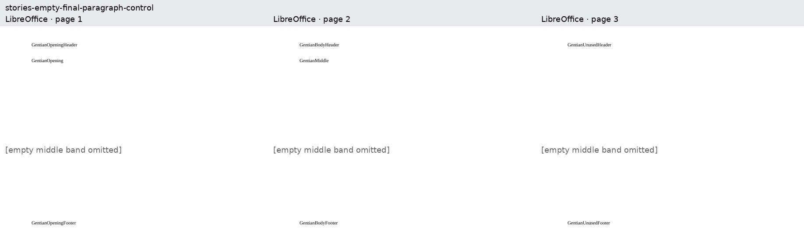

# Empty final-section stories

These original Gentian documents extend the evidence for
[Docxodus #1619](https://github.com/JSv4/Docxodus/issues/1619).
Two section-ending paragraphs are followed by a final body-level `sectPr` selecting
distinct headers and footers. The reproducer has no paragraph in that final section;
the control adds one empty paragraph. Both are valid OOXML.

LibreOffice renders three pages for both inputs, including the final section's distinct
header and footer on page three. Complete token inventories and eight unique-word page
checks require all stories to stay on their authored pages. Mutation tests move each final
story to page two without changing token counts and confirm rejection.

The [capture bundle](reference-bundle.json) is bound to the exact
[capture manifest](capture-manifest.json) supplied to `reference libreoffice --manifest`.
It records source/PDF hashes, inspections, environment and fonts. All pages are shown below; only their empty middle bands are
omitted. These are native references, not a claim that the candidate's paginated export
already meets every check. Product .NET and public Python tests directly check the
flow-selection and registry contracts. Word capture and candidate scoring are pending.
All prior DOCX hashes are unchanged.

