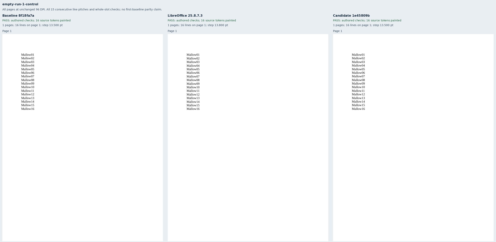
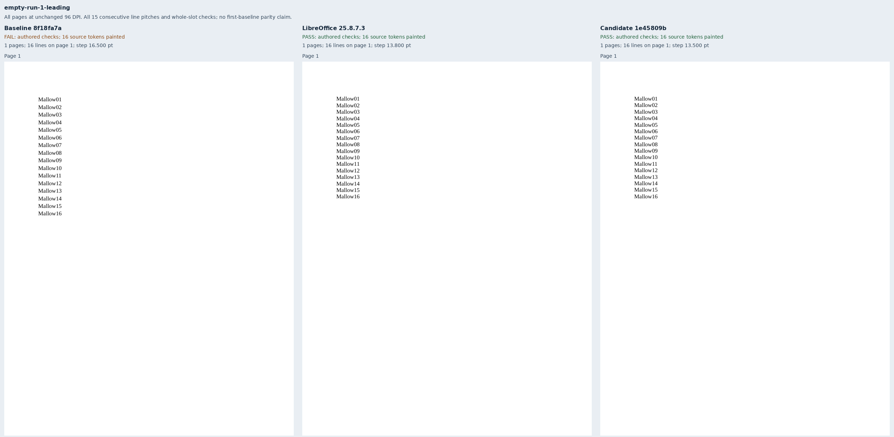
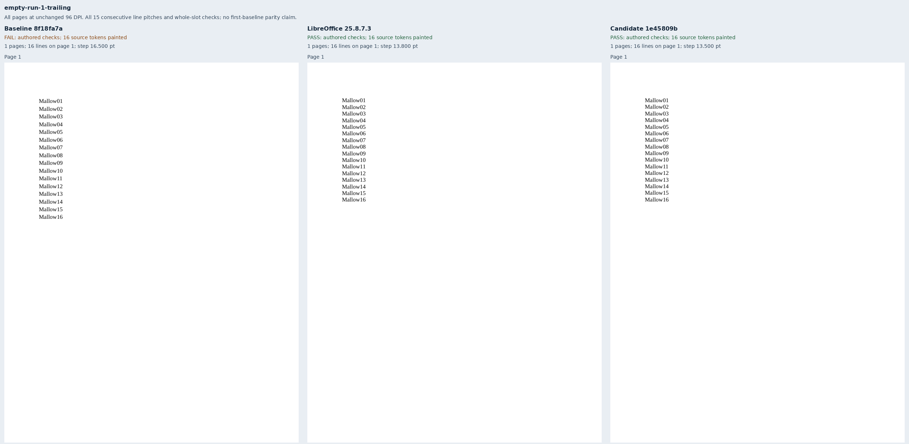
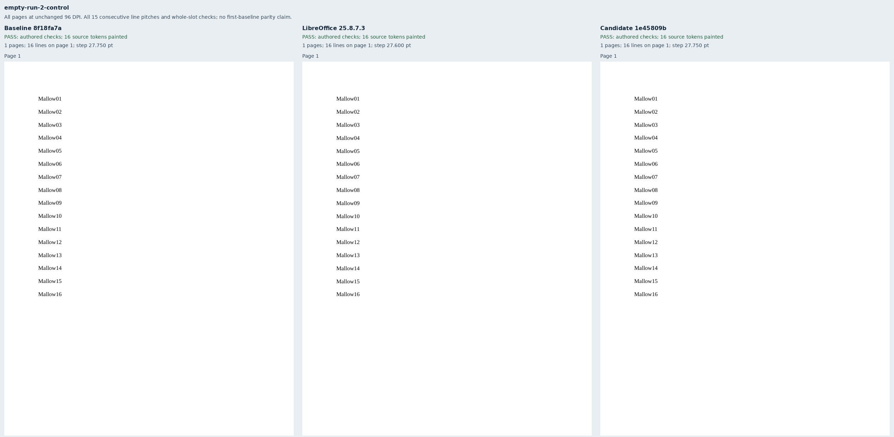
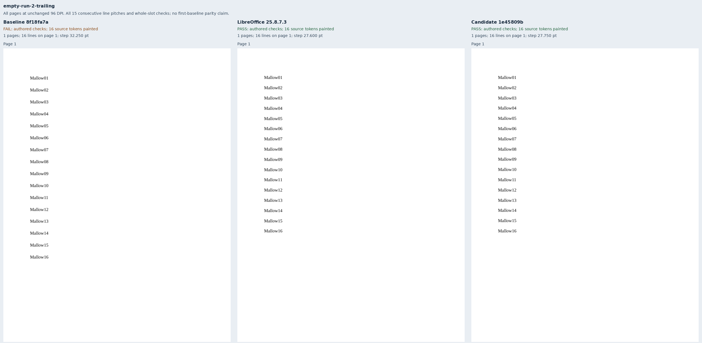

# Empty runs and line spacing

Eight original Mallow documents isolate an empty 14pt run in a paragraph of sixteen
12pt Liberation Serif lines. Each single- and double-spacing group contains a control
and leading, middle and trailing empty-run variants. Removing that one empty run
reproduces the control package's contents exactly. These fixtures address the empty-run
part of [Docxodus #1565](https://github.com/JSv4/Docxodus/issues/1565).

The source font's natural line pitch is `2355 / 2048 × 12` points, doubled for the
second group. Every label has an explicit page and whole-line-slot assertion. A separate
check covers all fifteen consecutive line pitches, including the last line. Complete
token inventories, visible ink, page ownership and paper geometry are also required.
All eight LibreOffice 25.8.7.3 references meet these checks.

Unchanged single-spacing controls revealed Chromium's 0.75pt glyph-origin quantization:
the greatest line-slot overrun was 0.352pt, and the greatest difference from the native
glyph top was 0.402pt. The retained calibration records the earlier 0.1pt slot tolerance;
the final shared slot tolerance is 0.5pt. Consecutive pitches allow 0.75pt because both
origins round independently. Neither check claims matching first-glyph baselines.

Baseline `8f18fa7a7380619a299bbbd76217ca3f37121816` passes the two controls and fails
all six empty-run cases. Candidate `1e45809bd8fe987ec74337cfddfe56d18cbdcab6` passes
all eight. The [evidence](evidence.json) binds 24 PDFs, 384 painted tokens on 24 pages,
16 strict-font production reports and eight comparison sheets. Each renderer's nineteen
build files and forty-five runtime assets were verified against the retained full-build
record. Clean source snapshots expose those exact artifacts without rebuilding or
relabeling them; the later core test-selector correction changes no production source.

Adversarial review found that the broad double-spacing slots alone could admit a line
moved down 10pt. The consecutive-pitch checks reject that displacement. All
[52 observation mutations](mutations.json) are rejected: a whole-line move in either
direction, missing/duplicate/unpainted/extra words in every case, and a within-slot move
in each double-spacing case. The fixture and mutation contracts run in the Python suite.

These are public exports with strict font checks and the sandboxed system Chromium
157.0.8103.38. This is diagnostic evidence, not a pinned-runtime benchmark score or a
full-suite parity claim. No new Word capture was made. Mixed-font paragraphs, blank
paragraphs and other line-height rules remain outside this fixture family.

## Reproduction

Generate `core-v126`, select `empty-run-*`, validate the packages, capture native
references and freeze the manifest. Build the exact renderer commits with
`python3 -m bench build-docxodus`, or verify every retained artifact against its original
build record. Capture each source into `RUN/baseline` or `RUN/candidate`, then compose:

```sh
node docs/results/export-reliability/Capture.mjs SOURCE RUN/manifest.json RUN/candidate RUN/environment.json --html
python3 docs/results/empty-runs/Compose.py RUN BASELINE_SOURCE CANDIDATE_SOURCE
python3 docs/results/empty-runs/Mutations.py
python3 -m unittest discover -s tests -v
node --test tests/test-adapter.mjs
python3 -m bench.audit
```









