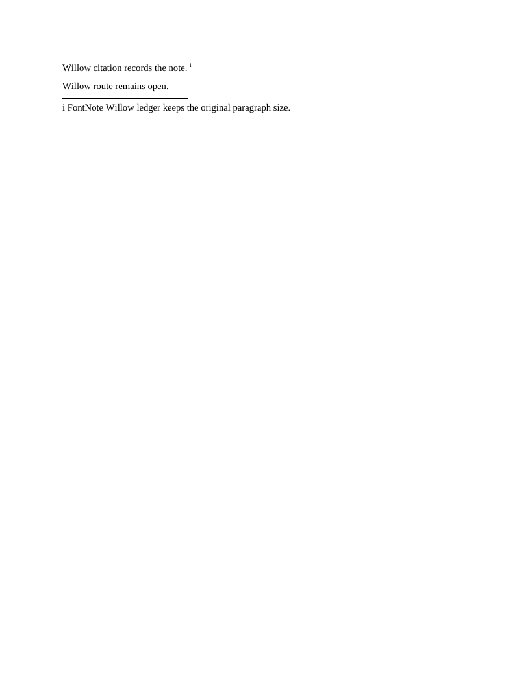
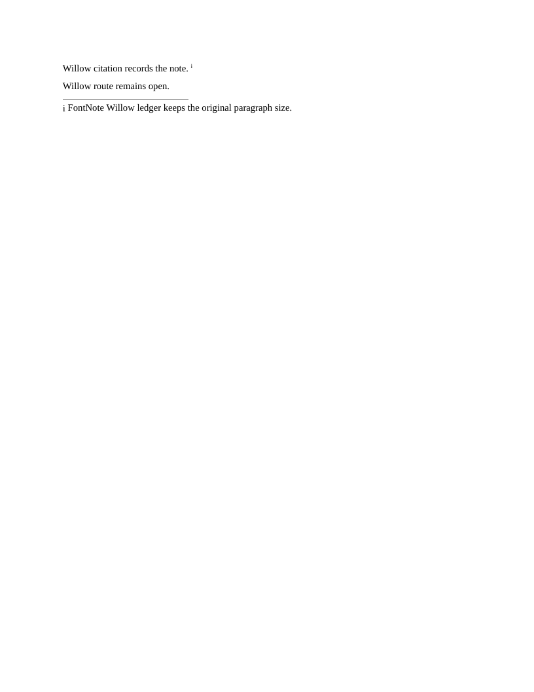
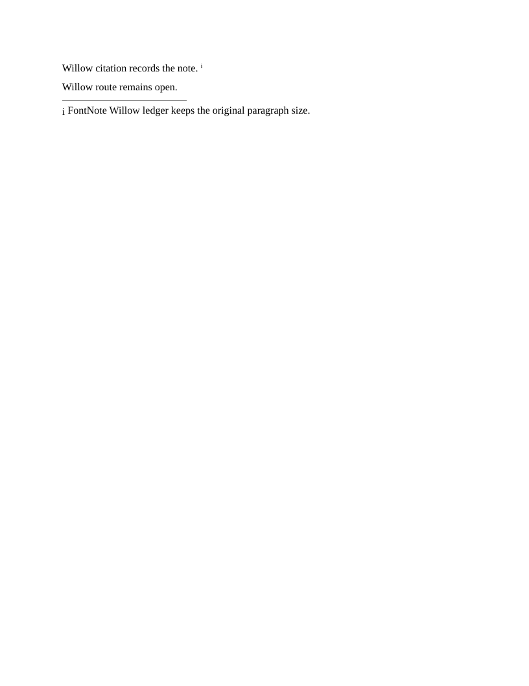

# Endnote paragraph fonts

These two original Willow fixtures reproduce the endnote baseline defect blocking Docxodus PR1494. The repair is [Docxodus PR1496](https://github.com/JSv4/Docxodus/pull/1496). Both packages validate with Open XML SDK3.5.1 (Microsoft365). All source parts are byte-identical except the default font size, 11pt versus12pt. The historical oracle and its half-point assertion are unchanged.

These are diagnostic native-converter/browser-paginator captures, compared with LibreOffice25.8.7.3. Production export CI is pending. `capture.json` records revisions, hashes, the font and mandatory checks.

The 11pt reproduction fails its half-point reference-position check on main and passes after preserving computed paragraph presentation: its marker moves from y117.702205pt to118.452205pt (LibreOffice118.249pt). The 12pt control is pixel-identical before and after. It has an existing0.65pt vertical difference from LibreOffice, so its new absolute region covers the full glyph rather than claiming a half-point match. Complete tokens, font, page and physical-geometry checks pass for both repaired cases.

## notes-endnote-font-11pt

LibreOffice reference, full page at96DPI.

Current browser paginator, full page at96DPI.

Fixed browser paginator, full page at96DPI.

## notes-endnote-font-12pt-control

LibreOffice reference, full page at96DPI.

Current browser paginator, full page at96DPI.

Fixed browser paginator, full page at96DPI.

