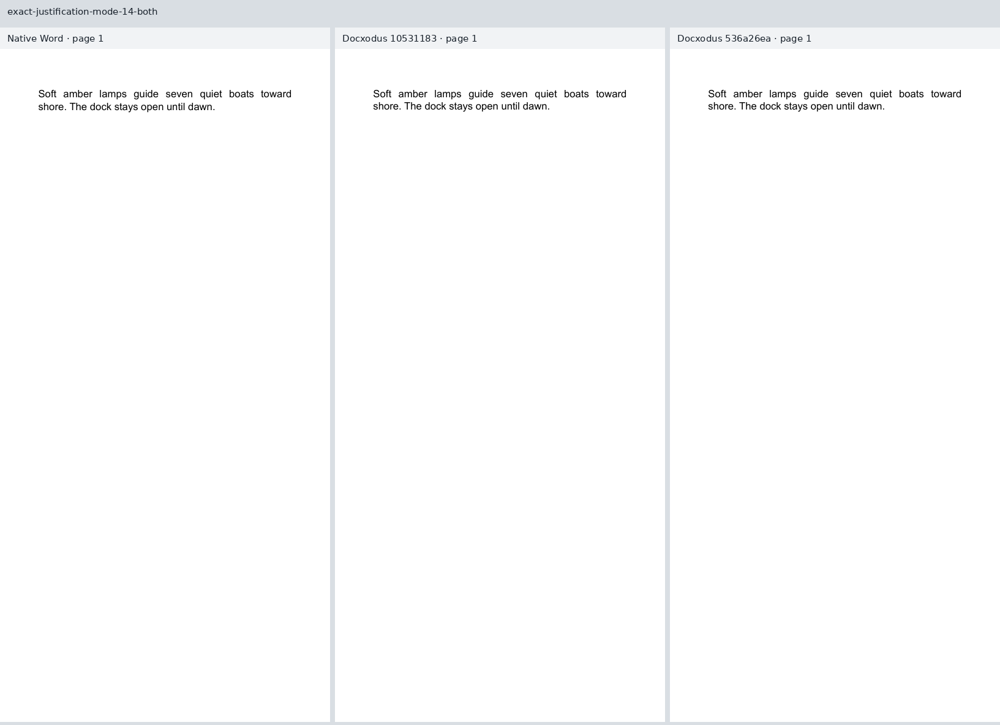
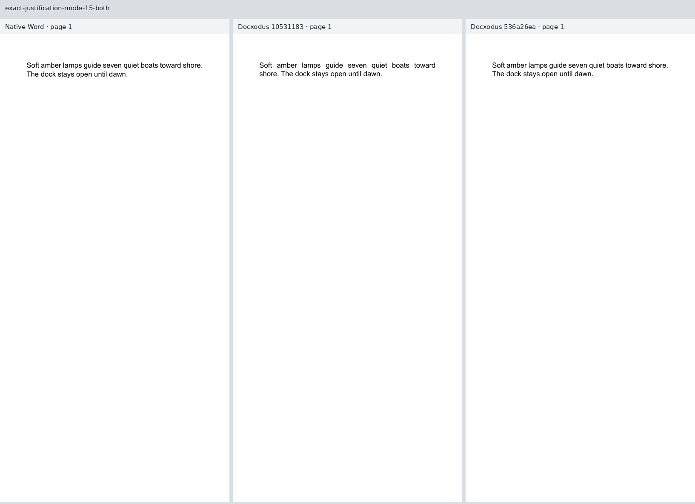
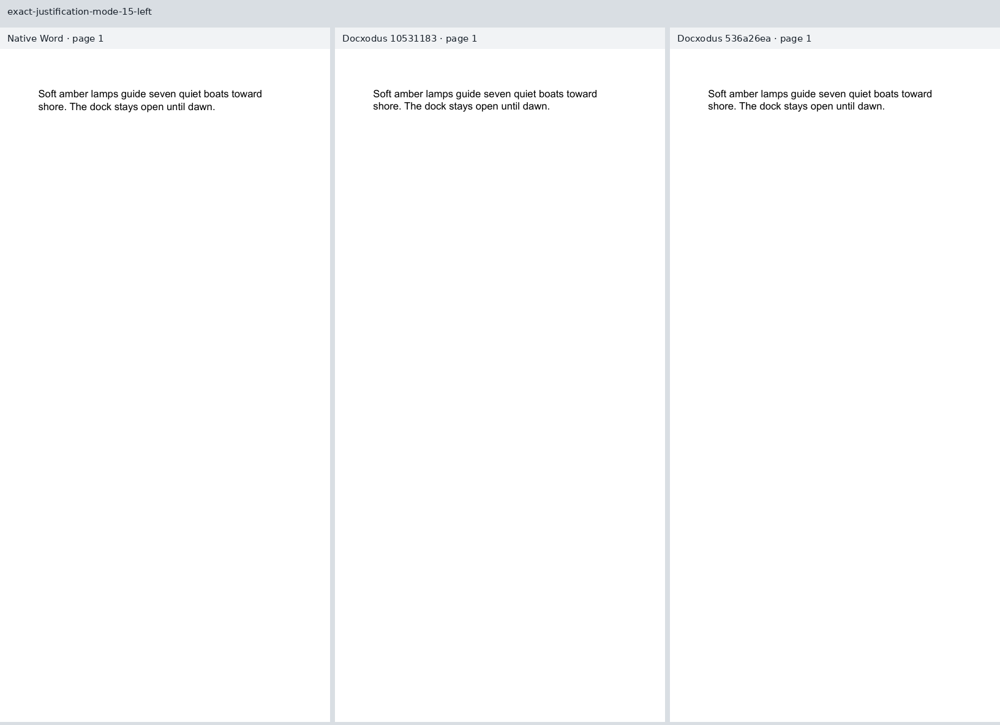

Four original cases pin [Docxodus #1524](https://github.com/JSv4/Docxodus/issues/1524): 12pt Arial in a 298pt column, exact 15pt lines, compatibility modes 14 and 15, and justified/left alignment. Each input was exported unchanged through signed-in Word for the web. The returned DOCX hashes equal the authored input hashes. All four inputs have zero Open XML SDK 3.5.1 findings.

Only modern justified Word text fits “shore.” on the first line. Current main `10531183` fails that declared line-region check and passes the three controls. Candidate `536a26ea` passes all 20 mandatory page/font/token/geometry/line-region checks. The declaration uses the full paper width and distinct 15pt vertical bands: it asserts line membership, not exact horizontal positions. Raw native, baseline and candidate inspections and hashes are retained in [evidence.json](evidence.json).

All four Word references are eligible. Separate LibreOffice references repeat at 100; their original inspections are retained independently, and the Word-adjudicated line assertions are evaluated against the Word track. No scorer, tolerance, source inventory or clipping rule changed. `core-v103` contains 748 cases; all 744 previous inputs and declarations except generator hashes are unchanged. All 459 Python tests pass.

These are unscored local diagnostics, not a full-suite result or raster-parity claim. The candidate passed the unmodified source-bound build recipe. Main exceeded its WASM wire-size budget by 2 KB; its completed WASM output and separately completed JavaScript/export builds are used only for the labeled baseline. The host fails strict user-namespace preflight, while the actual Chrome exports ran with the process sandbox and all production font/clipping checks. Arial is separately provisioned; matching family names do not establish identical cloud and local font outlines or versions.

All 12 pages below were visually inspected at the same scale. Each row shows native Word, baseline Docxodus, and candidate Docxodus, including the complete one-page output from each. Line membership and baseline pitch agree with Word after the fix; the three controls retain their original layout.

| Case | Native Word / baseline / candidate |
| --- | --- |
| `exact-justification-mode-14-both` |  |
| `exact-justification-mode-14-left` |  |
| `exact-justification-mode-15-both` |  |
| `exact-justification-mode-15-left` |  |
