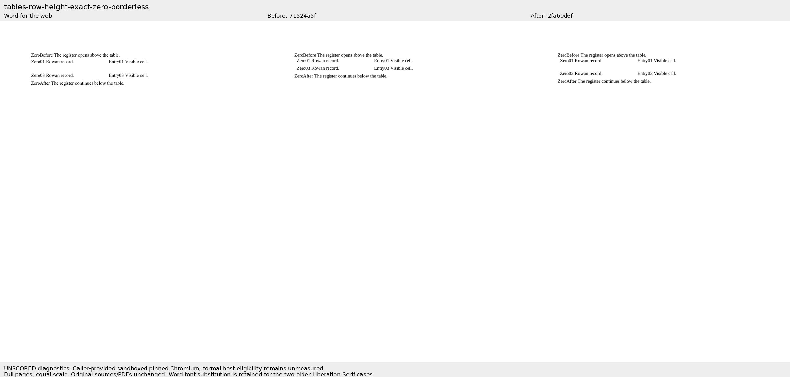
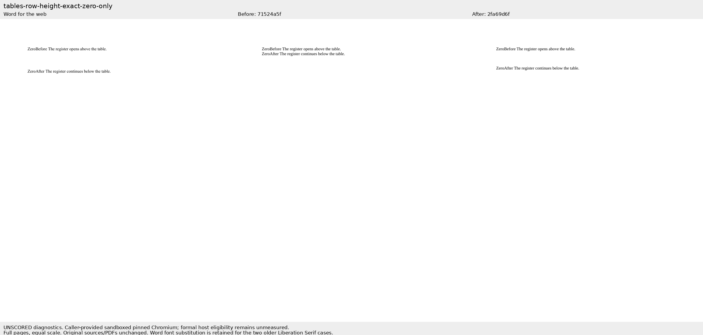
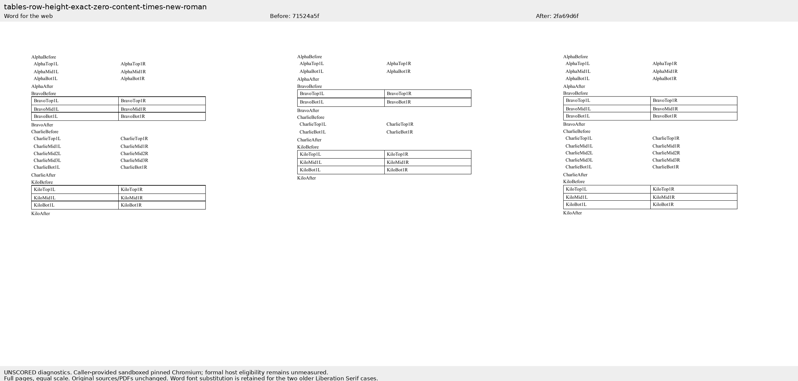
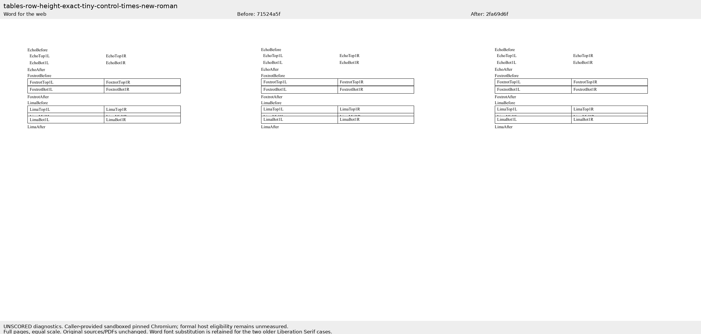

# Exact-zero rows use their content height

Companion to [Docxodus #1367](https://github.com/JSv4/Docxodus/pull/1367), fixing #1339. The two new Times New Roman cases reuse the original author’s literal OOXML from commit `7851026`; their bytes exactly match the native Word capture inputs. All 988 prior DOCX files are unchanged. The PDF suite is `core-v63` (304 cases); the redline suite remains `redline-v17` (152 cases).

Both Times New Roman references pass the importer’s complete token, font and assertion checks. The original `exact-zero-only` and `exact-zero-borderless` captures remain ineligible because Word substituted Times New Roman for their declared Liberation Serif. No thresholds or font-eligibility rules changed. Source/PDF hashes, capture times, actual local font-file hashes and rights are in [word-capture.json](word-capture.json). Native PDFs and UI proof remain in the durable per-issue Word evidence pack.

## Measurement limits

The formal candidate runs remain **unmeasured**: this host denies the unprivileged user namespaces required by the benchmark’s preflight. A root-owned, already installed Chrome helper does allow pinned Chromium 143.0.7499.4 to run with process sandboxing enabled. The separate public-export diagnostics below use that caller-provided browser and regular font files with the same recorded hashes. They are explicitly unscored and do not satisfy the benchmark’s release-baseline eligibility contract. No complete suite or fidelity score is claimed.

The 39 core row-height tests and 16 sandboxed production-export/PageMap tests pass. All six generated DOCX inputs saved by the export tests and both new benchmark inputs have zero Microsoft365 SDK findings. All 264 independent benchmark tests pass. The positive-height control has exactly the same marker coordinates before and after the fix.

## Word comparison

The zero-content case loses ten required labels before the fix and retains all of them after it. For `AlphaAfter`, Word’s y position is 142.999pt, current main is 126.702pt, and the fix is 143.202pt. Some other marker positions retain sub-point differences: `BravoAfter` is 0.827pt high, `CharlieAfter` 0.617pt high and `KiloAfter` 0.897pt high. Those remain outside the existing 0.5pt assertion tolerance; this change addresses zero-height content loss, and the residual raw geometry is retained rather than excused. Cloud/local font binaries are not asserted identical.

Every screenshot shows full pages at equal scale: native Word, source-bound current main `71524a5f`, and reviewed fix `2fa69d6f`. All four PNGs were actually opened and inspected. Full raw words, coordinates, checks, build identities, environment qualifications and artifact hashes are in [evidence.json](evidence.json).

## tables-row-height-exact-zero-borderless

## tables-row-height-exact-zero-only

## tables-row-height-exact-zero-content-times-new-roman

## tables-row-height-exact-tiny-control-times-new-roman

