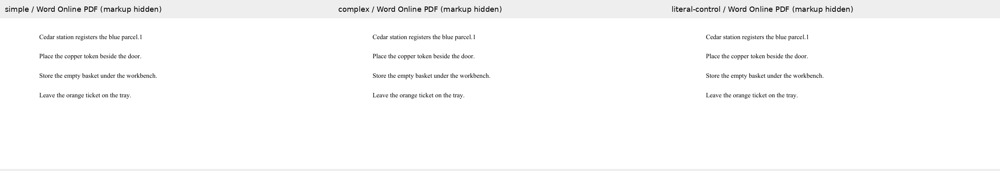
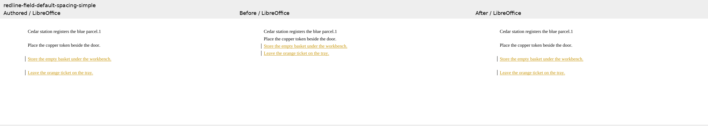
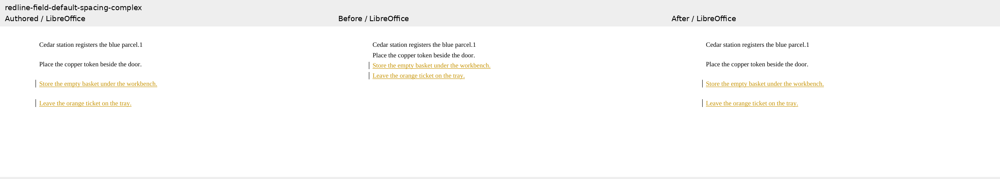
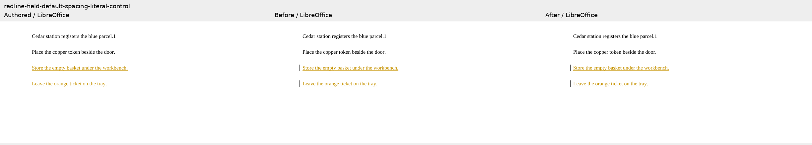

# Field defaults beside unchanged fields

The simple and complex PAGE cases append two paragraphs while changing document-default
after/line spacing from 80/260 to 280/380. The literal-text control has the same visible text.
Both field cases score 0 on `5bae7386` and 100 on `3ff2e7a5`; the control stays at 100.
All six LibreOffice accept/reject comparisons apply, and schema validation passes. These
are three focused diagnostics, not a complete 229-case suite score. `evidence.json` records
all mandatory checks. The 226 previous fixture sets remain byte-identical.

The screenshots below show authored markup, baseline, and candidate in LibreOffice. The
crop contains all document text. Word Online opened and exported all three authored redlines
through authenticated Playwright; `word-capture.json` binds each capture to its exact input
and PDF hashes. Word's reported build is unavailable. These default PDF exports hide revision markup and verify final appearance of the authored
redlines, not Word Compare output or native accept/reject behavior. Raw captures stay in
the local evidence directory; no font program or authentication data is included.

### simple

### complex

### literal-control

