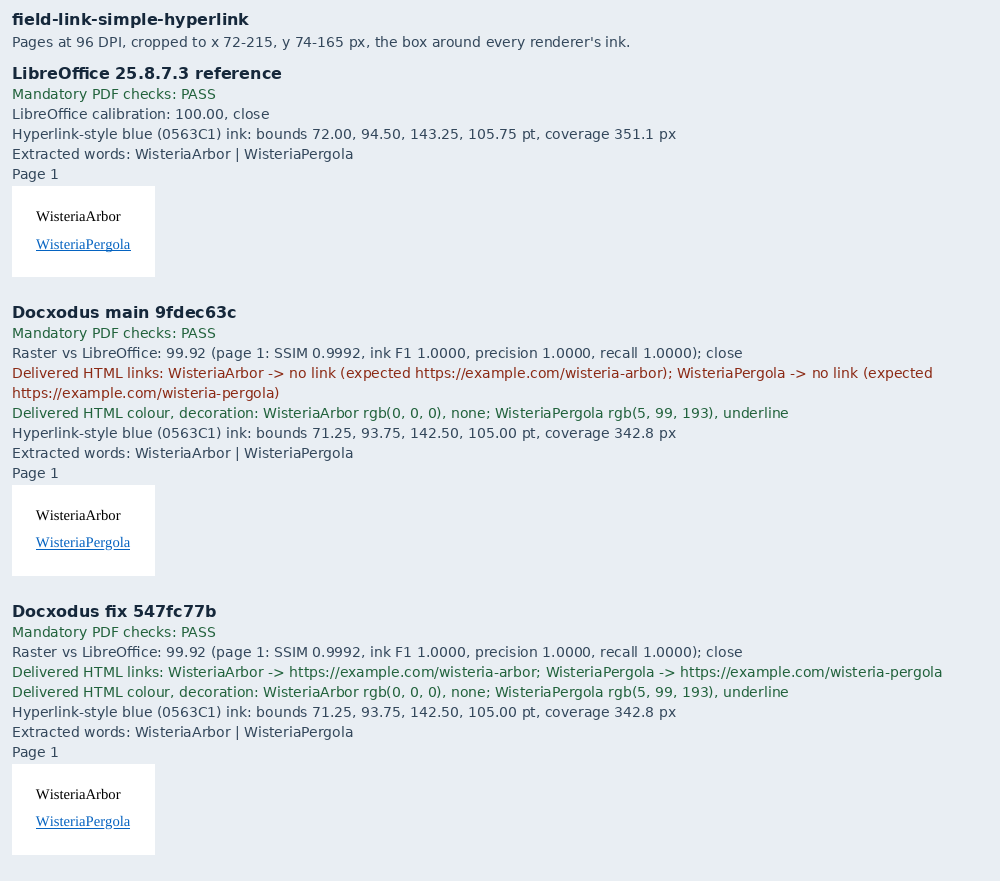
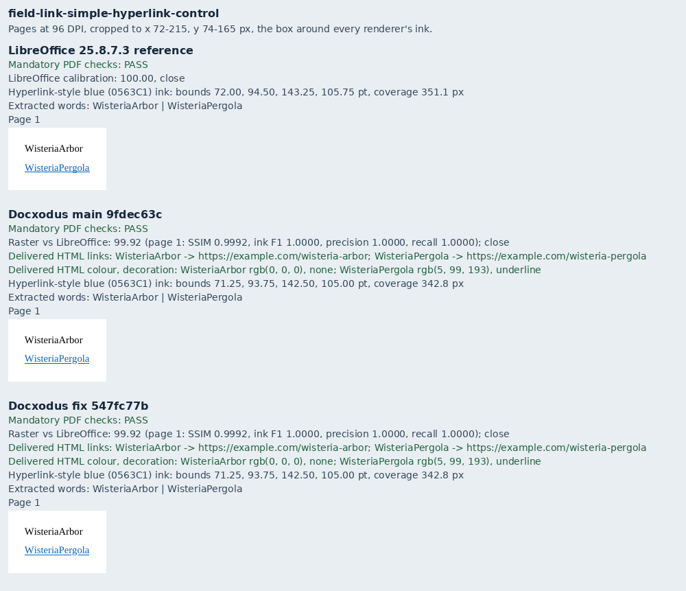
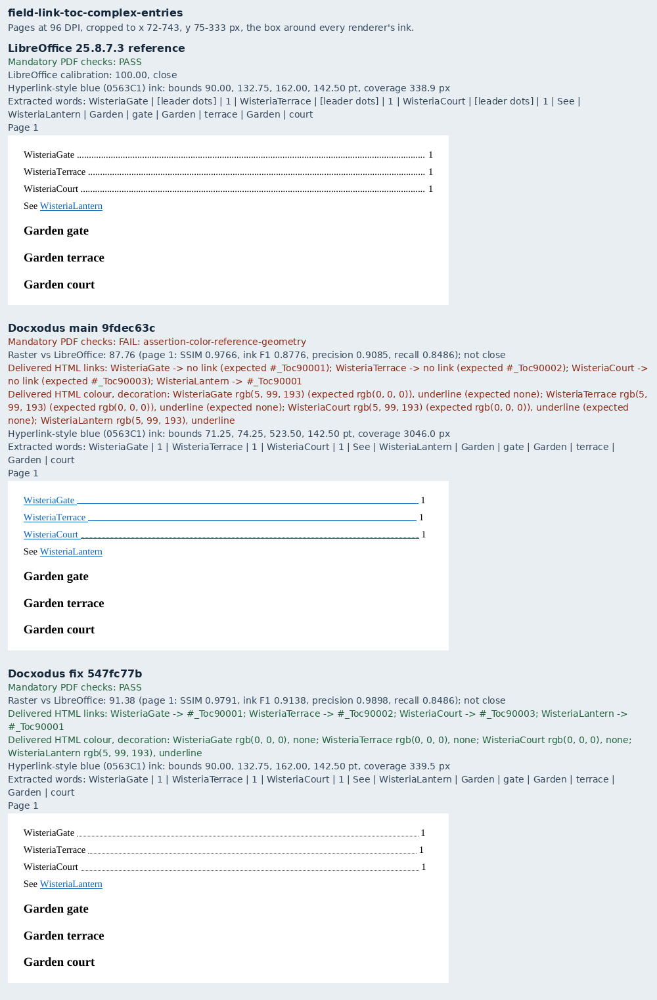
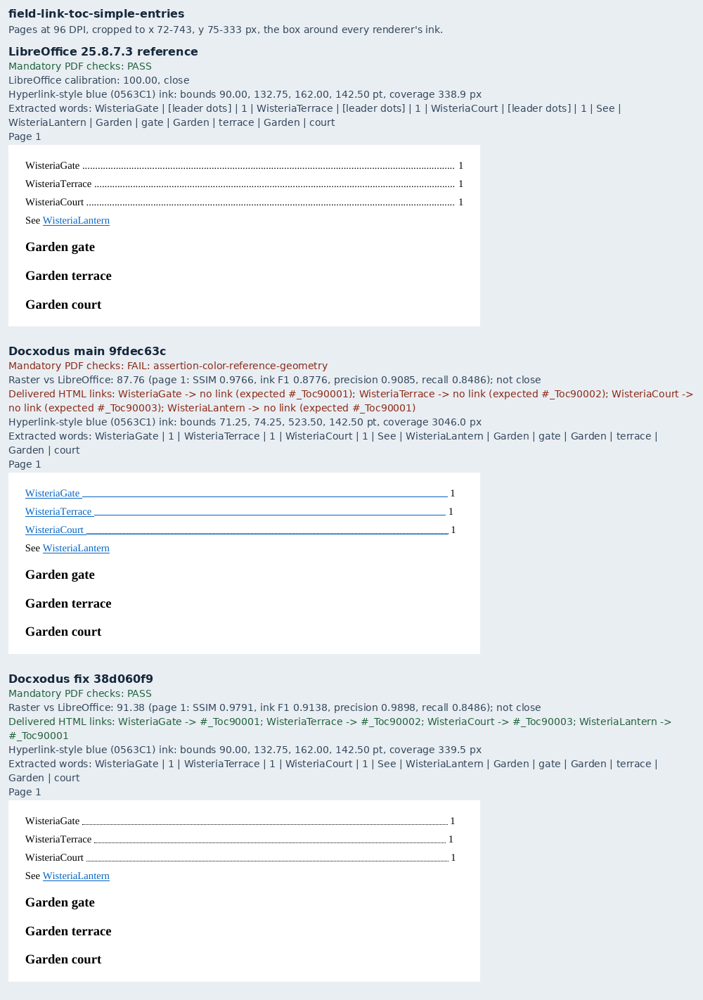
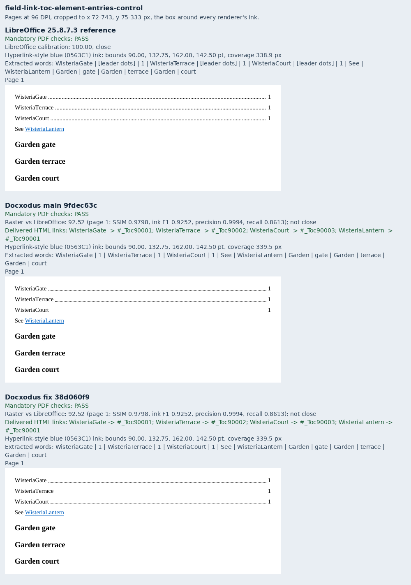

# Links written as fields ([JSv4/Docxodus#1870](https://github.com/JSv4/Docxodus/issues/1870))

A link can be written three ways: as a `w:hyperlink` element, as a complex HYPERLINK field (`w:fldChar` and
`w:instrText`), or as a simple field (`w:fldSimple`). Docxodus `main` at `9fdec63c` gets two of the field forms wrong:

- **A simple HYPERLINK field is not a link.** Its text renders as plain text with no `<a>`, so it cannot be followed.
- **A table-of-contents entry written as a HYPERLINK field is drawn blue and underlined, and is no link.** Each
  entry's text and leader tab are in the `Hyperlink` character style. Word draws a contents entry black and not
  underlined whether it is written as a field or as a `w:hyperlink` (measured in Word reference PDFs; see the
  Docxodus pull request for #1870, [JSv4/Docxodus#1879](https://github.com/JSv4/Docxodus/pull/1879)), and LibreOffice 25.8.7.3 draws all three forms the same way. Docxodus drew the
  `w:hyperlink` entries that way already, but drew field-form entries in the style's blue (0563C1) and underline, with
  a solid underline in place of the leader dots. It also wrote them into the HTML with no link. The same field outside
  the table of contents keeps the style's blue and underline in every renderer.

| Case | What it holds | Its control |
| --- | --- | --- |
| `field-link-simple-hyperlink` | two paragraphs, each a `w:fldSimple` HYPERLINK to an `https://example.com/` address: `WisteriaArbor` (a plain run) and `WisteriaPergola` (a run in the Hyperlink style) | `-control`: the same runs in `w:hyperlink` elements whose relationships hold the same addresses |
| `field-link-toc-complex-entries` | a `TOC \o "1-3" \h \z \u` field over three `TOC1` paragraphs, each entry a nested complex `HYPERLINK \l "_Toc9000N"` field holding the entry text and a tab in the Hyperlink style, then a nested `PAGEREF _Toc9000N \h` field whose `1` is `w:webHidden`; then `See WisteriaLantern`, the same link form outside the table of contents; then three headings holding the bookmarks | `field-link-toc-element-entries-control`: every link a `w:hyperlink w:anchor` |
| `field-link-toc-simple-entries` | the same, every link a `w:fldSimple` HYPERLINK field | the same control |

Each reproducer's package differs from its control's only in `word/document.xml`, and there only in the form of its
links: `tests/test_field_links.py` turns every field into the control's `w:hyperlink` and gets the control's XML. Both
packages of the simple pair carry the two address relationships. The `TOC` field begins in the first entry paragraph
and ends in the last, outside the entry's link, as Word writes it. Spaces either side of each leader tab keep its dots
apart from the words in the PDF text, so `isolated-dot-leaders-v1` can set them aside.

Two kinds of checks decide the cases:

- **Delivered HTML links.** A version 1 `marker-attribute` check on each label requires its nearest `href` to be the
  field's address or `#_Toc9000N`. A printed page cannot tell a link from plain text in the same ink. These checks are
  reported apart from the PDF score, as the scoring contract describes.
- **The Hyperlink style's blue.** A version 1 `color-reference-geometry` check on 0563C1 requires the blue ink to have
  the reference's bounds within 1.5pt and its coverage within 8%. These are the tolerances the static-image cases use.
  In each LibreOffice reference that ink is only `WisteriaPergola` or `WisteriaLantern` with its underline. So the
  check fails a renderer that draws the contents entries blue, and also one that turns the outside link, or the plain
  `WisteriaArbor`, into a blue link. The suite's earlier uses of this check measure pictures and drawn lines. Here it
  measures text ink with no change to its code or tolerances: it counts only pixels that are the declared colour
  blended over white, so black text and gray antialiasing stay out of the region, and the reference and candidate
  are measured by the same rule.

## Measurements

| Case | Kind | LibreOffice 25.8.7.3 | Docxodus main `9fdec63c` | Docxodus fix `38d060f9` |
| --- | --- | --- | --- | --- |
| `field-link-simple-hyperlink` | reproducer | pass; calibration 100.00 | PDF pass, raster 99.92, close; **HTML 0/2**: no link | PDF pass, raster 99.92, close; HTML 2/2 |
| `field-link-simple-hyperlink-control` | control | pass; calibration 100.00 | PDF pass, raster 99.92, close; HTML 2/2 | PDF pass, raster 99.92, close; HTML 2/2 |
| `field-link-toc-complex-entries` | reproducer | pass; calibration 100.00 | **PDF fail** (colour geometry), raster 87.76; **HTML 1/4**: no entry is a link | PDF pass, raster 91.38; HTML 4/4 |
| `field-link-toc-simple-entries` | reproducer | pass; calibration 100.00 | **PDF fail** (colour geometry), raster 87.76; **HTML 0/4**: no link at all | PDF pass, raster 91.38; HTML 4/4 |
| `field-link-toc-element-entries-control` | control | pass; calibration 100.00 | PDF pass, raster 92.52; HTML 4/4 | PDF pass, raster 92.52; HTML 4/4 |

"PDF pass" and "PDF fail" are the mandatory PDF checks: the complete visible-word inventory, the declared font family,
page geometry and the colour geometry. A mandatory failure makes the case score 0, so both contents reproducers score
0 on `main`. Their raster figure only describes the page. On `main`, the 0563C1 ink of both contents reproducers spans
71.25–523.50pt across and starts 58.5pt higher than the reference's, which spans 90.00–162.00pt. Its coverage is 3,046
pixels against 339. With the fix and in the control, the bounds equal the reference's and the coverage is within 0.2%.
"Raster" is the worst page's `100 × min(SSIM, ink F1)` against the LibreOffice reference, as `bench run` computes it.
"Close" is SSIM ≥ 0.98 and ink F1 ≥ 0.95 with every mandatory check passing. `evidence.json` holds each page's SSIM,
ink F1, precision and recall.

- **The simple pair.** Every renderer draws the same page, raster 99.92 on both builds, so the delivered HTML decides
  it. On `main`, neither label in the reproducer is in a link. With the fix, each is in an `<a>` to its address. The
  plain run stays black and the styled one blue: the colour-geometry check passes on both builds.
- **The contents cases' raster.** It moves the way the drawing does. Precision rises from 0.9085 on `main` to 0.9898
  with the fix; the control's is 0.9994. No contents case reaches close on either build, for two reasons outside
  #1870:
  - Docxodus draws a dot leader as a dotted rule where LibreOffice prints dots. That holds the control to recall
    0.8613 on both builds.
  - In both field forms, Docxodus ends each page number 8.7, 10.5 and 8.0pt short of the right tab stop on both
    builds. The control's numbers end within 0.1pt of LibreOffice's. This holds the reproducers' recall at 0.8486.
    Without the space run before the PAGEREF field, a diagnostic variant outside this suite still ends them 4.2–6.7pt
    short. It is a separate layout difference,
    [JSv4/Docxodus#1877](https://github.com/JSv4/Docxodus/issues/1877), which these cases leave to the raster score.
- **The outside link.** In the complex case, `WisteriaLantern` is already a link to `#_Toc90001` on `main`, since a
  complex HYPERLINK field outside another field already rendered as a link. Its check is there so that a fix which
  drops that link fails.

All five LibreOffice references are eligible, and the LibreOffice identical-engine calibration scores 100.00 on each
with the `close` gate. The two Docxodus columns are **unscored diagnostics**, not registered candidate scores. On this
host the benchmark's own adapter reports `ENVIRONMENT_INELIGIBLE` (`user_namespaces_unavailable`: the host denies the
unprivileged user namespaces that its pinned Chromium's sandbox needs). So the PDFs and HTML were captured with
`docs/results/export-reliability/Capture.mjs --html`. That uses the public export API in a system Chrome
158.0.8127.36, with its sandbox on, strict fonts and the Liberation Serif directory. The HTML comes from
`renderDocxArtifacts`, which builds its HTML through the same internal path as the adapter's
`convertDocxToStandaloneHtml`. `Inspect.py` checks a PDF against itself, so it cannot decide a reference-relative
check. `Compose.py` therefore applies `bench.pdf.correctness` against the LibreOffice reference, as `bench run` does,
and reads each delivered HTML file with `bench.html_artifacts.check`.

Both renderers were built with `bench build-docxodus` from clean detached worktrees: `main` at
`9fdec63cc39018ebdf68031496c8162ad34e2d52` and the fix at `38d060f9d9c959f8dea91f7da41d041701d096cc`. That
fix adds review changes to an earlier fix commit, `71641ebed61a659e6ebe3a268db449e14aa3f0b3`. Measured the same
way, the earlier commit gave the same result for every check, raster figure, colour region and page-number
position. The pull request's head, `073b38e0c03c4b22fa2e0afa3e86b5e391c31f3a`, differs from `38d060f9` only in a
test file, the changelog and documentation. Its library source (`Docxodus/`) is byte-identical, so it was not
measured again.

## Pending

- Word reference registration and full-suite scoring for `core-v177`. No Word capture was made for these cases.
- A candidate score under the benchmark's pinned Chromium runtime, from CI or a host that allows its sandbox.

## Reproduce

`evidence.json` binds:
- the manifest, the reference bundle and its environment, and the calibration result;
- both build identities, and the capture and inspection records;
- every page measurement, colour region and HTML check;
- the hashes of every PDF, delivered HTML file, page raster and screenshot.

`reference-bundle.json` is the LibreOffice bundle. Set `MANIFEST` to a manifest holding only these five cases,
`ENVIRONMENT` to the JSON that `bench.environment.environment(['Liberation Serif'])` returns, and `RUN` to a scratch
directory that holds `MANIFEST` as `manifest.json`. Then run:

```sh
python3 -m bench build-docxodus --source SOURCE --commit FULL_SHA   # for each build
python3 -m bench reference libreoffice --manifest MANIFEST --out RUN/reference
python3 -m bench run --manifest MANIFEST --reference RUN/reference/bundle.json --adapter libreoffice \
  --candidate reference-calibration --out RUN/calibration --gate close
node docs/results/export-reliability/Capture.mjs SOURCE MANIFEST RUN/capture-main ENVIRONMENT --html
python3 docs/results/export-reliability/Inspect.py MANIFEST RUN/capture-main/capture.json
python3 docs/results/field-links/Compose.py RUN
```

Before composing, repeat the capture and inspection for `RUN/capture-fix`. Then copy each source's
`.docx-bench-build.json` to `RUN/main-docx-bench-build.json` and `RUN/fix-docx-bench-build.json`. Each sheet shows
every page of a case, cropped to the box around all three renderers' ink. Each panel lists:
- the mandatory check result and the raster score;
- each label's delivered link;
- the bounds and coverage of the Hyperlink style's blue;
- the extracted words.










