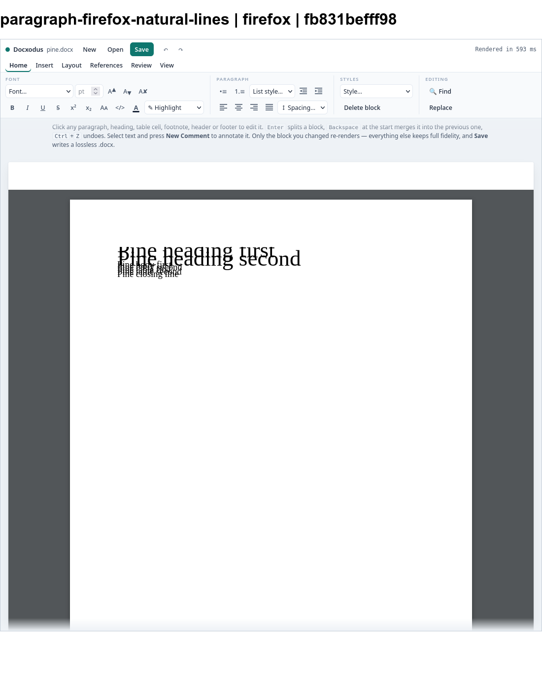
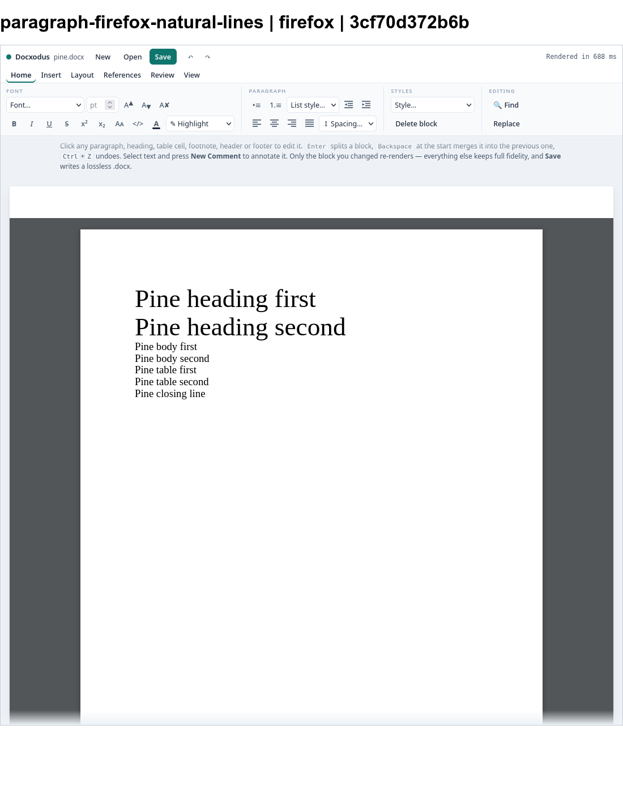
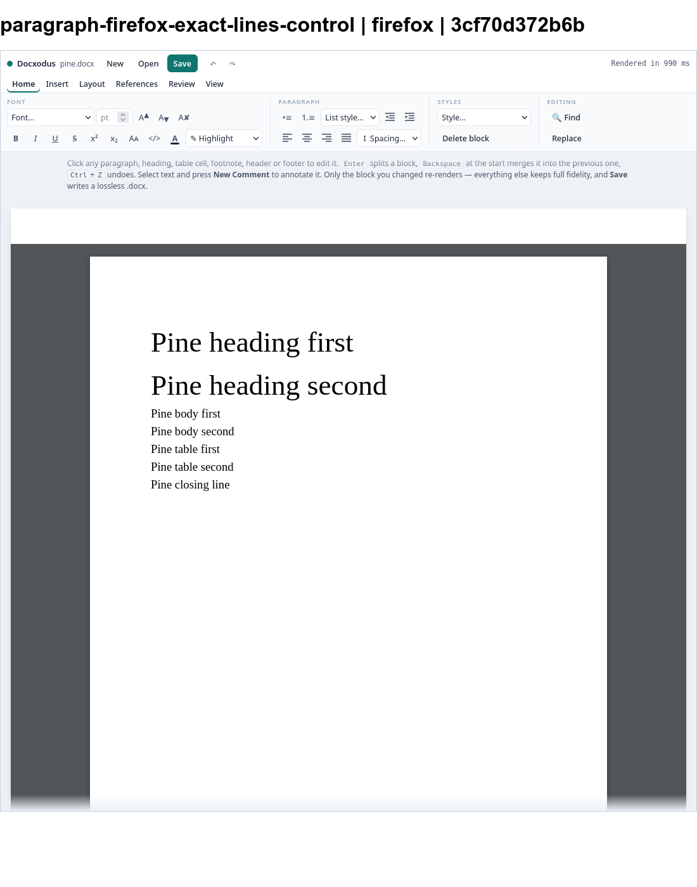
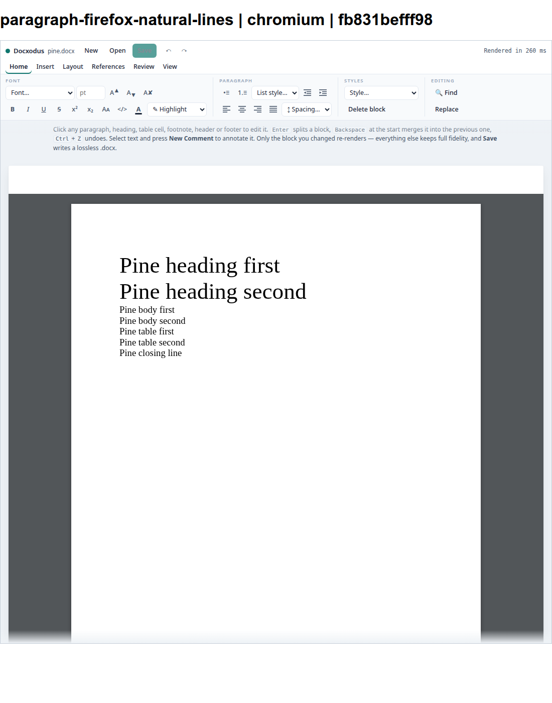
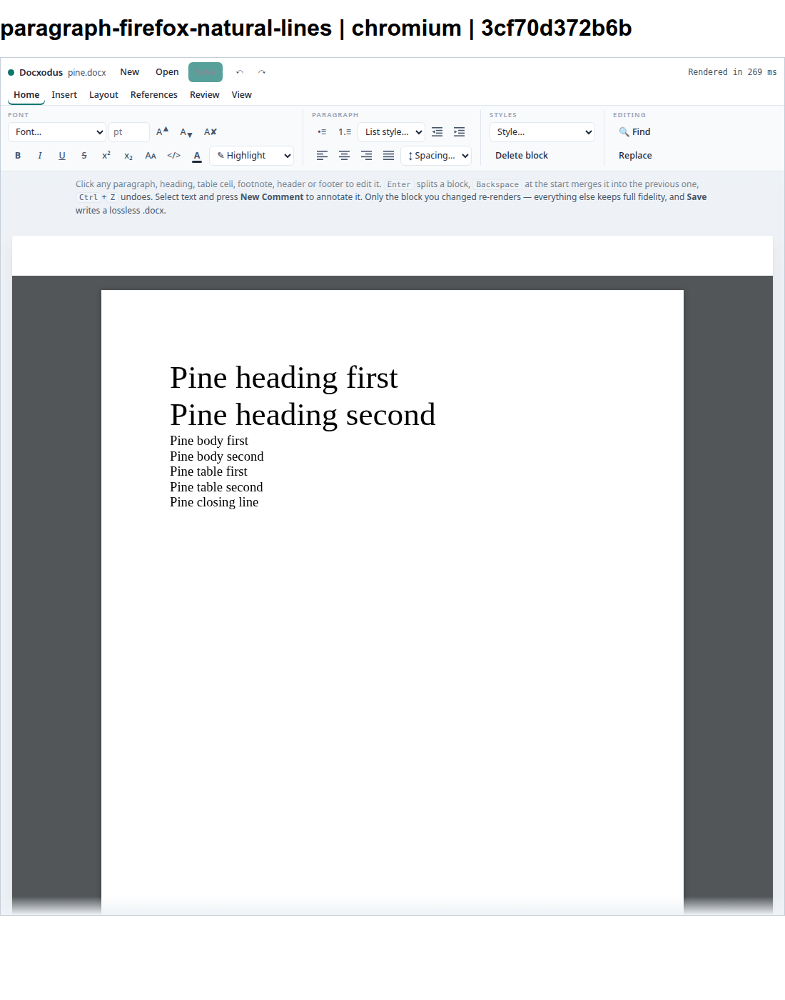
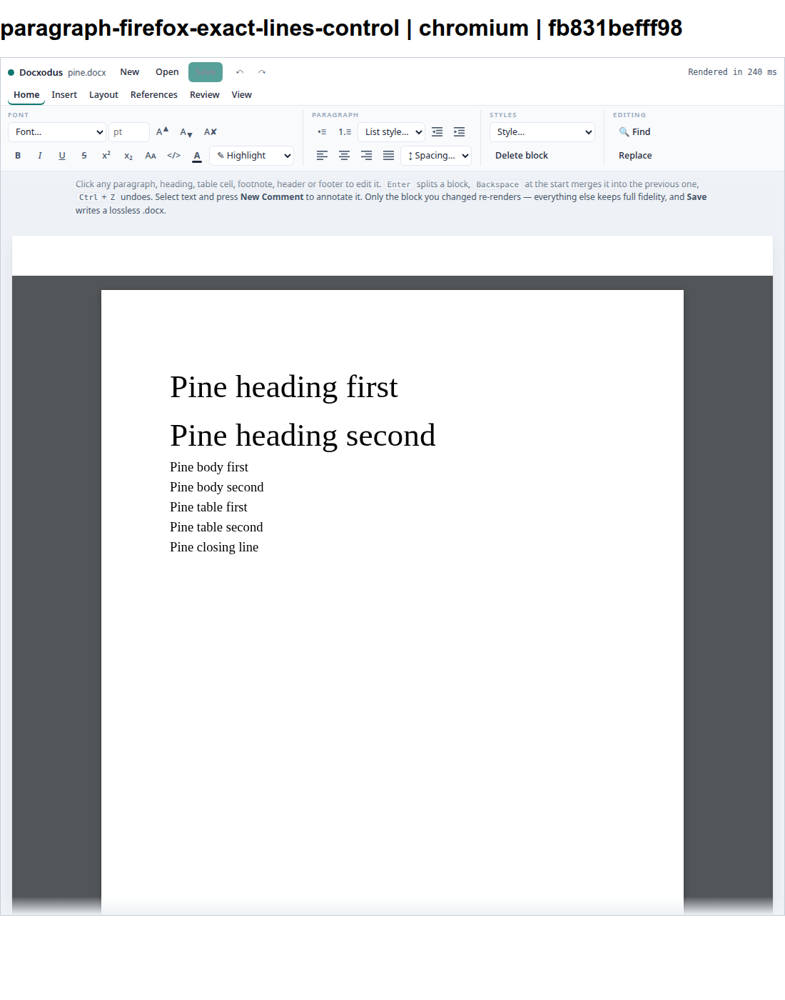

# Firefox natural line height

Independent authored reproducer/control for [Docxodus #1424](https://github.com/JSv4/Docxodus/issues/1424).
The two PDF-track inputs contain the same seven Pine lines in a heading, body, table, and closing paragraph.
Only four paragraph spacing elements differ: automatic single spacing versus explicit 1.5-em spacing.
Both inputs pass the Open XML SDK validator with zero findings. All 533 older inputs regenerate unchanged.

This supplemental diagnostic opens each DOCX through the shipped ribbon editor in Page view. It records
seven positive text ink boxes, checks their inventory and overlap, and rejects browser errors. Ink geometry
uses a zero-size baseline marker and canvas metrics; each marker must leave the original text range unchanged.
It measures browser geometry, **not PDF fidelity or Word behavior**. PDF references and scoring remain pending;
the Chromium PDF track alone cannot exercise a Firefox font-size cap.

| Renderer / case | Baseline | Candidate |
| --- | --- | --- |
| Chromium 155.0.8059.84 / natural | Pass | Pass |
| Chromium 155.0.8059.84 / exact control | Pass | Pass |
| Firefox 144.0.2 / natural | Fail: 15 overlapping line pairs | Pass |
| Firefox 144.0.2 / exact control | Pass | Pass |

Baseline: `fb831befff9824f9d41f8066ed836289574b61c3`.
Candidate: `3cf70d372b6b9669d4979d4dbc95e0784319279e`.
The same capture script, manifest, input hashes, Liberation Serif file, and browser binaries were used for both.
[Baseline record](baseline-capture.json) and [candidate record](candidate-capture.json) include production build
identity, source tree, artifact hashes, actual editor bundle hash, browser versions, input hashes, and measurements.
The script verifies clean tracked source and the standard production build before and after capture.

## Reproduce

Use a clean Docxodus checkout at either full commit above. Provision its npm dependencies, Playwright Firefox,
Chromium, and Liberation Serif, then run from this benchmark checkout:

```sh
python3 -m bench build-docxodus --source /path/to/Docxodus --commit FULL_COMMIT
PLAYWRIGHT_BROWSERS_PATH=/path/to/browsers DOCXODUS_CHROMIUM_PATH=/path/to/chromium \
  node docs/results/firefox-line-height/Capture.mjs /path/to/Docxodus FULL_COMMIT runs/firefox-capture
```

The baseline exits 1 because the natural-spacing Firefox case fails. The candidate exits 0 with four passes.
The script builds the editor bundle from that checkout after verifying the production build.

## Screenshots

All screenshots are original local captures, labeled with case, renderer, and commit.

### firefox: paragraph-firefox-natural-lines

Baseline:



Candidate:




### firefox: paragraph-firefox-exact-lines-control

Baseline:


Candidate:




### chromium: paragraph-firefox-natural-lines

Baseline:



Candidate:




### chromium: paragraph-firefox-exact-lines-control

Baseline:



Candidate:


