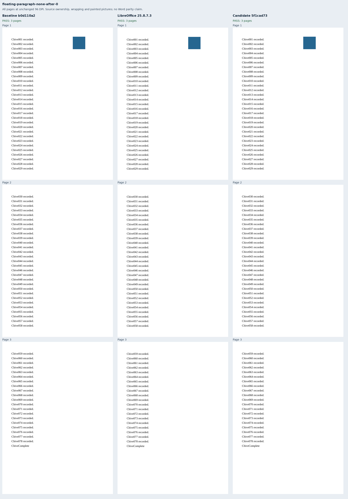
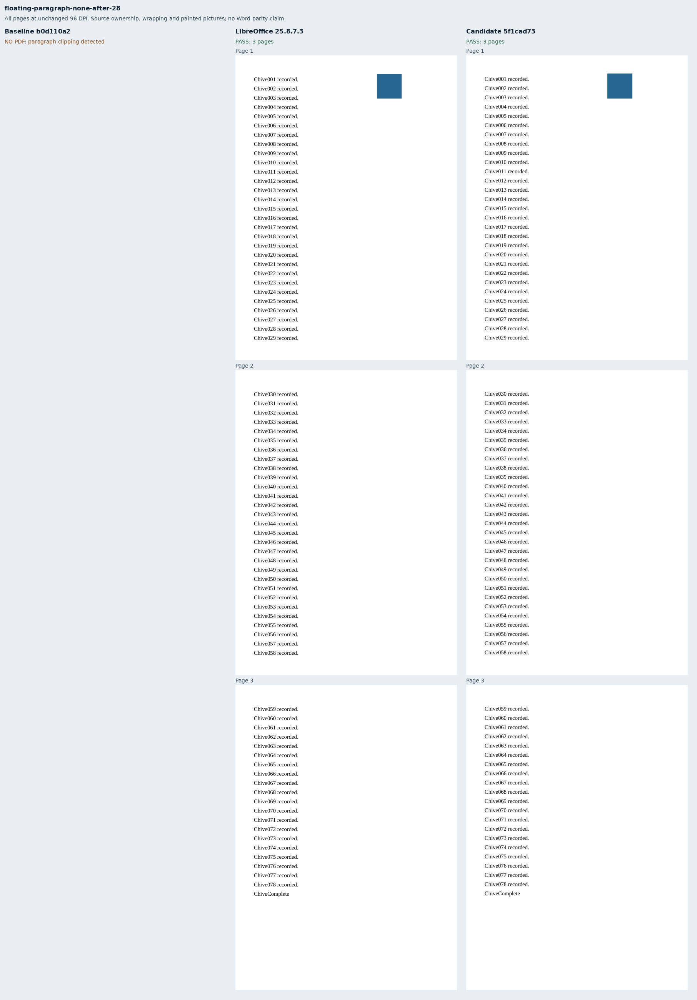
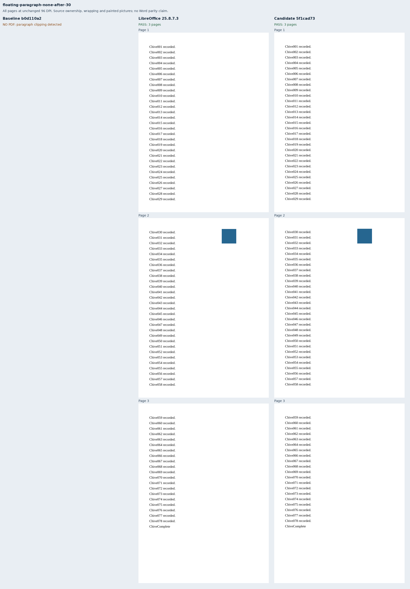
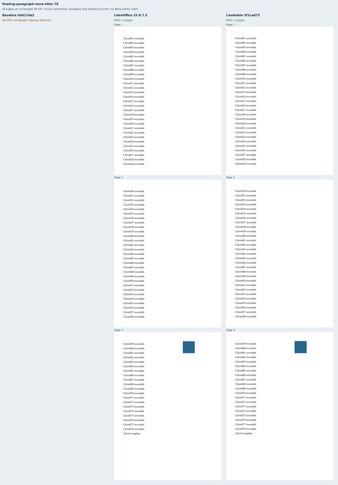
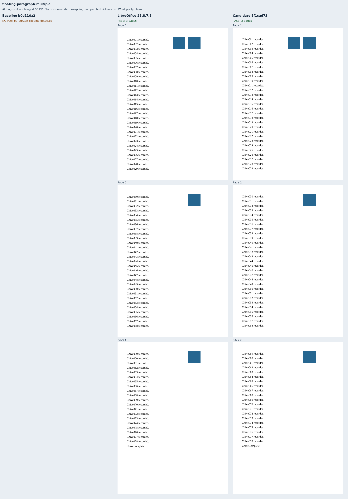
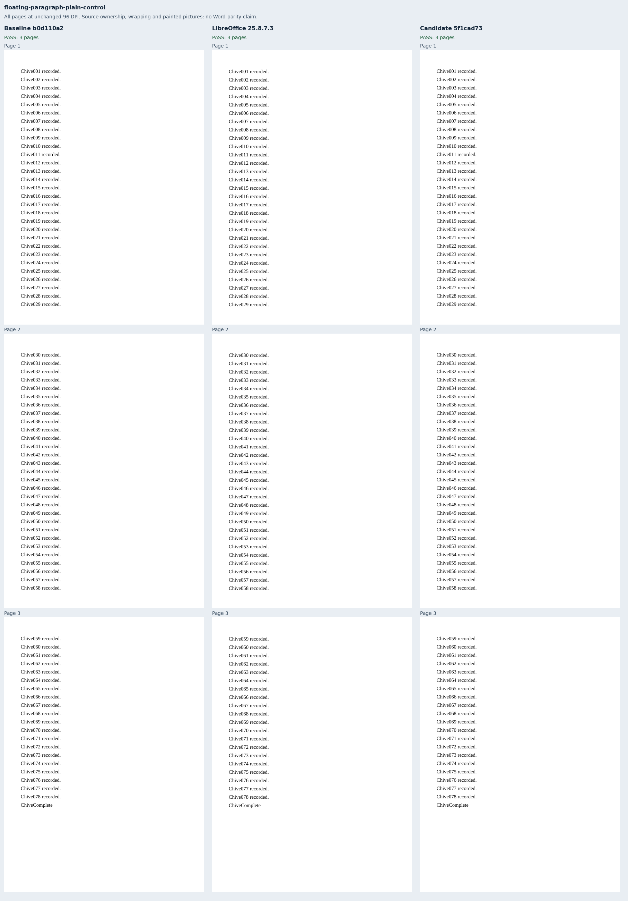
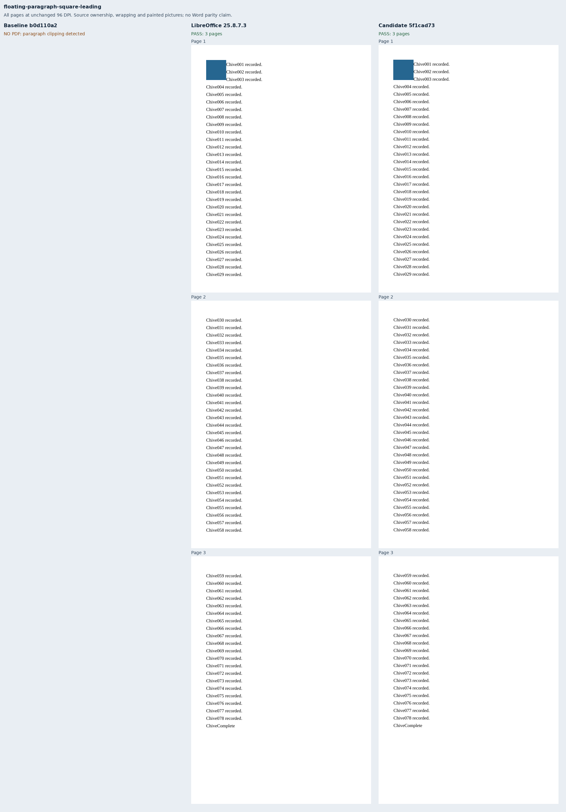
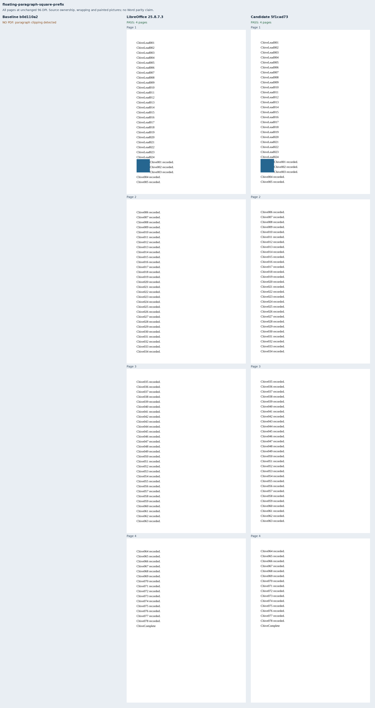
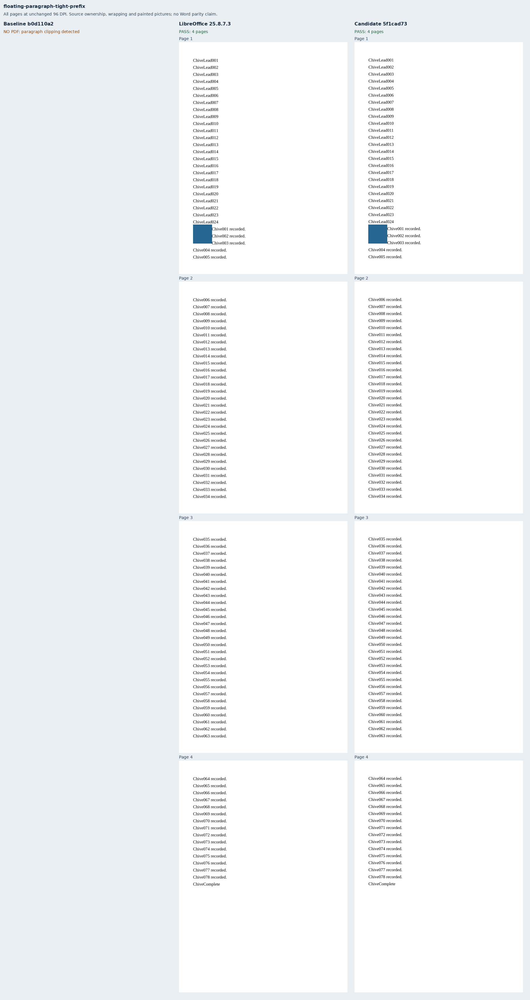

# Pictures inside paragraphs spanning pages

Twelve original Chive documents cover small pictures inside a paragraph longer than a
page. Six move a nonwrapping anchor through the first line, either side of a page cut,
and the paragraph end. Another contains four pictures, including two at distinct
positions on the first page. Square and tight wrapping each have a leading-picture
case and a case after 24 prefix lines. A plain paragraph is the second passing control.
These fixtures address part of Docxodus #1558.

Each paragraph has 78 uniquely labeled lines at exact 18pt spacing, on 432×594pt paper
with 36pt margins. The 522pt body has 29 line slots. The ordinary cases distribute
their labels 29/29/20; the prefix cases use 5/29/29/15. The pictures are original
48pt solid blue squares. Source-relative anchors determine their page and coordinates.
Every label has an explicit page and line-band assertion. Wrapping assertions require
the first three lines to clear the picture and the fourth to return to the left margin.

Primary checks compare complete token inventories, page ownership, wrapping and painted
picture geometry. Supplementary checks derive picture frames from the original OOXML,
measure every delivered HTML picture in physical page coordinates, and require each PDF
picture's colored bounds and area. Every PDF page is inspected, including pages with no
picture; blue paint outside the declared picture frames fails. Missing one of the two same-page pictures fails even
if the other survives. Source text must also have painted ink within the authored paper.
All tolerances are explicit: 0.0001pt for line bands, 0.1pt for HTML picture frames,
1pt for raster picture bounds and 4% for raster coverage.

The initial `floating-v1` run used 420×594pt paper. LibreOffice changed its width to
419.555906pt; both Docxodus builds preserved 420pt. The retained native calibration at
432pt preserves every word coordinate while emitting the exact authored paper size.
`floating-v2` uses that size and fresh native, baseline and candidate captures; no metric
tolerance, vertical position, wrapping bound or picture coordinate was relaxed. The old
inputs and captures remain locally retained, with their manifest and reference bundle
included here as calibration evidence. The initial composition script also corrected its
expected baseline refusal code from `output_verification_failure` to `pagination_failure`;
this changed no rendering assertion.

Adversarial PDF mutations exposed two further verifier gaps: an extra picture on an
unowned page, and damaged same-page pictures with unchanged combined bounds and area.
The final `floating-v3` run freezes all-page and per-picture paint checks, reuses the
unchanged v2 native inputs/references, and freshly captures both production builds.
The two actual corrupted PDFs now fail the stronger checks.

The near-bottom policy diagnostic in the core tests remains separate. When a picture
cannot fit in the remaining body band, Docxodus moves its first fragment to a fresh page;
LibreOffice may let it overhang the body margin. These fitting-prefix fixtures do not
claim to resolve that difference. Late wrapping anchors also remain outside this fix.
No new Word capture, pinned-runtime qualification or whole-suite score is claimed.

The exact pre-fix build `b0d110a2f039368091bd76e1e36f8e35aabff0ff` delivers two controls
and refuses ten cases. Candidate `5f1cad73d1b464d5af1a7cf6a4c498a851baa5f3` passes all twelve.
The [retained evidence](evidence.json) contains 26 PDFs across 82 pages, 14 verified
production reports and twelve full-page comparison sheets. All twelve native references
meet the declared contract. All 113 observation mutations are rejected, including 90 by
the primary assertions. Both builds retain verified bindings for 19 build files and 45
runtime assets. The [paper calibration](calibration.json) preserves the earlier evidence.

## Reproduction

Generate `core-v125`, select `floating-paragraph-*`, validate the packages and capture
native references before freezing `manifest.json`, `source-frames.json` and the verifier
hashes. Build the exact renderer commits with `python3 -m bench build-docxodus`. Then:

```sh
node docs/results/export-reliability/Capture.mjs SOURCE RUN/manifest.json RUN/candidate RUN/environment.json --html
node docs/results/floating-paragraphs/Geometry.mjs SOURCE RUN/candidate
python3 docs/results/floating-paragraphs/Compose.py RUN BASELINE_SOURCE CANDIDATE_SOURCE
python3 docs/results/floating-paragraphs/Mutations.py
python3 -m unittest discover -s tests -v
node --test tests/test-adapter.mjs
python3 -m bench.audit
```

Repeat both capture commands for the baseline. `evidence.json` binds the retained
documents, observations, screenshots, strict-font reports and renderer build manifests.













