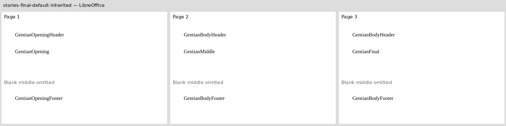
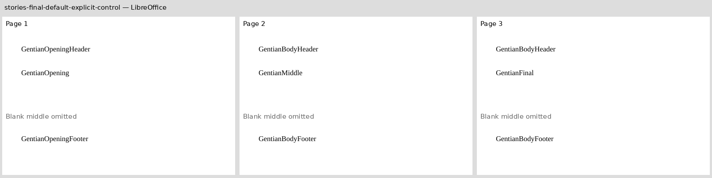

# Final-section default stories

The two original Gentian documents accompany [Docxodus #1619](https://github.com/JSv4/Docxodus/issues/1619).
Section one selects opening headers/footers; section two replaces them with body stories.
The final section inherits those defaults in the reproducer and explicitly repeats the
same references in the control. Both retain first-page references without enabling
different-first-page behavior, so those unused stories must remain invisible.

The complete PDF token inventories require opening stories once and body stories twice.
The unique opening header/footer must stay on page one, and each body paragraph must
stay on its authored page. These checks reject opening/body story swaps. Repeated body
story placement is covered by raster comparison; the marker contract requires unique words.
This pins preserved paginated behavior.
The product's independent .NET and public Python tests assert the flow-specific contract:
one final-section default header/footer pair, with no first/even/package-order fallback.
These PDF assertions do not detect that flow-only selection defect.

Both source-bound LibreOffice captures pass the declared contract. The
[capture bundle](reference-bundle.json) records input/PDF hashes, inspections, environment,
fonts and provenance. All three pages appear below; only their empty middle bands are
omitted. Candidate rendering/full-suite scoring remain pending. No Word capture or
candidate fidelity score is claimed, and all prior DOCX hashes are unchanged.

