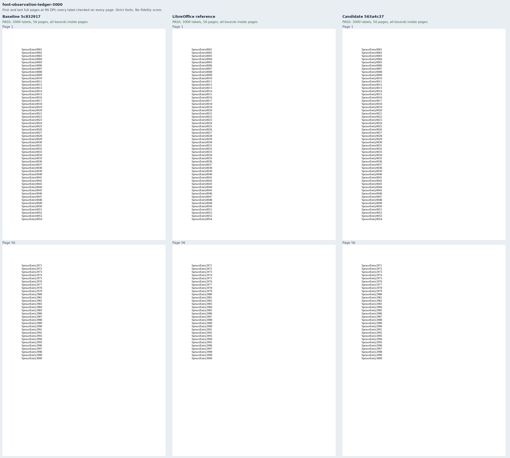
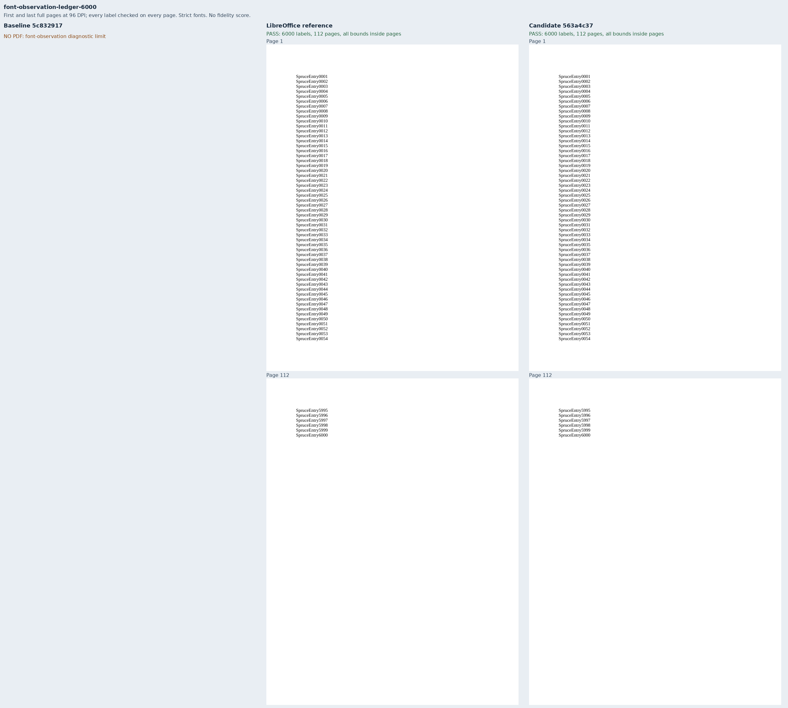

# Large exports survive the font-observation limit

Two original Spruce ledgers cover the diagnostic-budget portion of
[Docxodus #1558](https://github.com/JSv4/Docxodus/issues/1558). They contain 3,000 and
6,000 distinct one-line entries, with no imported fixtures or assets. All entries use
11pt Liberation Serif in exact 12pt paragraphs, on Letter pages with 72pt margins.
The declared 648pt body holds 54 entries per page: 56 and 112 pages respectively.

| Exact production source | 3,000 entries | 6,000 entries |
|---|---|---|
| Main `5c8329174f91692519e24217b2feacde2134e8b3` | 56-page PDF; complete observations | No PDF: font-observation diagnostic limit |
| Fixed `563a4c37e52ce3adc8e2d43be29e98b023c09227` | 56-page PDF; complete observations | 112-page PDF; observations unavailable, one warning |
| LibreOffice 25.8.7.3 | 56-page eligible reference | 112-page eligible reference |

Both renderer revisions have separate production AOT builds. These public exports use strict
font verification with separately provisioned Liberation Serif. Both fixed PDFs pass that check;
the larger document explicitly reports `fontObservation.status: unavailable`, reason
`diagnostic_limit`, and exactly one `font_observation_limit` warning. Its incomplete observation
list is discarded. The 3,000-entry control retains all 3,000 observations without warnings.
These are unscored diagnostics with a borrowed sandboxed Chromium, not pinned-runtime
qualification, Word parity or a full-suite fidelity score.

Every label is checked for exact inventory, its source-derived page number, and positive bounds
wholly inside its physical page. The readable case sheets show the first and last complete pages;
separate contact sheets include every page. Tight containment within the 12pt paragraph band is
not asserted: Liberation Serif's glyph bounds slightly overhang that band in both renderers.
That unrelated font geometry does not affect the observation-budget defect. No existing metric
or tolerance changed.

`core-v108` contains 770 PDF inputs. All prior 768 input bytes, tokens and assertions are unchanged;
shared generator hashes refresh. All 470 harness contracts pass. Both new packages validate with
Open XML SDK 3.5.1/Microsoft365. `evidence.json` binds the exact source/build identities, runtime
asset lists, browser/font environment, captures, PDF/raster/screenshot hashes and every-label
checks. Complete render reports, PDF inspections and the reference bundle are retained as
lossless `.json.gz` files with both compressed and uncompressed SHA-256 hashes. Raw outputs remain
under ignored `runs/observations/`.

The product's separate reproduction on current main `c72b191d` also failed for the original
6,000-paragraph issue document; fixed production `563a4c37` exports all 6,000 entries once and
in order across 131 pages. The 3,000-paragraph original control remains 66 pages. Public tests
exercise HTML, PDF and batch output with a lowered diagnostic budget, strict-font success and
failure, exact fit, discarded partial observations, cleanup and unchanged cancellation/errors.
An independent full-budget probe preserves all 61 existing diagnostics and adds exactly one
bounded summary warning; lower collection limits and PDF-size limits still fail.

This is a partial fix. Tall paragraphs/tables in multiple columns and the two cases still lacking
minimal source documents remain open under #1558. No clipping failure is downgraded to a warning.

```sh
python3 -m bench build-docxodus --source SOURCE --commit FULL_SHA
python3 -m bench reference libreoffice --manifest MANIFEST --out REFERENCE
node docs/results/export-reliability/Capture.mjs SOURCE MANIFEST OUTPUT ENVIRONMENT
python3 docs/results/font-observation-budget/Compose.py runs/observations
```

The composer requires Pillow for the labeled sheets. It verifies every label and all source/build
bindings before retaining evidence. Screenshot pages are unaltered 96-DPI renders; all-page
contact sheets are explicitly labeled thumbnails.





The baseline, reference and candidate all-page contact sheets are included beside these images.
