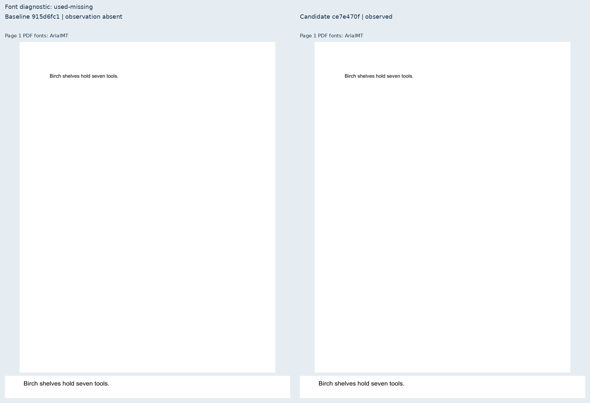
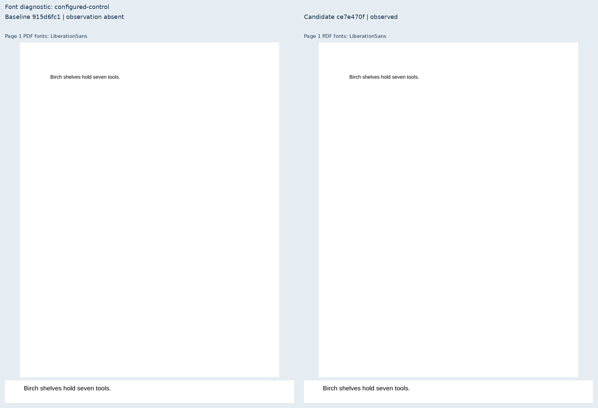
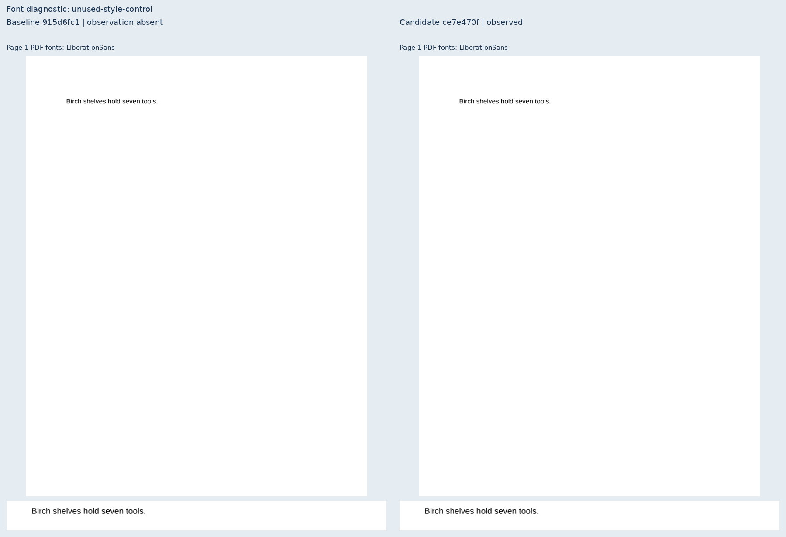
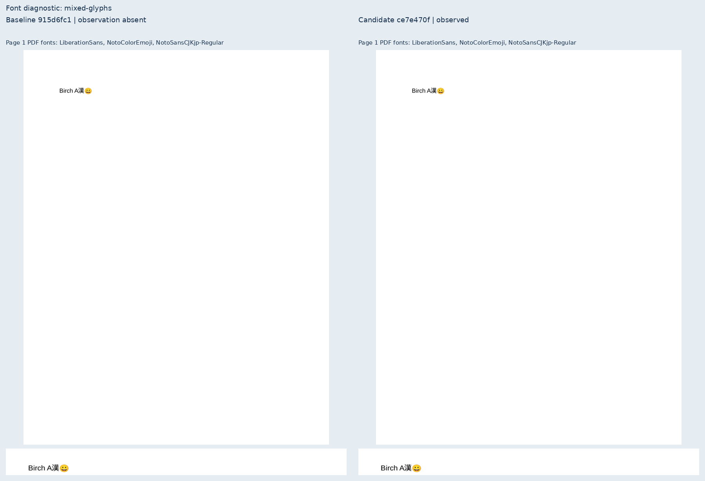
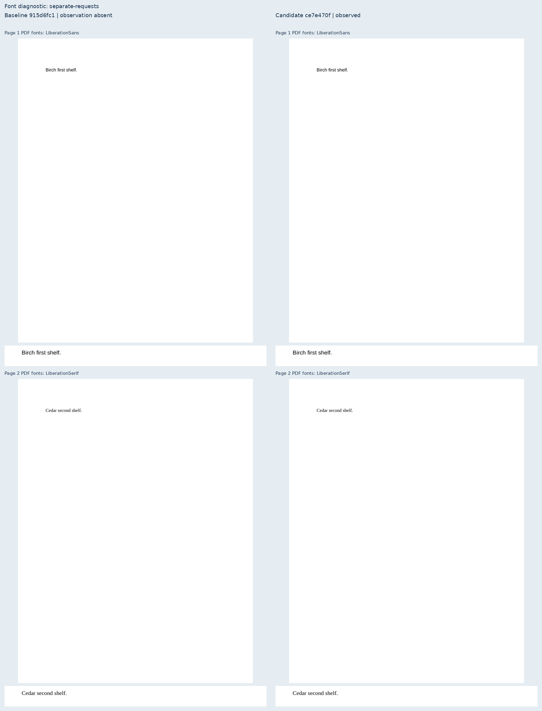

# Actual font observations

Seven original Birch cases compare public exports from baseline `915d6fc1` and candidate
`ce7e470f`. These are source-bound, unweighted diagnostics, with no native-reference or
fidelity-score claim. All baseline and candidate PDF page geometry, text coordinates and
font facts are identical. The candidate adds observed faces and source attribution; it
preserves missing-font warnings, resolver status and file-verification limits.

Each sheet shows every produced page and a text-detail crop. Baseline observations are
absent; the candidate observations match per-page font names independently read by Poppler.
The mixed-script case requires Liberation Sans plus CJK and emoji fallback. The two-page
cases independently test distinct request-to-face associations on each page.

[Local source/artifact bindings](local-evidence.json) identify the exact revisions and PDFs.
The benchmark checks both HTML-only screen observations and batch print observations,
complete text-node identities, page/report bindings, content inventories and positive text
paint. The final local candidate passes all seven cases; the baseline fails only new observation
checks. All nine page rasters are byte-identical. Pinned CI measurements are pending.

## used-missing

## configured-control

## unused-style-control

## unused-table-control

## mixed-glyphs

## separate-requests

## missing-separate

