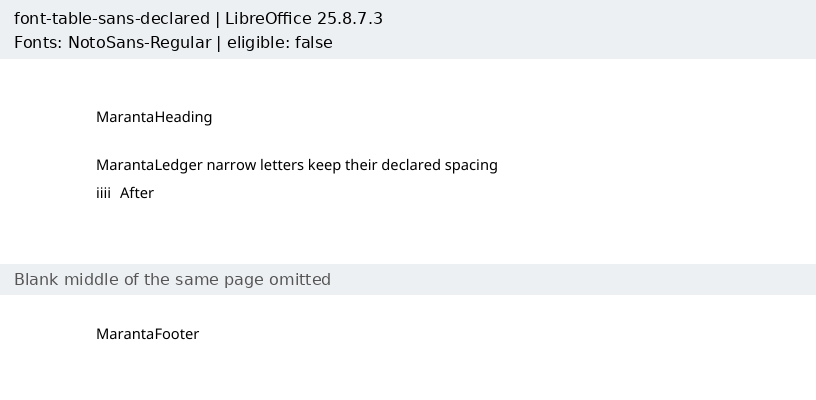
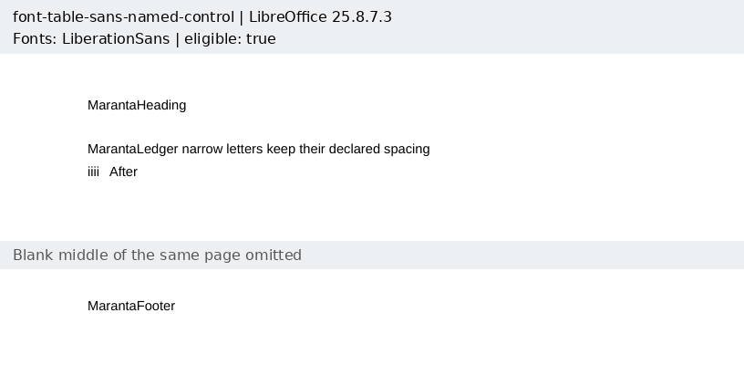
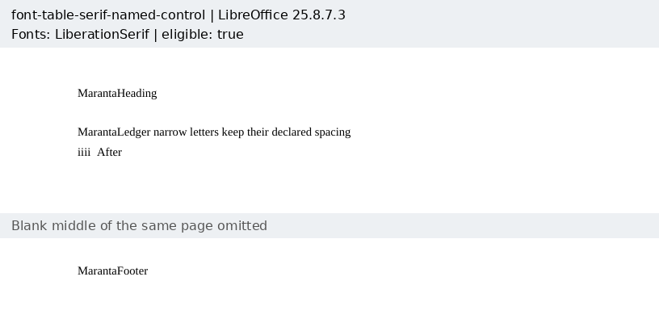
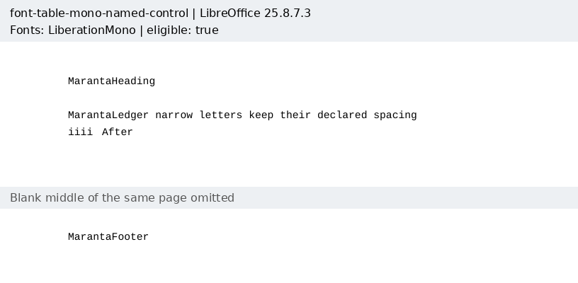
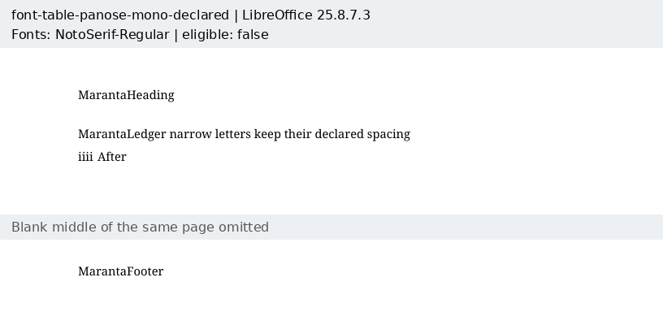
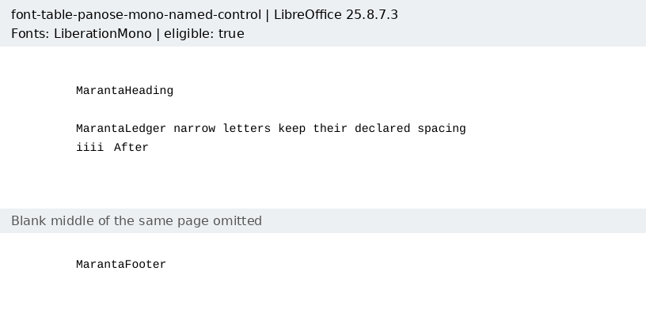

# Declared font classes

Eight original Maranta documents pin the missing-font descriptors reported in
[Docxodus #1574](https://github.com/JSv4/Docxodus/issues/1574): Swiss, Roman,
Modern/fixed pitch, and Latin-text PANOSE with monospaced proportion. Each has a
control selecting an installed Liberation family. Within each pair, only the
font name in `styles.xml` differs; the font table and all other parts are identical.
The documents include a header, body, 18/36pt tab stops, and footer.

The manifest's concrete Liberation-family checks are a **harness font policy**.
A generic class does not promise a particular installed face. LibreOffice picks
Noto Sans for Swiss and Noto Serif for Roman, preserving those classes but failing
the concrete-family check. It also picks Noto Serif for both monospaced probes,
which differs at the class level. All four declared captures remain **ineligible**.
The named controls are eligible only as references for their own inputs; none is
substituted for a declared input. No assertion was weakened to admit these captures.

The [exact capture manifest](capture-manifest.json) and [bundle](reference-bundle.json)
retain input/PDF hashes, inspections, eligibility and environment. Each case below
shows its full authored content; the empty middle of each single page is omitted.
All eight inputs have [zero Open XML SDK validation findings](schema-validation.json).
All 1,050 prior inputs retain their hashes. Tests bind the capture to its manifest,
check the control's exact scope and reject a wrong family in each eligible control.

Word capture and eligible native-reference scoring of declared inputs remain
pending. Product tests directly check emitted CSS classes, tab decisions, and
browser-computed fonts in running stories, comments, balloons and the appendix.
Those tests do not establish Word parity. The export adapter's existing strict-font
policy can also refuse an unknown primary family with only a generic fallback;
this corpus does not change or bypass that policy.

