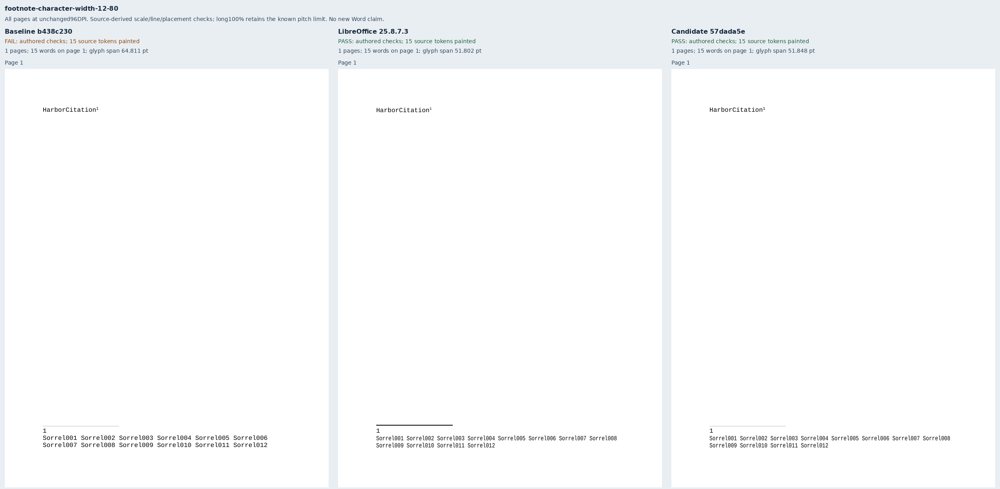
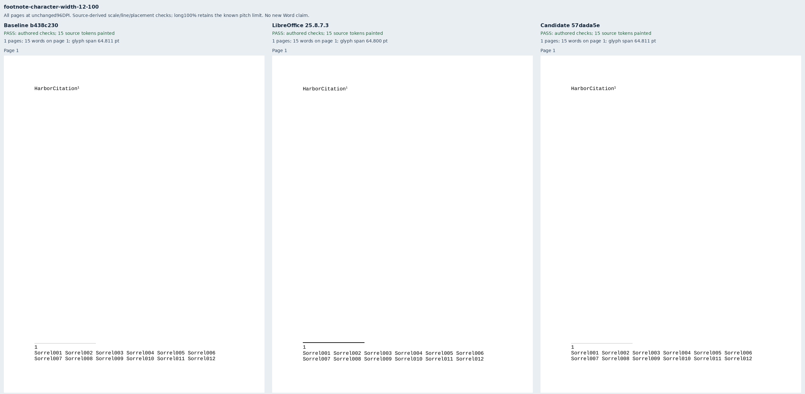
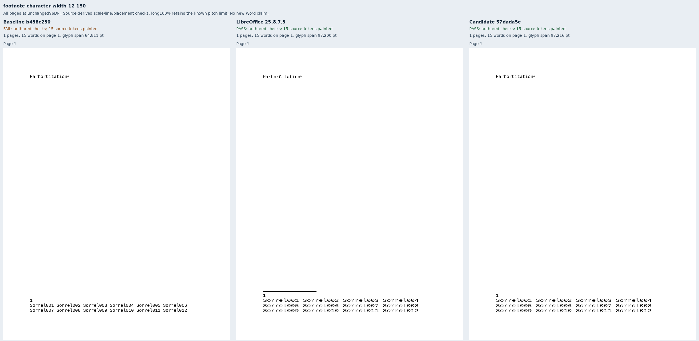
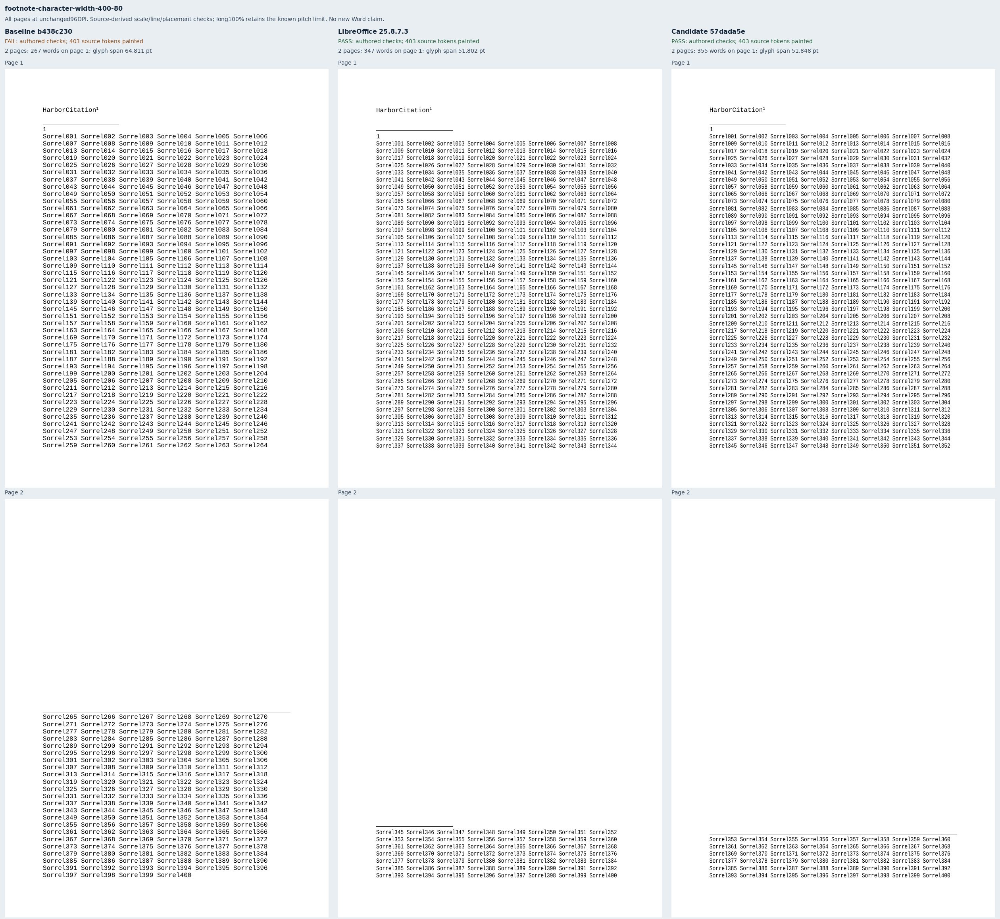
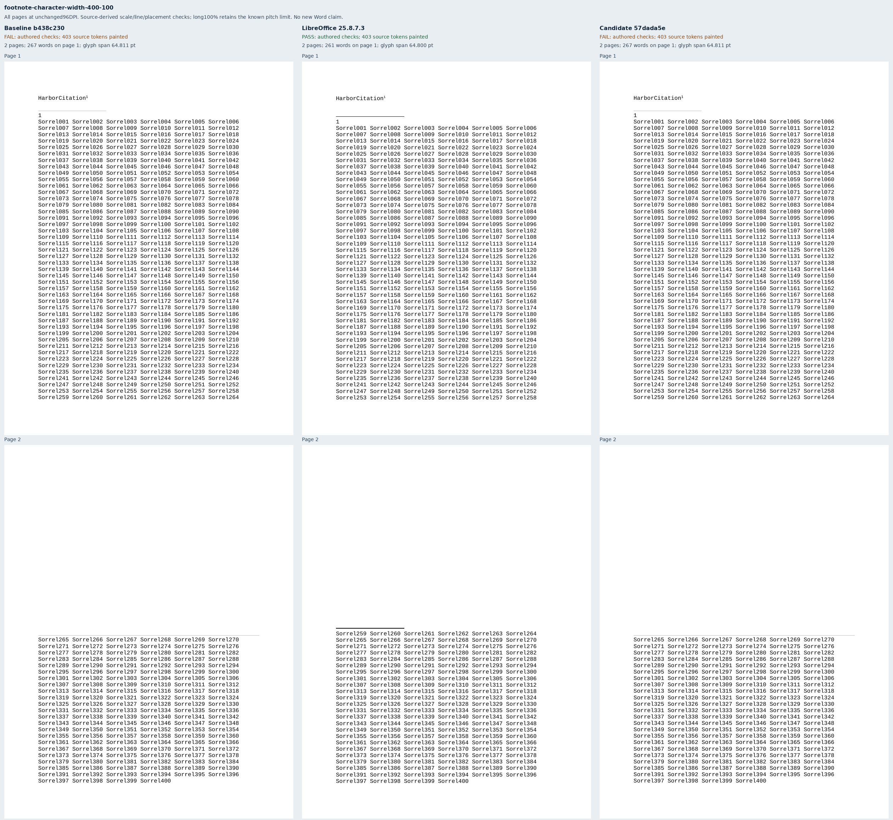
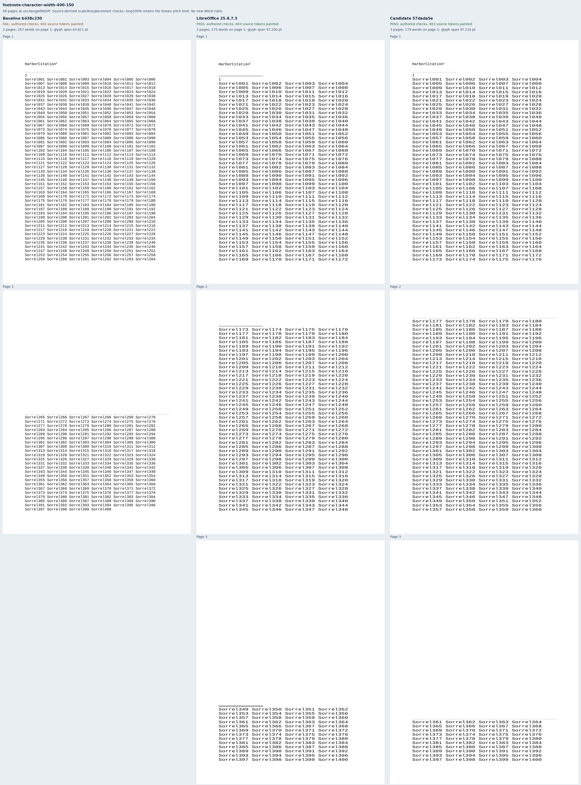
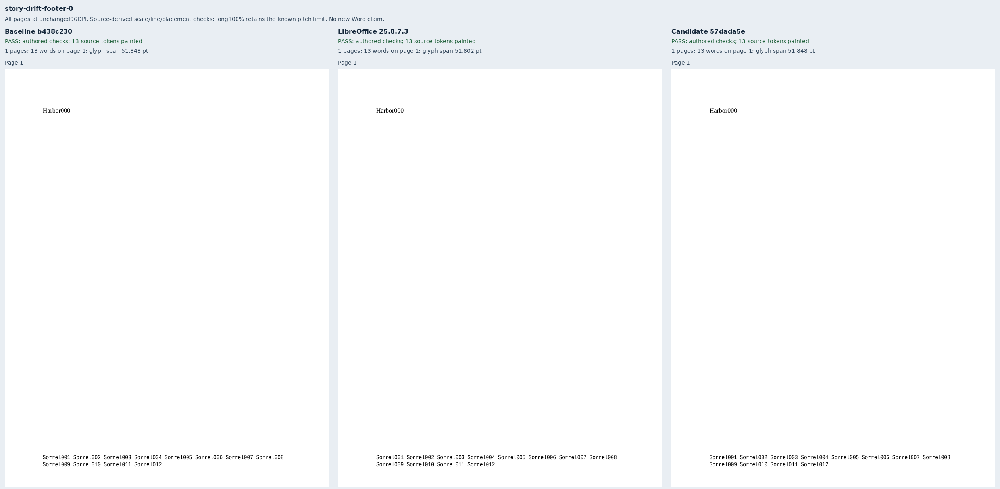
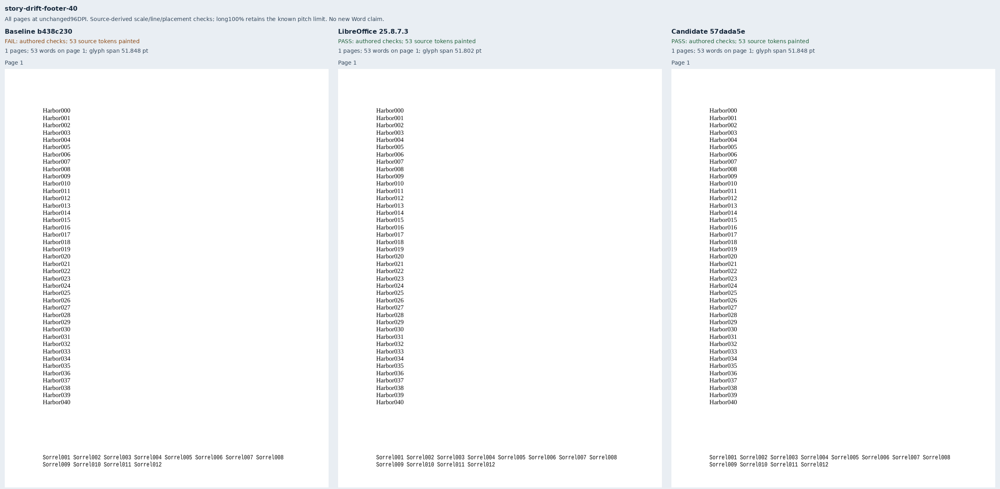

# Scaled footnotes and independent footer placement

Eight original documents cover part of
[Docxodus #1564](https://github.com/JSv4/Docxodus/issues/1564). Six pair short
12-word and continuing 400-word footnotes at 80%, 100% and 150% character width.
Two hold an 80% footer constant while adding 40 body paragraphs. The notes and
footers use 12pt Liberation Mono; the footer controls use 12pt Liberation Serif
body text to expose fractional line-height rounding that previously moved the
independent footer. All eight packages have zero Open XML SDK findings.

The source-derived contract checks complete painted inventories, reading order,
line contents, character widths, glyph heights, line pitch, page count, body
placement and note/footer bounds. Position bounds remain 0.5pt and glyph
dimensions and pitch 0.1pt. Each note word must remain in the 72–720pt body band;
the footer's bottom is 756pt. Source XML and installed font metrics determine
these expectations before candidate capture. All 1,004 previous inputs and
contracts remain unchanged apart from generator provenance.

Baseline `b438c230080c68a5004389f7c3d11704bd2778e0` is tree-identical to main
`967f40ac83cc88311a1552c47af4c3915caac929`. Candidate
`57dada5eb217ee90eb344e34229f0842fea2d16d` fits eligible scaled footnote paragraphs
at their attached width, refits continuing text when the destination width
changes, and isolates rounding between page stories. The baseline passes 2/8
authored geometry contracts; the candidate passes 7/8 and LibreOffice 25.8.7.3
passes 8/8. All eight candidate exports complete successfully with strict font
verification.

The remaining failure is deliberate and visible: the long 100% note retains
eight existing line-pitch failures, including 14.25pt gaps against the
13.59375pt font-derived pitch. Both 100% controls preserve every word's geometry
and every page raster exactly between baseline and candidate. Both footer cases
also preserve body geometry exactly. The changed footer previously ended at
756.237273pt; the candidate meets the unchanged 756pt bound.

Passing these contracts does not establish identical native page membership or
full raster parity. For example, the 400-word 80% native note ends page one at
Sorrel344, while the candidate ends it at Sorrel352. The checker allows this
existing difference in line allocation while enforcing line contents, order,
page count, pitch, dimensions and band bounds. Separator appearance also
differs. These are diagnostic captures using sandboxed system Chromium
157.0.8103.38 and LibreOffice 25.8.7.3, without a pinned-runtime score or a new
Word claim. Endnotes, mixed note runs and other #1564 scopes remain open.

[Evidence](evidence.json) binds 24 PDFs, 35 pages, 3,960 painted words, 16 strict
export reports and all eight comparison sheets. Every PDF was re-inspected,
every page raster hash verified and every sheet checked against those rasters.
All [124 damaged observations](mutations.json) produce additional stable
diagnostics, including missing/duplicate words, wrong dimensions, misplaced
lines, body changes, footer drift and a note repacked above its allowed band.

Adversarial review strengthened the per-word note-band check and required
mutations to add a diagnostic rather than merely change the failure list. It
also verified unchanged controls and exposed the native/browser allocation
difference documented above. The final run is `runs/note-width-v3`; its source
freeze is `d6ae0f35d00bd417363f1ef6c822c577fc34d14bc2a4c1c0fd6de8e30da4de60`,
pre-candidate contract freeze is
`eb8b05ce1660fc3780a9887f8836d40cdceb6a2fad805f39bd87c1e88ef0272c`, and final
artifact freeze is
`428a1b3c0dcd3530419dfa4d07bb2298650b5cced76139103d96c46ddfdf1a7a`.

The first attempt's XML checker incorrectly rejected the generator's empty
paragraph-properties element; that shape check was corrected before numeric
observations. The second attempt used Mono body text, whose upward rounding did
not reproduce footer drift. The final footer pair uses Serif body text and its
font-derived leading and pitch. Note sources and all numeric acceptance bounds
were preserved. The earlier attempts remain in ignored run directories.

## Reproduction

```sh
python3 -m bench.fixtures
node docs/results/export-reliability/Capture.mjs SOURCE RUN/manifest.json RUN/candidate RUN/environment.json --html
python3 docs/results/footnote-character-width/Compose.py RUN BASELINE_SOURCE CANDIDATE_SOURCE
python3 docs/results/footnote-character-width/Mutations.py
python3 -m unittest discover -s tests -v
node --test tests/test-adapter.mjs
python3 -m bench.audit
```
















