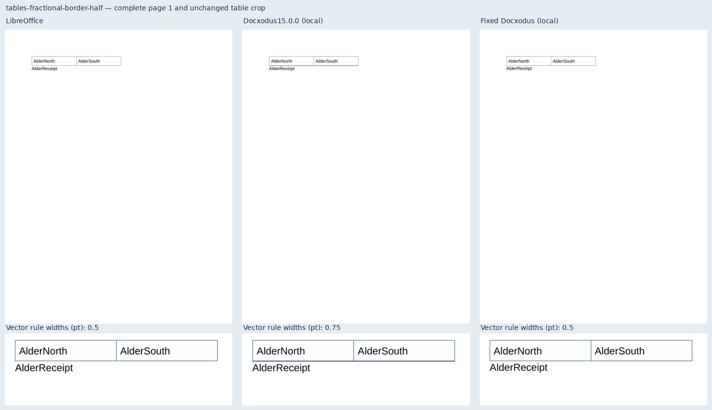
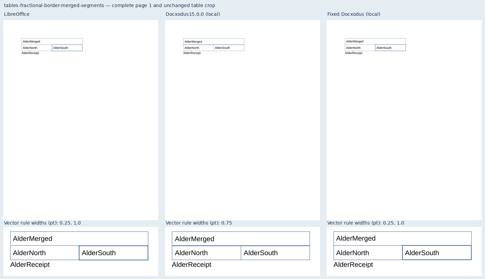
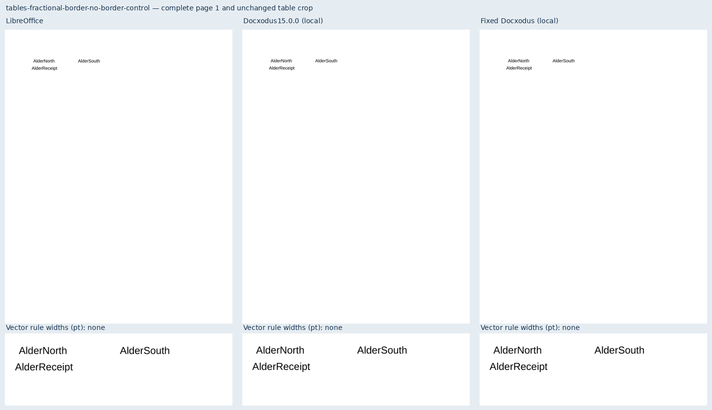
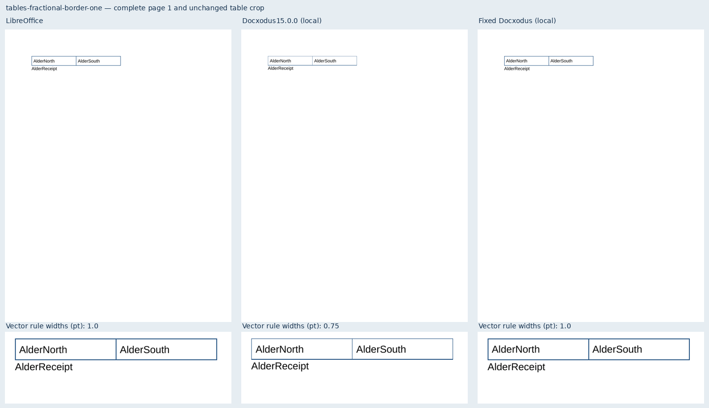
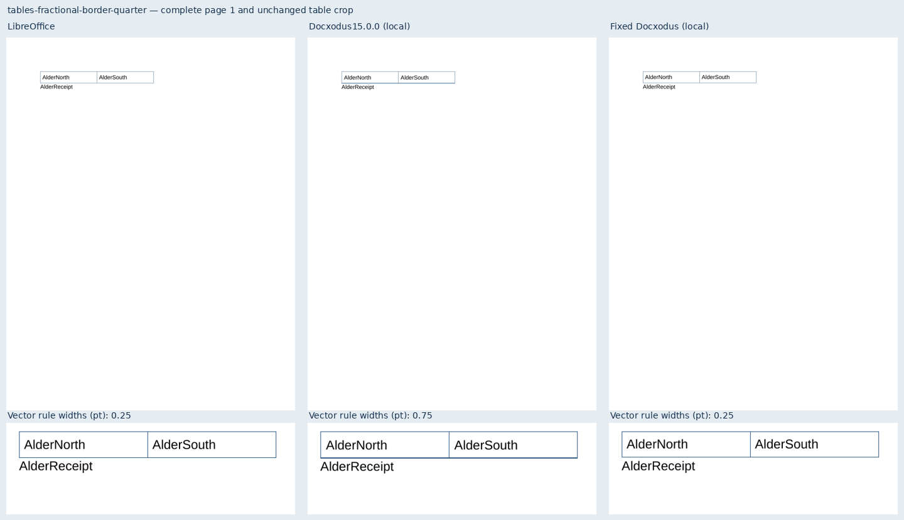
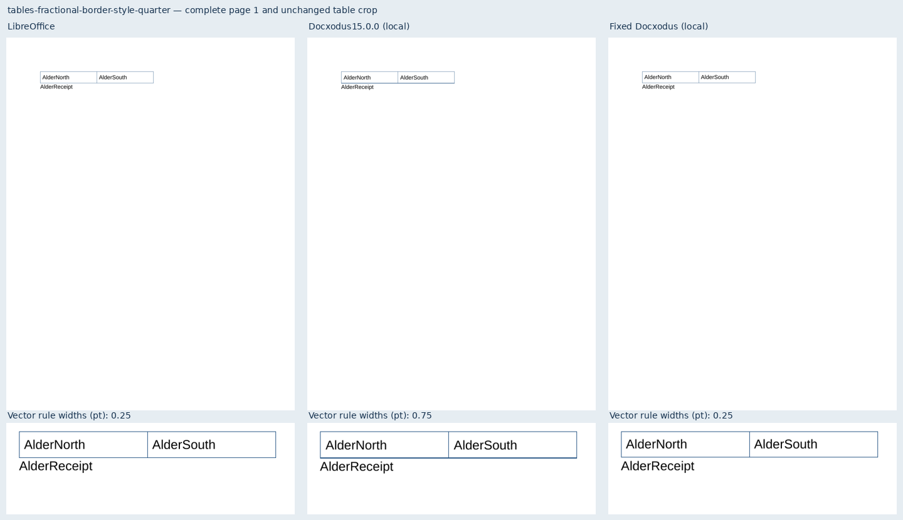
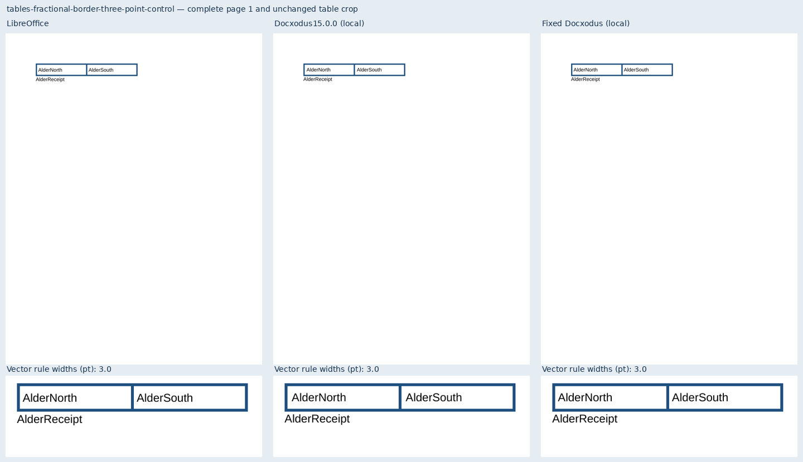
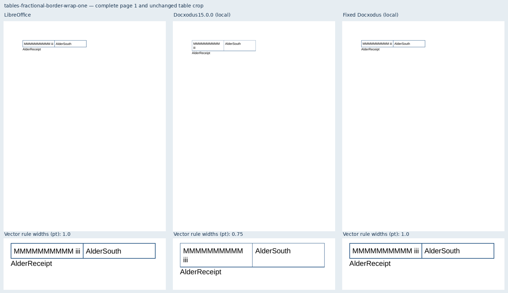
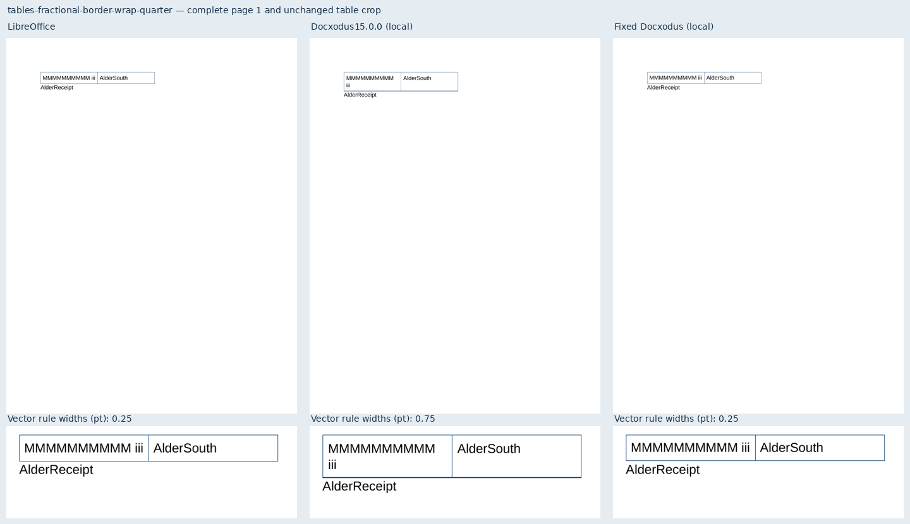

# Fractional fixed-table borders

Nine original Alder fixtures cover Docxodus #1522: quarter-, half- and one-point
rules, a table style, unequal merged shared segments, two wrapping boundaries,
a borderless control and a three-point control. All use two 120pt grid columns,
4.5pt cell margins and explicit 15pt lines in separately provisioned Liberation Sans.

The local baseline is the existing 15.0.0 build at
`4bb8386be06ded02dd41564fcf2d18742dd04cbe`. It fails seven cases; both controls pass.
The candidate at `c314e0470aeddd19f22bf6cc8eb0ab62c53d3e21`
([Docxodus PR #1537](https://github.com/JSv4/Docxodus/pull/1537)) and all nine LibreOffice
references pass every declared mandatory check. These are focused local diagnostics,
not a full-suite score or a fresh Word capture.

`colored-rule-widths` measures the source-declared physical widths from Poppler's
vector output. This catches 0.75pt paint for 0.25/0.5/1pt declarations even when 96-DPI
rasterization hides their differences. Filled rules with an additional outline are
rejected; positive and negative metric tests cover widths, transforms, missing/extra
sizes and unsupported paint. Bounds/coverage, complete token inventories, page geometry
and unmodified full-page raster scoring remain active. The wrapping band is derived
from the authored page top, cell margin, total border halves and 15pt first line;
the old renderer puts `iii` on the second line.

`evidence.json` binds the core commit/tree, converter/export/paginator source and
runtime-asset manifest, plus every input, PDF and screenshot hash. `schema.json`
records zero Open XML SDK 3.5.1 findings across all nine inputs. Every sheet shows
complete page 1 from all three renderers and a magnified, unchanged table crop.
Vector-width labels report measured PDF values rather than raster estimates.

The suite advances from core-v99 (715 cases) to core-v100 (724). All 715 prior inputs
and case contracts remain unchanged apart from their shared generator hash. The new
width inspector is opt-in, versioned and hash-bound in measurement records; raster
scoring and historical CI selections remain unchanged. Pinned CI comparisons are
recorded before merge.

