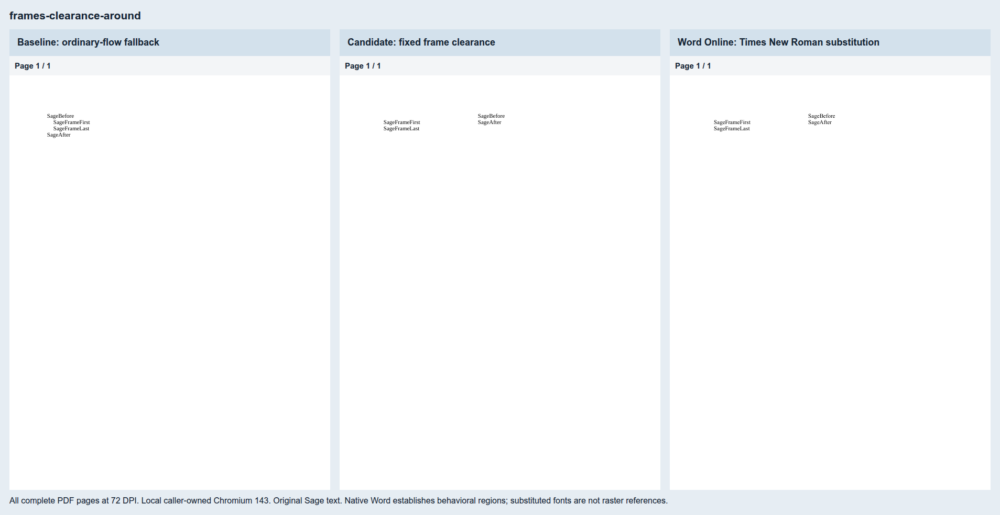
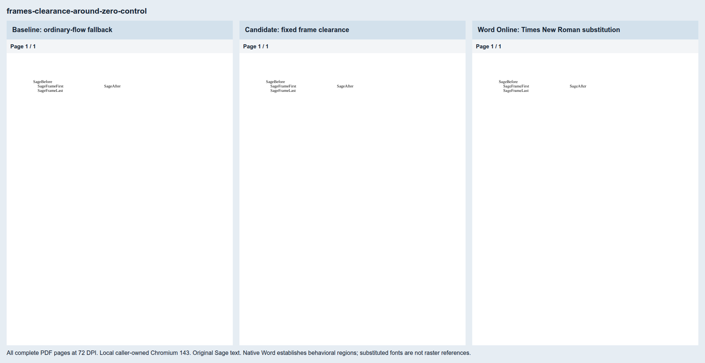
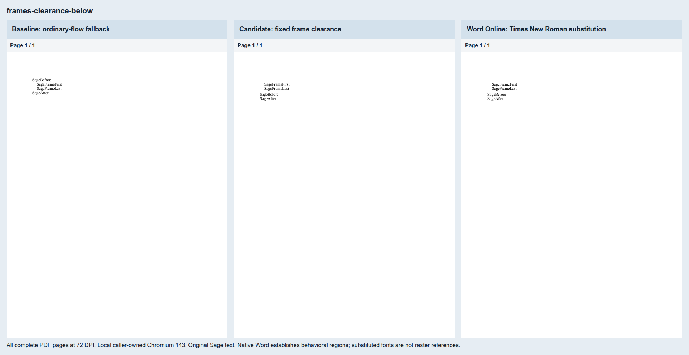
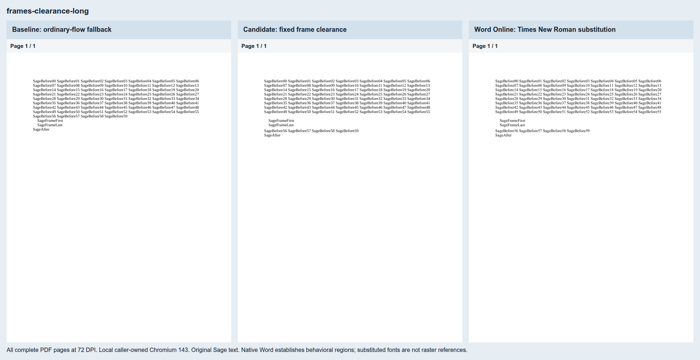
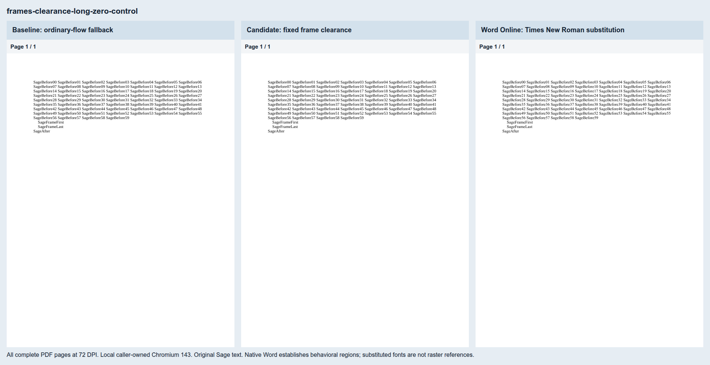
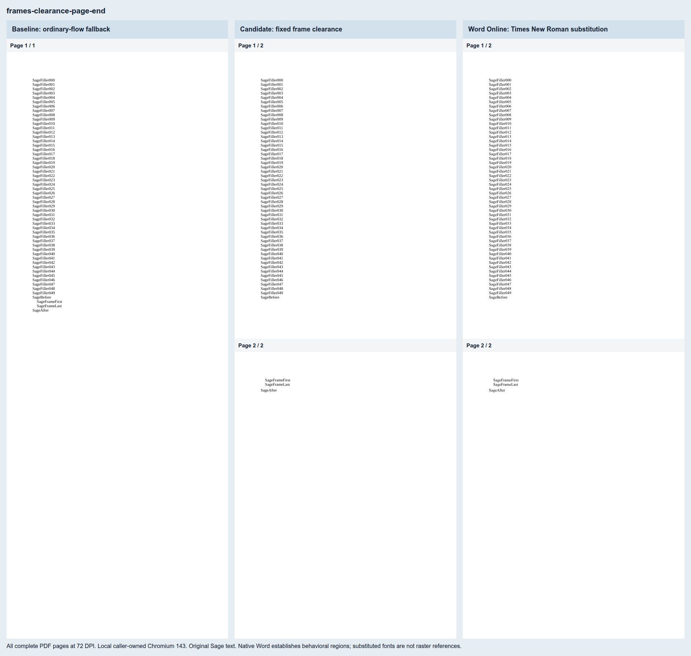
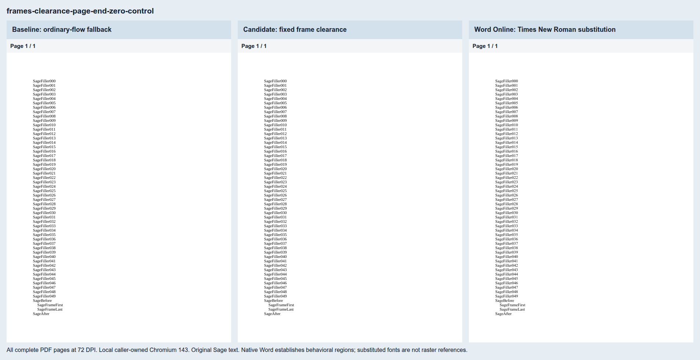

# Inline frame vertical clearance

Eight original Sage cases pin [Docxodus #1510](https://github.com/JSv4/Docxodus/issues/1510).
The four reproducers use 4 pt vertical text distance: `around`, `notBeside`, a long preceding
paragraph, and a page-end frame. Each has a matched zero-distance control. The suite is
`core-v96` (695 PDF cases); the 687 previous input bytes and declarations are unchanged except
the shared generator hash.

Word Online exported all eight exact inputs on October 31, 2026. [Capture hashes](native-captures.json)
and [measurements](native-measurements.json) bind the inputs and PDFs. With clearance, frame paint
stays at x84.025/y83.729 and y95.729 pt. `around` moves Before right to x264.100; `notBeside`
moves it below the frame to y111.749. The long paragraph moves only its last line below its
fixed frame. At the page end, the frame moves to page two while Before stays on page one.
All inputs pass the pinned SDK 3.5.1 validator ([results](source-validation.json)).

Word substitutes Times New Roman for Liberation Serif. Its PDFs pass all behavioral checks but
fail the declared-font check and remain ineligible for font-matched reference scoring. The
absolute marker regions are Word-adjudicated; LibreOffice's ordinary-flow treatment does not
bind those regions. No native substitution is normalized away.

[Local evidence](local-evidence.json) binds baseline/candidate assets and PDF reports to exact
inputs, inventories every token, and checks paper geometry, marker regions and painted source-word
bounds. The [candidate source record](candidate-source.json) names the uncommitted working-tree
capture's base HEAD, production-file hashes and patch digest. The baseline fails all four
reproducers and passes all four controls. The candidate passes all eight. All four control
rasters are byte-identical. These are local caller-owned Chromium 143 results; production CI
comparisons are pending.

Each sheet includes every complete PDF page, labeled by renderer.

