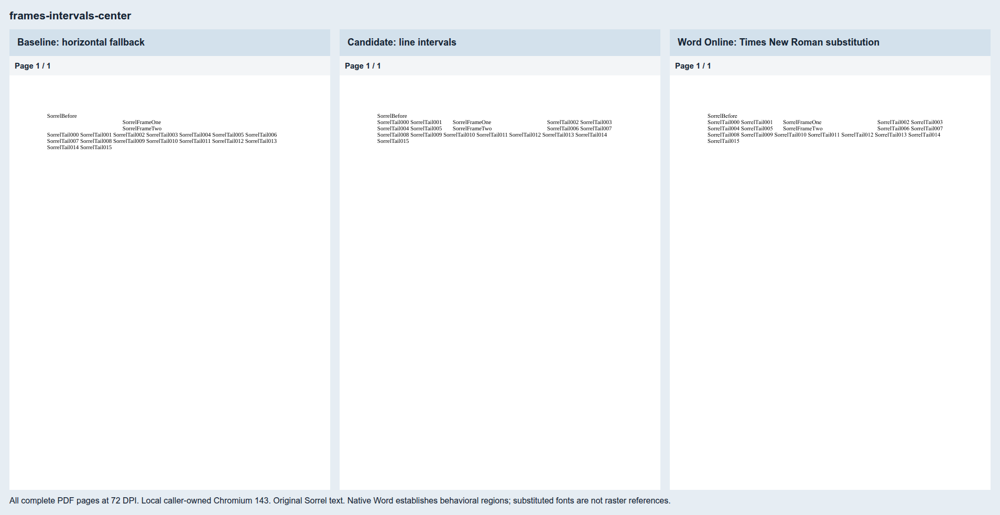
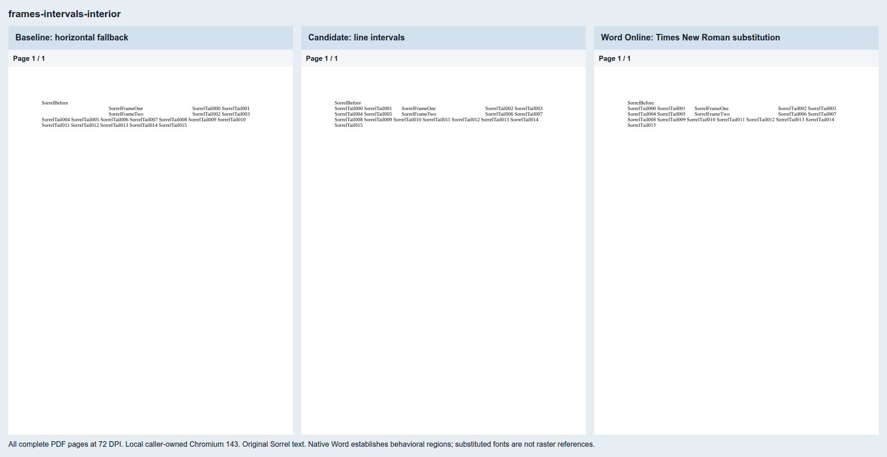
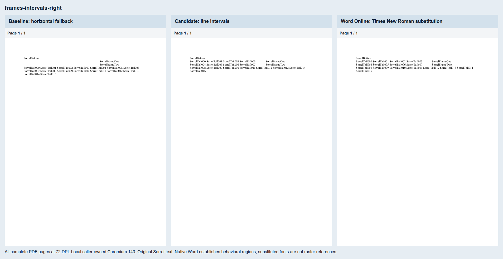
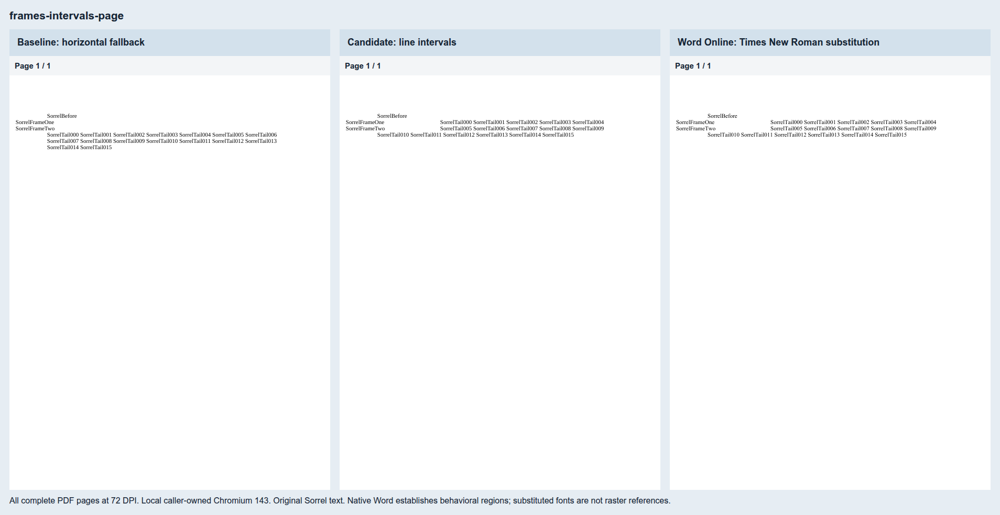
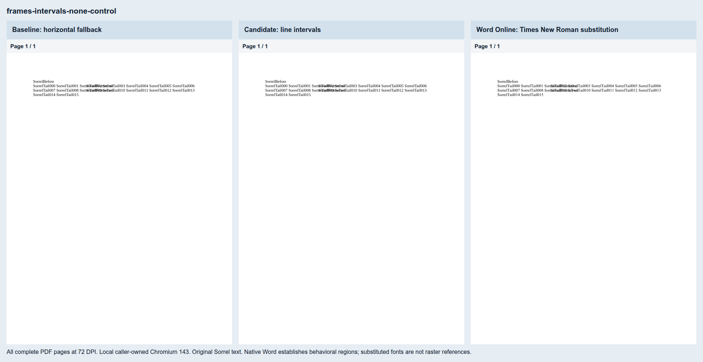
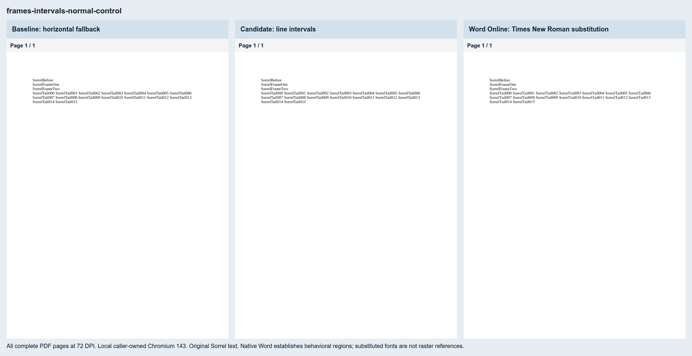

# Inline frame line intervals

Seven original Sorrel cases pin [Docxodus #1509](https://github.com/JSv4/Docxodus/issues/1509).
Centered and explicit interior placement leave two intervals on each affected line. Right alignment
leaves the left interval; page-relative placement leaves the right. The three controls use
`notBeside`, `none` and ordinary paragraphs. The suite is `core-v95` (687 PDF cases); all 680 prior
input hashes and declarations remain unchanged except their shared generator hash.

Word Online exported each exact input on October 31, 2026. [Capture hashes](native-captures.json)
and [measurements](native-measurements.json) bind the inputs and PDFs. The centered/interior
frame begins at x216.100 pt, with first-line text at x72.025 and x396.170. Right alignment puts the
frame at x360.150; page-relative offset puts it at x12 and following text at x192.080. All seven
inputs pass the pinned SDK 3.5.1 validator ([results](source-validation.json)).

Word substitutes Times New Roman for Liberation Serif. These native PDFs establish behavioral
regions and remain ineligible for font-matched reference scoring. The absolute marker regions
are Word-adjudicated; LibreOffice's ordinary-flow treatment does not bind those regions.
Native font substitution is reported explicitly, never normalized away.

[Local evidence](local-evidence.json) records baseline/candidate asset hashes, complete token
inventories, paper geometry, marker regions and painted source-word bounds. The local candidate
was captured before commit; its base HEAD, production-source hashes and patch digest are explicit. The baseline passes
the three controls and fails all four wrapping cases. The candidate passes all seven. All three
control rasters are byte-identical between baseline and candidate. These are local caller-owned
Chromium 143 results; production CI comparisons are pending.

Each sheet includes the entire one-page baseline, candidate and native PDF, labeled by renderer.

