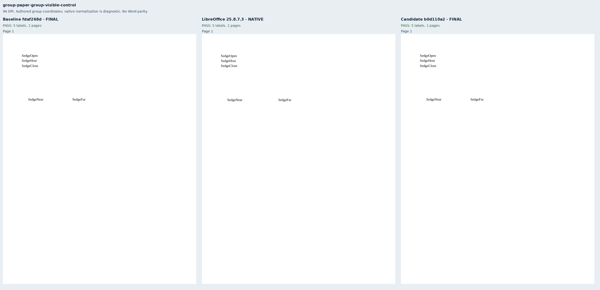
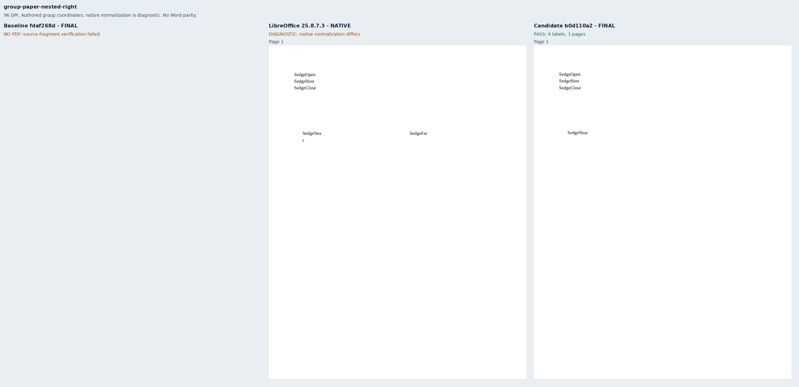
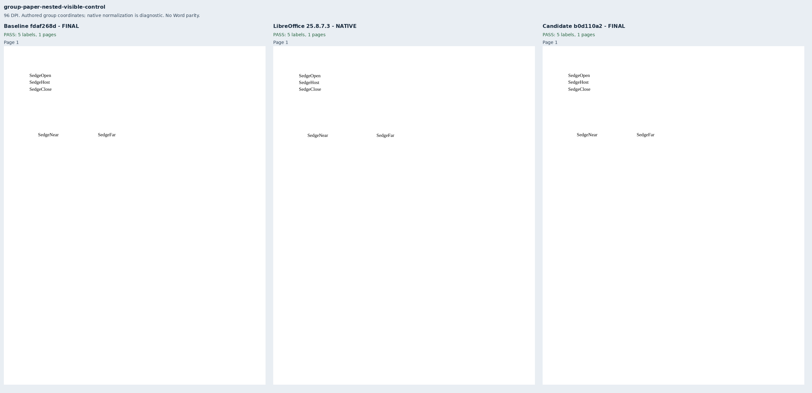
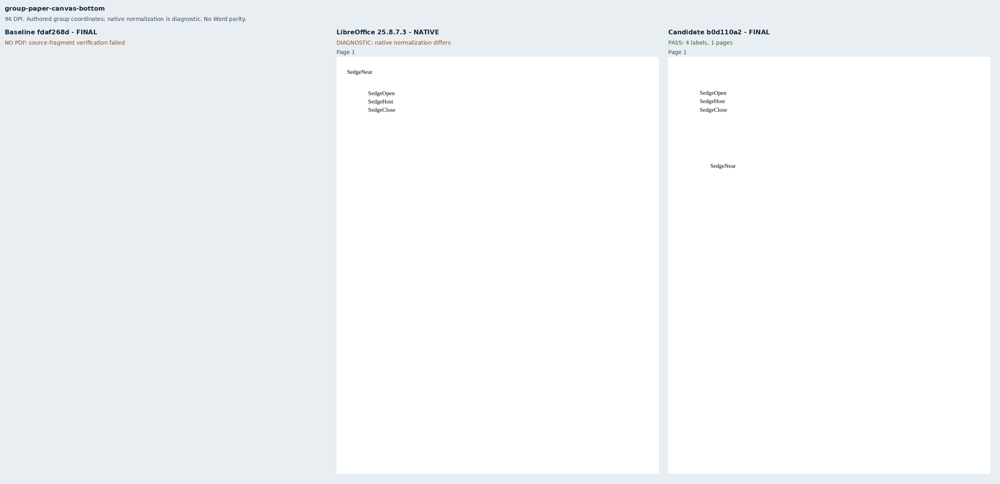
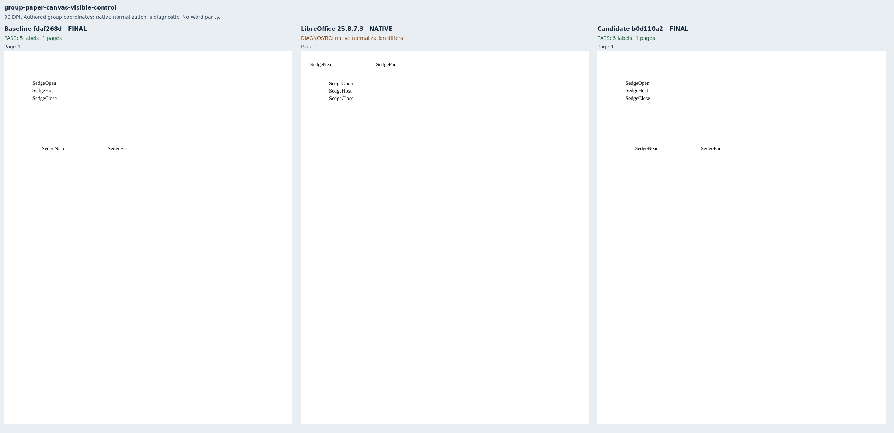
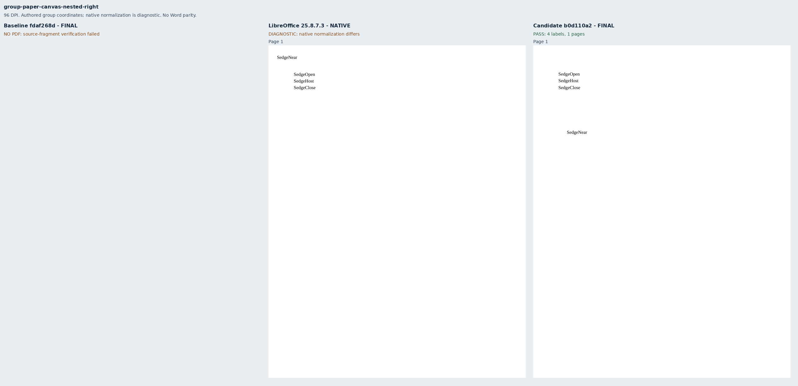
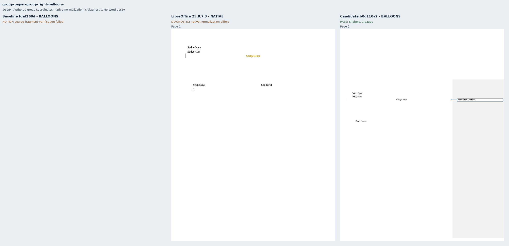
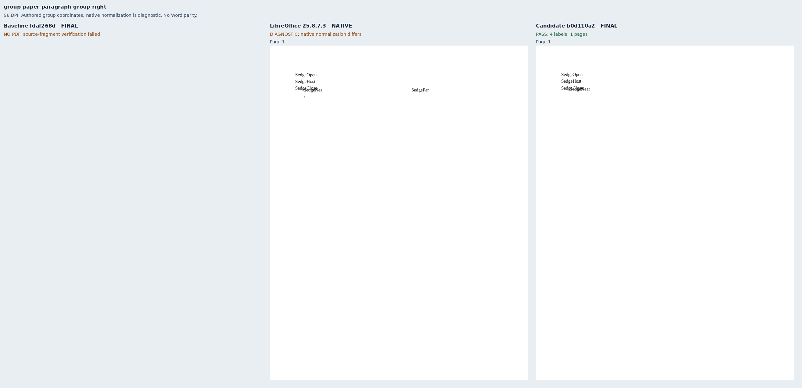

# Grouped text boxes at the paper edge

Nine original Sedge documents cover fixed text boxes in a group, nested group or drawing
canvas. Six place the far member beyond the paper; three controls keep both members
visible. One case uses a column/paragraph-relative root, and one has a separate formatting
balloon companion. These fixtures address part of Docxodus #1558.

`SourceCoordinates.py` derives the member frames from the original OOXML using rational
arithmetic. It checks the paper, margins, exact line spacing, host paragraphs, zero text-box
insets, fixed sizing and untransformed group maps. Nested maps apply the authored child
offset and scale. The near frame is `[80, 200, 120, 40]` pt, or `[80, 96, 120, 40]` for the
paragraph-relative case. The hidden far frame starts at x=760pt or y=1030pt, outside the
612×792pt paper. Visible controls start at `[220, 200]` pt. The same source coordinates
govern the complete label inventories and hidden-label exclusions.

Primary assertions require each visible box label inside its source frame. Supplementary
checks independently measure both boxes in delivered HTML, including hidden boxes, and
check visible PDF labels against the original frames. The balloon companion maps those
frames through the observed source-paper holder. Both checks allow an explicit 0.1pt for
layout and PDF rounding; the authored frames are unchanged. Contract tests exercise all
four tolerance edges just inside and outside the limit. Retained PDF observations also
reject ±100pt movement, missing or duplicate labels, and a wrong page.

LibreOffice normalizes some groups and canvases differently. Only two native references
meet the literal source-coordinate contract; all seven ineligible references remain in
the evidence and screenshots. They do not authorize changing the authored hidden-label
policy. No Word normalization, All Markup parity or whole-suite score is claimed.

The exact baseline `fdaf268d543cbf9de45467022c9f2a4d09790d60` delivers the three controls and
refuses the six off-paper cases. Candidate `b0d110a2f039368091bd76e1e36f8e35aabff0ff` delivers
all nine with strict verified fonts. Visible labels retain their source frames and painted
ink; every hidden far label has one source-linked clipping warning. The evidence retains
21 PDFs, 12 production reports, nine full-page comparison sheets and build manifests
binding 19 files and 45 runtime assets per renderer. These public API diagnostics use
sandboxed system Chrome, not pinned-runtime qualification.

The final `group-v5` manifest, source proofs and verifier hashes were frozen before its
captures. Earlier authoring runs remain locally retained: v1 lacked the final geometry
checks; v2 exposed a 0.007816pt strict-bound rounding failure; v3 had invalid suite metadata;
v4 revealed that the shared fixture helper overwrote the explicit tolerance with its
stricter default. The final generator sets the tolerance after that helper, with a contract
test preventing recurrence. All 901 previous inputs and declarations are unchanged apart
from generator provenance. All nine new packages have zero Open XML SDK findings.

## Reproduction

Generate `core-v124`, select `group-paper-*`, validate and freeze the scoped manifest and
source proofs, and build both exact renderer revisions with `python3 -m bench build-docxodus`.
Capture native diagnostics with `python3 -m bench reference libreoffice`. Derive the public
companion manifest from each case's `pdfCompanion` profile and inventory, then run:

```sh
node docs/results/export-reliability/Capture.mjs SOURCE RUN/companion-manifest.json RUN/candidate RUN/environment.json --html
node docs/results/group-paper-placement/Geometry.mjs SOURCE RUN/candidate
python3 docs/results/group-paper-placement/Compose.py RUN BASELINE_SOURCE CANDIDATE_SOURCE
python3 docs/results/group-paper-placement/Mutations.py
python3 -m unittest discover -s tests -v
node --test tests/test-adapter.mjs
python3 -m bench.audit
```

Repeat the two capture commands for the baseline. Retain its build/asset manifests and
schema validation before composition. `evidence.json` binds every retained PDF, inspection,
source proof and screenshot; `mutations.json` records the rejected observation mutations.

















