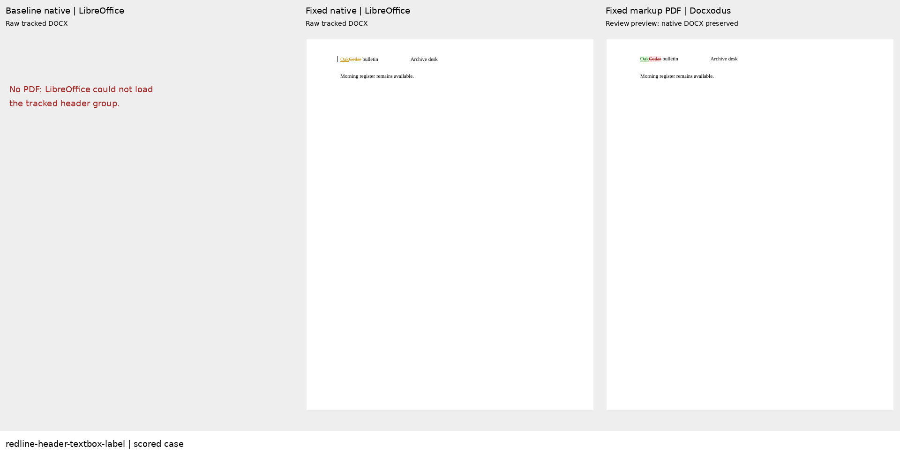
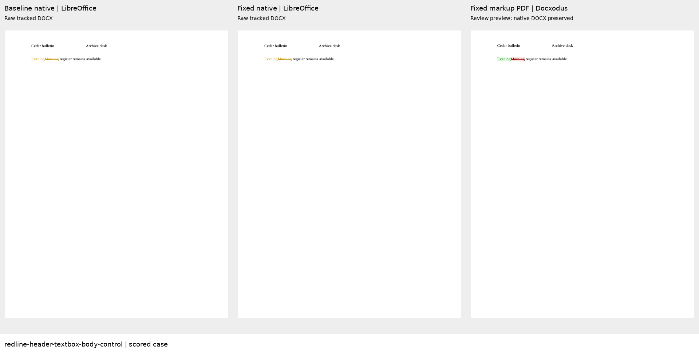
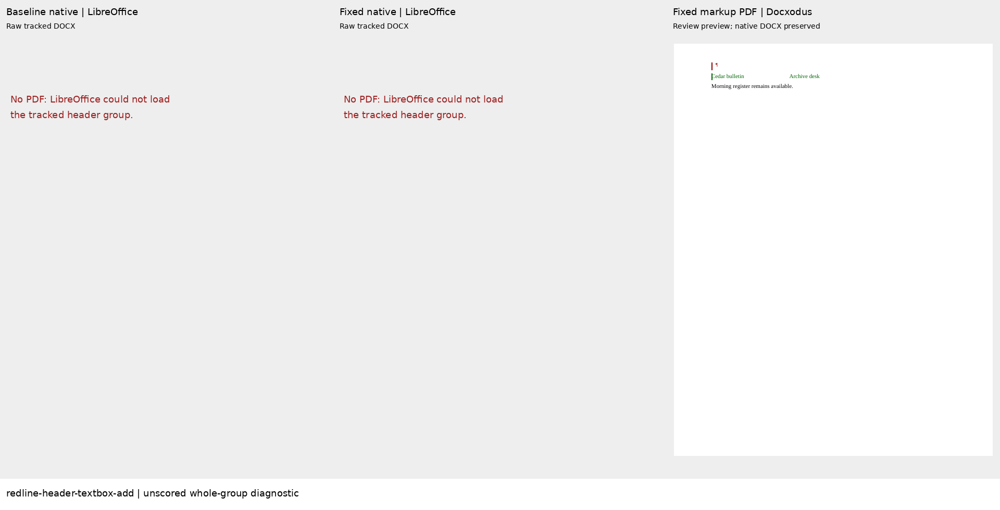
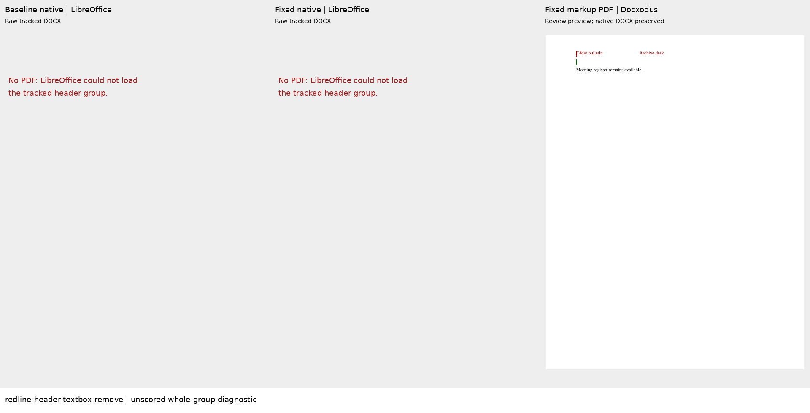

# Header textbox comparisons and review previews

These authored cases cover [Docxodus #1557](https://github.com/JSv4/Docxodus/issues/1557).
The masthead contains two original labels in an anchored DrawingML group. One case changes
`Cedar` to `Oak` inside the first label; its control changes body text and retains the masthead.

| Scored case | Baseline | Fixed | Authored calibration |
| --- | ---: | ---: | ---: |
| Header label edit | 0 | 100 | 100 |
| Body edit, unchanged header | 100 | 100 | 100 |

Baseline: `5b733a20d08684d79ac0952d5337a4eb1bc6d69c`.
Fixed: `fb49bd5023961572acd8934a22b4601b6a8ffd74`.
Both public .NET adapters are bound to clean exact source checkouts and DLL hashes.
Only these two cases were scored under metric contract 20 and `redline-v32` (245 cases).
The prior 243 case inputs, expected documents and authored redlines are unchanged.
All 468 harness contract tests pass. No full-suite score or Word parity is claimed.

The baseline replaces the entire header group, revises the unchanged sibling label, and cannot
be loaded by LibreOffice 25.8.7.3. The fixed output places revisions inside the changed textbox,
keeps its sibling untracked, and opens directly in LibreOffice. Independent accept/reject checks,
exact resolved drawing assertions and all four applicable LibreOffice endpoint checks pass for
the fixed build and authored calibration. All 22 inspected input/output packages have zero SDK
validation findings.

Metric 20 extends exact native drawing assertions to referenced header/footer parts. These
checks retain geometry and complete textbox content, resolve image references in their owning
parts, and normalize only effective XML text spaces and equivalent text-run splits in v2.
Mutation controls reject stale labels, lost drawings, changed geometry, changed image bytes,
missing image targets and lost significant spaces. All expected/authored LibreOffice work runs
before candidate loads, so a crashing candidate cannot invalidate fixture calibration.

The additional **unscored** whole-group insertion and deletion diagnostics preserve native
revision wrappers and both independently resolved endpoints. LibreOffice cannot load even their
authored redlines, so no redline score or LibreOffice endpoint eligibility is claimed for them.
The public `renderDocxArtifacts` API exports markup PDF companions containing both labels and
revision colors while retaining the native DOCX as the editable source. All four public exports
complete as one-page PDFs with no reported warnings or unsupported content. These previews do
not make the native whole-group DOCX loadable in LibreOffice.

The companion exports use the existing production AOT build from
`f7703d047d304a556617294228f804c68158aa5b`; it renders already-produced native redlines and performs
no comparison. [Evidence and artifact hashes](evidence.json) bind native build identities, inputs,
independent checks, raw LibreOffice outcomes, public render reports, PDFs and complete-page sheets.
The sheets show baseline native, fixed native and fixed companion outputs. Empty panels explicitly
record failed raw DOCX loads; no pages are cropped. These are review previews, not PDF-track scores
or placement measurements.

Regenerate the two scored cases with `bench.redline_fixtures.generate()`. To reproduce the unscored
boundary inputs in an ignored directory, call `header_textbox_redlines(Corpus(output_root),
boundary_controls=True)` and use its `add` and `remove` records. This reuses the independently authored
fixture generator; it does not import renderer test fixtures.

