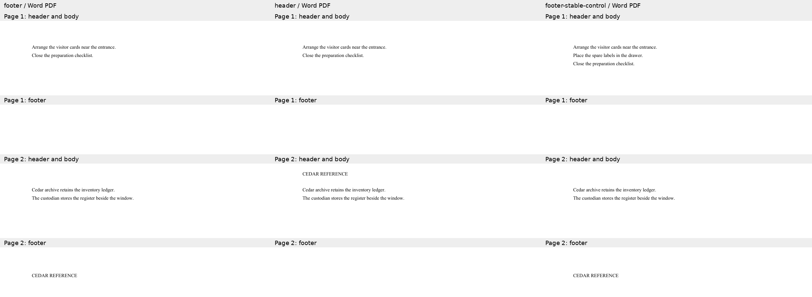
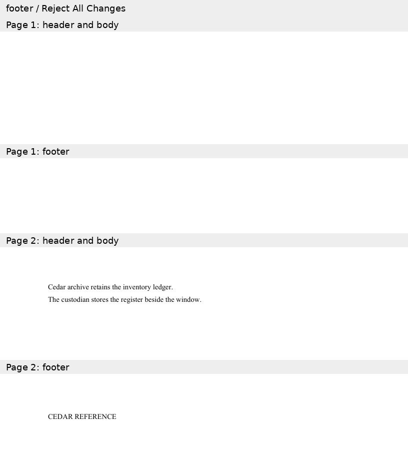
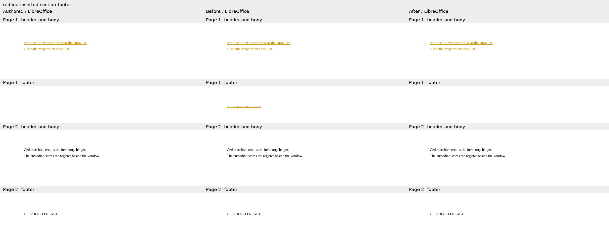
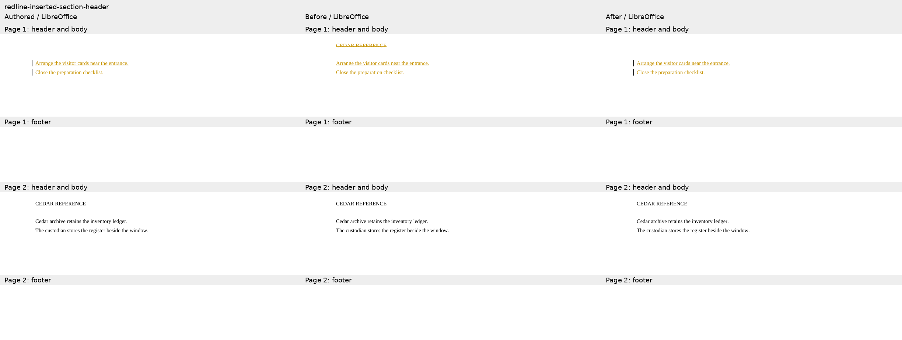
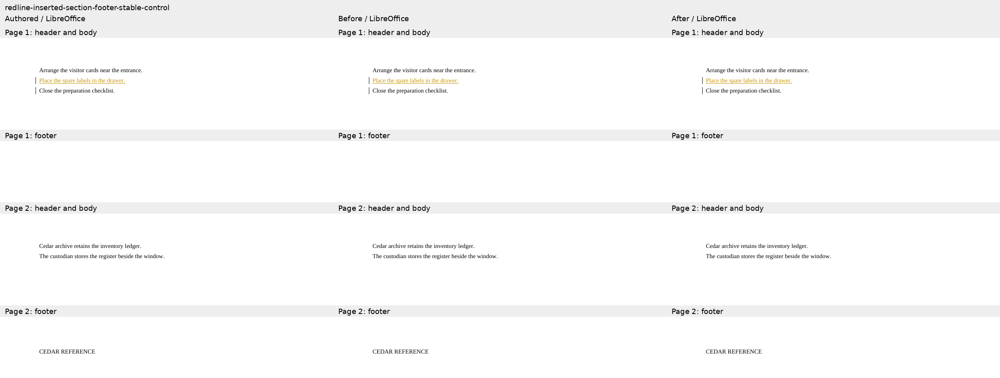

# Running stories in inserted sections

The two reproductions prepend an opening section with an explicitly empty default header
or footer. The later retained section still displays CEDAR REFERENCE. The control already
has both sections and only inserts body text. Baseline `5bae7386` scores 0 on both
reproductions and 100 on the control; candidate `50203662` and authored calibration score
100 on all three. These are focused diagnostics, not a complete 236-case suite score.
All input/authored/candidate SDK checks pass. The 233 previous fixture sets remain unchanged.

Four of six LibreOffice endpoint comparisons apply. LibreOffice 25.8.7.3 keeps an extra
empty section and running-story bindings when rejecting the two authored opening-section
insertions. Those two rejected comparisons are explicitly ineligible, calibrated from the
authored packages; exact independent markup endpoints and the raw review-story checks remain
mandatory. The control passes both provider resolutions.

Word Online opened/exported all three authored redlines through authenticated Playwright.
Its default PDF exports hide markup. A separate Reject All Changes action on the footer
fixture also leaves an empty first section: the downloaded DOCX has two sections and zero
remaining insertion/deletion markers, and its PDF retains a blank first page. This is a
recorded native-provider limitation of the authored section-break markup, not a native
accept/reject pass or a Word Compare result. Capture hashes and observations are in
`word-capture.json`; raw PDFs/DOCX remain outside the repository.

The following sheets preserve header/body and footer crops from every page of the authored,
baseline and candidate LibreOffice PDFs. All text is shown; blank middle-page space is omitted.
Exact source/PDF hashes and mandatory checks are recorded in `evidence.json`.

### footer

### header

### footer-stable-control

