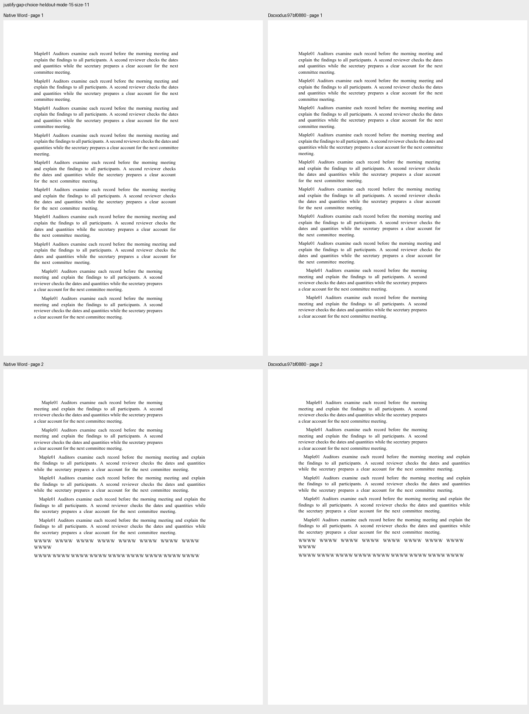
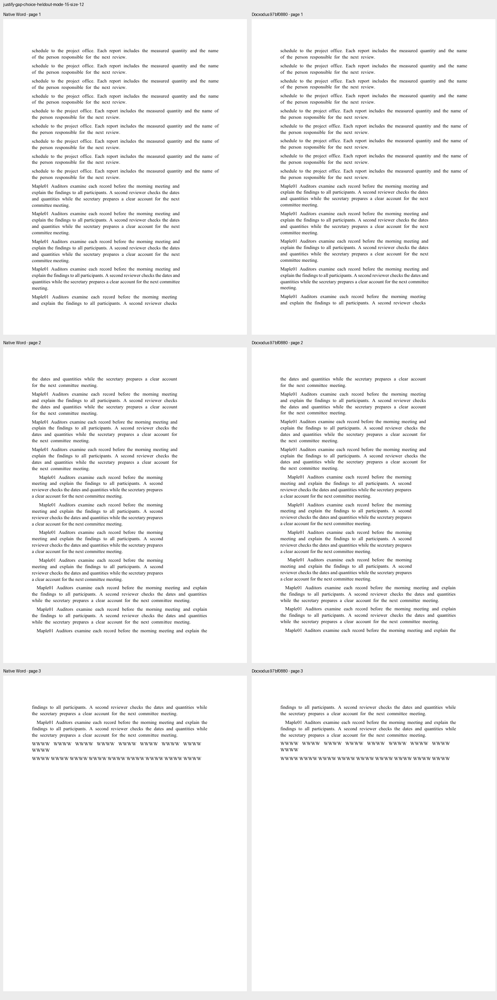

Two independently authored, Word-captured documents reproduce the line-choice boundaries behind [Docxodus #1124](https://github.com/JSv4/Docxodus/issues/1124). Their 45 paragraphs cover 11pt and 12pt Times New Roman, single and repeated ordinary spaces, first-line indents, signed trailing indents, and fitting/condensed final lines. The 12pt input also includes the native transition between 469.20pt and 469.25pt. All widths and text were fixed before Word capture and implementation.

The generator contains literal OOXML and integer twip widths; it imports no template or font measurement library. Both generated DOCX files match the captured inputs byte for byte, with zero Open XML SDK findings. `core-v70` contains 381 cases. All 379 previous PDF inputs, their declarations except generator hashes, and the historical 12-case CI suite remain unchanged.

`native-word.json` retains raw PDF inspections and input/PDF/returned-DOCX hashes. `candidate-proof.json` records the public exports at core `97bf0880`, all 45 matching paragraph line/page inventories, and the existing mandatory page/font/token/geometry checks. The four native line/page regressions in the core repository retain the original characters, paragraph identities and PageMap before/after painting. This benchmark adds no scorer, PDF normalization, inventory waiver or tolerance change. These repetitive prose fixtures have no unique marker assertions; the preserved native inventories and core regressions provide the line-specific evidence.

Local candidate exports used the pinned Chromium with its process sandbox and all production font/clipping checks. This host cannot satisfy the strict benchmark user-namespace preflight, so the retained exports are unscored diagnostics. Native Times New Roman 7.06 and separately provisioned local 2.82 have matching captured Latin advances; their outlines, hinting and rasterization are not asserted identical. The original agreement's [paired PDFs and 92.0731 historical result](https://github.com/JSv4/Docxodus/issues/1124) remain visible and are not replaced by these controls. Fresh CI measurement is required for a score claim.

Every new case is shown below. Native Word is on the left and Docxodus `97bf0880` on the right at the same physical scale, with every page labelled. All ten provider pages were visually inspected. The wider diagnostic set contains 30 captured input/output pairs, 410 measurable paragraph line/page inventories and 84 visually inspected provider pages; the native NBSP split-word control remains an explicit unsupported-layout difference.

| Case | Pages each | Native Word and Docxodus, every page |
| --- | ---: | --- |
| `justify-gap-choice-heldout-mode-15-size-11` | 2 |  |
| `justify-gap-choice-heldout-mode-15-size-12` | 3 |  |
