# Kept citing paragraphs and dense note chains in Word

Nineteen original Times New Roman cases cover the heading and dense keep-chain items in
[Docxodus #1217](https://github.com/JSv4/Docxodus/issues/1217). The generator reuses the author's
literal OOXML construction and the separately authored separator/keep/widow controls. Every
package reproduces its preserved native Word input hash byte-for-byte. The six-part packages
intentionally omit `settings.xml`; changing their implicit defaults would invalidate the oracle.

The suite is `core-v68` / 365 PDF cases. All 1,032 earlier DOCX files, `redline-v17` and the
historical 12-case CI inputs are unchanged. No renderer fixture, external document, template,
standalone font binary or authentication data is imported.

## Native observations

The exact inputs were opened in signed-in Word for the web, exported through **File > Export >
Download as PDF**, and downloaded unchanged as DOCX. [Native hashes and complete inspections](native-word.json)
retain every word, font and physical page box. Word did not disclose its server build. Times New
Roman is requested and observed; cloud/local font binaries and rasterization may differ.
[All nineteen source packages pass SDK validation](source-sdk-validation.json).

- With a kept heading, Word first moves the chain to a fresh page, then can leave the heading
  alone and move/split the kept citing paragraph. At 40pt note pitch, default/explicit widow-on
  leaves two citing lines on the last page; widow-off allows one. The no-keep-lines controls
  occupy two pages. Removing heading keep-next gives the paired three-page controls.
- At 39/40/41pt, the sixth heading/citation stays on page 3 while its whole note starts on page 4.
  At 89/90/91pt, the final body tail waits until the last note's continuation ends (page 11/11/12).
  One-point neighboring pitches retain the actual discontinuities rather than smoothing them.
- Explicit 15pt and one-twip marker-only separator definitions produce identical native Word
  geometry, words, fonts and page rasters. These are controls, not a fitted constant for the
  renderer. The core implementation reserves the separator font's natural line box.

Every authored body/note marker has an explicit Word-adjudicated page assertion and the exact
complete token inventory, including note numbers. The marker region is the source's physical
400×320pt paper: it asserts page membership, not exact baselines or margin rounding (Chromium
places the nominal 10pt left edge at 9.996093pt). Raw coordinates and unaligned raster differences
remain measured normally. Scorers and existing tolerances are unchanged. Word references must
pass their own assertions; the established LibreOffice adjudication policy remains in effect.
Contract negatives reject a wrongly deferred sixth citation, wrong widow split, missing last
note line and same-page duplicate even when citation survival or total page count could hide it.

## Candidate and limits

[Candidate proof](candidate-proof.json) records exact core `b7058e46`, with its
[source-bound build receipt](source-build.json). Its public PDF exports pass every mandatory
check on all 19 cases (94 pages), and all 27 focused heading/dense/table cases match Word's page
counts and marker pages. All eight prior table cases preserve their extracted geometry, words,
fonts, tokens and every page raster at 72 DPI. The final core browser suite passes 137 tests;
Release has zero warnings/errors and the unchanged C# revision passes 8,897 tests with two
existing skips. The TS-only correction reuses that C# validation with an explicit source diff.

These are **unscored public-export diagnostics** using the caller-provided pinned Chromium with
its process sandbox enabled and installed root-owned helper. The host still fails the strict
benchmark's unprivileged-user-namespace preflight; no preflight or clipping verification was
weakened. Small baseline/glyph and separator colour/length differences are visible below. There
is no close raster score claim. Every native and candidate page was visually inspected.

The original carried-note “no measurable fragment” input remains unavailable. Two separate
read-only oversized-kept-note exports still report clipping; those are not claimed fixed by this
change. The other unresolved #1217 work therefore remains open.

## Every new case

Each pair shows native Word on the left and core `b7058e46` on the right at the same physical
scale. Page pairs run left to right, then top to bottom; every provider/page is labelled.

| Case | Pages per provider | Native Word and candidate, all pages |
| --- | ---: | --- |
| `dense-chain-note-20pt-times-new-roman` | 3 | 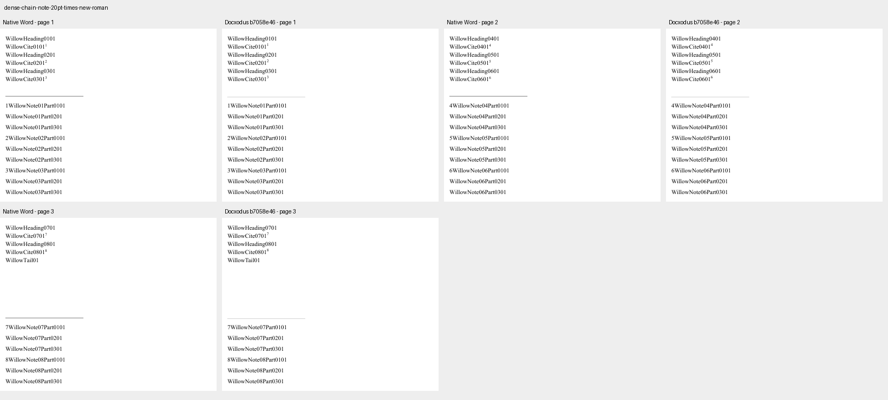 |
| `dense-chain-note-39pt-times-new-roman` | 5 | 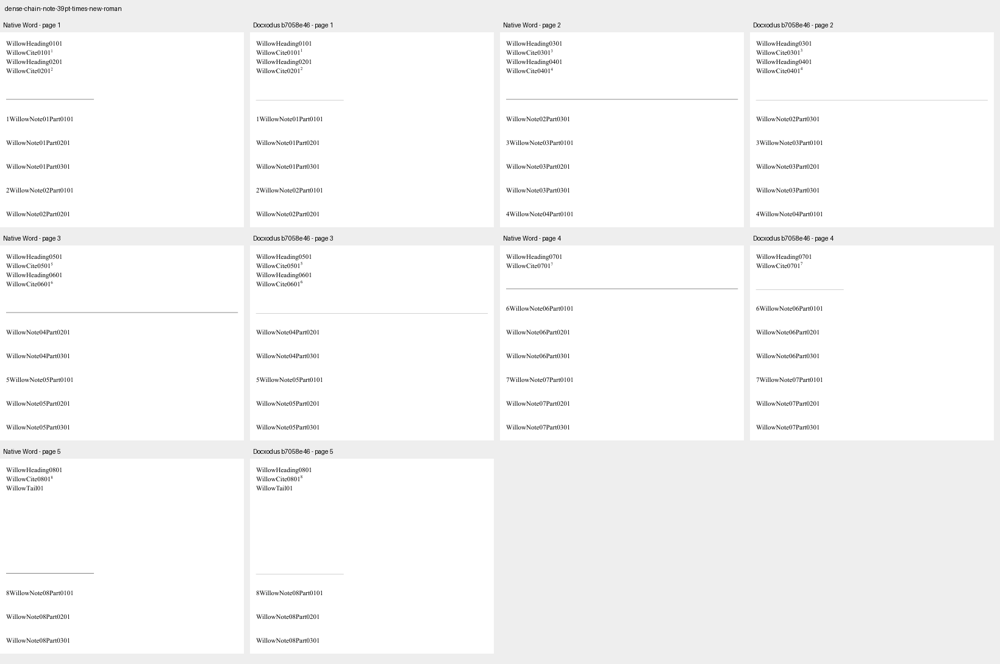 |
| `dense-chain-note-40pt-times-new-roman` | 5 |  |
| `dense-chain-note-41pt-times-new-roman` | 5 | 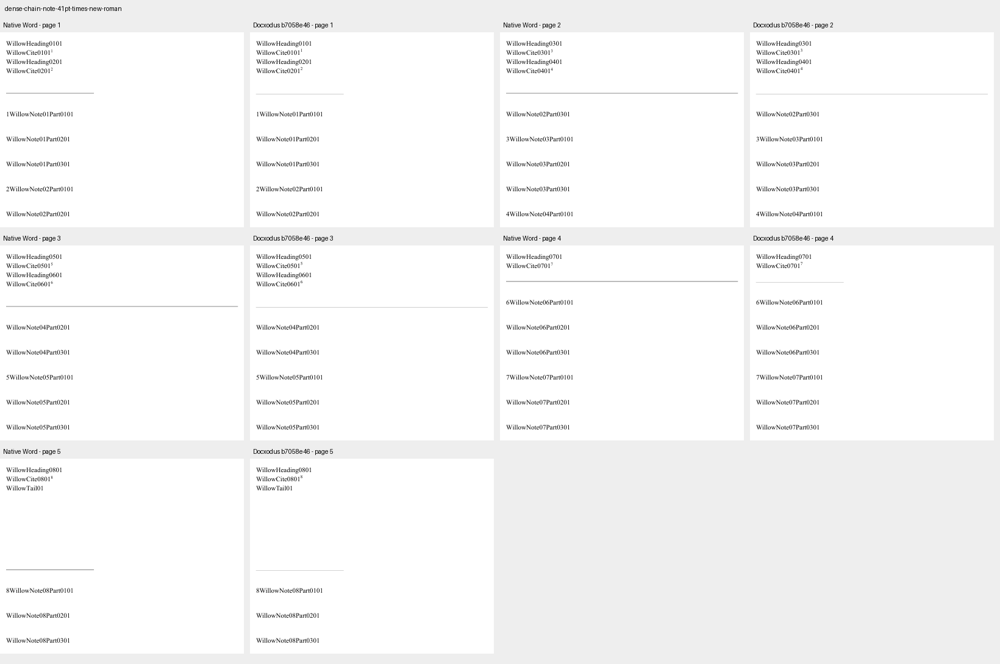 |
| `dense-chain-note-89pt-times-new-roman` | 11 | 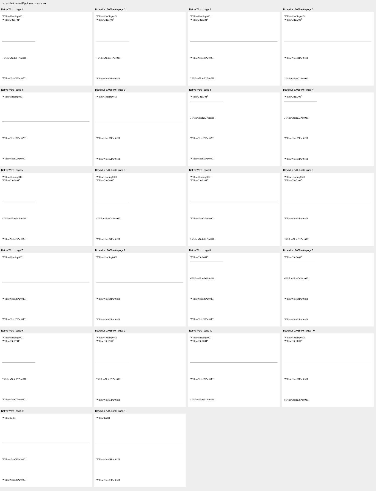 |
| `dense-chain-note-90pt-times-new-roman` | 11 | 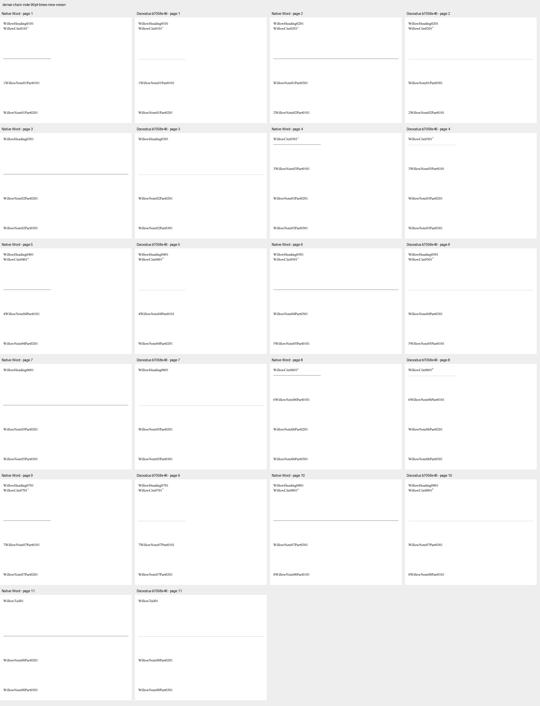 |
| `dense-chain-note-91pt-times-new-roman` | 12 | 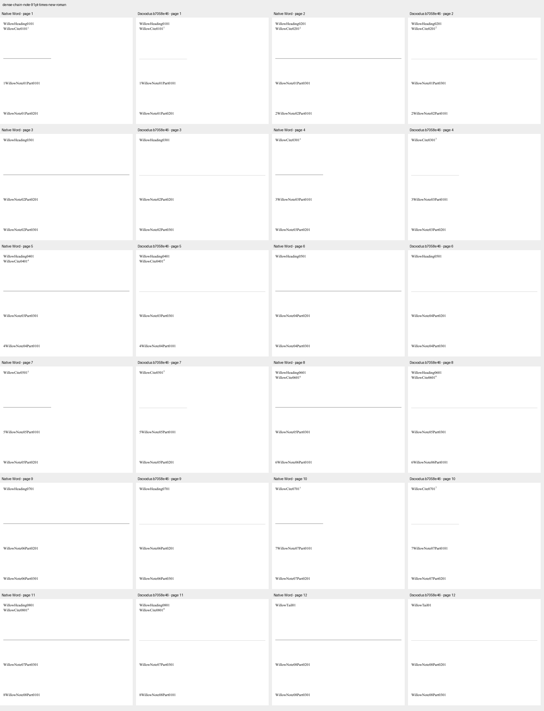 |
| `heading-note-20pt-keep-false-times-new-roman` | 3 | 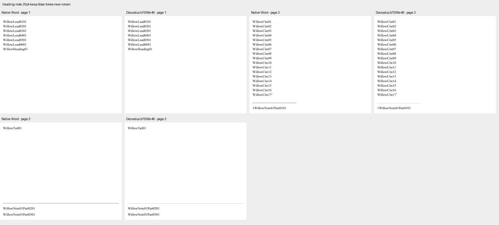 |
| `heading-note-20pt-keep-true-times-new-roman` | 4 | 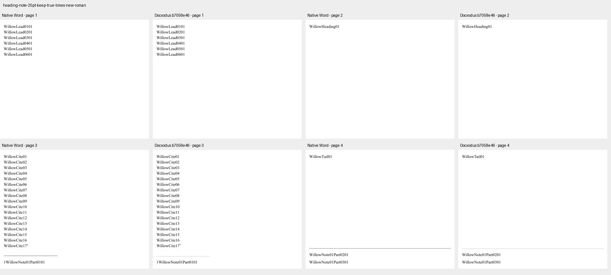 |
| `heading-note-40pt-keep-false-times-new-roman` | 3 | 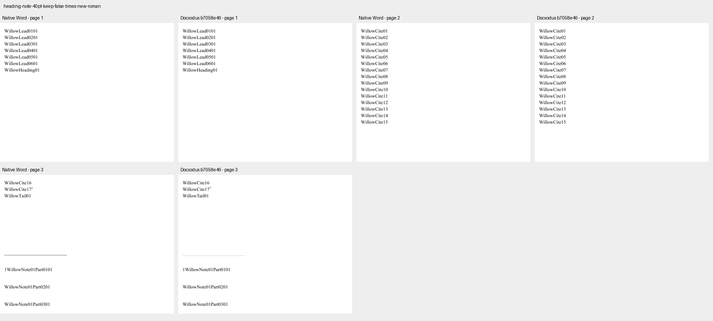 |
| `heading-note-40pt-keep-true-times-new-roman` | 4 |  |
| `heading-policy-note-20pt-no-keep-lines-times-new-roman` | 2 | 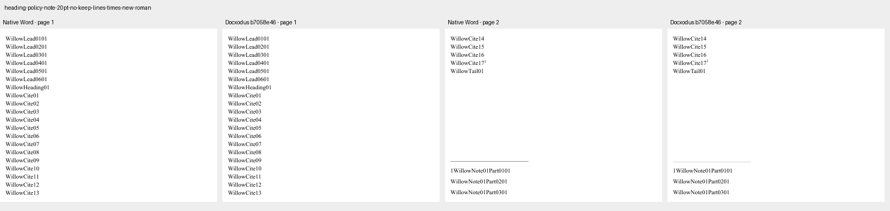 |
| `heading-policy-note-20pt-separator-15pt-times-new-roman` | 4 | 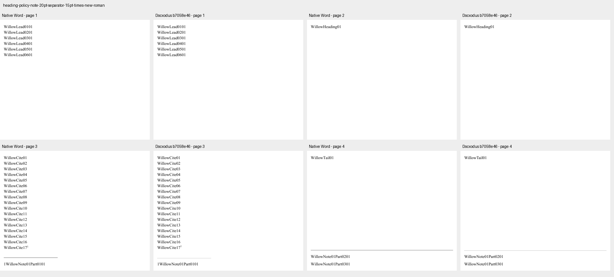 |
| `heading-policy-note-20pt-separator-one-twip-times-new-roman` | 4 |  |
| `heading-policy-note-40pt-no-keep-lines-times-new-roman` | 2 | 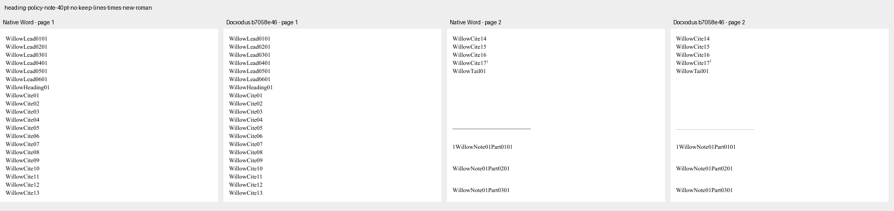 |
| `heading-policy-note-40pt-separator-15pt-times-new-roman` | 4 | 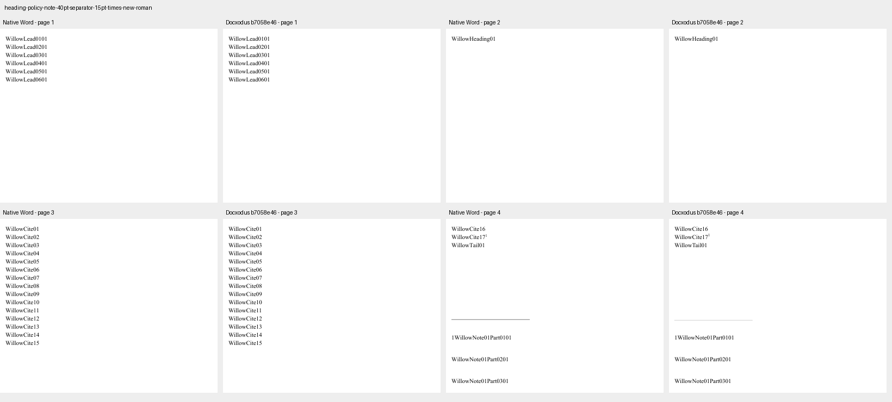 |
| `heading-policy-note-40pt-separator-one-twip-times-new-roman` | 4 | 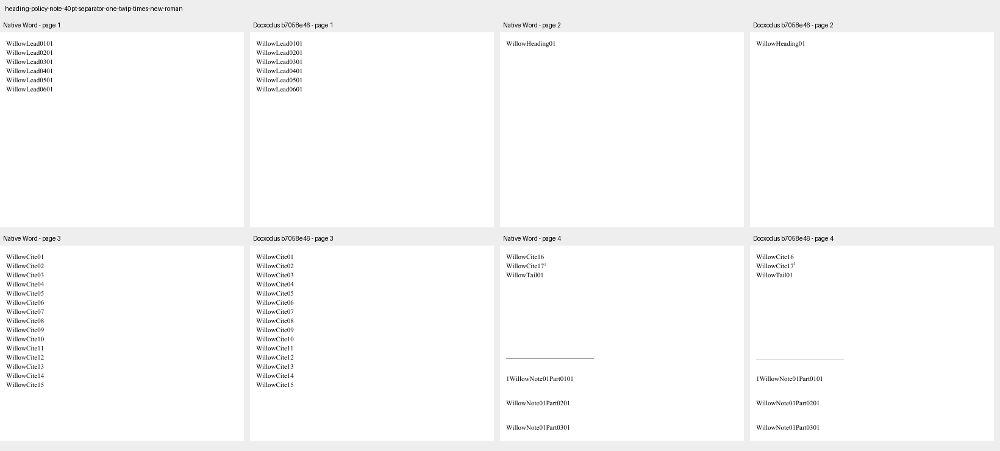 |
| `heading-policy-note-40pt-widow-off-times-new-roman` | 4 | 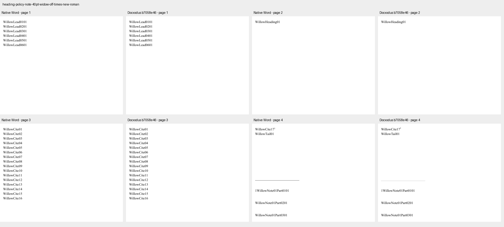 |
| `heading-policy-note-40pt-widow-on-times-new-roman` | 4 | 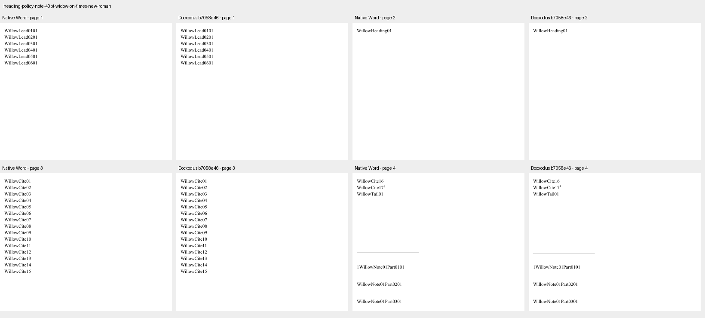 |
