# Kept footnote paragraphs in Word

Fourteen original Times New Roman cases cover oversized kept-note export and compatibility-mode placement for [Docxodus #1217](https://github.com/JSv4/Docxodus/issues/1217). Ten short controls cover fitting neighbors, default/explicit widow settings and modes 14/15. Four 120-line controls cover a first or mid-page citation in both modes. Every package exactly reproduces its separately captured Word input hash; the generator uses literal OOXML and no loaded documents or templates.

The suite is `core-v69` / 379 cases. All 1,051 earlier DOCX bytes, all 365 earlier case declarations (apart from the generator hash), `redline-v17` / 152 and the historical twelve-case CI selection are unchanged.

## Native observations

Signed-in Word for the web opened each unedited input and exported its PDF through File > Export > Download as PDF. Its returned DOCX is retained with the raw input/PDF in the per-issue cache. [Native input/output hashes and full inspections](native-word.json) retain every extracted word, font and physical page box. Word did not report its cloud build. Times New Roman is requested and observed; cloud and local font binaries/rasterization are not asserted identical. [All fourteen sources validate with Open XML SDK 3.5.1](source-sdk-validation.json).

- With 15pt exact note lines, the omitted/14 mode starts 18 lines beside the citation. A 19-line note keeps two trailing lines with default/explicit widow-on, so it splits 17/2; explicit off permits 18/1. The historical ID containing `deferred` records a hypothesis disproved by the native capture; its immutable bytes/ID are retained.
- Mode 15 instead defers the same 21-line kept note to note-only pages, split 19/2 after the two body paragraphs.
- With 120 explicit natural-height note lines, mode 14 starts 53 beside a fresh citation, carries 55 on the next page and finishes with 12. Mode 15 defers the note, then uses 55/55/10. The mid-page citation first moves to a fresh page in either mode. Every body/note label has its own explicit Word-adjudicated page assertion.

Every source word and note number is required exactly once, with the authored count for repeated numbers. No clipped/optional tokens or text-normalization policy is used. Marker regions are the source's physical paper, asserting page membership while retaining raw baselines and margin rounding. Scorers and tolerances are unchanged; native references must pass their own complete mandatory checks. Negative controls reject a mode-15 note starting early, incorrect widow boundaries, missing/duplicate last lines and wrong continuation pages without changing total tokens/page count.

## Candidate and qualification

[Candidate proof](candidate-proof.json) binds core `faeb81a29697ff6ee3884f7e9c0174d9824ae62b`, its [source-build receipt](source-build.json), exact public PDF hashes and all mandatory checks on fourteen cases / 37 pages. All 63 saved inputs export through the public API; all 27 prior heading/dense/table Word page contracts still pass. Browser validation covers 196 affected geometry tests, including line-pitch, baseline, exact-spacing and editor cases; eight focused reruns include four exact-ink tests after supplying their required CORS server. The unchanged C# production/test source reuses the validated 8,900 .NET passes and two existing skips. Typecheck and unchanged bundle budgets pass.

[The earlier candidate](candidate-before.json), `a10d411f`, fails both mode-14 long controls at note lines 54/109. Its 1000px natural-font probe underestimates Times New Roman's ratio as 1.149; a 10000px probe measures 1.1499, close to the font's 2355/2048 metric ratio. The precision correction also exposed an inconsistent 2pt deduction on fresh note-only fragments. Exact fragment probes now use the same measured physical band as carried continuations. Whole-note guards, safe fragmentation, source identity, text visibility and final export clipping verification remain in force.

These are **unscored public-export diagnostics** with the caller-provided pinned Chromium process sandbox enabled. The unchanged strict benchmark preflight rejects this host's unprivileged-user-namespace setup; no preflight, scorer, tolerance or clipping verification was weakened. Raw glyph/baseline and separator paint differences remain visible. The separately retained long soft-wrapping/hyphenated-identifier probes remain diagnostics: Word can legally split their identifiers across a page, so they were not forced into this benchmark's unchanged whole-word inventory contract. Their raw files remain unchanged. One earlier long-note diagnostic retains a native page-count difference; this is not a full Word fidelity or raster-score claim.

The original carried-note "no measurable fragment" input is still unavailable. This change covers the separately reproduced read-only kept-note clipping failure; it does not close the unresolved original report. The core change is stacked on closed [Docxodus PR #1373](https://github.com/JSv4/Docxodus/pull/1373), which remains awaiting the pending user clarification.

## Every new case

Native Word is on the left and core `faeb81a2` on the right at the same physical scale. Every provider/page is labelled, with page pairs arranged vertically. All 74 provider pages were visually reviewed.

| Case | Pages each | Native Word and core, every page |
| --- | ---: | --- |
| `kept-note-120-lines-citation-1-mode-14-times-new-roman` | 3 | 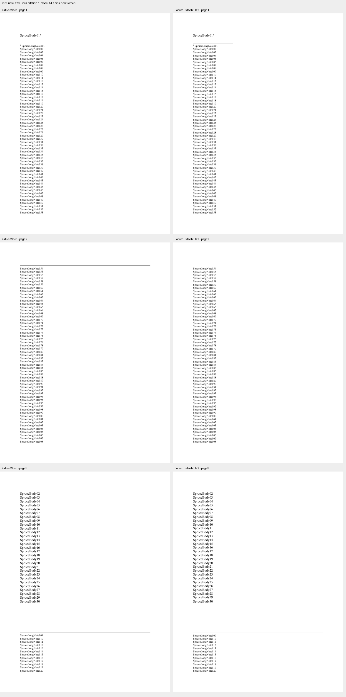 |
| `kept-note-120-lines-citation-1-mode-15-times-new-roman` | 4 | 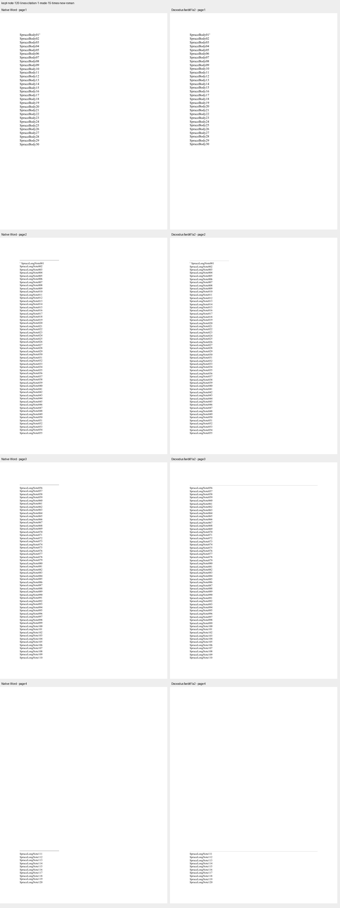 |
| `kept-note-120-lines-citation-16-mode-14-times-new-roman` | 4 | 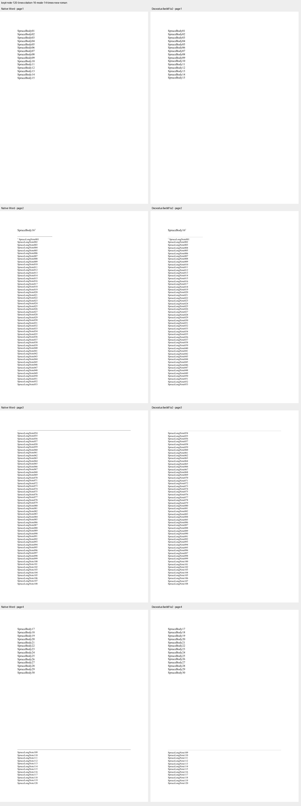 |
| `kept-note-120-lines-citation-16-mode-15-times-new-roman` | 5 | 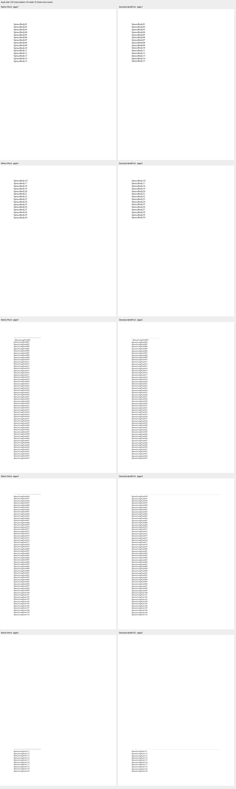 |
| `kept-note-18-lines-fitting-times-new-roman` | 2 | 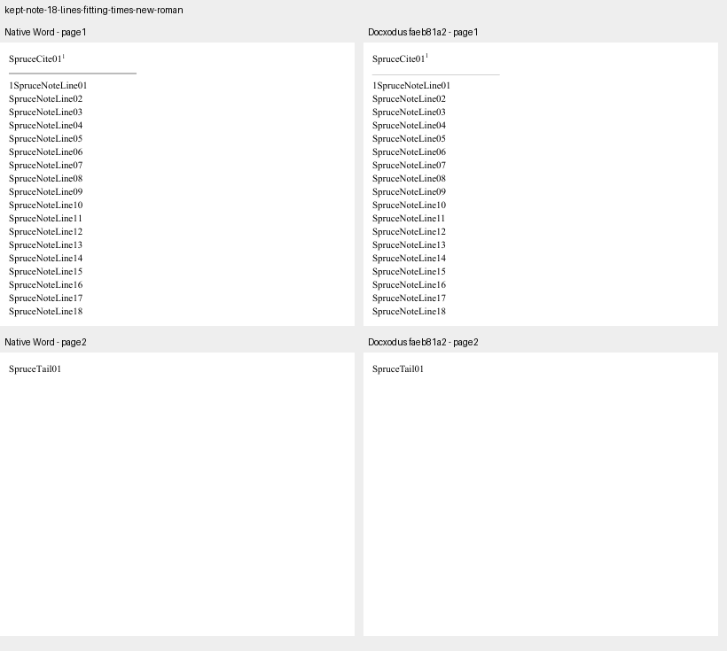 |
| `kept-note-19-lines-deferred-times-new-roman` | 2 |  |
| `kept-note-19-lines-widow-off-times-new-roman` | 2 | 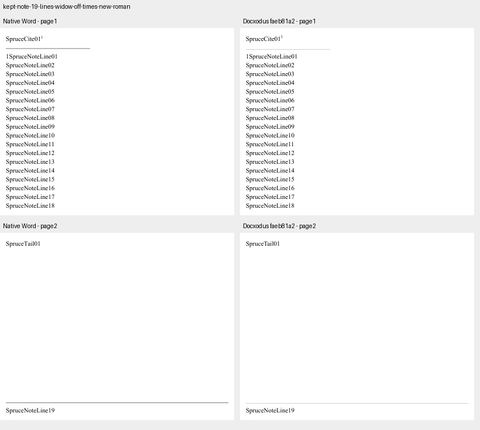 |
| `kept-note-19-lines-widow-on-times-new-roman` | 2 | 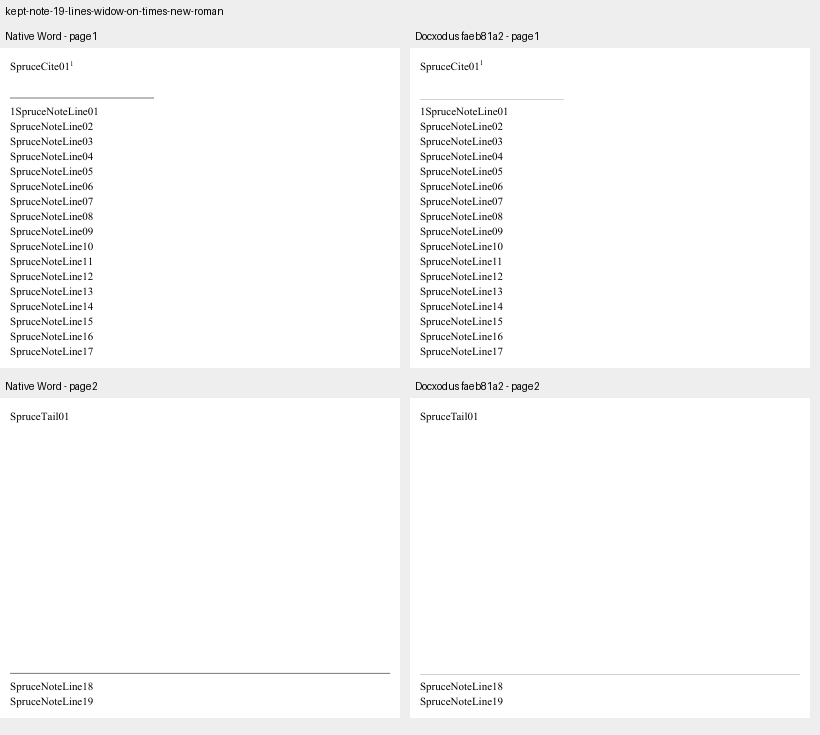 |
| `kept-note-20-lines-widow-default-times-new-roman` | 2 |  |
| `kept-note-20-lines-widow-off-times-new-roman` | 2 | 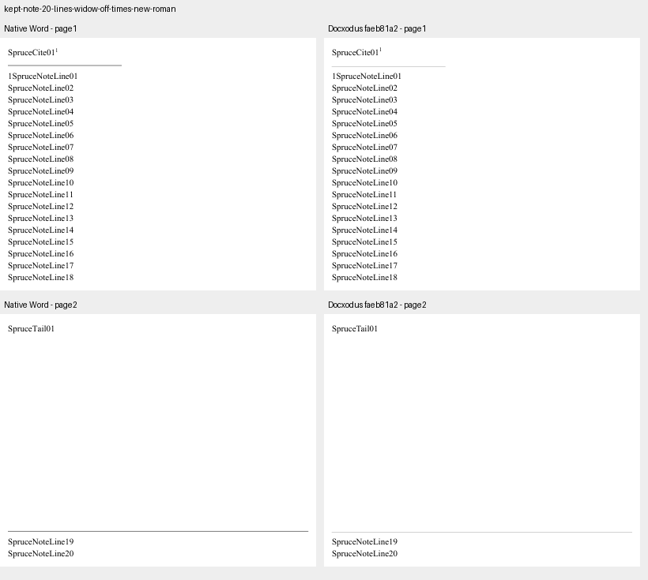 |
| `kept-note-20-lines-widow-on-times-new-roman` | 2 |  |
| `kept-note-21-lines-widow-default-times-new-roman` | 2 | 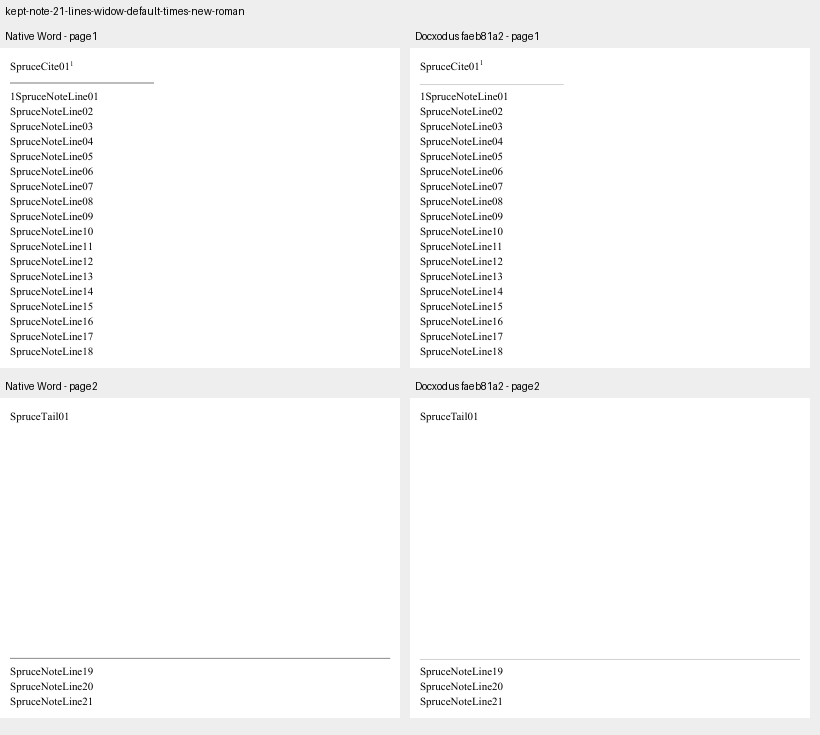 |
| `kept-note-mechanism-normal-mode14-opc-default-ns-times-new-roman` | 2 | 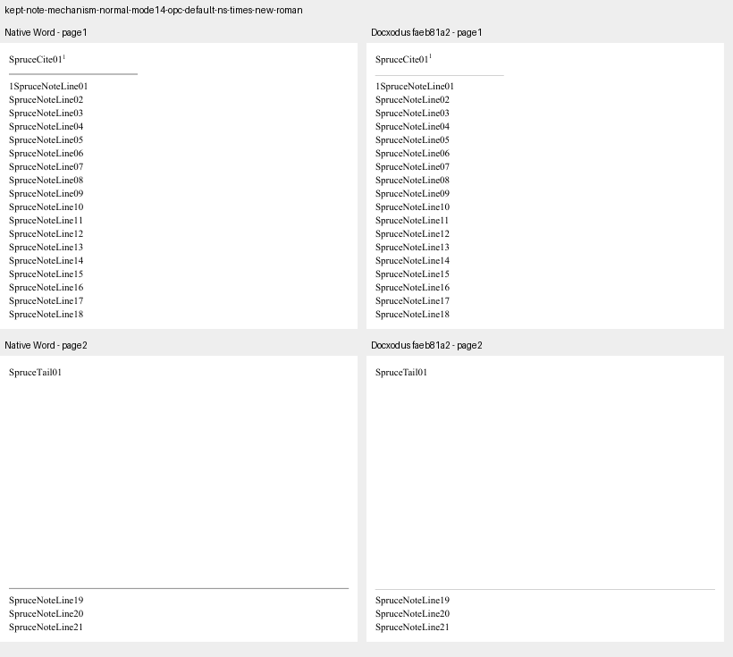 |
| `kept-note-mechanism-normal-mode15-opc-default-ns-times-new-roman` | 3 | 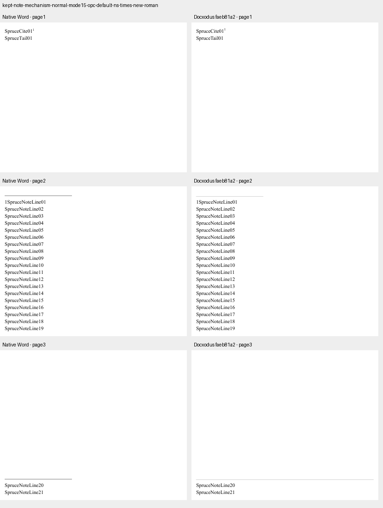 |
