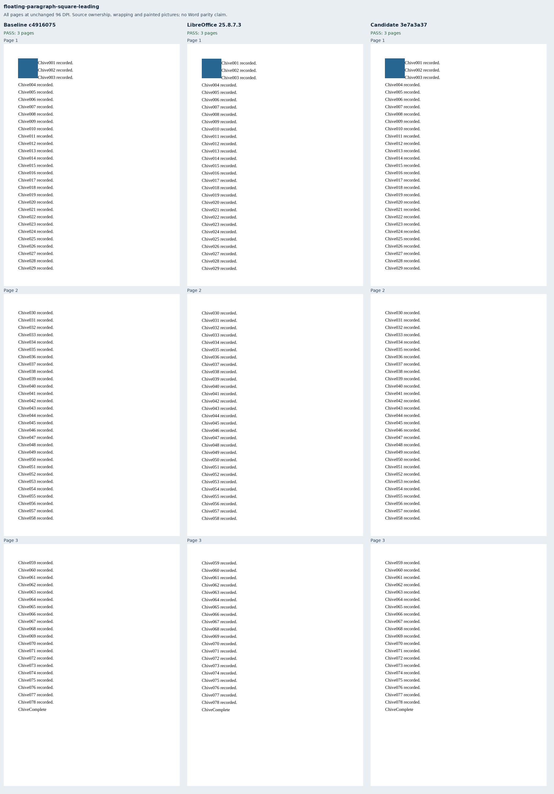
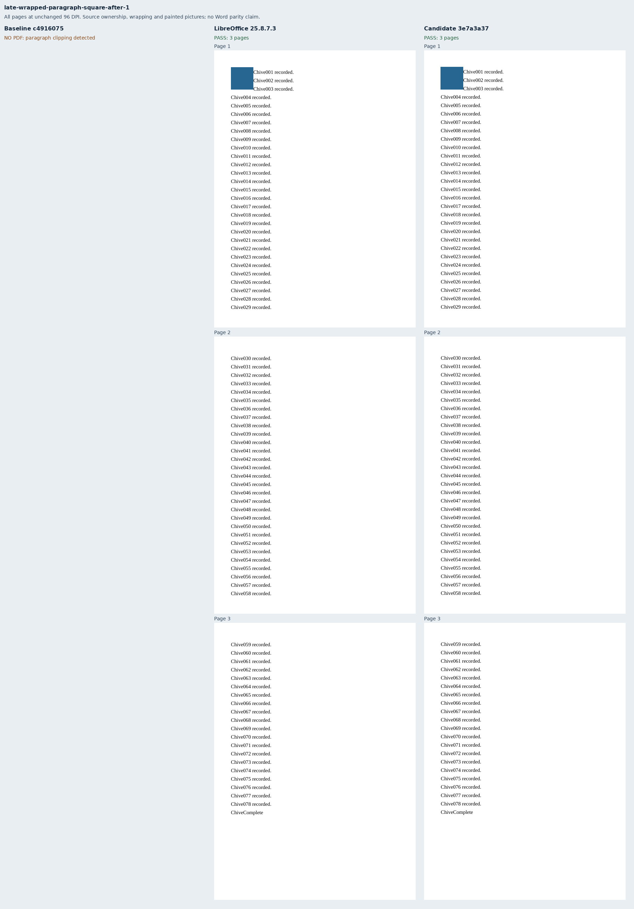
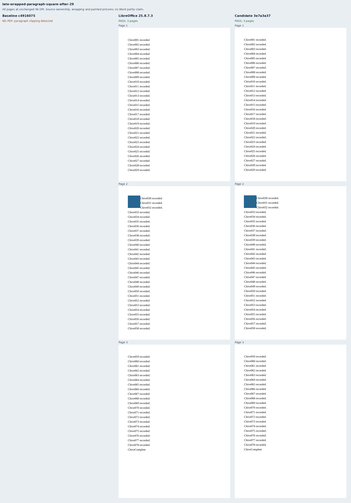
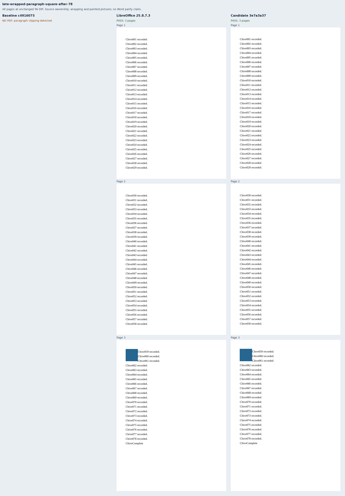
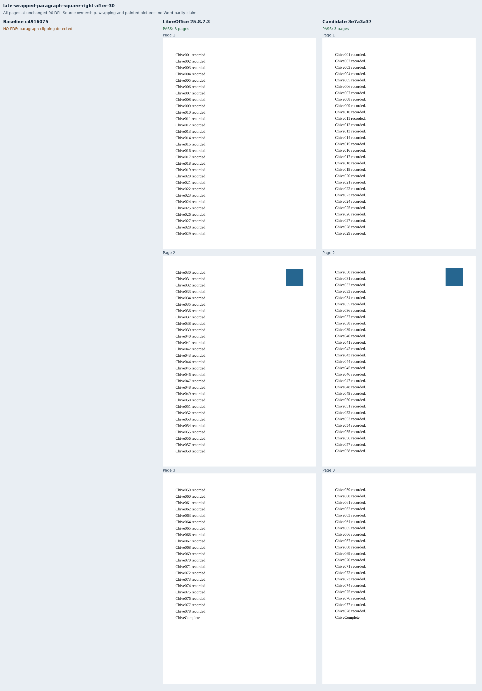
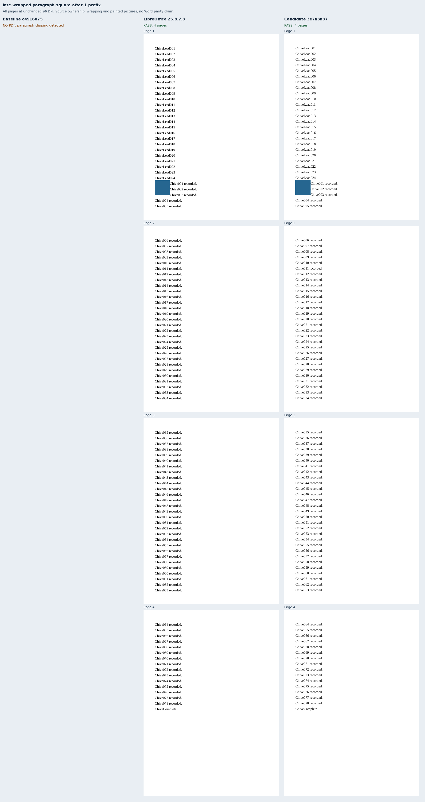

# Later wrapping pictures across page boundaries

Eight new original Chive documents put a square or tight-wrapped picture after source
text in a paragraph spanning pages. Five square cases move the anchor after lines 1, 28,
29, 30 and 78; the others cover tight wrapping, right-edge placement, and a fitting
24-line paragraph prefix. The two unchanged leading-picture cases are passing controls.
This is a partial regression contract for [Docxodus #1558](https://github.com/JSv4/Docxodus/issues/1558).

The 78 labeled lines use exact 18 pt spacing on 432×594 pt paper with 36 pt margins.
A 48 pt square owns the paragraph fragment containing its raw source anchor. Left-edge
wrapping narrows the first three lines of that fragment, including lines before the
raw anchor; the fourth returns to the margin. The right-edge case pins the picture's
placement and source ownership; its short labels do not exercise right-edge wrapping.
The prefix case retains five body labels on its first page, followed by 29/29/15.
All other cases retain 29/29/20 labels. Complete inventories, every label's page and line
band, picture frames, colored paint on every page, and absence of stray pictures are checked.

The source frames come from literal OOXML. Picture paint uses the existing independent
all-page/per-picture verifier without changing its tolerances: 0.1 pt for HTML frames,
1 pt for PDF raster bounds and 4% for colored coverage. Label bands retain 0.0001 pt tolerance.
All ten fresh LibreOffice references satisfy the complete contract. The generator preserves
all 944 prior DOCX hashes and declarations apart from the updated generator provenance.

Baseline `c49160756b4cc607101d796751d3f0eac5c750e9` has the same source tree as merged
main `9f7871ee28690c4ca7f30694e2dbe5bf4e191071`. It delivers the two controls and refuses
the eight new cases. Candidate `3e7a3a37ecd64ed65f767ce153ca50f858b65237` passes all ten.
The [retained evidence](evidence.json) binds 22 PDFs across 68 pages, 12 strict-font production
reports, 19 build files and 45 runtime assets per renderer, and ten full-page comparison sheets.
The [108 rejected mutations](mutations.json), including 88 rejected by primary assertions,
exercise lost/duplicated labels, wrong page or line ownership, missing/shifted pictures,
stray picture paint and missing or excessive wrapping exclusions.

Captures use sandboxed system Chromium 157.0.8103.38 and LibreOffice 25.8.7.3. This is
unscored diagnostic evidence, without a pinned-runtime qualification, whole-suite score
or new Word capture. The renderer's separate collision tests enforce a fresh-page retry
when a preceding float displaces the new exclusion, followed by explicit refusal if the
mismatch persists. That collision behavior is renderer policy, not native placement parity;
the source pictures allow overlap. Multiple late pictures, other story owners and the
remaining minimum-row/Word-dependent parts of #1558 remain outside this change.

## Reproduction

Generate `core-v129`, select `late-wrapped-paragraph-*` and the two leading square/tight
controls, validate the ten packages, capture native references, and freeze the manifest,
source frames, environment and verifier hashes. Build both exact renderer revisions, then:

```sh
node docs/results/export-reliability/Capture.mjs SOURCE RUN/manifest.json RUN/candidate RUN/environment.json --html
node docs/results/late-wrapped-paragraphs/Geometry.mjs SOURCE RUN/candidate
python3 docs/results/late-wrapped-paragraphs/Compose.py RUN BASELINE_SOURCE CANDIDATE_SOURCE
python3 docs/results/late-wrapped-paragraphs/Mutations.py
python3 -m unittest discover -s tests -v
node --test tests/test-adapter.mjs
python3 -m bench.audit
```

Repeat both capture commands for the baseline. The unchanged shared paint verifier is
included in the frozen hash inventory. Every page of each available renderer is shown below.
















