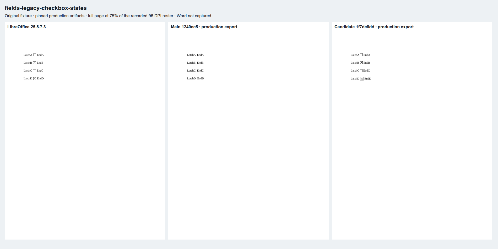
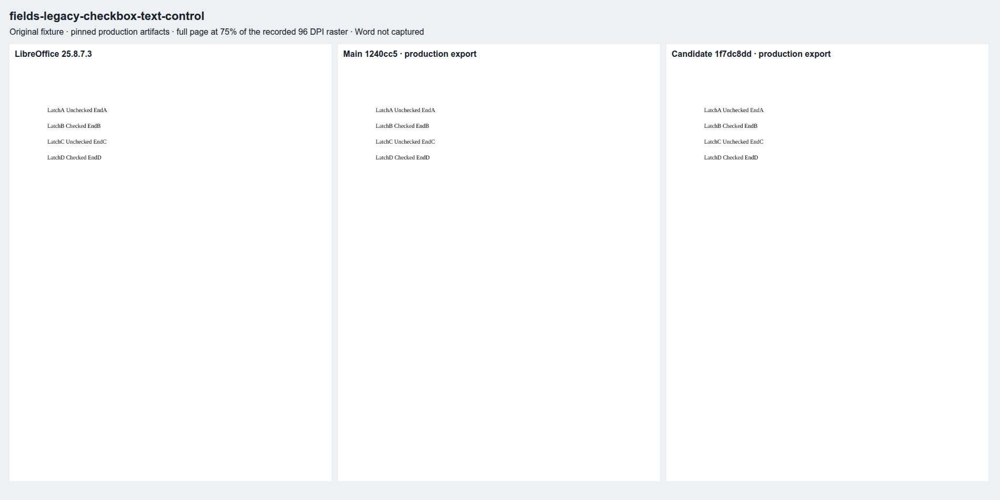
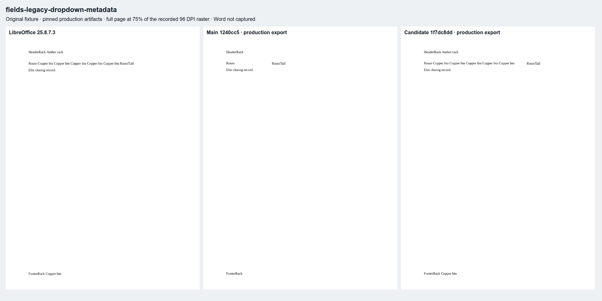
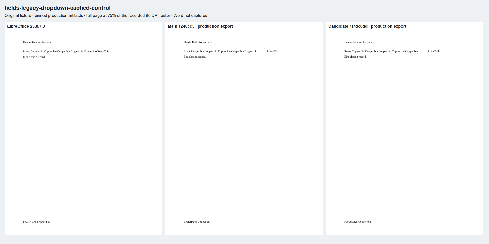
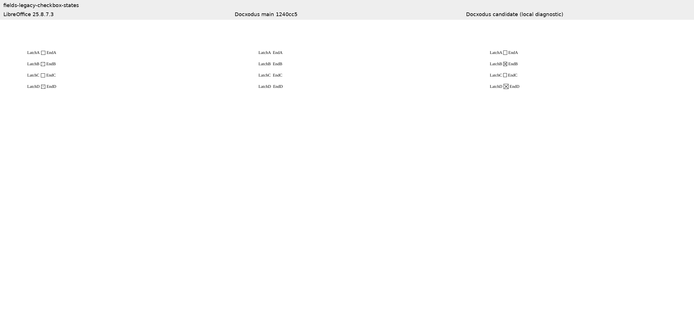
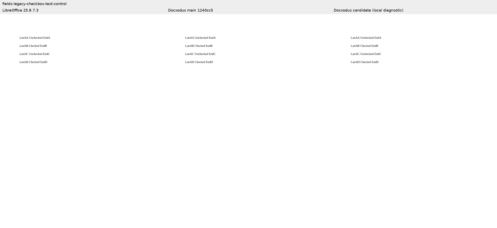
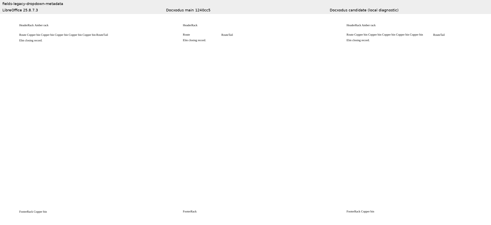
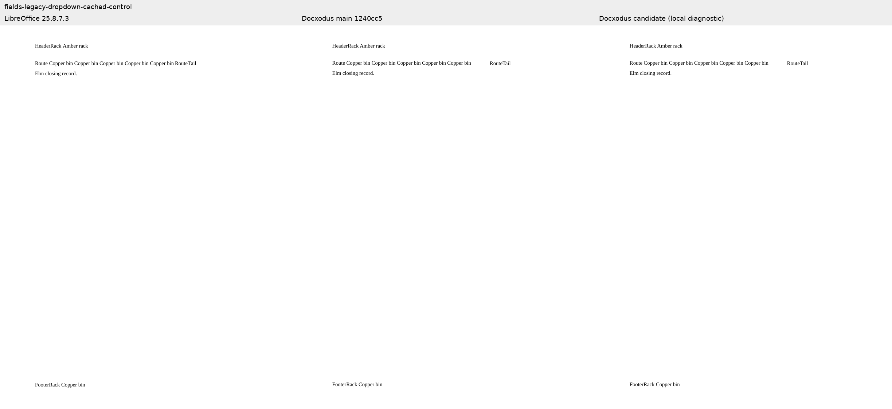

# Legacy form metadata (#1480)

Four original, SDK 3.5.1-valid packages cover checkbox states and dropdown selections without
cached text, plus controls that must remain unchanged. Core-v82 adds these four cases; all
546 previous package bytes and case contracts remain unchanged except the generator digest.

| Case | Reproducer or control | Local result |
|---|---|---|
| `fields-legacy-checkbox-states` | Defaults off/on, explicit off/on overriding the opposite default; automatic 11 pt and fixed 10/14 pt sizes | Main omits all four; candidate paints all four with correct state, size and caption placement |
| `fields-legacy-checkbox-text-control` | Complete FORMTEXT caches saying Checked/Unchecked | Main/candidate HTML and full-page PNG are identical |
| `fields-legacy-dropdown-metadata` | Selected body value before a tab, header default, footer selection; no caches | Main loses the selections; candidate displays each once and places RouteTail after the long value |
| `fields-legacy-dropdown-cached-control` | Same package with three matching cached values | Main/candidate HTML and full-page PNG are identical |

The text-field control tests unchanged cached behavior; it does not claim checkbox geometry
equivalence. The dropdown pair differs only in its three cached `w:t` values.

The checkbox HTML assertion reads accessibility state and independently captures actual pixels
from a script-disabled, offline browser. Python replays the hashed RGBA crop to require a square
outline, both diagonals for checked, an empty interior for unchecked, declared size and a box
immediately beside its caption. Actual-browser mutation tests reject blank/hidden/white ink,
wrong painted state, wrong size, solid fill, a missing diagonal and displaced boxes. These
assertions supplement the unchanged PDF text/font/geometry and full-page raster measurements.

LibreOffice 25.8.7.3 paints all four native box outlines about 10.15 pt wide, including explicit
10/14 pt sizes. Docxodus follows the field size declaration, so this provider difference is
reported rather than treating LibreOffice's uniform boxes as authoritative. Word was not
captured. The dropdown cached control has a pre-existing tab difference: native RouteTail
starts at 360.1 pt, Docxodus at 396 pt. The absolute region protects nonoverlap while accepting
both. It does not claim native tab parity.

[Local evidence](local-evidence.json) binds exact inputs, core source, baseline revision,
pagination bundle, HTML, PDFs and full-page rasters. These local previews use the native .NET library
and Chromium pagination. The baseline is main `1240cc5`; the candidate is `1f7dc8dd`, stacked on the preceding fixes.
The pagination bundle includes the independently reviewed font-preservation repair at `d38ca66b`;
its TypeScript source is unchanged at the candidate revision. Both controls are unchanged. All candidate
PDF mandatory checks and four checkbox pixel checks pass. Background-free and forced-colors
Chromium prints have identical decoded page pixels to ordinary printing.

The separate production WASM exports are complete: [baseline run 41171278328](https://github.com/JSv4/docx-fidelity-bench/actions/runs/41171278328)
and [candidate run 41171275372](https://github.com/JSv4/docx-fidelity-bench/actions/runs/41171275372),
both using bench `b24e2568`. [Production evidence](production-evidence.json) records the exact
core revisions, artifact ZIP hashes, reference/input contracts, runtime identities, file hashes
and check outcomes. All candidate PDF mandatory checks and all four painted-checkbox checks pass.
Independent review replayed the checks, PDF/raster bindings and actual printed checkbox pixels.

| Case | Main score | Candidate score | Production result |
|---|---:|---:|---|
| Checkbox states | 76.1861 | 90.0406 | Main has no matching controls; candidate passes all four state, paint, size and placement checks |
| Cached text control | 99.8600 | 99.8600 | Full-page PNG byte-identical |
| Dropdown metadata | 0 | 93.8481 | Missing text and RouteTail region fail on main; candidate passes |
| Cached dropdown control | 93.8481 | 93.8481 | Full-page PNG byte-identical |

These scores retain the provider differences described above; passing mandatory checks does not
mean full visual parity. Production captures retain delivered HTML only for checkbox states.
Control HTML identity is therefore established by the local diagnostics, while production
establishes identical control page pixels and scores. PDF bytes and PageMap digests differ;
PageMap includes the changed renderer fingerprint, and its payload was not retained to compare
geometry independently. No PageMap identity claim is made.

The following sheets display the recorded production page rasters, with labels and uniform scaling.

The earlier local diagnostic sheets are retained below.

